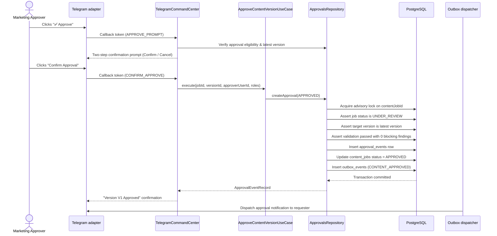

# Approval and rejection workflow

**Status:** Implemented in Phase 1F

The approval and rejection workflow defines the terminal resolution of a `ContentJob`. Content versions can only reach approval through explicit, authenticated, role-gated human actions that reference an exact validated version.

## Approval requirements

For an approval to succeed, all of the following conditions must be satisfied:

1. **Role authorization:** Actor must have `APPROVE_CONTENT` permission (e.g. `MARKETING_APPROVER`, `ADMIN`). `MARKETING_EDITOR` and `VIEWER` roles are rejected with `ForbiddenError`.
2. **Reviewable state:** The `ContentJob` status must be `UNDER_REVIEW`. Attempting to approve a job in `DRAFT`, `GENERATING`, `REVISION_REQUESTED`, `FAILED`, `APPROVED`, or `REJECTED` state throws `InvalidReviewStateError` or `ContentAlreadyApprovedError`.
3. **Exact latest version:** The target `contentVersionId` must match the job's highest `versionNumber`. Attempting to approve an older version (e.g. approving V1 when V2 exists) fails with `StaleContentVersionError`.
4. **Deterministic validation eligibility:** The target version must have a completed `ValidationResult` with `blockingCount === 0` and status in `['PASSED', 'PASSED_WITH_WARNINGS']`. If any blocking findings exist, approval fails with `ContentNotApprovalEligibleError`.
5. **No duplicate approval:** A job cannot be approved more than once. Concurrent approvers are serialized by advisory lock; the second attempt throws `ContentAlreadyApprovedError`. The PostgreSQL partial unique index `approval_events_single_approved_per_job` enforces this at the storage layer.

## Rejection semantics

Rejection provides a terminal conclusion for content that fails editorial or brand standards:

- **Role authorization:** Requires `REJECT_CONTENT` permission (`MARKETING_APPROVER`, `ADMIN`).
- **Optional comment:** The reviewer may provide a descriptive reason (up to 1,000 characters). In Telegram, clicking `❌ Reject` initiates a pending review interaction that awaits the reviewer's text comment.
- **Validation-independent:** Unlike approval, rejection is permissible even if the draft has blocking factual errors.
- **Terminality:** Once rejected, the job status moves to `REJECTED`. Further revisions or approvals are blocked.
- **Storage constraint:** Enforced by partial unique index `approval_events_single_rejected_per_job`.

## Audit and events

Approval and rejection events are append-only and immutable. Database triggers on `approval_events` reject any `UPDATE` or `DELETE` statements.

Every successful approval or rejection transaction produces an outbox event:

- `CONTENT_APPROVED` (payload: `contentJobId`, `contentVersionId`, `approvalEventId`, `approverUserId`)
- `CONTENT_REJECTED` (payload: `contentJobId`, `contentVersionId`, `approvalEventId`, `approverUserId`, `comment`)

Telegram notifications are dispatched from these outbox events to notify the original requester. Telegram delivery is decoupled from the transaction and is never workflow truth.
