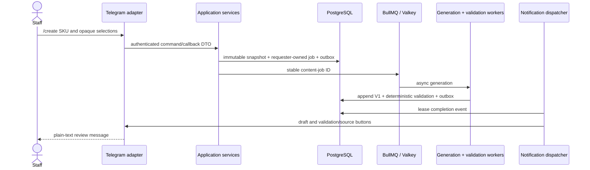

# Content workflow implementation status

Phase 1E connects Telegram to the existing Phase 1B–1D workflow without changing its facts or validation semantics.

Phase 1E stops at staff review. `ContentJob` still uses the implemented Phase 1C states `REQUESTED`, `GENERATING`, `DRAFT`, and `FAILED`; the broader review/approval state machine remains design material for Phase 1F. A blocked validation result leaves the immutable draft available, visibly blocked, and ineligible for later approval.

Ownership is explicit through required `ContentJob.requesterUserId`. Telegram status/history/source/validation reads are requester-scoped unless the actor is an administrator. Generation completion and notification are coordinated through database facts and outbox events; Telegram delivery is never workflow truth.

