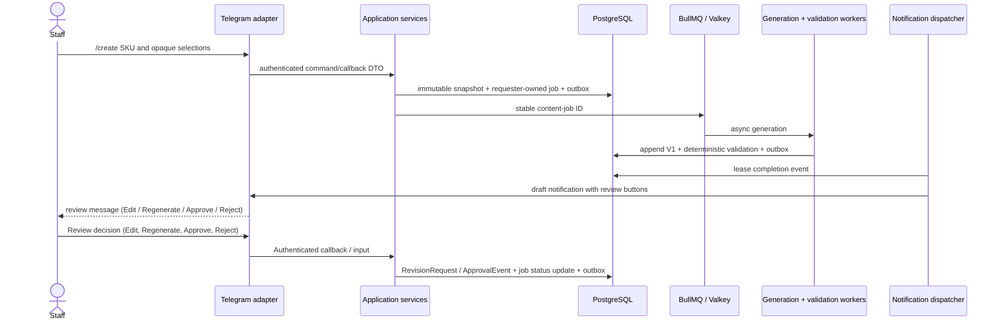

# Content workflow implementation status

**Status:** Phase 1F implemented

Phase 1F implements the human review workflow loop over the existing Phase 1B–1E foundation, allowing staff to review drafts, request revisions (edit or regenerate), and approve or reject exact versions without altering facts or validation semantics.

## Review and approval lifecycle

Phase 1F completes the human review loop:

- `ContentJob` advances through: `REQUESTED -> GENERATING -> DRAFT -> UNDER_REVIEW -> REVISION_REQUESTED -> GENERATING -> DRAFT -> UNDER_REVIEW -> APPROVED | REJECTED`.
- Reaching `APPROVED` or `REJECTED` is strictly terminal. Further edits or approvals are blocked.
- A blocked validation result (`BLOCKED`) leaves the draft reviewable for edits or rejection, but blocks approval (`APPROVE_CONTENT` button hidden; use case rejects approval).
- Pinned snapshots and brand rules: `ProductSnapshot` and `BrandRuleVersion` remain permanently pinned to original values across all revision generations.
- Concurrency protection: Advisory locks, stale version validation, and single pending revision constraints guarantee integrity.

Ownership remains explicit through required `ContentJob.requesterUserId`. Telegram status/history/source/validation reads are requester-scoped unless the actor is an administrator. Generation completion and notification are coordinated through database facts and outbox events; Telegram delivery is never workflow truth.
