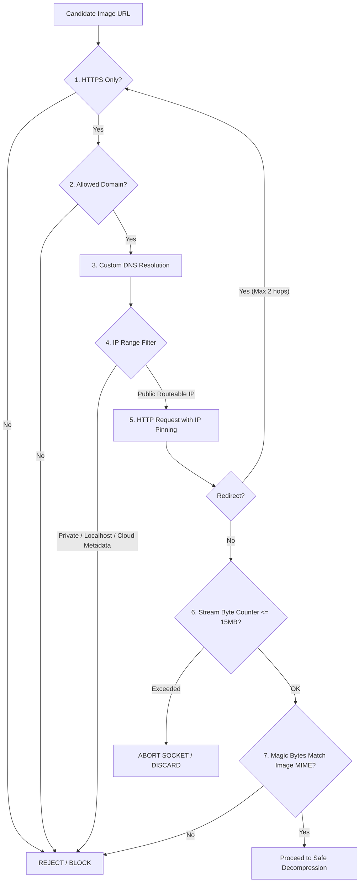

# Creative Automation Security & Image Safety Specification (Phase 2A)

**Document:** `/docs/creative-security.md`  
**Status:** PROPOSED SECURITY SPECIFICATION  
**Audience:** Security Engineers, Backend Architects, Infrastructure Leads  
**Related Documents:** [ADR-003](architecture-decisions/ADR-003-creative-automation-architecture.md), [MVP Security Review](security/mvp-security-review.md)  

---

## 1. Executive Summary

Phase 2A introduces remote image ingestion, external generative AI communication, binary image manipulation, and content-addressable storage. These capabilities introduce severe attack surfaces if not guarded by defensive engineering controls:
- **Server-Side Request Forgery (SSRF):** Attacking cloud infrastructure or internal network endpoints via image URLs.
- **Decompression Bombs (Zip/Pixel Bombs):** Memory exhaustion and denial-of-service via crafted image payloads.
- **Path Traversal:** Directory escape attempts via malicious filenames in storage subsystems.
- **Prompt Injection:** Tampering with generative brief prompts via malicious product descriptions or reviewer comments.
- **False Validation Confidence:** Relying on heuristics (e.g. OCR) as if they were mathematical guarantees.

This specification details the defensive controls implemented to eliminate these vulnerabilities.

---

## 2. Remote Asset Ingestion: Defensive SSRF Architecture

Product image ingestion from external catalog sources must satisfy a multi-stage defense-in-depth pipeline.



### Ingestion Defense Rules:

1. **Protocol Restriction:** Only `https://` schemes are permitted. Plaintext `http://`, `file://`, `ftp://`, or data URLs are strictly rejected.
2. **Domain Whitelisting (`ALLOWED_ASSET_DOMAINS`):** The URL host must match an explicit configuration whitelist (e.g. `*.parisianshopper.com`, approved CDN domains). Arbitrary user-supplied URLs from Telegram or web forms are **never fetched**.
3. **Safe DNS Resolution & IP Filtering:**
   - Prior to connecting, the hostname is resolved to IPv4 and IPv6 addresses.
   - Any address falling within non-routable, loopback, or internal ranges is blocked:
     - `127.0.0.0/8` (IPv4 Loopback)
     - `::1` (IPv6 Loopback)
     - `10.0.0.0/8`, `172.16.0.0/12`, `192.168.0.0/16` (RFC 1918 Private Networks)
     - `169.254.0.0/16`, `fe80::/10` (Link-Local / Cloud Metadata endpoint `169.254.169.254`)
     - `0.0.0.0/8`, `224.0.0.0/4`, `240.0.0.0/4` (Reserved / Multicast)
4. **Redirect Hop Constraints:**
   - Maximum redirects allowed: **2**.
   - For every redirect hop, the target URL is evaluated against the complete domain whitelist and DNS IP filter.
5. **Payload Streaming & Timeout Limits:**
   - Hard socket timeout: **5000 ms**.
   - Maximum compressed download size: **15 MB (15,728,640 bytes)**.
   - Enforced via a streaming byte counter that terminates the connection immediately if the byte limit is exceeded before stream completion.
6. **Magic Byte MIME Verification:**
   - Content-Type response headers are treated as untrusted hints.
   - The initial 16 bytes of the stream are inspected to verify standard image signatures:
     - JPEG: `FF D8 FF`
     - PNG: `89 50 4E 47 0D 0A 1A 0A`
     - WebP: `52 49 46 46 ... 57 45 42 50`

---

## 3. Image Decompression & Compositing Safety (DoS Defense)

Processing untrusted image binaries with high-performance native engines (`libvips`) carries resource exhaustion risks.

### Hard Resource Ceilings:

| Parameter | Limit | Enforcement Mechanism | Failure Action |
|---|---|---|---|
| **Max Input File Size** | 15 MB | Streaming byte counter | HTTP Stream Abort |
| **Max Decoded Pixels** | 16,777,216 px (16 MP) | `sharp({ limitInputPixels: 16777216 })` | Instant rejection before full decode |
| **Max Width / Height** | 4096 px × 4096 px | Metadata inspection post-header decode | Pipeline Error (`IMAGE_DIMENSIONS_TOO_LARGE`) |
| **Max Frame / Page Count** | 1 (Static images only) | `pages: 1` constraint; multi-frame animation rejected | Rejection (`ANIMATED_IMAGES_PROHIBITED`) |
| **Compositing Timeout** | 8000 ms per operation | Node.js `AbortSignal.timeout(8000)` | Terminate operation; log alert |
| **Libvips Memory Cache** | 128 MB max cache | `sharp.cache({ memory: 128, files: 20, items: 100 })` | Automatic LRU cache eviction |
| **Processing Concurrency** | Throttled to 2 concurrent jobs | BullMQ worker concurrency setting | Backpressure queuing |

---

## 4. Content-Addressable Storage (CAS) Defense

1. **Path Traversal Elimination:**
   - File system keys are derived strictly as:
     $$\text{Path} = \text{basedir} + \text{"/"} + \text{sha256}[0..1] + \text{"/"} + \text{sha256}[2..3] + \text{"/"} + \text{sha256} + \text{"."} + \text{ext}$$
   - Because the path consists entirely of lowercase hexadecimal characters from SHA-256 and an allowlisted file extension (`.webp`, `.png`, `.jpg`), path traversal characters (`../`, `..\\`) are mathematically impossible.
   - Original filenames supplied by upstream catalog sources or users are stored strictly as database metadata strings; they are never passed to filesystem calls.
2. **Access Control & Asset Serving:**
   - Local asset directory is served through NestJS controllers with authenticated authorization or signed temporary access tokens.
   - In production S3 environments, assets are private by default and accessed via time-limited pre-signed URLs (maximum 15-minute TTL).

---

## 5. Prompt Injection & Brief Sanitization

When generating ambient backgrounds, reviewers may submit natural language revision instructions via Telegram (`✏️ Request Visual Edit`).

### Mitigation Strategy:
1. **Schema Separation:** Revision instructions are constrained to a dedicated prompt field: `styleAdjustmentPrompt`.
2. **Structural Anchoring:** Prompts follow a strict rigid template where system instructions dominate:
   ```text
   [SYSTEM: Core Atmospheric Directives - IMMUTABLE]
   Create an ambient, high-end Parisian luxury interior background.
   Do not render any text, words, bottles, watches, human faces, or prices.
   The center area must remain an empty, clean pedestal.

   [STYLE GUIDELINES - BRAND PINNED]
   Style profile: Parisian Luxury Atelier
   Lighting: Warm natural morning window light

   [REVIEWER STYLING SUGGESTION - UNTRUSTED]
   Reviewer aesthetic preference: {{sanitizedReviewerInstruction}}
   ```
3. **Instruction Stripping:** Inputs are sanitized to strip markdown code blocks, prompt override attempts (e.g. *"Ignore previous instructions"*), and executable tokens.

---

## 6. Heuristic Scanning Boundaries & Limitations

### Crucial Security Invariant:
**Visual safety scanners (such as OCR for unexpected text detection) are heuristics, NOT deterministic proofs.**

1. **False Positives:** High-contrast organic textures, marble veins, intricate architectural wrought-iron railings, or botanical branches can trigger false-positive text detection.
   - *Policy:* High-severity detections trigger human notification with a clear warning flag rather than silent failure.
2. **False Negatives:** Blurry text, low-contrast text, artistic cursive typography, or watermarks embedded at extreme angles can bypass OCR detectors.
   - *Policy:* Passing the heuristic scanner (`NO_TEXT_DETECTED`) merely qualifies the image for **mandatory human review**. Human review is never bypassed.
3. **Exclusion Boundary:** The OCR heuristic scanner is never run against the canonical product layer. Trusted catalog packaging text is validated upstream in Phase 1 via `ProductSnapshot`.
