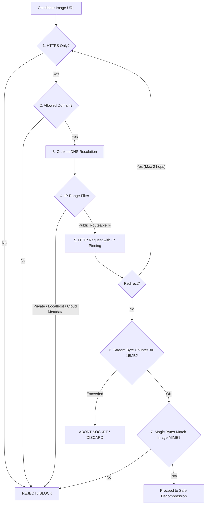

# Creative Automation Security & Image Safety Specification (Phase 2A)

**Document:** `/docs/creative-security.md`  
**Status:** PROPOSED SECURITY SPECIFICATION  
**Audience:** Security Engineers, Backend Architects, Infrastructure Leads  
**Related Documents:** [ADR-003](architecture-decisions/ADR-003-creative-automation-architecture.md), [MVP Security Review](security/mvp-security-review.md)

---

## 1. Executive Summary

Phase 2A introduces remote image ingestion, external generative AI communication, binary image manipulation, and content-addressable storage. These capabilities introduce severe attack surfaces if not guarded by defensive engineering controls:

- **Server-Side Request Forgery (SSRF):** Attacking cloud infrastructure or internal network endpoints via image URLs.
- **Decompression Bombs (Zip/Pixel Bombs):** Memory exhaustion and denial-of-service via crafted image payloads.
- **Path Traversal:** Directory escape attempts via malicious filenames in storage subsystems.
- **Prompt Injection:** Tampering with generative brief prompts via malicious product descriptions or reviewer comments.
- **False Validation Confidence:** Relying on heuristics (e.g. OCR) as if they were mathematical guarantees.

This specification details the defensive controls implemented to eliminate these vulnerabilities.

---

## 2. Remote Asset Ingestion: Defensive SSRF Architecture

Product image ingestion from external catalog sources must satisfy a multi-stage defense-in-depth pipeline.



### Ingestion Defense Rules:

1. **Protocol Restriction:** Only `https://` schemes are permitted. Plaintext `http://`, `file://`, `ftp://`, or data URLs are strictly rejected.
2. **Domain Whitelisting (`ALLOWED_ASSET_DOMAINS`):** The URL host must match an explicit configuration whitelist (e.g. `*.parisianshopper.com`, approved CDN domains). Arbitrary user-supplied URLs from Telegram or web forms are **never fetched**.
3. **Safe DNS Resolution & IP Filtering:**
   - Prior to connecting, the hostname is resolved to IPv4 and IPv6 addresses.
   - Any address falling within non-routable, loopback, or internal ranges is blocked:
     - `127.0.0.0/8` (IPv4 Loopback)
     - `::1` (IPv6 Loopback)
     - `10.0.0.0/8`, `172.16.0.0/12`, `192.168.0.0/16` (RFC 1918 Private Networks)
     - `169.254.0.0/16`, `fe80::/10` (Link-Local / Cloud Metadata endpoint `169.254.169.254`)
     - `0.0.0.0/8`, `224.0.0.0/4`, `240.0.0.0/4` (Reserved / Multicast)
4. **Redirect Hop Constraints:**
   - Maximum redirects allowed: **2**.
   - For every redirect hop, the target URL is evaluated against the complete domain whitelist and DNS IP filter.
5. **Payload Streaming & Timeout Limits:**
   - Hard socket timeout: **5000 ms**.
   - Maximum compressed download size: **15 MB (15,728,640 bytes)**.
   - Enforced via a streaming byte counter that terminates the connection immediately if the byte limit is exceeded before stream completion.
6. **Magic Byte MIME Verification:**
   - Content-Type response headers are treated as untrusted hints.
   - The initial 16 bytes of the stream are inspected to verify standard image signatures:
     - JPEG: `FF D8 FF`
     - PNG: `89 50 4E 47 0D 0A 1A 0A`
     - WebP: `52 49 46 46 ... 57 45 42 50`

---

## 3. Image Decompression & Compositing Safety (DoS Defense)

Processing untrusted image binaries with high-performance native engines (`libvips`) carries resource exhaustion risks.

### Hard Resource Ceilings:

| Parameter                  | Limit                          | Enforcement Mechanism                                 | Failure Action                                |
| -------------------------- | ------------------------------ | ----------------------------------------------------- | --------------------------------------------- |
| **Max Input File Size**    | 15 MB                          | Streaming byte counter                                | HTTP Stream Abort                             |
| **Max Decoded Pixels**     | 16,777,216 px (16 MP)          | `sharp({ limitInputPixels: 16777216 })`               | Instant rejection before full decode          |
| **Max Width / Height**     | 4096 px × 4096 px              | Metadata inspection post-header decode                | Pipeline Error (`IMAGE_DIMENSIONS_TOO_LARGE`) |
| **Max Frame / Page Count** | 1 (Static images only)         | `pages: 1` constraint; multi-frame animation rejected | Rejection (`ANIMATED_IMAGES_PROHIBITED`)      |
| **Compositing Timeout**    | 8000 ms per operation          | Node.js `AbortSignal.timeout(8000)`                   | Terminate operation; log alert                |
| **Libvips Memory Cache**   | 128 MB max cache               | `sharp.cache({ memory: 128, files: 20, items: 100 })` | Automatic LRU cache eviction                  |
| **Processing Concurrency** | Throttled to 2 concurrent jobs | BullMQ worker concurrency setting                     | Backpressure queuing                          |

---

## 4. Content-Addressable Storage (CAS) Defense

1. **Path Traversal Elimination:**
   - File system keys are derived strictly as:
     $$\text{Path} = \text{basedir} + \text{"/"} + \text{sha256}[0..1] + \text{"/"} + \text{sha256}[2..3] + \text{"/"} + \text{sha256} + \text{"."} + \text{ext}$$
   - Because the path consists entirely of lowercase hexadecimal characters from SHA-256 and an allowlisted file extension (`.webp`, `.png`, `.jpg`), path traversal characters (`../`, `..\\`) are mathematically impossible.
   - Original filenames supplied by upstream catalog sources or users are stored strictly as database metadata strings; they are never passed to filesystem calls.
2. **Access Control & Asset Serving:**
   - Local asset directory is served through NestJS controllers with authenticated authorization or signed temporary access tokens.
   - In production S3 environments, assets are private by default and accessed via time-limited pre-signed URLs (maximum 15-minute TTL).
3. **Storage Immutability & Privileged Retention:**
   - Normal application `AssetStoragePort` provides NO deletion methods. Assets participate in the tamper-evident audit chain and cannot be casually deleted.
   - Any future legal compliance or GDPR/retention purges must occur through a separate privileged port (`AssetRetentionPort` / `AssetAdministrationPort`) requiring administrative privileges and immutable audit logging.
4. **Atomic Staging & Symlink Defenses:**
   - Writes stage to `.tmp/${uuid}.tmp` with mode `0o600`, followed by `fsync` and atomic `rename`.
   - Symlinks are strictly rejected via `lstat` checks to prevent escape.
   - Reads re-verify the full SHA-256 digest against the key to detect bitrot or out-of-band disk tampering.
   - See detailed CAS architecture in [`creative-local-storage.md`](/docs/creative-local-storage.md).

---

## 5. Prompt Injection & Brief Sanitization

When generating ambient backgrounds, reviewers may submit natural language revision instructions via Telegram (`✏️ Request Visual Edit`).

### Mitigation Strategy:

1. **Schema Separation:** Revision instructions are constrained to a dedicated prompt field: `styleAdjustmentPrompt`.
2. **Structural Anchoring:** Prompts follow a strict rigid template where system instructions dominate:
   ```text
   [SYSTEM: Core Atmospheric Directives - IMMUTABLE]
   Create an ambient, high-end Parisian luxury interior background.
   Do not render any text, words, bottles, watches, human faces, or prices.
   The center area must remain an empty, clean pedestal.

   [STYLE GUIDELINES - BRAND PINNED]
   Style profile: Parisian Luxury Atelier
   Lighting: Warm natural morning window light

   [REVIEWER STYLING SUGGESTION - UNTRUSTED]
   Reviewer aesthetic preference: {{sanitizedReviewerInstruction}}
   ```
3. **Instruction Stripping:** Inputs are sanitized to strip markdown code blocks, prompt override attempts (e.g. _"Ignore previous instructions"_), and executable tokens.

---

## 6. Heuristic Scanning Boundaries & Limitations

### Crucial Security Invariant:

**Visual safety scanners (such as OCR for unexpected text detection) are heuristics, NOT deterministic proofs.**

1. **False Positives:** High-contrast organic textures, marble veins, intricate architectural wrought-iron railings, or botanical branches can trigger false-positive text detection.
   - _Policy:_ High-severity detections trigger human notification with a clear warning flag rather than silent failure.
2. **False Negatives:** Blurry text, low-contrast text, artistic cursive typography, or watermarks embedded at extreme angles can bypass OCR detectors.
   - _Policy:_ Passing the heuristic scanner (`NO_TEXT_DETECTED`) merely qualifies the image for **mandatory human review**. Human review is never bypassed.
3. **Exclusion Boundary:** The OCR heuristic scanner is never run against the canonical product layer. Trusted catalog packaging text is validated upstream in Phase 1 via `ProductSnapshot`.

## 7. Higgsfield video security controls

- `HF_CREDENTIALS` is server-side only, loaded from deployment secrets or ignored `.env.local`, and never persisted in content records.
- The vendor SDK is isolated behind `HiggsfieldSdkClient`; raw SDK errors and response bodies do not cross that adapter.
- Logs contain only provider ID, allowlisted model, requested duration/resolution/aspect ratio, stable error code, retry classification, and a request ID when one is safely returned.
- The official SDK is configured with zero submission retries to prevent duplicate paid generation after an ambiguous POST failure.
- Unit and CI tests use mock clients. The manual smoke test requires `RUN_HIGGSFIELD_LIVE_TESTS=true` and is never executed by test scripts.
- Product image-to-video is disabled because generative motion can alter product identity.
- Provider result URLs are temporary and untrusted. They are not fetched or persisted by this PR. A future provider-specific ingestion path must enforce HTTPS, trusted result provenance, public-IP resolution, redirect revalidation, download limits, magic-byte/media validation, and CAS storage.
- An application timeout maps to unknown provider state; it never triggers an automatic resubmission.

The live account currently returns insufficient credits. This is recorded as `BLOCKED_EXTERNAL_CREDITS`, not a successful generation or a platform failure.

---

## 8. Sharp Hero Compositor Security Controls (Phase 2A PR 2A-2B)

The deterministic `SharpHeroCompositor` adapter (`packages/application/src/modules/creative/infrastructure/sharp-hero-compositor.adapter.ts`) implements strict defensive measures against image-processing vulnerabilities:

1. **Pixel Bomb & Decompression DoS Defenses:**
   - Both product and background decoders configure `sharp({ limitInputPixels: 16777216, failOn: "error" })` (16 Megapixels).
   - Input dimension guards enforce maximum 4096 × 4096 on background and target canvas dimensions.
   - Streaming/Buffer size limit: Max 15 MB per input buffer.
2. **Resource Throttling & Process Protection:**
   - `sharp.cache({ memory: 128 * 1024 * 1024, files: 20, items: 100 })` prevents unbounded libvips memory growth.
   - `sharp.concurrency(2)` restricts libvips thread pool usage.
   - Application-level queue concurrency throttle restricts parallel compositing jobs to 2.
3. **Metadata Stripping & Privacy:**
   - Output images explicitly invoke `.withMetadata(false)` to strip all EXIF, GPS, camera metadata, ICC profiles, and comments from final visuals.
4. **Product Invariant & Alpha Enforcement:**
   - The product image MUST have an alpha channel (`channels >= 4` and `hasAlpha === true`). Opaque product photos are rejected immediately (`CreativeAlphaRequiredError`) to prevent canvas occlusion.
   - Product layer undergoes linear aspect-ratio-preserving downscaling (`fit: "inside"`) with zero generative modification. Product RGB pixel identity is preserved.
5. **Security Audit Governance (Advisory Review):**
   - Sharp 0.33.5 inherits 3 upstream C-library advisories in bundled libvips dependencies:
     - `GHSA-f88m-g3jw-g9cj` (libvips out-of-bounds read)
     - `GHSA-rgj7-g3m4-5g8c` (libheif integer overflow)
     - `GHSA-wq5f-xc86-pv6w` (librsvg resource exhaustion)
   - These are formally ignored via `auditConfig.ignoreGhsas` in `app/pnpm-workspace.yaml` based on technical review:
     - All inputs are strictly restricted to PNG, WebP, and JPEG formats (SVG and HEIF inputs are rejected).
     - Execution is isolated within background worker queues with memory caps and 16MP decompression limits.
     - No untrusted or arbitrary native files are loaded via filesystem paths.
