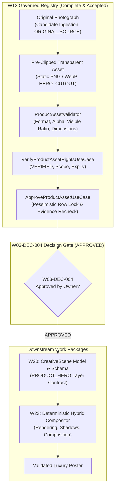
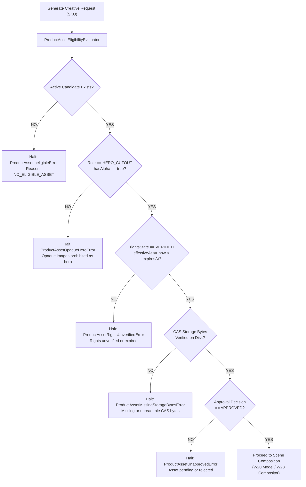
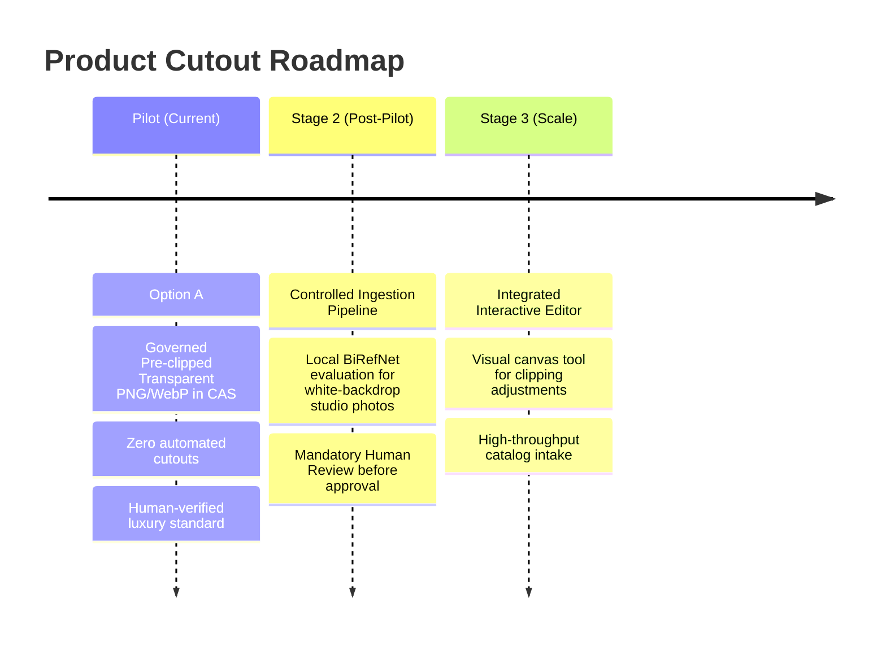

# W03-DEC-004: Product Image & Cutout Governance Decision Brief

**Document:** `/docs/implementation-evidence/W03-DEC-004-product-image-and-cutout-decision-brief.md`  
**Decision Reference:** `W03-DEC-004` in [`w03-business-decision-register.md`](file:///Users/macbookpro/Desktop/Development/parisian-shopper-ai/docs/specifications/w03-business-decision-register.md)  
**Parent Specifications:** [`layered-creative-scene-schema.md`](file:///Users/macbookpro/Desktop/Development/parisian-shopper-ai/docs/specifications/layered-creative-scene-schema.md), [`master-engineering-blueprint-v3.md`](file:///Users/macbookpro/Desktop/Development/parisian-shopper-ai/docs/master-engineering-blueprint-v3.md)  
**Prerequisite Work Package:** [W12 Governed Product Asset Registry](file:///Users/macbookpro/Desktop/Development/parisian-shopper-ai/docs/implementation-evidence/W12-governed-product-asset-registry.md) (Implemented & Accepted)  
**Target Work Package:** W20 (Layered CreativeScene Model)  
**Compositor Work Package:** W23 (Deterministic Hybrid Compositor)  
**Status:** **`APPROVED`** (Option A approved for the pilot; minimum-dimension requirement deferred)  
**Date:** 2026-10-20  
**Decision Date:** 2026-10-22  

---

## 1. Approved Decision

The Project Owner approved the product image sourcing, authenticity, and background-removal operating model below. The minimum-dimension requirement is deferred until real asset inventory measurements are available.

### Approved Decision Statement

> “For the Parisian Shopper AI pilot, only governed, rights-verified, human-approved, pre-clipped transparent PNG or WebP product assets from approved company sources or content-addressed storage may be used as hero product assets. Opaque original photographs may be retained for provenance but may not be used directly as hero cutouts. Automated and third-party background removal remain disabled until separately reviewed and approved. AI may generate ambient backgrounds and decorative elements, but it must never generate, redraw, replace, or materially alter the commercial product, packaging, labels, logos, colors, shape, cap, or proportions.”

---

## 2. Why W03-DEC-004 Blocked W20 and Now Clears Its Product-Asset Gate

Work Package **W20 — Layered CreativeScene Model** defines the versioned scene schema and layer data structures (`CreativeSceneVersion`, `SceneLayer`, `ProductHeroPayload`). The physical rendering and compositing engine is implemented separately in **W23 — Deterministic Hybrid Compositor**.

Decision `W03-DEC-004` previously blocked W20 because the scene-layer contract for `PRODUCT_HERO` could not be finalized without an authoritative business policy regarding:
1. **Layer Asset Sourcing:** Which asset roles (`HERO_CUTOUT` vs `ORIGINAL_SOURCE`) are admissible in a scene version.
2. **Provenance & Evidence Binding:** What validation assessments and rights events must be referenced within the scene's dependency graph.
3. **Transformation Constraints:** Which geometric adjustments and containment rules must be modeled in `ProductHeroPayload`.

### The Blocking Hazards
Without an authoritative business-owner decision:
- **Visual Degradation:** If unclipped rectangular JPEG photographs are admitted into the `PRODUCT_HERO` layer, downstream compositors would render opaque bounding boxes over luxury backgrounds, violating brand aesthetic standards.
- **Glass Transparency & Silhouette Corruption:** Perfume bottles feature transparent glass, refracted liquid, fine spray nozzles, and metallic caps. Automated cutout heuristics often produce jagged halos, erase clear glass walls, or dissolve the spray stem.
- **Hallucination Risk:** Generative diffusion models cannot be permitted to "draw" or "inpaint" the product bottle. Diffusion models consistently hallucinate gibberish label text, distort symmetry, alter brand logos, and misrepresent liquid colors.
- **Contractual & Commercial Liability:** Advertising a perfume with altered packaging, incorrect volume markings, or modified color violates trade description standards and brand partner agreements.

The owner decision now satisfies W20's product-asset governance gate. W20 must implement the approved Option A constraints and may not introduce automated or third-party background removal without a separate owner decision. This approval does not satisfy W20's other independent gates, including the typography decision `W03-DEC-007`.

---

## 3. Current W12 Safeguards

The completed and accepted work package [W12 Governed Product Asset Registry](file:///Users/macbookpro/Desktop/Development/parisian-shopper-ai/docs/implementation-evidence/W12-governed-product-asset-registry.md) has already established all technical infrastructure, database triggers, and domain invariants required to enforce this policy fail-closed:

1. **Role Separation & Privilege Boundary:**
   - Content creators authorized with `CREATE_CONTENT` or `EDIT_CREATIVE` can register candidate assets, but cannot grant usage rights.
   - Initial registration always initializes `rightsState` to `UNKNOWN` with `verifiedByUserId: null`.
   - Modifying rights requires dedicated permission `VERIFY_PRODUCT_ASSET_RIGHTS` via [`VerifyProductAssetRightsUseCase`](file:///Users/macbookpro/Desktop/Development/parisian-shopper-ai/app/packages/application/src/modules/products/application/verify-product-asset-rights.use-case.ts).
   - Approval requires dedicated permission `APPROVE_CREATIVE` via [`ApproveProductAssetUseCase`](file:///Users/macbookpro/Desktop/Development/parisian-shopper-ai/app/packages/application/src/modules/products/application/approve-product-asset.use-case.ts).

2. **Pessimistic Row-Locked Evidence Recheck:**
   - During approval, the database unit of work locks the asset and registration rows (`SELECT ... FOR UPDATE`) in deterministic ID order.
   - Inside the transaction, it re-verifies that the exact validation assessment passed (`isValid === true`, status `PASS` or `PASS_WITH_WARNINGS`), matches the current validator version, and that the latest rights event is `VERIFIED`, effective, and unexpired.
   - Missing or stale expected evidence throws [`ProductAssetStaleAssessmentError`](file:///Users/macbookpro/Desktop/Development/parisian-shopper-ai/app/packages/application/src/modules/products/domain/product-asset-errors.ts) or [`ProductAssetStaleEvidenceError`](file:///Users/macbookpro/Desktop/Development/parisian-shopper-ai/app/packages/application/src/modules/products/domain/product-asset-errors.ts) and rolls back atomically.

3. **Pending Replacement Continuity & Atomic Retirement:**
   - Submitting a replacement asset creates a registration in `SUBMITTED` state and links `replacesRegistrationId`.
   - The approved predecessor remains active and query-eligible while the replacement is pending.
   - If the replacement is rejected, the predecessor remains active.
   - Only upon explicit approval of the replacement is the predecessor retired and visual cache invalidation emitted (`approval.invalidation_requested_by_asset_change`).

4. **In-Place Fail-Closed Evaluation:**
   - [`ProductAssetEligibilityEvaluator`](file:///Users/macbookpro/Desktop/Development/parisian-shopper-ai/app/packages/application/src/modules/products/application/product-asset-eligibility-evaluator.ts) and [`PrismaProductAssetRepository`](file:///Users/macbookpro/Desktop/Development/parisian-shopper-ai/app/packages/database/src/product-asset/prisma-product-asset.repository.ts) share canonical candidate selection via `selectActiveHeroCutoutCandidate`.
   - If an active candidate's rights expire or its storage bytes in Content-Addressed Storage (CAS) are missing or corrupt, evaluation immediately fails closed with [`ProductAssetMissingStorageBytesError`](file:///Users/macbookpro/Desktop/Development/parisian-shopper-ai/app/packages/application/src/modules/products/domain/product-asset-errors.ts) or [`ProductAssetRightsUnverifiedError`](file:///Users/macbookpro/Desktop/Development/parisian-shopper-ai/app/packages/application/src/modules/products/domain/product-asset-errors.ts).
   - The system **never silently reactivates or falls back to a retired predecessor**.

5. **Production Fallback Prohibited:**
   - In production (`NODE_ENV === 'production'`), `allowLegacyProductAssetFallback` is strictly forced to `false`. Fallbacks fail fast with [`ProductAssetLegacyFallbackDisabledError`](file:///Users/macbookpro/Desktop/Development/parisian-shopper-ai/app/packages/application/src/modules/products/domain/product-asset-errors.ts).

6. **Remote Ingestion Security:**
   - [`SafeProductAssetAcquisitionService`](file:///Users/macbookpro/Desktop/Development/parisian-shopper-ai/app/packages/application/src/modules/products/infrastructure/safe-product-asset-acquisition.service.ts) enforces DNS resolution pinning, private/loopback/cloud metadata IP blocking, HTTPS port 443 enforcement, max 2 redirects, a 15 MiB default limit, and an absolute 35 MiB ceiling with immediate socket destruction on breach.

---

## 4. Approved Product-Image Sources

To prevent unauthorized or low-quality assets from entering the pipeline, approved candidate ingestion sources are strictly governed:

| Source Type | Channel / Origin | Ingestion & Governance Requirements | Role Restriction |
|-------------|------------------|-------------------------------------|------------------|
| **Authoritative Catalog Media** | Mekhla Product API (`https://api.mekhla.digital`) | **Candidate ingestion source only.** Host must match allowlist. Downloaded via pinned HTTPS. Stored in CAS. Must pass full validation, rights verification, and human approval. | Ingested photographs are typically opaque JPEGs, eligible only as `ORIGINAL_SOURCE`. They **cannot** be used as `HERO_CUTOUT` without a separately registered, approved transparent cutout. |
| **Internal Parisian Shopper CAS** | Content-Addressed Storage (`cas/<sha256>.<ext>`) | Immutable local or object storage indexed by SHA-256 digest. Guarantees byte-exact idempotency, tamper resistance, and repeatable rendering. | Admissible as `HERO_CUTOUT` only if the stored bytes represent static PNG or WebP with a verified alpha channel. |
| **Studio Photography Intake** | Controlled internal intake directory / authorized staff upload | High-resolution static PNG or WebP assets with a decoded alpha channel produced by Parisian Shopper photographers or retouchers. | Eligible for `HERO_CUTOUT` registration, subject to automated validation and visual approval. |

> [!CAUTION]
> The following sources are **strictly prohibited**:
> - Public search engine scraping (Google Images, Pinterest, Bing).
> - Third-party marketplace listings (eBay, unverified reseller sites).
> - Social media reposts or compressed chat attachments.
> - Caller-controlled arbitrary unverified URLs without host allowlisting.

---

## 5. Product Authenticity Requirements

Perfume and luxury beauty marketing depends entirely on brand prestige, packaging elegance, and consumer trust.

The platform enforces the following non-negotiable authenticity rules:
1. **Zero Generative Hallucination on Product:** AI models (Gemini Imagen, OpenAI DALL-E, etc.) are restricted to generating environmental backdrops, pedestals, lighting, and decorative motifs. AI must **never** draw, repaint, infill, or synthesize the product bottle.
2. **Label Typography Integrity:** The brand name, fragrance name, concentration (e.g. *Eau de Parfum*), and volume (e.g. *100 ml - 3.4 fl. oz.*) must remain 100% sharp, unaltered, and legible.
3. **Physical Geometry:** Bottle proportions, shoulder curvature, cap facets, and atomizer geometry must remain true to physical inventory.
4. **Liquid & Glass Fidelity:** The natural hue of the fragrance juice (e.g. golden amber, rose, clear) and transparency of the glass container must be preserved without artificial tint shifts.

---

## 6. Rights, Provenance, and Human-Approval Requirements

Every asset utilized in creative generation must maintain an unbroken chain of custody:

- **Provenance Tracking:** Ingested assets record `sourceSystem`, `sourceRecordId`, `sourceUrl`, `sourceRetrievedAt`, `sourceChecksum`, and parent-child derivation via `ProductAssetTransform` (linking derived cutouts to their `ORIGINAL_SOURCE` parent).
- **Usage Rights Verification:** Dedicated legal/brand review must record:
  - `rightsState`: Must be explicitly set to `VERIFIED`.
  - `permittedScope`: Commercial advertising and social media marketing.
  - `territory`: Permitted geographic distribution (e.g., Cambodia / ASEAN / Global).
  - `effectiveAt` & `expiresAt`: Valid date window (rights must already be effective and unexpired).
  - `verifiedByUserId`: Non-null staff user ID holding `VERIFY_PRODUCT_ASSET_RIGHTS`.
- **Independent Human Approval:** Even with verified rights and passing automated validation, an authorized approver (`APPROVE_CREATIVE`) must visually review the cutout asset and approve it via `ApproveProductAssetUseCase`.

---

## 7. Image Transformations: Implemented vs. Planned

To maintain technical clarity, image transformations are categorized into what is currently implemented, what is planned for W20, and what is planned for W23:

### 7.1 Already Implemented and Verified in W12
- **Image Decoding & Metadata Extraction:** Sharp-based format detection, dimension measurement, pixel counting, and alpha channel presence detection.
- **Alpha Channel Inspection:** Pixel-by-pixel scan verifying alpha byte values ($A < 250$ for transparency, $A > 10$ for visible content).
- **Visible Pixel Ratio Analysis:** Verifying visible pixels fall within configured boundaries ($0.05 \le \text{ratio} \le 0.98$).
- **Transparent Margin Trimming:** Calculation of trimmed bounding box (`TrimmedBounds`) to measure actual product bounds within canvas.
- **Cryptographic Digest Validation:** SHA-256 byte hashing and comparison against expected digests.

### 7.2 Planned for W20 (CreativeScene Model & Schema)
- **Scene Layer Schema Modeling:** Formalizing `ProductHeroPayload` fields: `casStorageKey`, `sha256`, `containment`, and `shadowConfig`.
- **Safe Area Containment Constraints:** Schema validation ensuring product placement does not breach margin boundaries (`safeMargins`).
- **Aspect Ratio Locking:** Declaring immutable $W/H$ ratio locks in the scene layer specification.

### 7.3 Planned for W23 (Deterministic Hybrid Compositor)
- **Uniform Proportional Scaling:** Aspect-locked resizing to fit the template's designated hero bounding box.
- **Lossless Transcoding:** Rendering static PNG or WebP assets into final composite canvas.
- **Contact Surface Shadow Synthesis:** Deterministic rendering of contact shadow ellipse on `SURFACE_SHADOW` layer below the bottle.
- **Directional Atmospheric Shadow:** Rendering soft drop shadow matching ambient scene art direction without occluding the product silhouette.

### 7.4 Strictly Prohibited Transformations
- ❌ **Non-Uniform Stretching:** Altering width and height independently, causing distorted bottles.
- ❌ **AI Inpainting / Restyling:** Passing the product cutout through diffusion img2img or neural stylization filters.
- ❌ **Edge Feathering Distortion:** Blurring bottle edges to blend into background, resulting in soft or fuzzy packaging.
- ❌ **Color / Saturation Shifts:** Applying global tint or color grades that alter the physical label or liquid color.
- ❌ **Obscuring Crops:** Cropping into the bottle silhouette, brand logo, or cap.
- ❌ **Opaque Rectangular Hero Placement:** Rendering a rectangular photograph with white or colored background as a hero layer over a composite scene.

---

## 8. Background-Removal Options and Tradeoffs

Three technical options were evaluated for producing transparent hero cutouts:

| Evaluation Dimension | Option A: Governed Pre-clipped Studio Assets Only (Recommended) | Option B: Deterministic Internal Removal (Local Neural Network) | Option C: Approved Third-Party Cutout SaaS (External API) |
|---|---|---|---|
| **Operating Mechanism** | Professional photographers or retouchers deliver pre-clipped static PNG or WebP files with verified alpha directly into CAS. | Platform runs a containerized neural model (e.g. BiRefNet, RMBG-1.4, U2-Net) on worker nodes to extract alpha mask from studio JPG. | Worker calls external cloud API (e.g. Photoroom, remove.bg) during registration to receive transparent asset. |
| **Glass & Transparency Quality** | **Lowest Authenticity Risk:** Human-retouched assets are expected to preserve transparent glass walls, fluid refractions, and liquid translucency more reliably than automated models. | **High Risk:** Automated segmentation frequently turns transparent glass opaque or erases delicate glass walls and internal spray tubes. | **Moderate Risk:** Effective on opaque solid packaging, but frequently fails on glass bottles, spray stems, and metallic caps. |
| **Fine Detail (Caps & Nozzles)** | **High Detail Retention:** Razor-sharp metallic edges, spray nozzles, and cap facets preserved without algorithmic haloing or erosion. | **Inconsistent:** Noticeable risk of edge haloing, jagged outlines, or eroded nozzles depending on background contrast. | **Inconsistent:** Occasional edge blurring, haloing, and loss of fine metallic reflections. |
| **Runtime Reliability** | **Deterministic:** Pre-validated bytes stored in CAS; zero compute overhead or failure points during scene generation. | **Worker Contention Risk:** Local model inference requires dedicated GPU/CPU resources and adds 2–10s processing latency. | **External Dependency:** Dependent on third-party uptime, network latency, rate limits, and external API stability. |
| **Operational & Financial Cost** | **\$0.00 platform runtime cost:** Leverages existing commercial photography deliverables. | **Hardware Cost:** Requires provisioning and maintaining GPU worker instances. | **Recurring SaaS Cost:** \$0.10–\$0.25 per cutout API call; recurring operational bill. |
| **Data Privacy & Security** | **Maximum:** Pre-release product photography never leaves internal infrastructure. | **Maximum:** All processing remains on internal worker nodes. | **Data Leakage Risk:** Unreleased packaging imagery transmitted to third-party cloud servers. |
| **Architectural Alignment** | **Aligned with W12:** W12's validator already enforces format, alpha channel, visible ratio, and CAS immutability. | Requires developing and maintaining a new neural segmentation service and complex manual correction UI. | Requires third-party credentials, outbound network traffic, and webhook reconciliation workflows. |

> [!NOTE]
> No automated segmentation method guarantees artifact-free cutouts on reflective glass and luxury perfume bottles. Human inspection remains necessary.

---

## 9. Recommended Pilot Policy

### Recommendation: Option A (Governed Pre-clipped Studio Assets Only)

It is recommended that the Project Owner approve **Option A** for the Parisian Shopper AI pilot.

#### Rationale:
1. **Lowest Authenticity Risk:** For luxury perfumes, even minor clipping artifacts (e.g. jagged bottle edges, halo effects on luxury packaging, or lost spray tubes) degrade brand trust. Human-retouched cutouts provide the highest visual standard.
2. **Immediate Technical Alignment:** Work Package W12 was built and verified specifically around Option A. The validator, rights service, approval service, CAS storage adapter, and database triggers are fully implemented and accepted.
3. **Zero Financial Overhead:** Eliminates unnecessary GPU hardware infrastructure and recurring SaaS API subscription costs during the pilot.
4. **Focused Pilot Scope:** The pilot catalog focuses on high-priority fragrance SKUs (Geparlys, Paris Bleu, etc.), which already have studio assets available.

---

## 10. Production Fail-Closed Behavior

When Option A is enforced, the platform operates under strict fail-closed guarantees:

If any condition fails:
- The poster generation job aborts cleanly.
- The failure reason is recorded in the job ledger with exact domain errors:
  - [`ProductAssetIneligibleError`](file:///Users/macbookpro/Desktop/Development/parisian-shopper-ai/app/packages/application/src/modules/products/domain/product-asset-errors.ts)
  - [`ProductAssetOpaqueHeroError`](file:///Users/macbookpro/Desktop/Development/parisian-shopper-ai/app/packages/application/src/modules/products/domain/product-asset-errors.ts)
  - [`ProductAssetRightsUnverifiedError`](file:///Users/macbookpro/Desktop/Development/parisian-shopper-ai/app/packages/application/src/modules/products/domain/product-asset-errors.ts)
  - [`ProductAssetMissingStorageBytesError`](file:///Users/macbookpro/Desktop/Development/parisian-shopper-ai/app/packages/application/src/modules/products/domain/product-asset-errors.ts)
  - [`ProductAssetUnapprovedError`](file:///Users/macbookpro/Desktop/Development/parisian-shopper-ai/app/packages/application/src/modules/products/domain/product-asset-errors.ts)
- In production, fallback to ungoverned or legacy images is permanently blocked via [`ProductAssetLegacyFallbackDisabledError`](file:///Users/macbookpro/Desktop/Development/parisian-shopper-ai/app/packages/application/src/modules/products/domain/product-asset-errors.ts).

---

## 11. Acceptance Criteria & Resolution Governance

### 11.1 Current Implemented Technical Enforcement (W12)
- [x] **Format Standard:** Only static PNG or WebP with decoded alpha channel accepted for `HERO_CUTOUT`.
- [x] **Multi-Frame Prohibition:** Multi-page or animated formats rejected (`ANIMATED_IMAGE_REJECTED`).
- [x] **Alpha & Visible Ratio Gates:**
  - `hasAlpha === true` and at least one transparent pixel ($A < 250$).
  - Minimum visible ratio: `0.05` (5% of canvas).
  - Maximum visible ratio: `0.98` (98% of canvas, ensuring transparent margin).
- [x] **Dimension Bounds:** Non-zero dimensions (`width > 0 && height > 0`), maximum dimension $\le 8192$ px, maximum decoded pixels $\le 16,000,000$.
- [x] **Placeholder Protection:** Known placeholder digests rejected ([`ProductAssetPlaceholderRejectedError`](file:///Users/macbookpro/Desktop/Development/parisian-shopper-ai/app/packages/application/src/modules/products/domain/product-asset-errors.ts)).
- [x] **Rights Verification:** Rights state `VERIFIED` with non-null `verifiedByUserId` and valid date range.
- [x] **Approval Invariant:** Approved state with exact assessment binding and non-null `decidedByUserId`.
- [x] **Automated Removal Disabled:** Automated neural and third-party cutout pipelines remain disabled in code.
- [x] **Zero Fallback:** Production environment strictly disables legacy unverified product image fallbacks.

### 11.2 Proposed Pilot Business Requirement (Pending Owner Decision)
- [ ] **Minimum Resolution Floor (Deferred):** The validator supports an optional `minDimension` check. The owner deferred a fixed minimum until real asset inventory measurements are available. Human review remains mandatory, and no minimum is marked implemented until a later approved value is configured and tested.

---

## 12. Future Upgrade Path

Approval of Option A for the pilot does not preclude future automation. A governed two-stage roadmap is established:

1. **Stage 2 (Post-Pilot Evaluation):** If catalog onboarding volume increases, evaluate a containerized BiRefNet segmentation model *strictly as an intake tool* for the photography team. Generated masks must still be reviewed and approved by a human before entering `APPROVED` status.
2. **Stage 3 (Interactive Studio Tooling):** Provide a visual editor for retouchers to adjust alpha threshold curves on glass refractions before committing assets to CAS.

---

## 13. Remaining Risks and Mitigations

| Identified Risk | Severity | Mitigation Strategy |
|---|:---:|---|
| **Ingestion Bottleneck:** Manual pre-clipping could delay onboarding new product SKUs. | Medium | Pre-clip top 50 revenue-generating SKUs in batch prior to campaign launches. |
| **Photographer Asset Variance:** Photographer uploads PNG with transparent background but dirty fringe pixels. | Low | W12 automated validator checks `visibleRatio`, bounding boxes, and placeholder hashes. Approver visually inspects Telegram review card. |
| **Packaging Updates:** Brand updates bottle label or cap design. | Medium | W12 replacement flow allows registering replacement B as `SUBMITTED`, keeping predecessor A active until B is approved, then atomically retiring A. |

---

## 14. Explicit Project-Owner Response Section

The formal owner decision is recorded below:

### Project-Owner Decision

#### 1. Product Image Operating Model
- [x] **APPROVE Option A for the pilot** (Governed pre-clipped transparent PNG or WebP assets only)
- [ ] **REJECT**
- [ ] **REQUEST CHANGES**

#### 2. Minimum Hero-Asset Dimension Requirement
- [ ] **APPROVE 1000×1000 minimum**
- [ ] **APPROVE another minimum:** __________
- [x] **DEFER the minimum-dimension decision and keep validation fail-closed through human review**

**Owner Name:** Brathna  
**Decision Date:** 2026-10-22  
**Comments / Directives:**  
Option A is approved for the pilot. Only governed, rights-verified, human-approved, pre-clipped transparent PNG or WebP product assets may be used as hero product assets. Automated and third-party background removal remain disabled. The minimum-dimension requirement is deferred until the real company asset inventory is measured; human visual review remains mandatory in the interim.  
