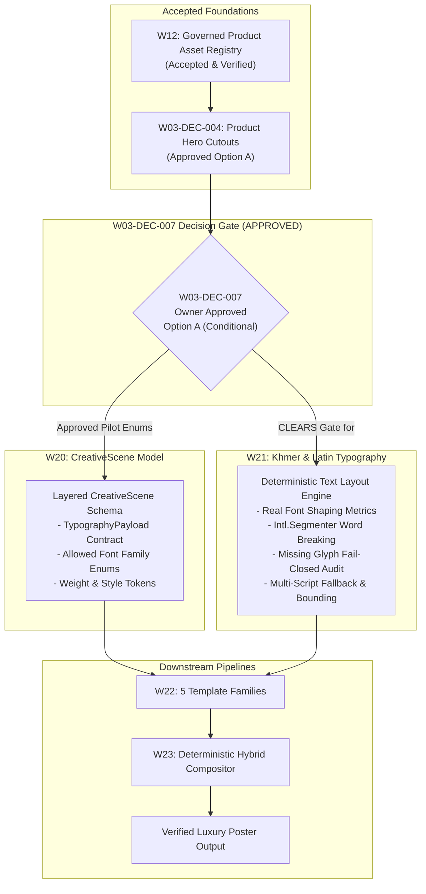
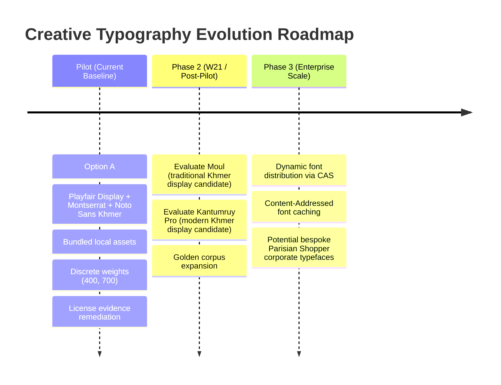

# W03-DEC-007: Approved Latin and Khmer Typography, Licensing, and Local Font Storage Decision Brief

**Document:** `/docs/implementation-evidence/W03-DEC-007-typography-and-font-licensing-decision-brief.md`  
**Decision Reference:** `W03-DEC-007` in [`w03-business-decision-register.md`](file:///Users/macbookpro/Desktop/Development/parisian-shopper-ai/docs/specifications/w03-business-decision-register.md)  
**Parent Specifications:** [`layered-creative-scene-schema.md`](file:///Users/macbookpro/Desktop/Development/parisian-shopper-ai/docs/specifications/layered-creative-scene-schema.md), [`brand-intelligence-and-data-governance.md`](file:///Users/macbookpro/Desktop/Development/parisian-shopper-ai/docs/specifications/brand-intelligence-and-data-governance.md), [`master-engineering-blueprint-v3.md`](file:///Users/macbookpro/Desktop/Development/parisian-shopper-ai/docs/master-engineering-blueprint-v3.md)  
**Prerequisite Work Package:** [W12 Governed Product Asset Registry](file:///Users/macbookpro/Desktop/Development/parisian-shopper-ai/docs/implementation-evidence/W12-governed-product-asset-registry.md) (Implemented & Accepted)  
**Related Business Decision:** [W03-DEC-004 Product Image & Cutout Governance](file:///Users/macbookpro/Desktop/Development/parisian-shopper-ai/docs/implementation-evidence/W03-DEC-004-product-image-and-cutout-decision-brief.md) (Approved Option A)  
**Target Work Packages:** W20 (Layered CreativeScene Model), W21 (Khmer and Latin Typography)  
**Downstream Packages:** W22 (Five Canonical Template Families), W23 (Deterministic Hybrid Compositor), W30 (Khmer Localization)  
**Status:** **`APPROVED`** (Option A approved as conditional pilot typography direction; Moul and Kantumruy Pro deferred; Noto Sans Khmer binary OFL replacement and W21 safeguards required)  
**Date:** 2026-10-22  
**Decision Date:** 2026-10-22  

---

> [!IMPORTANT]
> **Legal Notice:** This document provides technical evidence, font binary inspection findings, and engineering requirements. It does not constitute legal counsel or formal copyright clearance. Final licensing approval belongs to the authorized project owner and legal counsel.

---

## 1. Truth Table: Current Implementation vs. W21 Requirements

To eliminate confusion between what is currently operational in the repository and what remains to be built in Work Package W21, the table below provides a precise audit of all typography capabilities:

| Capability | Current State | Evidence | Required Next Action |
|---|:---:|---|---|
| **Local Font Assets** | **Verified Repository Asset** | Four TTF files and three license files present in the current worktree under `app/assets/fonts/` | Retain local files; resolve Noto licensing package before production |
| **License Evidence** | **Partially Implemented** | Playfair Display and Montserrat have matching local `OFL.txt`. Noto Sans Khmer binaries cite Apache 2.0 in metadata while adjacent file is `OFL.txt` | Choose remediation path: replace binaries with verified OFL builds or add matching Apache 2.0 notices and provenance |
| **Embedded SVG Font Loading** | **Currently Implemented** | [`font-loader.ts`](file:///Users/macbookpro/Desktop/Development/parisian-shopper-ai/app/packages/application/src/modules/creative/infrastructure/fonts/font-loader.ts#L58-L88) reads local TTFs and embeds base64 data URIs into SVG `@font-face` blocks | Retain base64 embedding; fix Playfair weight declaration in W21 |
| **Host-Font Fallback Removal** | **Partially Implemented** | [`font-loader.ts`](file:///Users/macbookpro/Desktop/Development/parisian-shopper-ai/app/packages/application/src/modules/creative/infrastructure/fonts/font-loader.ts#L47-L54) falls back to `/Library/Fonts/NotoSansKhmer-*.ttf` if local files are missing | **Required for W21:** Remove host system font fallback paths to enforce 100% hermetic builds |
| **Runtime Digest Verification** | **Not Implemented** | `font-loader.ts` reads files by path; does not verify SHA-256 at runtime | **Required for W21:** Add SHA-256 runtime assertion against approved digests prior to embedding |
| **Khmer Word Segmentation** | **Currently Implemented** | [`TextLayoutEngine.segmentText()`](file:///Users/macbookpro/Desktop/Development/parisian-shopper-ai/app/packages/application/src/modules/creative/domain/services/text-layout-engine.ts#L20-L73) uses `new Intl.Segmenter('km', { granularity: 'word' })` | Retain `Intl.Segmenter`; add Coeng-safe boundary guards during W21 |
| **Real Shaped Metrics Measurement** | **Not Implemented** | [`TextLayoutEngine.estimateCharWidth()`](file:///Users/macbookpro/Desktop/Development/parisian-shopper-ai/app/packages/application/src/modules/creative/domain/services/text-layout-engine.ts#L25-L36) uses character-class heuristic multipliers, not actual font metrics | **Required for W21:** Implement actual font-metric measurement and OpenType shaping advances |
| **Khmer Complex Shaping Verification** | **Not Implemented** | No automated tests currently verify that subscript ligatures (`Coeng`) and split vowels render identically across environments | **Required for W21:** Add golden test suite comparing rasterized Khmer shaping against reference images |
| **Coeng-Safe Line Breaking** | **Not Implemented** | `TextLayoutEngine` wraps at segment boundaries; does not explicitly guard against breaking after `U+17D2` (Coeng) | **Required for W21:** Add syllable and cluster constraints preventing line breaks after `U+17D2` or before vowels |
| **Mixed-Script Runs (`<tspan>`)** | **Not Implemented** | Text is emitted as monolithic SVG strings; no per-script token segregation or multi-font `<tspan>` markup exists | **Required for W21:** Implement multi-run layout generating script-specific `<tspan>` elements with explicit font families |
| **Missing-Glyph Rejection** | **Not Implemented** | No cmap validation pipeline exists; `PosterFontGlyphMissingError` **does not exist** in `creative-errors.ts` | **Required for W21:** Define `PosterFontGlyphMissingError` and implement fail-closed cmap audit before rendering |
| **XML Entity Escaping** | **Currently Implemented** | [`SafeSvgRenderer.escapeXml()`](file:///Users/macbookpro/Desktop/Development/parisian-shopper-ai/app/packages/application/src/modules/creative/domain/services/safe-svg-renderer.ts#L1-L8) escapes `&`, `<`, `>`, `"`, `'` | Retain XML escaping for dynamic text insertions |
| **Unicode Control Filtering** | **Not Implemented** | `SafeSvgRenderer` does not filter bidirectional overrides or non-printable Unicode control characters | **Required for W21:** Add sanitization for bidi overrides and illegal control characters |
| **Overflow Detection** | **Partially Implemented** | [`PosterLayoutOverflowError`](file:///Users/macbookpro/Desktop/Development/parisian-shopper-ai/app/packages/application/src/modules/creative/domain/creative-errors.ts#L318-L329) is thrown if heuristic line wrap exceeds bounding box at `minFontSize` | **Required for W21:** Upgrade overflow calculation from heuristic character widths to real shaped text bounds |
| **Cross-Platform Golden Tests** | **Not Implemented** | No visual regression or pixel-diff tests currently run across macOS and Linux CI containers | **Required for W21:** Implement golden raster visual test suite for bilingual typography |

---

## 2. Decision Required

The Project Owner (**Brathna**) is requested to review and decide upon the **Typography Operating Model, Licensing Remediation Path, and Local Font Storage Direction** for Parisian Shopper AI.

### 2.1 Scope of the Decision
This governance decision establishes:
1. **Pilot Typography Direction:** Candidate typeface pairings for Latin display titles, Latin body/price/CTA copy, and Khmer script messaging, conditional on resolving Noto license evidence and completing W21 safeguards.
2. **Noto Sans Khmer Licensing Remediation:** Authoritative business selection between replacing candidate binaries with verified upstream OFL versions, retaining Apache 2.0 binaries with matching notices, or requesting formal legal review.
3. **Hermetic Local Storage Policy:** Mandatory repository-bundled storage under `app/assets/fonts/` with runtime SHA-256 verification and explicit removal of host operating system font fallbacks in W21.
4. **Deterministic Fail-Closed Text Mandate:** Architectural requirement that all advertising copy, promotional pricing, and product titles are rendered deterministically by code-driven SVG layout, prohibiting generative AI diffusion models from synthesizing textual content.

### 2.2 Approved Decision Statement (Option A Conditional Pilot Direction)

> “Option A is approved as the conditional pilot typography direction. The pilot typeface suite shall pair **Playfair Display** (for Latin display headlines), **Montserrat** (for Latin body text, specifications, prices, and CTAs), and **Noto Sans Khmer** (for Khmer language headlines, body copy, and cultural messaging). Fonts must be loaded hermetically from local repository storage; host operating system font fallbacks must be removed in W21. Additional Khmer display typefaces (*Moul* and *Kantumruy Pro*) are deferred. Current *Noto Sans Khmer* binaries must be replaced with provenance-recorded OFL versions during W21. All required W21 safeguards—including a pre-render cmap validation pipeline, `PosterFontGlyphMissingError`, shaped font-metric measurement, Coeng-safe boundary guards, and mixed-script runs—must be completed and verified before production use. Generative AI diffusion models must never be relied upon to render marketing text.”

---

## 3. Why W03-DEC-007 Blocked W21 and Clears Its Governance Gate

In strict accordance with the Master Engineering Blueprint v3.0, architectural dependencies are strictly enforced. The creative generation pipeline requires business decisions on asset governance before code models and composition engines can be accepted.

### 3.1 Why W03-DEC-007 Blocks W21 (Khmer and Latin Typography)
Work Package **W21** implements the core deterministic text layout engine: font loading, Unicode text shaping, bilingual character measurement, line breaking, word segmentation, line-height calculation, alignment, truncation, and golden test corpora.

W21 cannot be implemented or accepted without this decision because:
- **Font Stack Definition:** The layout engine cannot hardcode glyph advance metrics, vertical typographic metrics (`typoAscender`, `typoDescender`, `typoLineGap`), or line wrapping thresholds without knowing the exact, approved font binaries.
- **Glyph Coverage Validation:** The fail-closed validator must compare input text against the exact `cmap` tables of the approved font binaries.
- **Licensing Compliance:** Automated test suites and production Docker builds cannot redistribute or compile font software without formal business sign-off on the licensing terms and resolution of the Noto license package.

### 3.2 How W03-DEC-007 Affects W20 (Layered CreativeScene Model)
Work Package **W20** formalizes the `CreativeScene` domain model, Prisma schema, and Zod validation contracts. In [`layered-creative-scene-schema.md`](file:///Users/macbookpro/Desktop/Development/parisian-shopper-ai/docs/specifications/layered-creative-scene-schema.md), the `TypographyPayload` defines the structural contract for text layers (`headline`, `subheadline`, `body`, `price`, `cta`).

W03-DEC-007 directly affects W20 by dictating:
- **Allowed Font Enums:** The Zod schema for `fontFamily` must be constrained to the approved enum values (e.g. `PLAYFAIR_DISPLAY`, `MONTSERRAT`, `NOTO_SANS_KHMER`).
- **Weight Constraints:** `fontWeight` integer ranges must match actual font capabilities (e.g. variable 400–900 for Playfair, 100–900 for Montserrat, and discrete static 400 or 700 for Noto Sans Khmer).
- **Layer Hash Stability:** Because scene versioning tracks cryptographic content hashes, changing font references mutates layer hashes and invalidates downstream visual approvals.

---

## 4. Inventory of Candidate Fonts Currently in the Repository

An exhaustive technical and cryptographic audit of all font software currently residing in `app/assets/fonts/` was conducted. The table below records the verified parameters:

### 4.1 Audited Font Inventory Table

| Asset Path | Format | Size | SHA-256 Digest | Internal Family & Subfamily | Version & Designer | Weights / Axes | Glyph Coverage | Layout Tables | License Evidence |
|---|:---:|:---:|---|---|---|---|---|:---:|---|
| `app/assets/fonts/playfair-display/PlayfairDisplay-Variable.ttf` | TrueType Variable | 300,724 B | `c40f2293766a503bc70cce9e512ef844a4ccb7cbcde792fe2ea31d191917d8d6` | Family: `Playfair Display` Subfamily: `Regular` PostScript: `PlayfairDisplay-Regular` | Version 1.203 Claus Eggers Sørensen | Variable `wght` **Min: 400.0** Def: 400.0 Max: 900.0 (6 named instances) | 659 codepoints Latin: 26/26 upper, 26/26 lower Digits: 10/10 USD (`$`): Yes, EUR (`€`): Yes Khmer: **0 codepoints** | `GSUB` `GPOS` | **SIL Open Font License 1.1** (with Reserved Font Name) Embedding: Installable (`fsType=0x0000`) |
| `app/assets/fonts/playfair-display/OFL.txt` | License Text | 4,374 B | `566be814f8e96e93dfa16101331557eb6b5467e9e03f627c0910fe93ca12300e` | — | Copyright 2017 The Playfair Display Project Authors | — | — | — | SIL Open Font License 1.1 |
| `app/assets/fonts/montserrat/Montserrat-Variable.ttf` | TrueType Variable | 744,936 B | `0f7b311b2f3279e4eef9b2f968bcdbab6e28f4daeb1f049f4f278a902bcd82f7` | Family: `Montserrat Thin` Typographic: `Montserrat` PostScript: `Montserrat-Thin` | Version 9.000 Julieta Ulanovsky | Variable `wght` Min: 100.0 Def: 100.0 Max: 900.0 (9 named instances) | 1,312 codepoints Latin: 26/26 upper, 26/26 lower Digits: 10/10 USD (`$`): Yes, EUR (`€`): Yes Khmer: **0 codepoints** | `GSUB` `GPOS` | **SIL Open Font License 1.1** Embedding: Installable (`fsType=0x0000`) |
| `app/assets/fonts/montserrat/OFL.txt` | License Text | 4,403 B | `8b7141c03fa4f8d44e6345d5d4931709290f0f67875e452e95ac1fd3a027802e` | — | Copyright 2024 The Montserrat.Git Project Authors | — | — | — | SIL Open Font License 1.1 |
| `app/assets/fonts/noto-sans-khmer/NotoSansKhmer-Regular.ttf` | TrueType Static | 48,644 B | `b122766dedf4af57abc999c04c43eeaef48571c013ef1f388d9d7e6cffc6690a` | Family: `Noto Sans Khmer` Subfamily: `Regular` PostScript: `NotoSansKhmer` | Version 1.30 (2013) Danh Hong / Google | Static Weight Regular (400) `usWeightClass=400` | 187 codepoints Latin: **0/26 upper, 0/26 lower** Digits: 10/10 (0-9) USD (`$`): Yes, Riel (`៛`): Yes Khmer (U+1780-U+17FF): **114** Khmer Sym (U+19E0-U+19FF): **32** | `GSUB` `GPOS` `morx` | **Apache License 2.0** in TTF Name table Directory contains `OFL.txt` Embedding: Allowed (`fsType=0x0008`) |
| `app/assets/fonts/noto-sans-khmer/NotoSansKhmer-Bold.ttf` | TrueType Static | 47,032 B | `2dd30d525e04d183b3eaf737a924b74c82d31497e6aca1f8e7f4c0918725f964` | Family: `Noto Sans Khmer` Subfamily: `Bold` PostScript: `NotoSansKhmer-Bold` | Version 1.00 (2012) Danh Hong / Google | Static Weight Bold (700) `usWeightClass=700` | 187 codepoints Latin: **0/26 upper, 0/26 lower** Digits: 10/10 (0-9) USD (`$`): Yes, Riel (`៛`): Yes Khmer (U+1780-U+17FF): **114** Khmer Sym (U+19E0-U+19FF): **32** | `GSUB` `GPOS` | **Apache License 2.0** in TTF Name table Directory contains `OFL.txt` Embedding: Installable (`fsType=0x0000`) |
| `app/assets/fonts/noto-sans-khmer/OFL.txt` | License Text | 4,373 B | `be0407f060aea48787ff9e75d8d3aedef70aef113b3ce9aca26fdaacd10b1870` | — | Copyright 2022 The Noto Project Authors | — | — | — | SIL Open Font License 1.1 |

### 4.2 Critical Audit Findings

> [!WARNING]
> **Audit Finding 1: Noto Sans Khmer License Evidence Mismatch (Severity: MEDIUM)**  
> Inspection of Name Table Record 13 inside both `NotoSansKhmer-Regular.ttf` and `NotoSansKhmer-Bold.ttf` reveals they are early Google Noto releases (Version 1.00/1.30, 2012–2013) that cite the **Apache License, Version 2.0**. However, the accompanying file in the directory is `OFL.txt` (dated 2022, from the modern `notofonts/khmer` repository).  
> This mismatch prevents clean production redistribution evidence. Before production approval, the project must either:  
> **A.** Replace the current Noto binaries with verified upstream OFL binaries and record their provenance and SHA-256 digests; or  
> **B.** Retain the Apache-licensed binaries, replace `OFL.txt` with the exact Apache 2.0 license text, and document required copyright notices and provenance.  
> Final licensing approval belongs to the authorized company owner or legal counsel.

> [!WARNING]
> **Audit Finding 2: Complete Disjointness of Latin and Khmer Scripts**  
> `Noto Sans Khmer` contains **zero Latin alphabet characters** ($0/26$ uppercase, $0/26$ lowercase). Conversely, `Playfair Display` and `Montserrat` contain **zero Khmer characters** ($0$ codepoints in `U+1780`–`U+17FF` and `U+19E0`–`U+19FF`).  
> If an English brand name (e.g. *"Dior"*, *"Chanel"*) is rendered using *Noto Sans Khmer* alone, it renders as blank tofu (`.notdef`). Inversely, if Khmer text is rendered using *Playfair Display* or *Montserrat*, it renders as tofu. **Every bilingual text layer requires an explicit font-stack fallback or multi-run layout engine.**

> [!WARNING]
> **Audit Finding 3: Playfair Display Weight Declaration Mismatch in font-loader.ts**  
> The inspected `PlayfairDisplay-Variable.ttf` binary supports the weight axis range `400.0` to `900.0`. However, the current implementation in [`font-loader.ts`](file:///Users/macbookpro/Desktop/Development/parisian-shopper-ai/app/packages/application/src/modules/creative/infrastructure/fonts/font-loader.ts#L79) declares:  
> `font-weight: 100 900;`  
> Weights below 400 (Thin 100, ExtraLight 200, Light 300) are **not present** in the Playfair binary. Declaring `100 900` produces unpredictable font-matching behavior. This mismatch must be corrected to `400 900` and verified with automated tests during W21.

> [!NOTE]
> **Audit Finding 4: Moul and Kantumruy Pro Are Not in the Repository**  
> Specifications mention *Moul* (traditional Khmer ceremonial display) and *Kantumruy Pro* (contemporary luxury display). **Neither font binary nor license currently exists in the repository.** They cannot be used in the pilot until formally sourced, verified, and approved during W21.

---

## 5. Current Implementation vs. Required W21 Safeguards

To prevent conflating prototypes with completed architecture, the status of all typography subsystems is classified below:

### 5.1 Font Loading and Storage Architecture
- **Local Repository Loading:** *Currently Implemented.* [`font-loader.ts`](file:///Users/macbookpro/Desktop/Development/parisian-shopper-ai/app/packages/application/src/modules/creative/infrastructure/fonts/font-loader.ts#L16-L40) resolves local TTFs from candidate repository roots (`assets/fonts`).
- **Base64 SVG Embedding:** *Currently Implemented.* `font-loader.ts` converts loaded font buffers to base64 data URIs and embeds them into an `@font-face` CSS stylesheet.
- **Host System Font Fallback:** *Currently Present (Defect).* `font-loader.ts` includes fallback paths to macOS system directories (`/Library/Fonts/NotoSansKhmer-*.ttf`). **Zero host OS dependency is NOT currently enforced.**
- **Removal of Host Fallback:** *Required for W21.* Remove all `/Library/Fonts/` paths so missing repository assets throw `PosterFontNotFoundError` immediately.
- **Runtime Digest Verification:** *Required for W21.* Verify SHA-256 digests against known good constants before converting buffers to base64.

### 5.2 Font Weight and Styling Rules
- **Playfair Display (Latin Display):** Inspected binary supports `wght` 400–900. Supported named instances are Regular (400), Medium (500), SemiBold (600), Bold (700), ExtraBold (800), Black (900). Weights below 400 are unsupported. Correction of `@font-face` declaration is *Required for W21*.
- **Montserrat (Latin Body / Pricing / CTA):** Inspected binary supports `wght` 100–900. Supported instances are Thin (100) through Black (900).
- **Noto Sans Khmer (Khmer Primary):** Inspected binaries are static files supporting only Regular (400) and Bold (700).
- **Synthetic Weight Prohibition:** Synthetic bolding ("faux bold") produces distorted outlines and blurred serifs. Prohibition of synthetic bolding is a *Required W21 Rule* and is **not currently enforced in code**.

### 5.3 Text Measurement and Word Segmentation
- **Khmer Word Segmentation:** *Currently Implemented.* [`TextLayoutEngine.segmentText()`](file:///Users/macbookpro/Desktop/Development/parisian-shopper-ai/app/packages/application/src/modules/creative/domain/services/text-layout-engine.ts#L62-L69) uses `Intl.Segmenter('km', { granularity: 'word' })` to identify word boundaries in Khmer text.
- **Advance Measurement Heuristic:** *Current State.* [`TextLayoutEngine.estimateCharWidth()`](file:///Users/macbookpro/Desktop/Development/parisian-shopper-ai/app/packages/application/src/modules/creative/domain/services/text-layout-engine.ts#L25-L36) uses character-class heuristic multipliers (`fontSize * 0.6`, `fontSize * 0.1` for combining signs). It **does not measure shaped glyph advances from the actual font**.
- **Real Font-Metric Measurement:** *Required for W21.* Replace heuristic advance estimation with HarfBuzz shaping or OpenType metric advances.
- **Coeng-Safe Boundary Guard:** *Required for W21.* Khmer text must never break across lines immediately following a `Coeng` (`U+17D2`), between a base consonant and its subscript, or before a dependent vowel. This guard is not currently present in `TextLayoutEngine`.
- **Mixed-Script `<tspan>` Runs:** *Required for W21.* Monolithic text rendering cannot resolve mixed Latin/Khmer strings cleanly across disjoint fonts. The layout engine must segment text by Unicode script run and emit discrete `<tspan>` tags with explicit `font-family` assignments.
- **Overflow Detection:** *Partially Implemented.* [`PosterLayoutOverflowError`](file:///Users/macbookpro/Desktop/Development/parisian-shopper-ai/app/packages/application/src/modules/creative/domain/creative-errors.ts#L318-L329) is thrown when heuristic line measurement exceeds bounds at `minFontSize`. Upgrading this check to shaped bounding boxes is *Required for W21*.

### 5.4 SVG Safety and Pre-Render Validation
- **XML Entity Escaping:** *Currently Implemented.* [`SafeSvgRenderer.escapeXml()`](file:///Users/macbookpro/Desktop/Development/parisian-shopper-ai/app/packages/application/src/modules/creative/domain/services/safe-svg-renderer.ts#L1-L8) escapes `&`, `<`, `>`, `"`, `'`.
- **Unicode Control & Bidi Filtering:** *Required for W21.* `SafeSvgRenderer` does not currently strip bidirectional override characters or non-printable control characters.
- **Pre-Render Cmap Glyph Validation:** *Required for W21.* The codebase does not currently perform pre-render glyph coverage checks. `PosterFontGlyphMissingError` **does not exist** in `creative-errors.ts`. Implementing `PosterFontGlyphMissingError` and cmap-based pre-render validation is a mandatory W21 deliverable.
- **Cross-Platform Golden Tests:** *Required for W21.* Identical rasterization across macOS and Linux containers must be proved using automated visual regression tests in W21.

### 5.5 AI Background Text Prohibition
- **Deterministic Overlay Rule:** *Required Architecture.* All marketing copy, promotional pricing, and product branding must be composited via deterministic code-generated vector layers.
- **Diffusion Text Limitation:** Negative prompts (e.g. `"text, words, letters, labels, watermarks"`) reduce but **cannot guarantee the total absence of hallucinated text or garbled lettering** in generative diffusion outputs.
- **Visual Validation Safeguard:** *Required for W21/W24.* Automated visual validation and mandatory human review must inspect generated backgrounds for accidental pseudo-text or watermarks prior to approval.

---

## 6. Operating Policy Evaluation (Options Comparison)

Three typography operating models were evaluated against brand aesthetics, linguistic accuracy, licensing legality, and engineering feasibility:

| Evaluation Dimension | Option A: Repository OFL Fonts (Recommended Pilot Direction) | Option B: Expanded Khmer Display Suite (Future Candidates) | Option C: Commercial Proprietary Typefaces |
|---|---|---|---|
| **Latin Display Font** | *Playfair Display* (Variable TrueType, 400–900) | *Playfair Display* (Variable TrueType) | Custom proprietary luxury serif (e.g. Parisian Bodoni) |
| **Latin Body / CTA Font** | *Montserrat* (Variable TrueType, 100–900) | *Montserrat* (Variable TrueType) | Custom proprietary sans-serif |
| **Khmer Body & Title** | *Noto Sans Khmer* (Static TrueType, 400 & 700) | *Kantumruy Pro* (Unverified candidate) & *Noto Sans Khmer* | Custom commissioned Khmer typeface |
| **Khmer Heritage Heading** | *Noto Sans Khmer Bold* (Clean modern treatment) | *Moul* (Unverified candidate) | Custom commissioned ornate Khmer font |
| **License Evidence** | Playfair and Montserrat have matching local OFL evidence; Noto Sans Khmer has license-evidence mismatch | Unverified candidate; requires authoritative source and license evidence | Commercial license agreement required |
| **Licensing Cost** | **\$0.00** royalty fees (Open-source OFL / Apache 2.0) | Unknown until the exact font and license are verified | Cost unknown; requires foundry quotation and license review |
| **Server-Side Rights** | Permitted under open-source terms once Noto mismatch resolved | Not established | Depends on negotiated commercial license agreement |
| **Asset Readiness** | **Partially Ready:** Binaries present in current worktree; Noto licensing mismatch requires remediation | **Not present in the worktree:** Requires W21 sourcing and audit | **Not present in the worktree:** Requires quotation, contract negotiation, and license review |
| **Khmer Shaping Fidelity** | Standard OpenType tables present; HarfBuzz testing required in W21 | Requires HarfBuzz shaping evaluation with verified candidate binaries in W21 | Depends on foundry OpenType implementation and complex-script support |
| **Aesthetic Fit** | High luxury aesthetic (Haussmann / editorial feel paired with clean Khmer) | Traditional display styling suitable for cultural campaigns | Bespoke luxury branding, subject to font design and cost |
| **Recommendation** | **RECOMMENDED PILOT DIRECTION** *(Conditional on license remediation & W21 safeguards)* | **DEFERRED TO W21 EVALUATION** | **NOT RECOMMENDED FOR THE PILOT; remains available only if the owner later requests commercial font evaluation** |

---

## 7. Recommended Pilot Baseline

Option A is recommended as the pilot design direction, conditional on resolving Noto license evidence and completing all W21 technical safeguards.

### 7.1 Font Pairings and Functional Roles

1. **Latin Display Headline Role:**
   - **Typeface:** *Playfair Display*
   - **Styling:** Serif, high contrast, elegant editorial luxury.
   - **Usage:** Short English display titles, collection names (e.g. *"L'Élixir Parisien"*, *"Haute Parfumerie"*), seasonal headers.
   - **Allowed Weights:** Bold (700) or SemiBold (600). Regular (400) for subheadings. Weights below 400 are unsupported.

2. **Latin Body, Metadata, Price & CTA Role:**
   - **Typeface:** *Montserrat*
   - **Styling:** Geometric sans-serif, high legibility at small sizes.
   - **Usage:** Fragrance notes, product volumes (e.g. *"100ml / 3.4 FL. OZ."*), price numerals and currency symbols (`$`, `€`), promotion badges, CTA buttons.
   - **Allowed Weights:** Bold (700) for prices and CTAs, SemiBold (600) for labels, Regular (400) or Light (300) for body copy.

3. **Khmer Primary Role (Headlines, Body, and Cultural Campaigns):**
   - **Typeface:** *Noto Sans Khmer*
   - **Styling:** Clean, modern, highly legible humanist sans-serif optimized for digital screens and print posters.
   - **Usage:** All Khmer headlines, promotional descriptions, and cultural greetings (e.g. *"ក្លិនក្រអូបបែបប្រណីតពីប៉ារីស"*).
   - **Allowed Weights:** Bold (700) for headlines and titles; Regular (400) for descriptive body copy and notes. Synthetic intermediate weights are prohibited.

### 7.2 Candidate Typographic Scale Tokens (Pending W21 Validation)

> [!NOTE]
> The design tokens below represent the candidate engineering scale prototyped in [`poster-tokens.ts`](file:///Users/macbookpro/Desktop/Development/parisian-shopper-ai/app/packages/application/src/modules/creative/domain/poster-tokens.ts). They are submitted as baseline proposals and remain subject to empirical layout validation and golden-testing during W21.

| Typography Token | Target Role | Primary Font | Weight | Candidate Font Size | Line Height | Letter Spacing |
|---|---|---|:---:|:---:|:---:|:---:|
| `displayLarge` | Hero Display Title | Playfair Display / Noto Sans Khmer | 700 | 54 px | 1.15 | -0.5 px (Latin) / 0.0 px (Khmer) |
| `displayMedium` | Section / Secondary Header | Playfair Display / Noto Sans Khmer | 700 | 42 px | 1.20 | -0.2 px (Latin) / 0.0 px (Khmer) |
| `heading` | Card / Product Title | Noto Sans Khmer / Montserrat | 700 | 32 px | 1.25 | 0.0 px |
| `subheading` | Accent / Category Label | Montserrat | 600 | 24 px | 1.30 | +0.5 px |
| `bodyLarge` | Editorial Lead Paragraph | Noto Sans Khmer / Montserrat | 400 | 22 px | 1.40 | 0.0 px |
| `bodyRegular` | Fragrance Description / Notes | Noto Sans Khmer / Montserrat | 400 | 18 px | 1.45 | 0.0 px |
| `priceDisplay` | Hero Price Figure | Montserrat | 700 | 38 px | 1.05 | -0.5 px |
| `priceCurrency` | Currency Symbol (`$`, `៛`) | Montserrat / Noto Sans Khmer | 700 | 24 px | 1.05 | 0.0 px |
| `ctaButton` | Action Button Text | Montserrat | 700 | 16 px | 1.00 | +1.0 px (Uppercase Latin) |
| `legalDisclaimer`| Origin / Bottle Authenticity | Montserrat / Noto Sans Khmer | 400 | 12 px | 1.35 | 0.0 px |

---

## 8. Acceptance Criteria

### 8.1 Technical Acceptance Criteria (For W21 Implementation)
- [ ] **Cryptographic Font Loading:** Fonts are loaded exclusively from verified repository paths (`app/assets/fonts/`) matching audited SHA-256 digests.
- [ ] **Zero System Font Dependency:** Compositor renders identically in macOS local development and headless Linux Docker containers; all host OS fallback paths are removed.
- [ ] **Deterministic HarfBuzz Shaping:** Khmer subscript ligatures (`Coeng`), dependent vowels, and combining marks shape cleanly with zero overlapping or detached marks.
- [ ] **Dictionary-Based Segmentation:** Khmer copy wraps cleanly at word boundaries identified by `Intl.Segmenter`; zero breaks occur after `U+17D2` or mid-syllable.
- [ ] **Fail-Closed Missing Glyph Gate:** Strings containing unsupported characters abort composition with `PosterFontGlyphMissingError`.
- [ ] **Discrete Weight Enforcement:** Synthetic bolding is disabled; all rendered weights map to verified font instances. Playfair Display `@font-face` declaration is corrected to `400 900`.
- [ ] **Golden Corpus Verification:** 100% pass rate across a golden test corpus covering English, Khmer, mixed-language copy, prices with USD (`$`), and promotional CTAs.

### 8.2 Governance Acceptance Criteria (This Decision)
- [x] **Project Owner Approval:** Decision recorded with Brathna's formal sign-off (2026-10-22).
- [x] **Register Status Update:** Decision register updated referencing this brief.
- [x] **Licensing Remediation Directive:** Owner selected remediation path: replace current Noto Sans Khmer binaries with provenance-recorded OFL versions during W21.
- [x] **W21 Unblocked:** Development team authorized to proceed with W21 typography implementation.

---

## 9. Future Upgrade Path

The proposed Option A baseline establishes a solid foundation while defining an orderly upgrade path:

1. **Phase 2 (W21 Evaluation):** During W21 implementation, evaluate candidate binaries for *Moul* and *Kantumruy Pro*. Evaluation requires: authoritative source verification, exact license evidence, SHA-256 recording, glyph audit, HarfBuzz shaping tests, visual brand review, and separate owner approval.
2. **Phase 3 (Enterprise Governance):** Migrate font binary distribution into Content-Addressed Storage (CAS) alongside product assets, governed by the W12 asset registry.

---

## 10. Remaining Risks and Mitigations

| Identified Risk | Severity | Mitigation Strategy |
|---|:---:|---|
| **Noto Sans Khmer License Evidence Mismatch:** The TTF name table cites Apache 2.0 while the directory contains `OFL.txt`. | **Medium** | Blocks clean redistribution evidence. Remediate before production by replacing with verified upstream OFL binaries or adding matching Apache 2.0 notices and provenance. |
| **Host System Font Fallback Leak:** `font-loader.ts` contains fallback paths to macOS `/Library/Fonts/`. | **Medium** | Remove all host font fallbacks in W21; fail closed if repository font assets are missing. |
| **Playfair Weight Range Mismatch in font-loader.ts:** Declares `100 900` while binary only supports `400 900`. | **Low** | Correct `@font-face` weight declaration in `font-loader.ts` during W21 and test font matching. |
| **Heuristic Text Advance Inaccuracy:** `TextLayoutEngine` uses character multipliers rather than real font metrics. | **Medium** | Replace heuristic calculation with real font shaping advances during W21. |
| **Khmer Word Segmenter Variance:** Different Node.js / V8 engine versions could produce subtle differences in `Intl.Segmenter` break points. | **Medium** | Pin Node.js runtime version in `.nvmrc` and Docker containers; lock segmenter golden test corpus in CI. |
| **AI Diffusion Accidental Text Generation:** Negative prompts reduce but cannot completely eliminate hallucinated text in background images. | **Medium** | Add automated visual validation and mandatory human review before approving creative scenes. |

---

## 11. Explicit Project-Owner Response Section

The Project Owner (**Brathna**) must record the formal decision below.

### Project-Owner Decision Form

#### 1. Typography Operating Model Direction
- [x] **APPROVE Option A as the pilot design direction, conditional on resolving Noto license evidence and completing W21 safeguards**
- [ ] **REJECT**
- [ ] **REQUEST CHANGES**

#### 2. Additional Khmer Display Typefaces (Moul & Kantumruy Pro)
- [x] **DEFER evaluation of Moul and Kantumruy Pro; use Noto Sans Khmer exclusively for the pilot**
- [ ] **APPROVE technical evaluation only, without production approval**
- [ ] **REQUEST another direction:** __________________________________________________

#### 3. Noto Sans Khmer Licensing Remediation Path
- [x] **Replace current binaries with provenance-recorded OFL versions**
- [ ] **Retain current Apache-licensed binaries and add matching license/provenance evidence**
- [ ] **Request legal review before choosing**

**Owner Name:** Brathna  
**Decision Date:** 2026-10-22  
**Comments / Directives:**  
Approved Option A as the conditional pilot typography direction. Defer Moul and Kantumruy Pro. Replace the current Noto Sans Khmer binaries with provenance-recorded OFL versions during W21. Complete all required W21 safeguards before production use.  
