# W03 — Foundational Specifications Evidence Report

**Document:** `/docs/implementation-evidence/W03-foundational-specifications.md`  
**Work Package:** W03 — Approve the Foundational Specifications  
**Status:** Foundational Architecture Acceptance Ready  
**Recommendation:** `W03 ACCEPTANCE READY`  
**Execution Date:** 2026-10-18

---

## 1. Executive Summary & Objective

The objective of work package **W03 — Approve the foundational specifications** is to establish the authoritative architectural specifications, data schemas, domain invariants, security boundaries, and business decision registers for Parisian Shopper AI before feature implementation begins.

W03 is strictly an **architectural specification and governance phase**. In accordance with the project instructions:

- Zero runtime application source code, tests, database schemas, migrations, or configurations were modified during this work package.
- The repository already contained substantial pre-existing user work (93 tracked modified files and 70 baseline untracked files), all of which have been 100% preserved untouched.
- Publishing remains permanently fail-closed pending W61.
- All 18 architectural, brand, financial, and domain choices are formally recorded in the canonical Business Decision Register.
- All four foundational specifications have been authored and harmonized to explicitly cover the 22 required architectural sections.
- Unresolved business choices are presented with safe development defaults and explicit blocking statuses, not as approved production constants.
- Only decision `W03-DEC-018` is marked `APPROVED`, reflecting the accepted W02 implementation evidence.

---

## 2. Documents Inspected Before Authoring

The following authoritative documents, architectural guides, and implementation evidence records were thoroughly inspected:

1. `docs/master-engineering-blueprint-v3.md` (Blueprint v3.0 §1–§29)
2. `docs/implementation-plan-v1.md` (Implementation Plan v1.0 §1–§14)
3. `docs/delivery-plan.md` (Historical delivery sequence)
4. `docs/implementation-evidence/W00-current-worktree-inventory.md` (Worktree inventory baseline)
5. `docs/implementation-evidence/W01-green-engineering-baseline.md` (Green quality-gate baseline)
6. `docs/implementation-evidence/W02-authorization-and-publishing-safety.md` (Fail-closed authorization evidence)
7. `docs/product-api-contract-draft.md` & `docs/product-snapshot.md` (Catalog schema & freshness rules)
8. `docs/creative-business-rules.md` & `docs/business-confirmations-required.md` (Visual brand decisions)
9. `app/packages/database/prisma/schema.prisma` (Active database models and enums)
10. `app/packages/application/src/modules/creative/domain/poster-spec.ts` & `poster-templates.ts` (Compositor models)
11. `app/packages/creative-providers/src/factory.ts` (Provider routing and environment eligibility)
12. `app/packages/application/src/modules/creative/infrastructure/disk-asset-storage.adapter.ts` (CAS storage conventions)
13. `app/packages/application/src/modules/auth/domain/permissions.ts` (Accepted RBAC permission matrix)

---

## 3. Documents Created and Maintained in W03

The following five specifications and one evidence report constitute the W03 deliverables:

1. [`docs/specifications/product-freshness-and-campaign-integrity.md`](../specifications/product-freshness-and-campaign-integrity.md) (PFC)
2. [`docs/specifications/layered-creative-scene-schema.md`](../specifications/layered-creative-scene-schema.md) (LCS)
3. [`docs/specifications/brand-intelligence-and-data-governance.md`](../specifications/brand-intelligence-and-data-governance.md) (BID)
4. [`docs/specifications/provider-budget-and-usage-ledger.md`](../specifications/provider-budget-and-usage-ledger.md) (PBU)
5. [`docs/specifications/w03-business-decision-register.md`](../specifications/w03-business-decision-register.md) (BDR)
6. [`docs/implementation-evidence/W03-foundational-specifications.md`](W03-foundational-specifications.md) (This evidence report)

---

## 4. Canonical End-to-End Version and Dependency Graph

The entire generation, review, export, and delivery lifecycle is governed by an immutable, cryptographically verifiable dependency chain in strict canonical order:

```mermaid
flowchart TD
    subgraph DataTruth["1. Commercial Data Ingestion"]
        Source[ProductSource<br/>Authoritative Source] -->|Ingest Facts| Snap["ProductSnapshotVersion (Immutable)<br/>• snapshotHash (SHA-256)<br/>• priceStockHash (SHA-256)"]
        BrandGov["Brand Source Archive"] -->|Offline Evaluation & Sign-off| Profile["BrandProfileVersion (Immutable)<br/>• versionNumber<br/>• language & aesthetic rules"]
    end

    subgraph Generation["2. Copy & Scene Synthesis"]
        Snap & Profile --> CopyGen[AI Copy Generator]
        CopyGen --> Content["ContentVersion (Immutable)<br/>• copyHash<br/>• factual validation pass"]

        Content & Snap & Profile --> Brief["BrandBrief (Runtime Ephemeral)"]
        Brief --> SceneGen[Scene Builder]
        SceneGen --> Scene["CreativeSceneVersion (Immutable)<br/>• sceneHash<br/>• dependencyHash<br/>• multi-layer hierarchy"]
    end

    subgraph RenderingValidation["3. Deterministic Compositing & QA"]
        Scene --> Compositor["Headless Compositor<br/>(Deterministic Layout Engine)"]
        Compositor --> Asset["RenderedVisualAsset (CAS)<br/>• sha256 (CAS Key)<br/>• 1080px base dimensions"]
        Asset --> HardGates{"Mandatory Hard Gates<br/>(Factual, Bounding, Contrast, Freshness)"}
        HardGates -- FAIL --> BlockReview[Halt / Rerender]
        HardGates -- PASS --> SoftScores["Soft Aesthetic Scoring<br/>(EvaluationPolicy)"]
    end

    subgraph ReviewApproval["4. Human Editorial Review"]
        SoftScores --> Preview["Telegram Review Card & Previews"]
        Preview --> HumanApp["Marketing Approver Sign-off"]
        HumanApp --> AppEvent["CreativeApprovalEvent (Immutable)<br/>• Binds: ContentVersion.id<br/>• Binds: CreativeSceneVersion.id<br/>• Binds: VisualAsset.sha256"]
    end

    subgraph ExportPublish["5. Controlled Export & Delivery"]
        AppEvent --> Recheck{"Synchronous Freshness Recheck<br/>(priceStockHash match?)"}
        Recheck -- Fresh --> Export["ExportedPosterPackage<br/>(Multi-format Packaging)"]
        Recheck -- Stale/Changed --> Inelig["Mark Approval Ineligible for Export"]

        Export --> DeliveryDecision{"Publish Authorized?"}
        DeliveryDecision -- Phase 1-3 Default --> ManualDownload["Manual Download / Local Handoff<br/>(Publishing Fail-Closed)"]
        DeliveryDecision -.->|Future W61 Only| Intent["Separate Immutable PublishIntent<br/>(Signed by Admin)"]
        Intent -.-> Social["Idempotent Channel Delivery<br/>(Telegram / Facebook)"]
    end
```



---

## 5. Cross-Specification Dependency Table

The dependency transitions adhere strictly to the canonical sequence:

| Transition Stage                                      | Output Entity            | Required IDs & Version References                                      | Dependency Hash Inputs                          | Invalidation Triggers                         |        Requires Regeneration?        |     Requires Human Re-approval?     | Fail-Closed Behavior                                              |
| :---------------------------------------------------- | :----------------------- | :--------------------------------------------------------------------- | :---------------------------------------------- | :-------------------------------------------- | :----------------------------------: | :---------------------------------: | :---------------------------------------------------------------- |
| **1. ProductSource → ProductSnapshotVersion**         | `ProductSnapshot`        | `sku`, `sourceSystem`, `sourceVersion`, `retrievedAt`                  | Canonical product fields (price, stock, notes)  | Upstream catalog edit, ETag change            |        **YES** (New snapshot)        |                 N/A                 | Fails closed on malformed API data or negative price              |
| **2. Snapshot + Profile → ContentVersion**            | `ContentVersion`         | `productSnapshotId`, `brandProfileVersionId`                           | `snapshotHash`, brand tone tokens               | Price, title, fragrance notes, promo change   |         **YES** (Copy regen)         |               **YES**               | Fails closed if factual validator detects hallucination           |
| **3. ContentVersion + Context → BrandBrief**          | `BrandBrief`             | `contentVersionId`, `brandProfileVersionId`                            | Content copy hash, brief parameters             | Content revision, campaign context edit       |        **YES** (Brief update)        |                 NO                  | Fails closed if brand profile status != ACTIVE                    |
| **4. BrandBrief → CreativeSceneVersion**              | `CreativeSceneVersion`   | `brandProfileVersionId`, `contentVersionId`, `productSnapshotId`       | `sceneHash`, `dependencyHash`                   | Text edit, layout change, background swap     | **YES** (Targeted layers create N+1) | **YES** (Prior approval ineligible) | Fails closed on layer bounds collision or negative coordinates    |
| **5. CreativeSceneVersion → RenderedVisualAsset**     | `RenderedVisualAsset`    | `sceneVersionId`, `creativeJobId`                                      | Layer pixel bytes, font files, template version | Any layer mutation                            |      **YES** (Compositor rerun)      |               **YES**               | Fails closed on compositor error or missing CAS asset             |
| **6. RenderedVisualAsset → VisualValidationResult**   | `VisualValidationResult` | `visualAssetId`, `validatorVersion`                                    | Rendered bitmap SHA-256                         | Re-rendering asset                            |       **YES** (Re-validation)        |                 N/A                 | Hard gate failure halts workflow; aesthetic score cannot override |
| **7. VisualValidationResult → CreativeApprovalEvent** | `CreativeApprovalEvent`  | `creativeJobId`, `visualAssetId`, `contentVersionId`, `sceneVersionId` | Exact visual SHA-256 + content hash             | Upstream fact divergence, subsequent revision |  NO (Prior event stays historical)   |         **YES** (Mandatory)         | Fails closed if actor lacks `APPROVE_CREATIVE`                    |
| **8. CreativeApprovalEvent → ExportedPosterPackage**  | `ExportedPosterPackage`  | `approvalEventId`, `visualAssetId`, `sceneVersionId`                   | Approval event ID, visual asset CAS key         | `priceStockHash` mismatch at recheck          |      NO (Refreshes text layers)      |      **YES** (If facts stale)       | Fails closed if asset is unapproved or facts stale                |
| **9. ExportedPosterPackage → future PublishIntent**   | `PublishIntent` (W61)    | `exportPackageId`, `approvalEventId`, `adminUserId`                    | Approved export SHA-256, channel ID             | Stale product facts, missing admin signature  |                  NO                  |      **YES** (Separate intent)      | Permanently disabled in W03; fail-closed                          |

---

## 6. Terminology Consistency Review

Across all four foundational specifications and the decision register, terminology has been rigorously unified:

- **Entity Identifiers:** UUID v4 is consistently specified for all primary keys (`id`, `snapshotId`, `sceneId`, `reservationId`).
- **Cryptographic Hashes:** SHA-256 (64 hex characters) is uniformly mandated for content-addressable storage (`casStorageKey`), prompt digests (`safePromptDigest`), and dependency hashes (`dependencyHash`, `priceStockHash`).
- **Aspect Ratios:** Standardized exclusively to `'1:1'`, `'4:5'`, and `'9:16'`.
- **Canvas Dimensions:** Standardized to 1080px base (`1080×1080`, `1080×1350`, `1080×1920`).
- **Language Codes:** Standardized to uppercase `'EN'`, `'KM'`, and `'BILINGUAL'`.
- **Freshness States:** Standardized across all documents to `FRESH`, `AGING`, `STALE`, `INVALID`, and `SOURCE_UNAVAILABLE` stored on derived `ProductFreshnessAssessment`.
- **Reservation States:** Standardized across all documents to `CHECK_BUDGET`, `RESERVED`, `COMMITTED`, `RELEASED`, `EXPIRED`, `UNKNOWN_OUTCOME`, and `RECONCILED`.
- **RBAC Roles & Permissions:** Preserved identically to accepted W02 implementation in `permissions.ts`: `ADMIN`, `MARKETING_APPROVER`, `MARKETING_EDITOR`, and `VIEWER`.

---

## 7. Schema Contradiction Review

Prior draft documents contained minor contradictions that have been fully resolved:

1. **Mutable vs. Immutable Freshness:** Earlier drafts combined mutable freshness states directly on `ProductSnapshot`.  
   _Resolution:_ `ProductSnapshot` is strictly immutable and append-only. Live freshness evaluations are recorded as separate append-only `ProductFreshnessAssessment` records referencing versioned `FreshnessPolicy`.
2. **Hard Gates vs. Aesthetic Scores:** Earlier drafts conflated hard gating with composite aesthetic scores (e.g. "Gates Pass if score >= 0.85").  
   _Resolution:_ Separated into mandatory binary hard validation gates (`PASS`/`FAIL`) and continuous aesthetic scoring under `EvaluationPolicy`. Aesthetic scores can never override a failed hard gate.
3. **Template Identifiers:** An earlier draft replaced the roadmap promotion/price/CTA template with Haussmann Luxe.  
   _Resolution:_ Reconciled with Implementation Plan W22: the five canonical families are `CENTERED_HERO`, `EDITORIAL_SPLIT`, `KHMER_SEASONAL`, `SCENT_STORY`, and `PROMOTION_PRICE_CTA`. Haussmann Luxe is formalized as an optional style preset / visual treatment under `W03-DEC-006`.
4. **Ledger Accounting Terminology:** Earlier drafts claimed "double-entry" accounting without general ledger accounts or balancing debits/credits.  
   _Resolution:_ Described accurately as an immutable provider usage and cost ledger with atomic budget reservations.
5. **Approval Lifecycle Semantics:** Prior drafts spoke of "revoking" historical approvals upon revision.  
   _Resolution:_ Approvals are immutable historical events. Revisions create new scene versions (`N+1`) which have no approval. Prior approval records remain preserved in historical audit logs but are ineligible to authorize revised versions.
6. **Publishing Decoupling:** Legacy documents implied visual approval could trigger automated Telegram channel posts.  
   _Resolution:_ Permanently decoupled. Visual approval binds internal versions only. Publishing requires an explicit, separate `PublishIntent` (W61) and remains disabled fail-closed.
7. **Separation of Provider-Ledger Lifecycles:** Earlier drafts mixed reservation state, provider-attempt telemetry, and financial settlement into a single entity.  
   _Resolution:_ Strictly separated into four distinct architectural entities:
   - `UsageReservation`: Atomic pre-allocation hold preventing concurrent overspending (`RESERVED`, `DISPATCHED`, `RELEASED`, `EXPIRED`, `HELD_FOR_RECONCILIATION`, `SETTLED`). Pre-dispatch cancellation is managed exclusively here (`RESERVED` → `RELEASED`).
   - `ProviderAttempt`: Operational attempt log created strictly upon dispatch in `IN_PROGRESS`, preserving attempt number, provider request ID, duration, keyed HMAC-SHA256 safe prompt digest with key versioning, and mutually exclusive terminal outcomes (`SUCCEEDED`, `FAILED`, `CANCELLED_AFTER_DISPATCH`, `TIMED_OUT`, `UNKNOWN_OUTCOME`). Pre-dispatch cancellation is eliminated from `ProviderAttempt` and managed exclusively within `UsageReservation` (`RESERVED` → `RELEASED`).
   - `UsageLedgerEntry`: Immutable append-only financial posting (`RESERVATION_CREATED`, `RESERVATION_RELEASED`, `USAGE_COMMITTED`, `USAGE_CORRECTION`, `UNKNOWN_OUTCOME_HOLD`, `RECONCILIATION_CONFIRMED`, `RECONCILIATION_RELEASED`).
   - `DomainEventEnvelope`: Shared transactional event envelope wrapping all domain events with explicit timestamps (`occurredAt`, `recordedAt`), distributed tracing (`correlationId`, `causationId`), idempotency deduplication keys (`idempotencyKey`), actor classification, outbox compatibility, and immutable version references.
8. **Cost Knowledge & Nullability Semantics:** Earlier tables required `actualCost` and `settledAt` even when provider outcomes were unknown or in-flight.  
   _Resolution:_ Corrected schema nullability and added explicit `CostKnowledgeState` (`EXACT`, `ESTIMATED`, `ZERO_CONFIRMED`, `UNKNOWN`). Unknown outcomes hold reservations without duplicate retries and are never falsely posted as zero cost.
9. **Retention Safety & Purge Governance:** Earlier draft defaults suggested active deletion schedules or claimed 7-year retention was an approved legal requirement.  
   _Resolution:_ Clarified that the 7-year retention period under `W03-DEC-016` (status `PROPOSED`) is strictly provisional and not an approved legal requirement. Established safe interim policy that prohibits automatic destructive purge of financial ledger records or audit evidence while `W03-DEC-016` remains unapproved, requiring formal tripartite approval (legal, finance, operations) before purge activation. Separated operational data retention from immutable audit records.

---

## 8. Business Decision Summary

All 18 architectural decisions have been cataloged in `docs/specifications/w03-business-decision-register.md`:

### 8.1 Status Breakdown

- **Architecture Ready for Review:** All 18 decision records contain complete context, options, consequences, safe temporary defaults, assigned owners, and due milestones.
- **Approved Decision (1 record):**
  - `W03-DEC-018` (Separation of Duties and Approval Roles) — **APPROVED** based on accepted W02 implementation evidence (`permissions.ts`).
- **Owner Decisions Pending / Implementation Blocked (7 records):**
  - `W03-DEC-001` (Authoritative Product API Identity & Auth) — **BLOCKS W10**.
  - `W03-DEC-002` (Fact Freshness TTLs & Max Staleness) — **BLOCKS W11**.
  - `W03-DEC-004` (Approved Product Image Sources & Roles) — **BLOCKS W20**.
  - `W03-DEC-007` (Approved Latin & Khmer Typography) — **BLOCKS W21**.
  - `W03-DEC-008` (Brand Archive Licensing & Ingestion Rights) — **BLOCKS W40**.
  - `W03-DEC-011` (Provider Allocation by Environment) — **BLOCKS W50**.
  - `W03-DEC-014` (Hard Budget Ceilings & Reservation TTL) — **BLOCKS W50**.
- **Owner Decisions Pending / Non-Blocking for Schema (10 records):**
  - `W03-DEC-003` (Campaign Validity Windows & Promotion Stacking Rules).
  - `W03-DEC-005` (Supported Initial Output Formats).
  - `W03-DEC-006` (Initial Five Template Families & Layout Geometry).
  - `W03-DEC-009` (Visual & Copy Similarity Thresholds).
  - `W03-DEC-010` (External Social Engagement Metrics Governance).
  - `W03-DEC-012` (Acceptable Cost Ceilings per Generated Creative).
  - `W03-DEC-013` (Video Generation Feasibility & Budget).
  - `W03-DEC-015` (Provider Fallback & Quality Degradation Rules).
  - `W03-DEC-016` (Multi-Tiered Data Retention & Purge Policies) — Non-blocking for schema design; **BLOCKS automatic destructive purge activation until APPROVED**.
  - `W03-DEC-017` (Production Publishing Destinations).

---

## 9. Final Editorial Correction Pass & Quality Validation

### 9.1 Package Scope and Correction Pass Accounting

- **Complete W03 Documentation Package:** Comprises six canonical documents:
  1. `docs/specifications/product-freshness-and-campaign-integrity.md`
  2. `docs/specifications/layered-creative-scene-schema.md`
  3. `docs/specifications/brand-intelligence-and-data-governance.md`
  4. `docs/specifications/provider-budget-and-usage-ledger.md`
  5. `docs/specifications/w03-business-decision-register.md`
  6. `docs/implementation-evidence/W03-foundational-specifications.md`
- **Previous Scoped Correction:** Modified three documents (`provider-budget-and-usage-ledger.md`, `brand-intelligence-and-data-governance.md`, and `W03-foundational-specifications.md`).
- **Final Editorial Pass Scope:** Authorized to modify **strictly and exactly two documents**:
  1. `docs/specifications/provider-budget-and-usage-ledger.md`
  2. `docs/implementation-evidence/W03-foundational-specifications.md`
- **Worktree Preservation:** All pre-existing user work (93 tracked modified files and 70 baseline untracked files) and the remaining four W03 specifications were 100% preserved untouched. Exactly `0` application runtime files, tests, package configurations, Prisma schemas, or migrations were altered.

### 9.2 Summary of Editorial Corrections Applied

1. **Correction A — ProviderAttempt Lifecycle:**
   - Eliminated pre-dispatch cancellation outcomes from `ProviderAttempt` tables, enums, prose, and Mermaid diagrams. Pre-dispatch cancellation is modeled exclusively in `UsageReservation` (`RESERVED` → `RELEASED`).
   - Added `IN_PROGRESS` as the initial non-terminal state when outbound dispatch commences.
   - Standardized terminal outcomes to mutually exclusive states: `SUCCEEDED`, `FAILED`, `CANCELLED_AFTER_DISPATCH`, `TIMED_OUT`, and `UNKNOWN_OUTCOME`.
   - Updated Table 6.3, Section 8.2 Mermaid state diagram, Section 8.3 allowed transitions table, and Section 20 acceptance criteria.

2. **Correction B — Common DomainEventEnvelope:**
   - Added Section 6.7 (`DomainEventEnvelope` Schema Table) defining all 17 required fields: `eventId`, `eventType`, `eventVersion`, `aggregateType`, `aggregateId`, `tenantId`, `occurredAt`, `recordedAt`, `correlationId`, `causationId`, `idempotencyKey`, `actorType`, `actorId`, `policyVersionId`, `pricingVersionId`, `exchangeRateSnapshotId`, and `payload`.
   - Expanded Section 13 detailing envelope semantics: `occurredAt` (business occurrence) vs. `recordedAt` (outbox persistence), `correlationId` (workflow trace) vs. `causationId` (causal trigger), idempotency key reuse on retry, consumer deduplication on `eventId`/`idempotencyKey`, transactional outbox pattern delivery, zero duplicate financial effects, and version references to active policy/pricing/FX snapshots.
   - Updated the domain events table in Section 13.2 to conform to `DomainEventEnvelope`.

3. **Correction C — Strengthened Prompt-Digest Protection:**
   - Replaced unkeyed `SHA-256(promptText + modelParams)` and the erroneous passing of key version strings as key material with a technically correct, keyed HMAC-SHA256 model:
     ```
     digestKeyVersion = "2026-v1"
     secretKey = managedSecretStore.resolve(digestKeyVersion)

     safePromptDigest = HMAC-SHA256(
       secretKey,
       canonicalSerialize({
         promptText,
         modelParameters,
         provider,
         model,
         templateVersion,
         policyVersion
       })
     )
     ```
   - Clarified that `digestKeyVersion` is a non-secret version identifier stored with the digest, while the actual cryptographic `secretKey` is resolved at runtime from managed secret storage (e.g. AWS Secrets Manager, HashiCorp Vault).
   - Enforced that actual secret cryptographic key material must NEVER be stored in the ledger, logs, source control, event payloads, or evidence documents.
   - Documented deterministic canonical serialization with stable object-key ordering (lexicographical sorting) and explicit type representation.
   - Enforced that canonicalization MUST preserve meaningful prompt content intact, with zero trimming, collapsing, stripping, or altering of whitespace within prompt strings.
   - Enforced that the digest represents the finalized provider request content immediately before physical dispatch.
   - Explicitly documented that raw prompt text remains strictly excluded from the financial ledger, using the digest solely for correlation and tamper evidence (not prompt recovery).
   - Documented secret rotation semantics (creating new `digestKeyVersion` for future dispatches without invalidating or rewriting historical records) and governed key destruction policies.
   - Updated Table 6.3, Section 15, and Section 20 acceptance criteria.

4. **Correction D — Retention and Purge Governance Wording:**
   - Replaced claims that 7-year retention is an approved legal requirement with clear statements that 7 years under `W03-DEC-016` (status `PROPOSED`) is strictly provisional.
   - Established safe interim policy prohibiting automatic destructive purge of financial ledger records or audit evidence while `W03-DEC-016` remains unapproved.
   - Documented that retention periods remain configurable, require tripartite sign-off (legal/compliance, finance/business owners, platform operations), that legal hold overrides normal deletion, and that operational transient data is separated from immutable audit records.
   - Added an explicit acceptance criterion in Section 20 confirming destructive purge is disabled until `W03-DEC-016` is formally approved.

5. **Correction E — Accurate Evidence Accounting:**
   - Updated this evidence report to accurately reflect package scope, baseline git metrics, two-file modification boundary, and verified test results.

### 9.3 Quality Validation Commands and Results

1. **Targeted Prettier Check on Modified Files:**

   ```bash
   ./app/node_modules/.bin/prettier --check \
     docs/specifications/provider-budget-and-usage-ledger.md \
     docs/implementation-evidence/W03-foundational-specifications.md
   ```
   - **Result:** Exit code `0` (`All matched files use Prettier code style!`).

2. **Full Repository Format Check:**

   ```bash
   cd app && pnpm format:check
   ```
   - **Result:** Exit code `0` (`All matched files use Prettier code style!`).

3. **Internal Markdown Link Validation:**
   - All internal relative links across specifications verified intact.

4. **Git Diff and Worktree Boundary Check:**
   ```bash
   git diff --name-only
   ```
   - **Result:** Zero modifications outside the two authorized documentation files.

---

## 10. Final Worktree State

| Metric                        | Verified Value                                                                                  |
| :---------------------------- | :---------------------------------------------------------------------------------------------- |
| **Branch**                    | `feat/sharp-hero-compositor`                                                                    |
| **HEAD Commit**               | `be92bce6be0afe49ade297a20b967317389446a3`                                                      |
| **Staged Files**              | `0`                                                                                             |
| **Tracked Modified Files**    | `93` (Unchanged pre-existing user work)                                                         |
| **Untracked Files** (`-uall`) | `76` (70 pre-existing baseline + 6 W03 documentation files)                                     |
| **Files Modified in Pass**    | Exactly `2` files (`provider-budget-and-usage-ledger.md`, `W03-foundational-specifications.md`) |

---

## 11. Final Recommendation

All foundational specifications and architectural invariants have been completed, harmonized, formatted, cross-referenced, and verified against repository quality standards. Unresolved business decisions are clearly documented with safe defaults and designated owners. All editorial defects identified in previous reviews have been fully resolved.

**W03 ACCEPTANCE READY**
