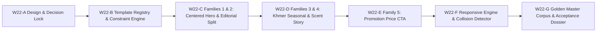

# W22-A — Template Family Technical Design & Decision Lock

**Document:** `/docs/implementation-evidence/W22-A-template-family-technical-design.md`
**Work Package:** W22 — Approved Template System
**Step:** W22-A — Baseline Verification, Template-Family Decision Lock, and Technical Design
**Status:** `DESIGN COMPLETE — PROPOSED DECISION LOCKED FOR OWNER APPROVAL`
**Target Branch:** `feat/w22-template-families`
**Date:** 2026-10-25
**Author:** Principal Typography & Creative Systems Engineer
**Governing Documents:**

- [`master-engineering-blueprint-v3.md`](../master-engineering-blueprint-v3.md) (§§11.1, 11.5, 22)
- [`implementation-plan-v1.md`](../implementation-plan-v1.md) (§W22)
- [`w03-business-decision-register.md`](../specifications/w03-business-decision-register.md) (`W03-DEC-006`)
- [`layered-creative-scene-schema.md`](../specifications/layered-creative-scene-schema.md)
- [`W20-versioned-layered-creative-scene-model.md`](./W20-versioned-layered-creative-scene-model.md)
- [`W21-deterministic-khmer-latin-typography.md`](./W21-deterministic-khmer-latin-typography.md)

---

## 1. Preflight Verification Record

Prior to undertaking design and audit analysis, environment state and repository baseline were strictly verified and recorded:

```bash
# 1. Active Branch
git branch --show-current
# Output: feat/w22-template-families

# 2. Base Commit Hash
git rev-parse HEAD
# Output: 3cc2f5ffd6d00ec1fb533209a154d0c06ce524fe

# 3. Cached / Staged Changes
git diff --cached --name-only
# Output: (empty — 0 files staged)

# 4. Short Working Tree Status
git status --short
# Output: (clean — 0 modified or untracked files)
```

### Preflight Confirmation

1. **W21 Merged & Accepted:** Confirmed. W21 Pull Request #2 merged into `main` at commit `3cc2f5f`.
2. **Branch Lineage:** Branch `feat/w22-template-families` originates directly from latest merged `main` (`3cc2f5f`).
3. **Clean Worktree:** 0 untracked files, 0 uncommitted modifications, 0 staged files.
4. **Target Branch Verified:** Exactly `feat/w22-template-families`.

---

## 2. Comprehensive Evidence-Backed Audit

An exhaustive code and architecture audit of the current poster and template subsystem was conducted across `poster-templates.ts`, `poster-spec.ts`, `poster-tokens.ts`, `layout-intent.ts`, and `sharp-poster-compositor.adapter.ts`.

### 2.1 Audit of Existing Four Template Implementations

| Template ID       | Visual Concept                                                                                                | Product Zone                                                                                   | Text Zone                                                                                                                  | Key Deficiencies Identified                                                                                                                                                                                                                          |
| ----------------- | ------------------------------------------------------------------------------------------------------------- | ---------------------------------------------------------------------------------------------- | -------------------------------------------------------------------------------------------------------------------------- | ---------------------------------------------------------------------------------------------------------------------------------------------------------------------------------------------------------------------------------------------------- |
| `EDITORIAL_SPLIT` | Asymmetric luxury split with product on left (44% width) and editorial typography panel on right.             | `x: margins.left`, `width: Math.round(width * 0.44)`, pedestal baseline at 74% height.         | Right panel starting at `panelX = Math.round(width * 0.5)`. Text content width `panelW - 48`.                              | Hardcoded linear gradient rect (`panelX - 40`). Magic vertical increments (`currentY += 34`, `currentY += 56`). Hardcoded price box (`260x48`) and CTA box (`180x48`). Vertical overflow risk if secondary headline wraps to 3 lines.                |
| `CENTERED_HERO`   | Symmetrical centered product hero on pedestal with top brand header and bottom secondary lockup.              | `heroW = Math.round(width * 0.58)`, `heroH = Math.round(height * 0.52)` centered horizontally. | Top eyebrow & headline starting at `margins.top`; bottom cluster anchored at magic offset `height - margins.bottom - 160`. | Hardcoded bottom offset `160px` causes severe text collisions when supporting copy is present or when aspect ratio changes from 4:5 to 9:16. Magic gradient heights (`32%`, `55%`). Symmetrical pedestal lacks format-specific vertical flexibility. |
| `SCENT_STORY`     | Olfactory notes hierarchy (Top, Heart, Base) alongside luxury fragrance hero.                                 | `heroWidth = Math.round(width * 0.42)`, `heroHeight = Math.round(height * 0.60)` on left.      | Right panel starting at `panelX = Math.round(width * 0.48)`. Scent note chips rendered in sequence.                        | Fixed chip dimensions (`140x28px`) overflow the panel if 5+ notes exist. Lacks multi-column layout or responsive stacking. Scent notes metadata is weakly typed in `PosterSpec`.                                                                     |
| `KHMER_SEASONAL`  | Cultural / festive campaign celebration (Pchum Ben, Khmer New Year, Water Festival) with ornate gold framing. | Centered hero on ceremonial gold pedestal.                                                     | Centered Khmer-prominent headline, ornamental lotus crest (`renderLotusOrnamentSvg`), and corner accents.                  | Hardcoded decorative framing scale (`scale = 1.2`) and fixed corner margin offset (`margins.left - 12`). In 9:16 aspect ratio, the vertical gap between headline and product stretches excessively without responsive flex-spacing.                  |

---

### 2.2 The Missing `PROMOTION_PRICE_CTA` Family

- **Mandate:** Explicitly specified in Master Engineering Blueprint v3.0 §11.1, Implementation Plan v1.0 §W22, and Business Decision `W03-DEC-006`.
- **Current Reality:**
  - Missing from `PosterTemplateId` union in `poster-spec.ts`.
  - Missing from `PosterSpecSchema` Zod validation in `poster-spec.ts`.
  - Missing from `PosterTemplateRenderer.renderTemplate` switch statement in `poster-templates.ts` (silently falls through to `renderEditorialSplit`).
  - Missing from `LayoutIntentSchema` in `layout-intent.ts`.
- **Commercial Risk:** Parisian Shopper retail sales, seasonal flash promotions, and special offers currently have no dedicated conversion layout. Fallback to `EDITORIAL_SPLIT` results in sub-optimal price prominence and compromised visual hierarchy.
- **Resolution:** Formally introduced as Canonical Family 5 with dual-currency strike-through pricing, promotional badges, and prominent CTA styling.

---

### 2.3 Hard-Coded Coordinates and Magic Constants Audit

The audit uncovered critical reliance on hardcoded pixel literals that undermine responsive multi-format composition:

1. **Hardcoded Box Sizes:**
   - `priceBox`: hardcoded to `{ width: 260, height: 48 }` in `EDITORIAL_SPLIT` and `{ width: 180, height: 36 }` in `CENTERED_HERO`.
   - `ctaBox`: hardcoded to `{ width: 180, height: 48 }` in `EDITORIAL_SPLIT` and `{ width: 200, height: 48 }` in `CENTERED_HERO`.
   - `scentChip`: hardcoded to `{ width: 140, height: 28 }`.
   - `campaignLabel`: hardcoded to `{ height: 24 }`.
2. **Hardcoded Vertical Steps:**
   - `currentY += 34`, `currentY += 56`, `currentY += 40` (unrelated to actual typography leading or measured ink bounds).
   - Bottom anchor heuristic: `bottomY = height - margins.bottom - 160`.
3. **Hardcoded Visual Shifts:**
   - Split panel gradient background: `x="${panelX - 40}"`.
   - Lotus crest center: `topY + 24`.
4. **Architectural Consequence:**
   - Hardcoded offsets fail when text auto-shrinks or wraps.
   - Fixed widths trigger false-positive `PosterCollisionError` or unsafe element clipping.
   - Prevents seamless adaptation between 1:1, 4:5, and 9:16.

---

### 2.4 Template Versions and Dependency Hashes Audit

1. **Manifest Version Stagnation:**
   - `PosterLayoutManifest.version` is hardcoded to `'poster-layout-v1'` across all four implementations.
   - No individual template family versioning exists (e.g., `EDITORIAL_SPLIT@1.0.0`).
2. **Cryptographic Binding Gap:**
   - In `CreativeSceneVersion` (W20), fields `templateId` and `templateVersion` exist, but there is no canonical `TemplateRegistry` hashing the template constraint definitions.
   - If template layout logic changes in code, historical scenes could render differently, violating the immutable scene reproducibility contract.
3. **Resolution:**
   - Introduce an immutable `TemplateRegistry` where each template definition has a semantic version (`semver`), a state lifecycle (`DRAFT`, `APPROVED`, `DEPRECATED`, `RETIRED`), and a cryptographic definition hash (`templateDefHash`).
   - Bind `TEMPLATE_DEF` into the W20 scene dependency graph (sort order 30).

---

### 2.5 Format Adaptation Audit (1:1 vs 4:5 vs 9:16)

The current system supports three canonical dimensions:

- **1:1 (Square Feed):** 1080 × 1080 px
- **4:5 (Portrait Feed):** 1080 × 1350 px
- **9:16 (Vertical Story):** 1080 × 1920 px

**Audit Finding:** Current templates merely stretch canvas height and call `calculateSafeMargins(width, height)`. They do not re-proportion zones:

- In 9:16, the product hero becomes disproportionately small or floats in excessive empty space.
- In 1:1, vertical space for secondary headlines and scent chips is severely compressed.
- **Resolution:** W22 must implement explicit format-specific zone ratios, font scale steps, and flex-distribution rules per aspect ratio.

---

### 2.6 Optional Copy and Long-Copy Behavior Audit

1. **Optional Field Skipping:**
   - When optional fields (`campaignLabel`, `secondaryHeadline`, `supportingText`, `promotionalPrice`, `size`, `concentration`) are omitted, `currentY` skips forward without re-distributing vertical space.
   - Result: Unsightly voids or bottom-heavy layouts.
2. **Long-Copy Behavior:**
   - `TextLayoutEngine.wrapText` auto-shrinks down to `minFontSize`. However, when max lines are exceeded, it throws `PosterLayoutOverflowError`.
   - Current templates pass arbitrary `minFontSize` values (e.g. 28px in headline, 16px in secondary headline) without holistic layout budget coordination.

---

### 2.7 Logo-Safe Regions and Product Geometry Audit

1. **Logo Region Collision:**
   - In `SharpPosterCompositor`, the brand logo is hardcoded to composite at `left: safeMargins.left, top: safeMargins.top` (top-left).
   - In `EDITORIAL_SPLIT` and `KHMER_SEASONAL`, this directly collides with corner ornaments, campaign labels, or background gradients.
2. **Product Aspect Ratio Mismatches:**
   - Slender vertical perfume bottles (aspect ratio 1:3) vs wide cosmetic jars (aspect ratio 4:3) are treated identically by raw `heroWidth` allocation, resulting in vertical pedestaling errors.
3. **Resolution:**
   - Introduce an explicit `logoZone` per template family with clearance rules (`POSTER_DESIGN_TOKENS.logoClearSpace: 24`).
   - Calculate product placement using bounding box containment and optical center grounding.

---

### 2.8 Preservation of W20 and W21 Contracts

W22 is an application domain layout layer that builds directly on W20 and W21. It strictly preserves:

1. **W20 Contracts:**
   - 5 Layer Groups: `BACKGROUND` (0–99), `SURFACE_SHADOW` (100–199), `PRODUCT_HERO` (200–299), `TYPOGRAPHY` (300–399), `BRAND_DECORATION` (400–499).
   - Authoritative scene evidence verification and unbroken entity chains.
   - Immutable PostgreSQL triggers and transactional outbox events.
2. **W21 Contracts:**
   - WebAssembly HarfBuzz OpenType shaping with zero `.notdef` missing glyphs.
   - Grapheme-cluster-aware bilingual script partitioning (`Intl.Segmenter`).
   - Khmer line breaking with Lek Took repetition merging and orphan punctuation guards.
   - Atomic non-breaking currency prices and SKUs.
   - Direct HarfBuzz vector glyph outline rendering (`SafeSvgRenderer`).
   - True aggregate per-glyph ink bounding boxes (`TextLayoutEngine.wrapText`).
   - Hermetic local OFL font assets (`Playfair Display`, `Montserrat`, `Noto Sans Khmer`).

---

## 3. Template-Family Decision Lock (W03-DEC-006)

In accordance with project guidelines, **`W03-DEC-006` remains PROPOSED** until explicit project owner sign-off. The formal decision brief is submitted below.

### Formal Proposal: W03-DEC-006 Option A

- **Decision Title:** Formal Selection and Geometry Architecture for the Five Canonical Template Families.
- **Selected Architecture (Option A):**
  1. `CENTERED_HERO` — Centered Luxury Product Hero
  2. `EDITORIAL_SPLIT` — Editorial Split Layout
  3. `KHMER_SEASONAL` — Khmer Cultural & Festive Campaign
  4. `SCENT_STORY` — Scent Pyramid & Olfactory Education
  5. `PROMOTION_PRICE_CTA` — Promotional Price, Discount & Conversion CTA
     _(Haussmann architectural styling is formalized as an optional visual treatment preset applicable across all families)_.
- **Trade-off Evaluation:** Option A preserves all five commercial marketing use-cases while maintaining clean separation between layout geometry (templates) and artistic aesthetic treatments (presets).

---

## 4. Technical Design Specifications

### 4.1 Canonical Family Profiles & Zone Taxonomy

```mermaid
flowchart TD
    subgraph F1["1. CENTERED_HERO"]
        F1_Top["Top Brand Header (Logo / Eyebrow / Headline)"]
        F1_Mid["Symmetrical Centered Product Hero + Pedestal"]
        F1_Bot["Bottom Lockup (Supporting Copy / Price / CTA)"]
        F1_Top --> F1_Mid --> F1_Bot
    end

    subgraph F2["2. EDITORIAL_SPLIT"]
        F2_Left["Left Hero Zone (44% Width, Authentic Product Cutout)"]
        F2_Right["Right Editorial Panel (Contrast Tint, Structured Typography)"]
    end

    subgraph F3["3. KHMER_SEASONAL"]
        F3_Decor["Traditional Gold Lotus Crest & Ceremonial Framing"]
        F3_Head["Prominent Dual-Line Khmer Headline (Noto Sans Khmer 700)"]
        F3_Hero["Centered Product on Ceremonial Surface"]
        F3_CTA["Cultural Action Lockup & Khmer Currency (៛)"]
        F3_Decor --> F3_Head --> F3_Hero --> F3_CTA
    end

    subgraph F4["4. SCENT_STORY"]
        F4_Left["Fragrance Hero Flacon on Travertine Slab"]
        F4_Right["Olfactory Pyramid: Top, Heart, Base Notes & Ingredient Tags"]
    end

    subgraph F5["5. PROMOTION_PRICE_CTA"]
        F5_Badge["Promotional Eyebrow / Discount Badge (-20%, Special Edition)"]
        F5_Hero["Product Hero with Dynamic Attention Vignette"]
        F5_Price["Dual Price Lockup (Strike-through Original vs Promo Price)"]
        F5_CTA["High-Visibility Optical CTA Button"]
        F5_Badge --> F5_Hero --> F5_Price --> F5_CTA
    end
```



---

### 4.2 Content Slot Schema Matrix

| Slot Identifier     | Type       | Required / Optional  | Maximum Length / Bounds         | Roles / Fallback Behavior                               |
| ------------------- | ---------- | -------------------- | ------------------------------- | ------------------------------------------------------- |
| `brandLogo`         | Image Ref  | Optional             | Max 160×48 px; 24px clear space | Safe margin anchor; hidden if unprovided.               |
| `campaignEyebrow`   | Text       | Optional             | 24 chars                        | `LABEL` role; uppercase, tracking 2.0px.                |
| `headline`          | Text       | **Required**         | 45 chars                        | `HEADLINE` role; auto-shrinking within bounds.          |
| `secondaryHeadline` | Text       | Optional             | 55 chars                        | `SECONDARY_HEADLINE` role; Khmer/Bilingual balance.     |
| `supportingText`    | Text       | Optional             | 90 chars                        | `SUPPORTING` role; clamped to max 3 lines.              |
| `primaryPrice`      | Currency   | **Required**         | 20 chars                        | `PRICE` role; non-breaking atomic token.                |
| `promotionalPrice`  | Currency   | Optional (Req in F5) | 20 chars                        | Highlighted accent lockup with strike-through original. |
| `productSpecs`      | Text       | Optional             | 40 chars                        | Size & Concentration chip (`100ml · Eau de Parfum`).    |
| `callToAction`      | Text       | **Required**         | 28 chars                        | Optically centered CTA pill button.                     |
| `scentNotes`        | Structured | Optional (Req in F4) | 3–6 items                       | Top / Heart / Base olfactory chips.                     |
| `decorativeFrame`   | Preset ID  | Optional             | Frame Token                     | Corner accents, Haussmann border, or Lotus motif.       |

---

### 4.3 Multi-Format Responsive Adaptation Rules

Templates must produce mathematically balanced layouts across all three approved formats:

```mermaid
xychart-beta
    title "Vertical Budget Allocation across Aspect Ratios"
    x-axis ["1:1 Square (1080x1080)", "4:5 Portrait (1080x1350)", "9:16 Story (1080x1920)"]
    y-axis "Percentage of Canvas Height" 0 --> 100
    bar [18, 14, 11]
    bar [48, 52, 54]
    bar [22, 22, 23]
    bar [12, 12, 12]
```



_(Legend: Top Header, Product Hero Zone, Typography/Price Zone, Safe Margins/Breathing Room)_

1. **1:1 Square (1080 × 1080):** Compact vertical hierarchy. Font size scale scales down by 10% from standard to ensure headline and product do not collide. Scent chips format as 2-column grid.
2. **4:5 Portrait (1080 × 1350) [Reference Canvas]:** Baseline proportion. Scent chips format as 3 vertical tiers. Balanced optical grounding.
3. **9:16 Vertical Story (1080 × 1920):** Extended vertical breathing space. Increased negative space above and below product hero. Expanded safe margins (top 140px, bottom 180px) to prevent Telegram / Instagram UI story occlusion.

---

### 4.4 Design Token Hierarchy & Safe Margin Contract

```ts
export interface TemplateSafeMarginTokens {
  readonly standard: {
    readonly topPercent: 0.07;
    readonly bottomPercent: 0.08;
    readonly horizPercent: 0.06;
  };
  readonly story9x16: {
    readonly topPercent: 0.09;
    readonly bottomPercent: 0.11;
    readonly horizPercent: 0.07;
  };
}
```

- **Z-Index Layer Invariant:**
  - `BACKGROUND`: 0–99
  - `SURFACE_SHADOW`: 100–199
  - `PRODUCT_HERO`: 200–299
  - `TYPOGRAPHY`: 300–399
  - `BRAND_DECORATION`: 400–499
- **Collision Invariant:** Bounding boxes of text elements (`type: 'TEXT'`), CTA button (`type: 'BUTTON'`), and product hero (`type: 'PRODUCT'`) must have zero mathematical intersection (`boxesIntersect === false`), with a mandatory minimum 12px breathing buffer.

---

### 4.5 Template Version Lifecycle Model

To guarantee 100% historical reproducibility for W20 scene graphs:

1. **State Machine:**
   $$\text{DRAFT} \longrightarrow \text{APPROVED} \longrightarrow \text{DEPRECATED} \longrightarrow \text{RETIRED}$$
2. **Lifecycle Policies:**
   - **`DRAFT`:** Template under development; cannot be used in production creative scene generation.
   - **`APPROVED`:** Formally reviewed and signed off by Brand Owner; active for scene creation.
   - **`DEPRECATED`:** Existing scenes remain valid and reproducible; new scene creation prohibited.
   - **`RETIRED`:** Archived; supported strictly for read-only historical re-rendering.
3. **Immutable Specification Hash:**
   $$\text{templateDefHash} = \text{sha256}(\text{canonicalJson}(\text{TemplateDefinition}))$$
   Stored in `layer_dependencies` with sort order 30, cryptographically bound into `sceneHash`.

---

## 5. Failure and Error Handling Strategy

1. **Text Layout Overflow:** When copy exceeds slot bounds at minimum font size, throw typed `PosterLayoutOverflowError` with exact slot name and constraint details.
2. **Zone Collision:** When product hero and typography overlap, throw `PosterCollisionError` with element IDs and bounding box intersection geometry.
3. **Missing Required Slot:** If required slot (`headline`, `primaryPrice`, `cta`) is empty, fail fast with typed `PosterMissingSlotError`.
4. **Unsupported Aspect Ratio:** If aspect ratio outside `1:1`, `4:5`, `9:16` is requested, throw `PosterUnsupportedAspectRatioError`.
5. **Zero Silent Fallback:** No unapproved fallback layouts or synthetic text shrinking below `minFontSize`.

---

## 6. Implementation Sequence (W22-B through W22-G)



- **W22-B:** Implement `TemplateRegistry`, semantic versioning, and constraint validation engine.
- **W22-C:** Implement `CENTERED_HERO` (v1.0.0) and `EDITORIAL_SPLIT` (v1.0.0) across 1:1, 4:5, 9:16 with zero magic constants.
- **W22-D:** Implement `KHMER_SEASONAL` (v1.0.0) and `SCENT_STORY` (v1.0.0) across 1:1, 4:5, 9:16 with Khmer cultural motifs and olfactory tiers.
- **W22-E:** Implement `PROMOTION_PRICE_CTA` (v1.0.0) with strike-through dual-currency price lockups across 1:1, 4:5, 9:16.
- **W22-F:** Implement format-specific flex distribution, collision detection, and W20/W21 scene graph integration.
- **W22-G:** 30-vector template golden master test suite, multi-format pixel verification, and final owner acceptance dossier.

---

## 7. Status & Sign-off

**Classification:** `DESIGN COMPLETE — PROPOSED DECISION LOCKED FOR OWNER APPROVAL`

Work package step **W22-A** is complete. All preflight checks, code audits, architectural specifications, and lifecycle models are established. No application code or templates have been modified prior to owner sign-off.
