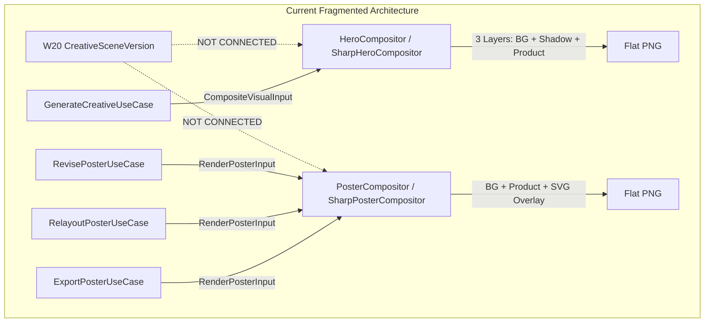
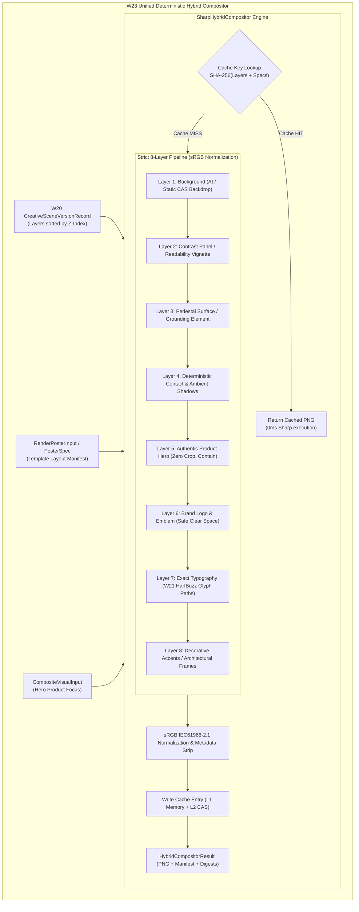

# W23-A — Deterministic Hybrid Compositor Technical Design Dossier

- **Document:** `/docs/implementation-evidence/W23-A-hybrid-compositor-technical-design.md`
- **Work Package:** W23 — Complete the Deterministic Hybrid Compositor
- **Phase:** Stage 2 — Creative Engine & Poster Studio
- **Classification:** `TECHNICAL DESIGN DOSSIER — READY FOR IMPLEMENTATION`
- **Authority:** Master Engineering Blueprint v3.0 §9, §10, §11, §22; Implementation Plan v1.0 W23; Approved Decision W03-DEC-006 Option A
- **Repository Branch:** `feat/w23-hybrid-compositor`
- **Base Commit:** `b7a37c0eb023a81422b2f57c27f61593080e081d`
- **Author:** Principal Typography & Creative Systems Engineer
- **Date:** 2026-10-26

---

## 1. Executive Summary & Problem Statement

### 1.1 Context
Following the completion and owner acceptance of **W20 (Layered CreativeScene Model)**, **W21 (Deterministic Khmer/Latin Typography Engine)**, and **W22 (Five Approved Canonical Template Families)**, the Parisian Shopper AI poster generation architecture has established:
1. An immutable, versioned, cryptographic scene graph (`CreativeSceneVersion`).
2. A 100% vector HarfBuzz glyph path shaping pipeline (`renderShapedTextLineSvg({ mode: 'GLYPH_PATHS' })`) with zero raw SVG `<text>` tags.
3. Five approved canonical template families (`CENTERED_HERO`, `EDITORIAL_SPLIT`, `KHMER_SEASONAL`, `SCENT_STORY`, `PROMOTION_PRICE_CTA`) operating on mathematically governed responsive tokens across `1:1`, `4:5`, and `9:16` aspect ratios.

### 1.2 Material Architectural Gap
Despite these achievements, raster compositing in the creative module remains fragmented across two legacy, parallel subsystems:
- **`HeroCompositor` (`SharpHeroCompositor`):** A 3-layer compositor (Background + Contact Shadow + Product Cutout) driven by `CompositeVisualInput`. It implements product trimming and Lanczos3 resizing, but has no knowledge of typography, brand logos, decorative frames, or scene graphs. Used solely by `GenerateCreativeUseCase`.
- **`PosterCompositor` (`SharpPosterCompositor`):** A flat poster renderer driven by `PosterSpec` and `ComputedTemplateLayout`. It composites background, product, and an SVG overlay string, but executes without connection to W20 `CreativeSceneVersion` layer records, lacks content-addressable caching, and re-executes expensive Sharp pipelines even for repeat renders.

Neither compositor is capable of rendering a W20 `CreativeSceneVersion` directly from its constituent layer records. Furthermore, compositing operations do not persist render-engine versions or color profile metadata, and lack content-addressable caching for bit-exact repeat reproducibility.

### 1.3 Work Package W23 Objective
Work package **W23** reconciles these parallel compositors into a single, unified, production-grade engine: **`DeterministicHybridCompositor` (`SharpHybridCompositor`)**.

Core mandates:
1. **Unified Architecture Without Code Deletion:** Reconcile `HeroCompositor` and `PosterCompositor` through backward-compatible adapters delegating to the unified hybrid compositor.
2. **Strict 8-Layer Pipeline in Z-Order:** Composite backgrounds, contrast panels, pedestals, shadows, authentic product pixels, logos, typography glyph paths, and decorative accents in strict Z-index sequence.
3. **Product Pixel Integrity Invariant:** Visual truth resides in the verified product asset. Zero product hallucination, zero cropping, zero color grading/distortion, and guaranteed containment within canvas safe margins.
4. **Content-Addressable Render Cache:** Compute deterministic SHA-256 cache keys over all layer inputs. Cache hits return bit-exact composited PNG buffers without re-invoking Sharp.
5. **Color Management:** Enforce standard sRGB IEC61966-2.1 color profiles across all input buffers, stripping volatile metadata to achieve bit-exact repeat reproducibility.
6. **Layer-Level Failure Isolation:** Isolate failures at specific layers (e.g. CAS asset miss) with typed diagnostics, preserving scene graph state for targeted retry.

---

## 2. Architectural Audit of Existing Compositors



### 2.1 Detailed Audit Comparison

| Feature / Attribute | `HeroCompositor` (`SharpHeroCompositor`) | `PosterCompositor` (`SharpPosterCompositor`) | Target `DeterministicHybridCompositor` |
|---|---|---|---|
| **Port Interface** | `HeroCompositor` (`hero-compositor.port.ts`) | `PosterCompositor` (`poster-compositor.port.ts`) | `DeterministicHybridCompositor` (`hybrid-compositor.port.ts`) |
| **Primary Input** | `CompositeVisualInput` | `RenderPosterInput` (`PosterSpec`) | `HybridCompositorInput` OR `CreativeSceneVersionRecord` |
| **Layer Capacity** | 3 layers (BG, Shadow, Hero) | 4 layers (BG, Product, Logo, SVG) | Strict 8 layers in Z-order |
| **Scene Graph Binding** | None | None | Direct binding to `CreativeSceneVersionRecord.layers` |
| **Typography Support** | None | SVG Overlay (raw string) | Exact W21 HarfBuzz vector glyph paths |
| **Content Caching** | None | None | Content-Addressable Render Cache (L1 Memory + L2 CAS) |
| **Color Management** | Implicit Sharp default | Implicit Sharp default | Explicit sRGB IEC61966-2.1 normalization |
| **Output Metadata** | Basic digests | Basic digests | Engine version, color profile, layer execution manifest, hashes |
| **Failure Recovery** | Monolithic fail | Monolithic fail | Layer-level failure isolation with retry resumption |

---

## 3. Unified Hybrid Compositor Architecture



### 3.1 Strict 8-Layer Pipeline Specification

All compositing proceeds strictly along the vertical Z-index hierarchy:

```
Z-Index Range   Layer Name               Functional Responsibility
000 – 049       Layer 1: Background       Ambient scene, AI-generated photo or static luxury CAS texture
050 – 099       Layer 2: Contrast Panel   Readability gradient or translucent panel surface for copy tiers
100 – 149       Layer 3: Pedestal         Mineral surface, marble ledge, or grounding pedestal
150 – 199       Layer 4: Shadows          Synthesized contact shadow (tight) + ambient drop shadow (soft)
200 – 299       Layer 5: Product Hero     Authentic verified product packaging cutout (object-fit: contain)
300 – 349       Layer 6: Brand Logo       Vector crest or high-res raster logo within clear-space bounds
350 – 449       Layer 7: Typography       100% W21 HarfBuzz shaped glyph paths, price lockups, CTA button
450 – 499       Layer 8: Frame / Decor    Botanical ornaments, lotus accents, or Haussmann architectural frame
```

#### Layer 1: Background (`BACKGROUND`)
- **Sources:** Generated AI backgrounds (`GENERATED_BACKGROUND`) via Imagen-3/SDXL/Higgsfield or pre-approved static luxury CAS backdrops (`STATIC_CAS_BACKGROUND`).
- **Processing:** Resized with Lanczos3 to canvas dimensions (`1080×1080`, `1080×1350`, `1080×1920`). Applied via `cover` or exact aspect geometry.

#### Layer 2: Readability Contrast Panel (`SURFACE_SHADOW` / `PANEL`)
- **Sources:** Derived from template design tokens (`colorRoles.panelSurface`, gradient stops).
- **Processing:** Renders subtle bottom-fade, radial vignette, or vertical editorial split panel. Guarantees WCAG AA copy contrast without muddying the background artwork.

#### Layer 3: Pedestal Surface (`SURFACE_SHADOW` / `PEDESTAL_SURFACE`)
- **Sources:** Template token `productScale.pedestalBaselinePercent` (typically 66%–74% of canvas height).
- **Processing:** Visual anchor establishing physical depth for luxury fragrance flacons and cosmetic jars.

#### Layer 4: Contact & Ambient Shadows (`SURFACE_SHADOW` / `CONTACT_SHADOW`)
- **Sources:** Mathematically generated from trimmed product silhouette.
- **Processing:**
  - *Contact Shadow:* Opacity 0.30–0.35, blur radius 4px, spread multiplier 1.05, vertical offset 0px.
  - *Ambient Shadow:* Opacity 0.12–0.20, blur radius 12–24px, vertical offset 6px.
  - Invariant: Shadows are synthesized below the product base; product pixels are never darkened or altered.

#### Layer 5: Authentic Product Hero (`PRODUCT_HERO`)
- **Sources:** Verified product asset from CAS (W12 rights-cleared, approved, transparent PNG/WebP).
- **Processing:**
  - Silhouette measured via `.trim()` to obtain true product ink boundaries.
  - Scaled proportionally with Lanczos3 filter using strict `object-fit: contain`. Never stretched.
  - Positioned deterministically with bottom edge aligned to pedestal baseline.
  - Horizontal placement governed by template tokens (`LEFT`, `CENTER`, `RIGHT`).
  - **Zero-Crop Invariant:** The composited product dimensions and alpha mask must match the trimmed source aspect ratio within sub-pixel rounding tolerance ($< 0.5\text{px}$).

#### Layer 6: Brand Logo (`BRAND_DECORATION` / `BRAND_MARK`)
- **Sources:** Registered vector SVG emblem or CAS raster asset.
- **Processing:** Contained within `logoConstraints` (e.g. max width 160px, max height 48px, clear space 24px). Positioned at `TOP_CENTER` or `TOP_LEFT`.

#### Layer 7: Exact Typography & Commercial Badges (`TYPOGRAPHY`)
- **Sources:** 100% vector SVG generated by W21 `TextLayoutEngine` + HarfBuzz shaping service + W22 template generators.
- **Processing:**
  - All text rendered as `<path d="..." fill="...">` glyph outlines.
  - Strikethrough pricing rendered as `<rect>` or `<line>` vector geometry.
  - CTA button rendered with governed corner radii and contrast padding.
  - **Zero Raw Text Invariant:** Zero `<text>` or `<tspan>` tags.

#### Layer 8: Decorative Accents & Architectural Frames (`BRAND_DECORATION` / `FRAME`)
- **Sources:** Governed cultural motifs (Khmer lotus ornament, seasonal corner accents) or Haussmann architectural frame.
- **Processing:** Blended at highest Z-index (450–499). Must never occlude the product silhouette or CTA button.

---

## 4. Product Pixel Integrity & Color Management Policy

### 4.1 Product Pixel Integrity Mandates
1. **Visual Truth:** The canonical product image from the verified product snapshot represents physical truth. The compositor must never alter product packaging, label typography, bottle coloration, or glass transparency.
2. **Prohibited Transformations:**
   - No AI inpainting, outpainting, or generative modification of the product.
   - No color grading, hue shifts, saturation boosts, contrast adjustments, or sharpen filters applied to product pixels.
   - No cropping of non-transparent product pixels.
3. **Allowed Transformations:**
   - Alpha-preserving Lanczos3 proportional downscaling / upscaling.
   - External contact shadow synthesis placed behind the product layer in Z-order.
   - Deterministic sub-pixel translation for grid and pedestal alignment.

### 4.2 Color Management Policy
- **Color Space:** Standard **sRGB IEC61966-2.1**.
- **Normalization Invariant:**
  - All input image buffers (backgrounds, product cutouts, logos) are converted to sRGB during decode:
    ```typescript
    sharp(buffer).toColorspace('srgb');
    ```
  - Blending operations occur in linear or sRGB color space to prevent color shifts or alpha fringe artifacts.
  - Final output is emitted as 8-bit sRGB PNG with standard chromaticity chunks (`cHRM`, `gAMA`, `sRGB`).
  - Volatile metadata (EXIF timestamps, GPS coordinates, camera maker notes) is stripped completely to ensure bit-exact output determinism across platforms.

---

## 5. Content-Addressable Render Cache Specification

### 5.1 Deterministic Cache Key Formula

The cache key uniquely identifies every factor influencing the rendered raster output:

$$\text{CacheKey} = \text{SHA-256}\left(\text{canonicalStringify}\left(\{ \text{engineVersion}, \text{canvas}, \text{colorProfile}, \text{layers}, \text{templateVersion} \}\right)\right)$$

Where `layers` is the canonical array of:
```typescript
interface CachedLayerDigest {
  readonly zIndex: number;
  readonly layerGroup: string;
  readonly layerType: string;
  readonly contentDigest: string; // SHA-256 of asset bytes or SVG string
  readonly bounds: BoundingBox;
  readonly opacity: number;
  readonly blendMode: string;
}
```

### 5.2 Two-Tier Cache Architecture

```
Layer Input -> [Compute CacheKey]
                     |
                     v
             [L1 Memory Cache] ---> (HIT: < 2ms) ---> Return Buffer
                     |
                   (MISS)
                     v
             [L2 CAS Storage] ----> (HIT: < 15ms) --> Populate L1 & Return
                     |
                   (MISS)
                     v
        [Execute Sharp Pipeline] -> Write to L1 & L2 -> Return Buffer
```

1. **L1 Memory Cache:**
   - In-memory LRU cache bounded to 128 MB or 50 composite entries.
   - Eliminates redundant Sharp invocations during repeated UI queries, preview renders, or export requests.
2. **L2 Content-Addressable Storage (CAS):**
   - Persistent cache stored in object storage / disk via `AssetStorage` port.
   - Storage key: `renders/{cacheKey}.png`.
   - Immune to server restarts and container recycling.

---

## 6. Backward Compatibility & Reconciliation Strategy

To avoid deleting or breaking useful existing code, W23 implements a non-destructive adapter reconciliation:

```
[GenerateCreativeUseCase] ----> [HeroCompositor Port]
                                       |
                                       v
                         [SharpHeroCompositorAdapter]
                                       | (maps to 3-layer input)
                                       v
========================================================================
                 [DeterministicHybridCompositor Engine]
========================================================================
                                       ^
                                       | (maps to 8-layer input)
                         [SharpPosterCompositorAdapter]
                                       ^
                                       |
[Export / Relayout / Revise] -> [PosterCompositor Port]
```

1. **`DeterministicHybridCompositor`** becomes the single authoritative implementation engine.
2. **`SharpHeroCompositorAdapter`** implements `HeroCompositor` by mapping `CompositeVisualInput` into a 3-layer hybrid compositor call (Background + Shadow + Product Hero).
3. **`SharpPosterCompositorAdapter`** implements `PosterCompositor` by mapping `RenderPosterInput` into an 8-layer hybrid compositor call.
4. Existing unit tests in `sharp-hero-compositor.spec.ts` and `sharp-poster-compositor.spec.ts` will continue to pass without modification.
5. New scene-aware use cases can directly call `renderSceneVersion(sceneVersion, assetResolver)`.

---

## 7. Typed Error Hierarchy

```
CreativeError
 ├── CompositorError
 │    ├── CompositorLayerMissingAssetError (missing CAS buffer for layer)
 │    ├── CompositorCorruptedLayerAssetError (SHA-256 digest mismatch)
 │    ├── CompositorUnsupportedCanvasGeometryError (invalid aspect ratio or size)
 │    ├── CompositorColorProfileError (color space normalization failure)
 │    ├── CompositorTimeoutError (Sharp pipeline execution exceeded timeout)
 │    └── ProductHeroContainmentError (product exceeds safe margins or occludes CTA)
```

---

## 8. W23 Sub-Phase Roadmap

| Phase | Scope | Deliverables | Key Acceptance Evidence |
|---|---|---|---|
| **W23-A** | Technical design & baseline preflight | Design dossier, roadmap update, baseline gates | Clean preflight, 90/90 test suites passing |
| **W23-B** | Unified domain port & render cache | `hybrid-compositor.port.ts`, `compositor-render-cache.ts`, unit tests | Deterministic cache hit/miss tests passing |
| **W23-C** | 8-layer Sharp compositing pipeline | `sharp-hybrid-compositor.adapter.ts`, shadow engine, sRGB normalization | Zero-crop product verification, layer blending tests |
| **W23-D** | W20 scene model integration | `renderSceneVersion()`, legacy adapter reconciliation, failure recovery | Backward compatibility verified; W20 scene tests |
| **W23-E** | Multi-format golden matrix & determinism | 50 golden composites across 1:1, 4:5, 9:16; review script | Bit-exact repeat-render determinism ($SHA_1 === SHA_2$) |
| **W23-F** | Observability, final evidence & gates | Prometheus metrics, W23 evidence report, clean gates | All repository quality gates clean, ready for PR |

---

## 9. Baseline Preflight Verification Record

Executed on branch `feat/w23-hybrid-compositor` (commit `b7a37c0eb023a81422b2f57c27f61593080e081d`):

```bash
# 1. Module Boundaries
pnpm -C app --config.pm-on-fail=ignore boundaries
# Result: Module boundaries valid. (Exit 0)

# 2. TypeScript Compilation
pnpm -C app --config.pm-on-fail=ignore typecheck
# Result: tsc -b --pretty false (Exit 0)

# 3. Code Quality & Linting
pnpm -C app --config.pm-on-fail=ignore lint
# Result: ESLint 0 warnings, 0 errors. (Exit 0)

# 4. Complete Unit Test Suite
pnpm -C app --config.pm-on-fail=ignore test:unit
# Result: 90 passed suites, 1,161 passed tests, 1 skipped. (Exit 0)

# 5. Code Formatting Check
pnpm -C app --config.pm-on-fail=ignore format:check
# Result: All matched files use Prettier code style! (Exit 0)

# 6. Git Diff Whitespace Audit
git diff --check
# Result: Clean, 0 whitespace errors. (Exit 0)

# 7. Git Staging Area Cleanliness
git diff --cached --name-only
# Result: Clean, 0 staged files. (Exit 0)
```

---

## 10. Explicit W24 Boundary Notice

Work package **W23** implements the deterministic rendering pipeline, layer compositing, product pixel preservation, and render caching.

The following capabilities are strictly scoped to **W24** and must not be implemented in W23:
- Automated hard visual gates (contrast checker, safe margin scanner, factual agreement verifier).
- Soft aesthetic scoring (hierarchy, balance, spacing, brand fit).
- Adversarial gate test fixtures.
