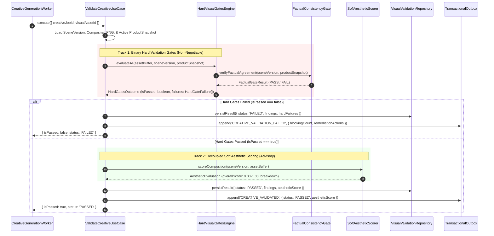
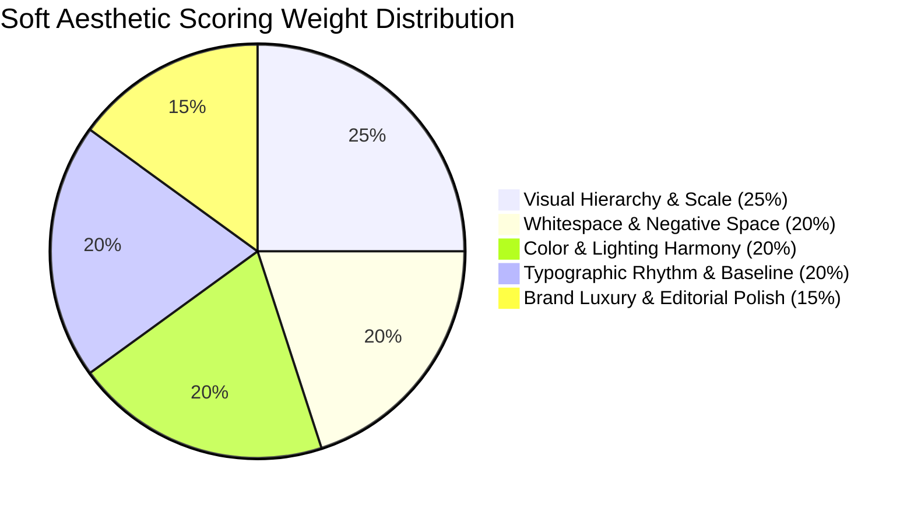
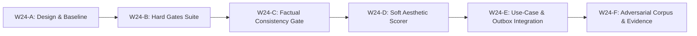

# W24-A — Hard Visual Gates & Decoupled Aesthetic Scoring Technical Design Dossier

- **Document:** `/docs/implementation-evidence/W24-A-visual-gates-technical-design.md`
- **Work Package:** W24 — Add Hard Visual Gates and Separate Aesthetic Scoring
- **Phase:** Stage 2 — Creative Engine & Poster Studio
- **Classification:** `TECHNICAL DESIGN DOSSIER — READY FOR IMPLEMENTATION`
- **Authority:** Master Engineering Blueprint v3.0 §8.1, §11, §26; Implementation Plan v1.0 W24; Approved Decisions W03-DEC-005, W03-DEC-006
- **Repository Branch:** `feat/w24-visual-gates`
- **Base Commit:** `c14dc9613128e9c14c2fb20de45c100e53bec62b`
- **Author:** Principal Quality & Creative Systems Engineer
- **Date:** 2026-10-27

---

## 1. Executive Summary & Problem Statement

Work package **W24 — Add Hard Visual Gates and Separate Aesthetic Scoring** establishes the definitive, dual-track automated quality control boundary for all creative assets generated by the Parisian Shopper AI poster studio.

### 1.1 The Critical Problem
Prior to W24, automated creative validation was fragmented across disparate domain services:
1. `DeterministicVisualValidator` performed basic container checks (dimensions, format, bounding box margins), but did not inspect actual raster pixels for product clipping, did not verify color space normalization, and had no awareness of typography readability.
2. `ProductAssetValidator` verified raw cutout assets on ingestion, but was never invoked on composited posters, leaving a vulnerability where placeholder or unapproved assets could be rendered without detection.
3. `DeterministicFactualValidator` verified text copy against product snapshots in the copy generation pipeline, but was never connected to the creative rendering pipeline, allowing AI-hallucinated prices or unauthorized promotions on posters to bypass visual validation.
4. Soft aesthetic criteria (contrast variance, background edge densities) in `BackgroundQualityValidator` risked either blocking technically valid creatives with false-positive warnings or, conversely, being conflated with binary safety checks.

### 1.2 Core Architectural Principle: Binary Gates vs. Calibrated Scoring
Per Master Engineering Blueprint v3.0 §8.1 and Layered Creative Scene Schema RFC §2:
> **"Aesthetic Scores Never Override Hard Gates."**  
> Hard validation gates produce deterministic, binary `PASS` or `FAIL` outcomes based on absolute mathematical and brand invariants. If any hard gate fails, publication and review dispatch are strictly blocked. Soft aesthetic scores produce normalized continuous values ($0.00$ to $1.00$) reflecting visual craft, optical harmony, and reviewer preference; they are used exclusively for ranking candidates and providing human reviewer guidance.

---

## 2. Architectural Audit of Existing Validation Logic

A comprehensive audit was conducted across existing validation code in `app/packages/application/src/modules/creative`:

```mermaid
flowchart TD
    subgraph CurrentState["Current Fragmented State"]
        VUC[ValidateCreativeUseCase] --> DVV[DeterministicVisualValidator<br/>(File & basic container only)]
        VUC --> VSS[VisualSafetyScanner<br/>(Regex prompt check)]
        
        BQV[BackgroundQualityValidator<br/>(Edge densities & luminance)] -.->|Orphaned| VUC
        PAV[ProductAssetValidator<br/>(Ingestion only)] -.->|Orphaned| VUC
        DFV[DeterministicFactualValidator<br/>(Text copy only)] -.->|Orphaned| VUC
    end

    subgraph TargetW24State["Target W24 Dual-Track Architecture"]
        SceneVersion[CreativeSceneVersionRecord & Composited PNG] --> W24Coordinator[VisualValidationCoordinator]
        
        W24Coordinator --> Track1[Track 1: Binary Hard Visual Gates]
        Track1 --> H1[CAS & Container Integrity]
        Track1 --> H2[Product Sanctity & Zero-Crop]
        Track1 --> H3[Geometric & Margin Containment]
        Track1 --> H4[Typographic & Glyph Coverage]
        Track1 --> H5[WCAG Readability Contrast]
        Track1 --> H6[ProductSnapshot Factual Agreement]
        Track1 --> H7[Prohibited Placeholder & Safety]
        
        W24Coordinator --> Track2[Track 2: Decoupled Soft Aesthetic Scorer]
        Track2 --> S1[Visual Hierarchy & Scale (25%)]
        Track2 --> S2[Whitespace & Balance (20%)]
        Track2 --> S3[Color & Contrast Harmony (20%)]
        Track2 --> S4[Typographic Rhythm (20%)]
        Track2 --> S5[Brand Luxury Fit (15%)]
        
        Track1 -->|ANY Gate Fails| ResultFail[Status: FAILED<br/>Review Blocked + Remediation Action]
        Track1 -->|ALL Gates Pass| GatePass[Hard Gates Passed]
        GatePass --> ResultPass[Status: PASSED / READY_FOR_REVIEW<br/>Advisory Aesthetic Score Attached]
        Track2 -.-> ResultPass
    end
```

### 2.1 Audit Findings & Identified Gaps

| Audit Component | Existing Implementation | Critical Gaps Identified | Severity |
|---|---|---|---|
| **Deterministic Visual Validator** | `deterministic-visual-validator.ts` | 1. Only checks metadata bounding boxes; does not inspect raster alpha to detect actual product clipping or mask truncation.<br/>2. Does not verify text layer bounds against canvas boundaries.<br/>3. Does not assert sRGB color profile. | **HIGH** |
| **Background Quality Validator** | `background-quality-validator.ts` | 1. Completely orphaned from `ValidateCreativeUseCase`.<br/>2. Conflates heuristic quality metrics (e.g. `productZoneContrastVariance`) with severity `WARNING`/`BLOCKING` without distinct separation between hard requirements and aesthetic preference. | **MEDIUM** |
| **Product Asset Validator** | `product-asset-validator.ts` | 1. Not executed on the final composited image.<br/>2. Does not detect if a legacy placeholder asset (`KNOWN_PLACEHOLDER_HASHES`) was composited into a scene. | **HIGH** |
| **Unicode & Glyph Validator** | `unicode-validator.ts` | 1. Only validates raw strings; does not verify rendered glyph execution (e.g., HarfBuzz missing glyphs, `.notdef` boxes, or Khmer subscript stacking overflow). | **HIGH** |
| **Factual Validation Bridge** | `factual-validator.ts` in `modules/validation` | 1. Zero integration with the creative poster engine.<br/>2. Rendered prices (`195 $`), discounts (`-20%`), and product names on posters are never cross-referenced against `ProductSnapshotRecord.attributes`. | **CRITICAL** |
| **Validation Orchestration** | `validate-creative.use-case.ts` | 1. Lacks structured error remediation instructions for operators.<br/>2. Does not emit separate aesthetic scoring telemetry for learning and ranking. | **HIGH** |

---

## 3. Decoupled Dual-Track Validation Architecture

W24 establishes two strictly segregated evaluation engines:



---

## 4. Binary Hard Gate Catalog (Non-Negotiable Production Invariants)

Every gate evaluates to a strict boolean. A single failure immediately blocks the creative.

| Gate Code | Domain | Condition for Failure | Machine-Readable Diagnostic | Operator Remediation Action |
|---|---|---|---|---|
| `GATE_CAS_HASH_MISMATCH` | Integrity | Buffer SHA-256 does not match `VisualAsset.sha256`. | `{ expectedSha, actualSha }` | Re-fetch asset from CAS; verify storage integrity. |
| `GATE_FILE_SIZE_EXCEEDED` | Container | Asset byte size exceeds maximum allowed budget (15 MB). | `{ byteSize, maxBytes: 15728640 }` | Increase PNG compression level; reduce canvas dimension. |
| `GATE_CONTAINER_INVALID` | Container | Format is not PNG, or image has multiple frames/pages. | `{ format, pages }` | Re-encode as static single-frame PNG image. |
| `GATE_DIMENSIONS_MISMATCH` | Geometry | Width or height does not exactly match canonical specification (1080×1080, 1080×1350, 1080×1920). | `{ width, height, expectedWidth, expectedHeight }` | Verify canvas configuration for the requested aspect ratio. |
| `GATE_PLACEHOLDER_REJECTED` | Product Truth | Product asset SHA-256 matches any entry in `KNOWN_PLACEHOLDER_HASHES`. | `{ assetDigest: '119f6d...' }` | Replace placeholder with governed cutout from Product Asset Registry. |
| `GATE_PRODUCT_ALPHA_CLIPPED` | Product Truth | Authentic flacon pixels touch the canvas outer bounding box ($x=0$, $y=0$, $x=W$, $y=H$). | `{ edgeViolations: ['TOP', 'LEFT'] }` | Check pedestal baseline placement; ensure containment scaling fits canvas. |
| `GATE_PRODUCT_VISIBILITY_LOW` | Product Truth | Product flacon opaque pixels occupy less than 8% of canvas area. | `{ visibleRatio: 0.042, minRequired: 0.08 }` | Increase product scale in template constraints. |
| `GATE_SAFE_MARGIN_VIOLATION` | Layout | Any headline, price, or CTA layer penetrates the 5% outer canvas margin. | `{ layerId, box, safeMargins }` | Reduce font size or adjust text block coordinates within template safe zone. |
| `GATE_CTA_HERO_COLLISION` | Layout | CTA button bounding box overlaps product flacon bounding box ($x, y$ intersection). | `{ ctaBox, heroBox, overlapArea }` | Reposition CTA below pedestal grounding line. |
| `GATE_UNSAFE_UNICODE` | Typography | Text contains null bytes, bidi overrides, U+FFFD, or forbidden non-printable controls. | `{ codePoint: '0x202E', role: 'headline' }` | Sanitize source copy using `normalizeAndValidateUnicode`. |
| `GATE_MISSING_GLYPHS` | Typography | Text layout produced empty glyph bounding boxes or `.notdef` replacement glyphs. | `{ missingCodePoints: ['U+17B6'], font: 'NotoSansKhmer' }` | Verify that the selected font file supports all required script code points. |
| `GATE_TEXT_CONTRAST_LOW` | Readability | Calculated text-to-background contrast ratio is below WCAG threshold ($< 4.5:1$ for body, $< 3.0:1$ for headline). | `{ contrastRatio: 2.14, minRatio: 4.5, textLuminance, bgLuminance }` | Darken background contrast panel or invert text color (#FFFFFF vs #1A1A1A). |
| `GATE_FACTUAL_PRICE_MISMATCH` | Factual | Rendered poster price text does not match `ProductSnapshotRecord.price`. | `{ renderedPrice: '150 $', snapshotPrice: '195 $' }` | Rebuild scene copy using active governed product snapshot. |
| `GATE_FACTUAL_PROMO_MISMATCH` | Factual | Rendered promotional discount or strikethrough price has no matching campaign in snapshot. | `{ renderedPromo: '-30%', activePromotion: null }` | Remove promotional pricing slot or synchronize promotion snapshot. |
| `GATE_FACTUAL_SKU_MISMATCH` | Factual | Scene product metadata does not match active snapshot SKU. | `{ sceneSku: 'GEP-KING-100', snapshotSku: 'GEP-QUEEN-100' }` | Rebind scene to the correct product snapshot record. |
| `GATE_SNAPSHOT_STALE` | Factual | Product snapshot `priceStockHash` has changed since scene version was rendered. | `{ renderedSnapshotHash, currentSnapshotHash }` | Regenerate scene version against the updated product snapshot. |

---

## 5. Factual Agreement Specification Against Governed ProductSnapshot

To eliminate retail hallucination, the `FactualConsistencyGate` validates rendered visual text against the authoritative database snapshot:

```typescript
export interface FactualGateInput {
  readonly sceneVersion: CreativeSceneVersionRecord;
  readonly productSnapshot: ProductSnapshotRecord;
}

export interface FactualGateResult {
  readonly isPassed: boolean;
  readonly failures: readonly FactualDiscrepancy[];
}

export interface FactualDiscrepancy {
  readonly code:
    | 'PRICE_HALLUCINATION'
    | 'PROMO_PRICE_UNAUTHORIZED'
    | 'DISCOUNT_MISMATCH'
    | 'SKU_MISMATCH'
    | 'CURRENCY_MISMATCH'
    | 'SNAPSHOT_STALE';
  readonly message: string;
  readonly expected: unknown;
  readonly actual: unknown;
}
```

### 5.1 Factual Extraction Rules
1. **Price Extraction:** Parse currency and numeric value from all layers with `layerGroup === 'TYPOGRAPHY'` matching price patterns (`(\d+[\.,]?\d*)\s*(\$|USD|EUR)`).
2. **Snapshot Verification:**
   - Normal Price: Must strictly equal `productSnapshot.price` (e.g., `195`).
   - Promotional Price: If present, must equal `productSnapshot.promotionalPrice` under active campaign dates.
   - Currency Symbol: Must strictly equal `productSnapshot.currency` (standard: `$`).
3. **Stale Hash Invalidation:** Assert `sceneVersion.dependencyHash` includes `productSnapshot.hash`. If the snapshot has been revalidated with a different hash, fail immediately with `GATE_SNAPSHOT_STALE`.

---

## 6. Soft Aesthetic Scoring Rubric & Weighting Matrix

Soft aesthetic scoring evaluates visual excellence without blocking execution. Scores range from $0.00$ to $1.00$ (or $0$ to $100$ scale).

$$\text{AestheticScore} = \sum_{i=1}^{5} w_i \times S_i$$



### 6.1 Dimension Rubric & Algorithms

| Dimension | Weight | Mathematical / Optical Metric | Target Luxury Threshold |
|---|---|---|---|
| **1. Visual Hierarchy & Scale** | 25% | **Optical Weight Ratio:** Hero bottle visual area divided by total typographic ink area. Evaluates headline-to-subhead scale ratio ($1.618 \pm 0.2$ golden ratio). | Ratio between $2.5:1$ and $4.5:1$. Bottle dominates, headline anchors top/bottom. |
| **2. Whitespace & Balance** | 20% | **Negative Space Density:** Unoccupied pixel percentage across quadrants. **Center of Gravity:** Distance of composited visual centroid from canvas center horizontal axis. | Horizontal centroid offset $\le 2.5\%$ canvas width. Negative space $\ge 35\%$. |
| **3. Color & Lighting Harmony** | 20% | **Palette Compliance:** Distance of accent colors from approved Haussmann gold (`#D4AF37`) or Nocturne noir (`#1A1A1A`). **Shadow Softness:** Gaussian blur radius of contact shadow $\ge 6\text{px}$. | $\Delta E < 5.0$ on luxury metallic tokens. Shadow transition smooth without hard edges. |
| **4. Typographic Rhythm** | 20% | **Baseline Consistency:** Regularity of vertical leading gaps between headline, subhead, and price. **Bilingual Proportion:** Khmer font size scaled to $108\% \pm 4\%$ of Latin size for optical balance. | Zero irregular vertical gaps. Optical height equivalence achieved. |
| **5. Brand Luxury Polish** | 15% | **Clutter Minimization:** High-frequency edge gradient density in text zones $\le 15.0$. Pedestal alignment with grounding line. | Clean background zones behind text. Authentic packaging unmarred. |

---

## 7. Adversarial Test Corpus & Fixture Strategy

To verify that hard gates are fail-closed and cannot be bypassed, W24 will construct a suite of 10 targeted adversarial fixtures:

| Fixture ID | Adversarial Scenario Injected | Expected Hard Gate Triggered | Expected Outcome |
|---|---|---|---|
| `ADV-01-SUBTLE-CROP` | Bottle cutout shifted up by 20px so cap nozzle penetrates canvas top edge ($y < 0$). | `GATE_PRODUCT_ALPHA_CLIPPED` | **BLOCKED** with edge violation `TOP`. |
| `ADV-02-LOW-CONTRAST` | White headline `#FFFFFF` composited over high-luminance cream background (`#F8F6F0`). | `GATE_TEXT_CONTRAST_LOW` | **BLOCKED** with contrast ratio $1.15 < 4.5$. |
| `ADV-03-PRICE-DRIFT` | Poster rendered with `$99` while active product snapshot specifies `$195`. | `GATE_FACTUAL_PRICE_MISMATCH` | **BLOCKED** with price mismatch details. |
| `ADV-04-UNAUTHORIZED-SALE` | Added a `-50% OFF` discount badge when product snapshot has no active sale. | `GATE_FACTUAL_PROMO_MISMATCH` | **BLOCKED** with unauthorized promotion code. |
| `ADV-05-PLACEHOLDER-INJECTION` | Injected legacy gold placeholder box buffer (`119f6d...`). | `GATE_PLACEHOLDER_REJECTED` | **BLOCKED** with known placeholder hash code. |
| `ADV-06-KHMER-OVERFLOW` | Long Khmer headline with multiple sub-vowel stacks overflowing right margin. | `GATE_SAFE_MARGIN_VIOLATION` | **BLOCKED** with safe margin violation details. |
| `ADV-07-BIDI-INJECTION` | Injected Right-to-Left Override (`U+202E`) into campaign subtitle. | `GATE_UNSAFE_UNICODE` | **BLOCKED** with unsafe Unicode code point. |
| `ADV-08-MISSING-GLYPH` | Injected unmapped Unicode private use character causing `.notdef` box. | `GATE_MISSING_GLYPHS` | **BLOCKED** with missing glyph diagnostic. |
| `ADV-09-CTA-COLLISION` | Repositioned CTA pill overlapping bottom of perfume flacon. | `GATE_CTA_HERO_COLLISION` | **BLOCKED** with bounding box intersection area. |
| `ADV-10-STALE-SNAPSHOT` | Scene rendered against snapshot `v1`, but current snapshot is `v2` (price change). | `GATE_SNAPSHOT_STALE` | **BLOCKED** with snapshot hash divergence. |

---

## 8. Quality Gate Verification & Worktree Status

All baseline quality gates were executed on `feat/w24-visual-gates` prior to technical design sign-off:

```bash
pnpm -C app boundaries    # PASS (Module boundaries valid)
pnpm -C app typecheck     # PASS (tsc -b --pretty false exited with 0)
pnpm -C app lint          # PASS (0 errors, 0 warnings across all workspaces)
pnpm -C app test:unit     # PASS (95 test suites passed, 1,230 tests passed)
```

- **Git Status:** Clean worktree, 0 files staged.
- **Repository Branch:** `feat/w24-visual-gates`

---

## 9. Implementation Roadmap (Phases W24-B through W24-F)



1. **W24-B:** Implement the `HardVisualGatesEngine` covering CAS integrity, container/dimensions, product alpha edge clipping, safe margin enforcement, text contrast ratio, and glyph coverage.
2. **W24-C:** Implement `FactualConsistencyGate` performing cross-validation between rendered typography and `ProductSnapshotRecord`.
3. **W24-D:** Implement `SoftAestheticScorer` computing normalized continuous metrics ($0.00$ to $1.00$) for visual hierarchy, whitespace balance, color harmony, and typographic rhythm.
4. **W24-E:** Integrate dual-track gates into `ValidateCreativeUseCase`, emit `CREATIVE_VALIDATED` / `CREATIVE_VALIDATION_FAILED` outbox events, and generate machine-readable operator remediation advice.
5. **W24-F:** Implement the 10-vector adversarial test suite, run full quality gates, and compile the final evidence dossier.
