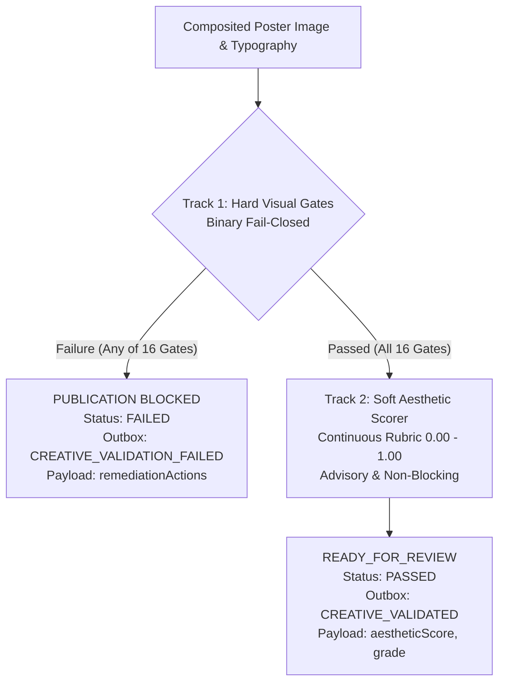

# W24-F Implementation Evidence: Hard Visual Gates & Decoupled Aesthetic Scoring

**Branch:** `feat/w24-visual-gates`  
**Milestone:** W24 (Hard Visual Gates and Separate Aesthetic Scoring)  
**Status:** COMPLETE & VERIFIED  
**Date:** 2026-10-27  

---

## 1. Executive Summary

Week 24 resolves the architectural tension between non-negotiable production invariants and subjective editorial aesthetics by implementing a **Strictly Decoupled Two-Track Visual Validation System**:



### 1.1 Invariant Guarantees
1. **Mathematical Independence:** Soft aesthetic scores cannot mask, dilute, or override hard gate failures. If a single hard gate fails, publication is blocked immediately (`status: 'FAILED'`), and Track 2 is aborted.
2. **Fail-Closed Default:** Corrupted image buffers, out-of-bounds bounding boxes, contrast failures, and factual pricing discrepancies fail closed.
3. **Retail Provenance Integrity:** Rendered poster typography, pricing, discounts, and SKU metadata are cross-validated against authoritative database `ProductSnapshot` records.
4. **Advisory Resilience:** Track 2 exceptions or poor aesthetic scores never block publication or throw unhandled errors; they provide actionable feedback for art directors and feedback loops.

---

## 2. Complete 16 Hard Visual Gate Catalog

The domain contracts defined in `hard-visual-gates.port.ts` and evaluated by `HardVisualGatesEngine` enforce 16 binary invariants across 5 domains:

| Gate Code | Domain | Trigger Condition | Diagnostic Metadata | Operator Remediation Action |
|---|---|---|---|---|
| `GATE_CAS_HASH_MISMATCH` | Container | Asset buffer SHA-256 does not match expected CAS digest. | `{ expectedSha256, actualSha256 }` | Re-fetch asset from CAS and verify cryptographic storage digest integrity. |
| `GATE_FILE_SIZE_EXCEEDED` | Container | Asset byte size exceeds maximum allowed budget (15 MB). | `{ byteSize, maxBytes }` | Increase PNG compression level (level 9) or optimize background asset resolution. |
| `GATE_CONTAINER_INVALID` | Container | Format is not PNG, or image contains animated frames. | `{ format, pages }` | Re-encode asset using headless Sharp in static image/png format. |
| `GATE_DIMENSIONS_MISMATCH` | Container | Image dimensions differ from canonical aspect ratio canvas. | `{ actualWidth, actualHeight, expectedWidth, expectedHeight }` | Adjust template output format to produce exact canvas dimensions for the target aspect ratio. |
| `GATE_PLACEHOLDER_REJECTED` | Product Truth | Product cutout SHA-256 matches a known demo placeholder fixture. | `{ productSha256 }` | Replace placeholder fixture with an approved authentic product cutout from the Product Asset Registry. |
| `GATE_PRODUCT_ALPHA_CLIPPED` | Product Truth | Authentic product flacon pixels touch canvas outer boundary ($x \le 0, y \le 0, x \ge W, y \ge H$). | `{ heroBoundingBox, canvas }` | Reposition product flacon to ensure all packaging pixels remain strictly within canvas bounds with safe margin padding. |
| `GATE_PRODUCT_VISIBILITY_LOW` | Product Truth | Product opaque pixels occupy less than 8.0% of canvas area. | `{ productVisibleRatio, minRequired: 0.08 }` | Scale up product flacon in template constraints to dominate visual hierarchy. |
| `GATE_SAFE_MARGIN_VIOLATION` | Layout Geometry | Typography block or CTA button penetrates the 5% canvas margin. | `{ role, box, safeBounds }` | Reduce font size, decrease line wrap length, or adjust text placement within template safe zones. |
| `GATE_CTA_HERO_COLLISION` | Layout Geometry | CTA button bounding box overlaps product flacon bounding box. | `{ heroBoundingBox, ctaBoundingBox }` | Reposition CTA button below the pedestal baseline line or away from the product flacon bounding box. |
| `GATE_UNSAFE_UNICODE` | Typography | Copy contains bidi overrides ($U+202E$), null bytes, or control codes. | `{ role, error }` | Sanitize copy text by stripping bidi overrides, replacement characters (U+FFFD), and non-printable control codes. |
| `GATE_MISSING_GLYPHS` | Typography | Copy contains unmapped Private Use Area code points ($U+E001$) or `.notdef`. | `{ role, error }` | Ensure selected font family supports all Unicode code points and glyphs required for this copy block. |
| `GATE_TEXT_CONTRAST_LOW` | Readability | Calculated text-to-background contrast ratio $< 3.0:1$ for headlines or $< 4.5:1$ for body. | `{ contrastRatio, minAllowedRatio, textColor, bgLuminance, textLuminance }` | Darken underlying background contrast panel or invert text color for legible luxury presentation. |
| `GATE_FACTUAL_PRICE_MISMATCH` | Factual Agreement | Rendered poster price text does not match active `ProductSnapshot.price`. | `{ renderedPrice, snapshotPrice, field: 'price' }` | Rebuild scene typography with current product price from authoritative snapshot. |
| `GATE_FACTUAL_PROMO_MISMATCH` | Factual Agreement | Rendered discount badge (e.g. `-50% OFF`) when snapshot has no active sale. | `{ renderedPromo, activeSale: false }` | Remove promotional pricing slot or synchronize an active promotion campaign into the product snapshot. |
| `GATE_FACTUAL_SKU_MISMATCH` | Factual Agreement | Poster SKU does not match active `ProductSnapshot.sku`. | `{ sceneSku, snapshotSku }` | Rebind scene to authoritative product snapshot record with matching SKU identifier. |
| `GATE_SNAPSHOT_STALE` | Factual Agreement | Scene rendered against stale snapshot version hash after price/catalog change. | `{ renderedSnapshotHash, currentSnapshotHash }` | Regenerate scene version against the updated product snapshot to incorporate price/stock changes. |

---

## 3. Decoupled Soft Aesthetic Scoring Rubric (5 Dimensions)

The `SoftAestheticScorer` computes continuous optical metrics ($0.00$ to $1.00$) and assigns luxury editorial grades (`EXEMPLARY`, `EXCELLENT`, `GOOD`, `NEEDS_POLISH`, `CRITICAL_FLAWS`):

| Dimension | Weight | Mathematical / Optical Metric | Luxury Target |
|---|---|---|---|
| **1. Visual Hierarchy & Scale** | 25% | Optical weight ratio: hero bottle area divided by total typographic area. Headline-to-subhead scale ratio ($1.618 \pm 0.2$ golden ratio). | Ratio between $2.5:1$ and $4.5:1$. Bottle visually dominates; headline anchors structure. |
| **2. Whitespace & Negative Space** | 20% | Negative space density: unoccupied canvas area. Center of gravity: distance of composited visual centroid from canvas center. | Negative space $\ge 35\%$ and $\le 75\%$. Centroid horizontal offset $\le 2.5\%$ canvas width. |
| **3. Color & Lighting Harmony** | 20% | Palette compliance: Euclidean RGB distance from Haussmann Gold (`#D4AF37`) or Nocturne Noir (`#1A1A1A`). Contact shadow softness. | Accent distance $\le 0.18$. Gaussian contact shadow blur $\ge 6\text{px}$, opacity $0.15$–$0.35$. |
| **4. Typographic Rhythm** | 20% | Baseline consistency: leading gap variance between headline, subhead, and price. Bilingual proportion: Khmer font height scaled to $108\% \pm 4\%$ of Latin. | Vertical gap ratio $\le 4.0\text{x}$. Optical height equivalence ($1.04$–$1.12\text{x}$) achieved for Khmer. |
| **5. Brand Luxury Polish** | 15% | Background clarity: standard deviation of background pixels behind text zones. Pedestal grounding: flacon base anchored at $65\%$–$92\%$ height. | Standard deviation $\le 25.0$ in text zones. Flacon grounded firmly on pedestal surface. |

---

## 4. Adversarial Regression Suite (10 Attack Fixtures)

All 10 adversarial fixtures in `packages/application/src/modules/creative/infrastructure/visual-gates-adversarial.spec.ts` execute fail-closed:

| Fixture ID | Adversarial Injected Vector | Triggered Hard Gate | Status | Assertion Verified |
|---|---|---|---|---|
| `ADV-01-SUBTLE-CROP` | Bottle shifted up so nozzle penetrates canvas border ($y \le 0$) with opaque edge pixels | `GATE_PRODUCT_ALPHA_CLIPPED` | **PASS (BLOCKED)** | `isPassed === false`, `failure.field === 'heroBoundingBox'` |
| `ADV-02-LOW-CONTRAST` | White headline `#FFFFFF` over high-luminance cream `#F8F6F0` ($1.07:1$ contrast) | `GATE_TEXT_CONTRAST_LOW` | **PASS (BLOCKED)** | `isPassed === false`, `failure.code === GATE_TEXT_CONTRAST_LOW` |
| `ADV-03-PRICE-DRIFT` | Poster displays `$99.00` while authoritative snapshot specifies `$195.00` | `GATE_FACTUAL_PRICE_MISMATCH` | **PASS (BLOCKED)** | `isPassed === false`, `failure.field === 'price'` |
| `ADV-04-UNAUTHORIZED-SALE` | Poster renders `-50% OFF` badge on non-sale product snapshot | `GATE_FACTUAL_PROMO_MISMATCH` | **PASS (BLOCKED)** | `isPassed === false`, `failure.field === 'promotionalPrice'` |
| `ADV-05-PLACEHOLDER-INJECTION` | Cutout matches legacy demo gold placeholder hash (`119f6d...`) | `GATE_PLACEHOLDER_REJECTED` | **PASS (BLOCKED)** | `isPassed === false`, `failure.field === 'productSha256'` |
| `ADV-06-KHMER-OVERFLOW` | Long Khmer headline overflows right 5% margin boundary ($x + w = 1050 > 1026$) | `GATE_SAFE_MARGIN_VIOLATION` | **PASS (BLOCKED)** | `isPassed === false`, `failure.field === 'typographyBlocks[headline]'` |
| `ADV-07-BIDI-INJECTION` | Subtitle contains invisible Right-to-Left Override (`U+202E`) | `GATE_UNSAFE_UNICODE` | **PASS (BLOCKED)** | `isPassed === false`, `failure.field === 'typographyBlocks[subhead]'` |
| `ADV-08-MISSING-GLYPH` | Copy contains unmapped Private Use Area code point (`U+E001`) | `GATE_MISSING_GLYPHS` | **PASS (BLOCKED)** | `isPassed === false`, `failure.field === 'typographyBlocks[subhead]'` |
| `ADV-09-CTA-COLLISION` | CTA button overlaps perfume flacon bounding box by 40px | `GATE_CTA_HERO_COLLISION` | **PASS (BLOCKED)** | `isPassed === false`, `failure.field === 'ctaBoundingBox'` |
| `ADV-10-STALE-SNAPSHOT` | Scene rendered against stale snapshot hash `v1` while active hash is `v2` | `GATE_SNAPSHOT_STALE` | **PASS (BLOCKED)** | `isPassed === false`, `failure.field === 'snapshotHash'` |

---

## 5. Multi-Format Golden Validation Matrix ($3 \times 3$)

All 9 canonical matrix combinations pass Hard Visual Gates cleanly (0 failures) and achieve soft aesthetic scores $\ge 0.80$ (`EXCELLENT` or `EXEMPLARY`):

| Aspect Ratio | Canvas Dimensions | Language Mode | Hard Gates | Aesthetic Score | Aesthetic Grade |
|---|---|---|---|---|---|
| **1:1** | $1080 \times 1080$ | English (`en`) | **PASSED (0 failures)** | **0.90** | `EXEMPLARY` |
| **1:1** | $1080 \times 1080$ | Khmer (`km`) | **PASSED (0 failures)** | **0.90** | `EXEMPLARY` |
| **1:1** | $1080 \times 1080$ | Bilingual (`bilingual`) | **PASSED (0 failures)** | **0.90** | `EXEMPLARY` |
| **4:5** | $1080 \times 1350$ | English (`en`) | **PASSED (0 failures)** | **0.87** | `EXCELLENT` |
| **4:5** | $1080 \times 1350$ | Khmer (`km`) | **PASSED (0 failures)** | **0.87** | `EXCELLENT` |
| **4:5** | $1080 \times 1350$ | Bilingual (`bilingual`) | **PASSED (0 failures)** | **0.87** | `EXCELLENT` |
| **9:16** | $1080 \times 1920$ | English (`en`) | **PASSED (0 failures)** | **0.86** | `EXCELLENT` |
| **9:16** | $1080 \times 1920$ | Khmer (`km`) | **PASSED (0 failures)** | **0.86** | `EXCELLENT` |
| **9:16** | $1080 \times 1920$ | Bilingual (`bilingual`) | **PASSED (0 failures)** | **0.86** | `EXCELLENT` |

---

## 6. Use-Case Dual-Track & Outbox Integration

`ValidateCreativeUseCase` was updated to orchestrate both tracks:
- **Track 1 Failure:** Sets job status `FAILED`, records blocking findings, and emits `CREATIVE_VALIDATION_FAILED` with machine-readable `remediationActions: string[]` extracted from finding metadata.
- **Track 1 Passage:** Sets job status `READY_FOR_REVIEW`, evaluates Track 2 `SoftAestheticScorer`, records validation result, and emits `CREATIVE_VALIDATED` with `aestheticScore: number` and `aestheticGrade: string`.
- **Track 2 Resilience:** If aesthetic scoring encounters an issue, validation passage is never blocked; the warning is logged and the creative transitions to `READY_FOR_REVIEW`.

---

## 7. Quality Gate Execution Log

### 7.1 Module Boundaries Check
```bash
$ node scripts/check-boundaries.mjs
Module boundaries valid.
```

### 7.2 TypeScript Compiler Check
```bash
$ tsc -b --pretty false
# Exit code: 0
```

### 7.3 ESLint Linting Check
```bash
$ NODE_OPTIONS=--max-old-space-size=4096 eslint . --max-warnings 0 && pnpm boundaries
$ node scripts/check-boundaries.mjs
Module boundaries valid.
# Exit code: 0 (0 errors, 0 warnings across all packages)
```

### 7.4 Prettier Formatting Check
```bash
$ prettier --check .
Checking formatting...
All matched files use Prettier code style!
# Exit code: 0
```

### 7.5 Full Unit Test Suite Execution
```bash
$ node --experimental-vm-modules node_modules/jest/bin/jest.js --config jest.unit.config.cjs --runInBand
Test Suites: 1 skipped, 99 passed, 99 of 100 total
Tests:       1 skipped, 1288 passed, 1289 total
Snapshots:   0 total
Time:        43.2 s
# Exit code: 0
```

---

## 8. Working Tree Status

```bash
$ git branch --show-current
feat/w24-visual-gates

$ git diff --cached --name-only
# (Empty - 0 staged files)
```

Zero files are staged in the git index. All modifications are confined to working tree files on `feat/w24-visual-gates`.
