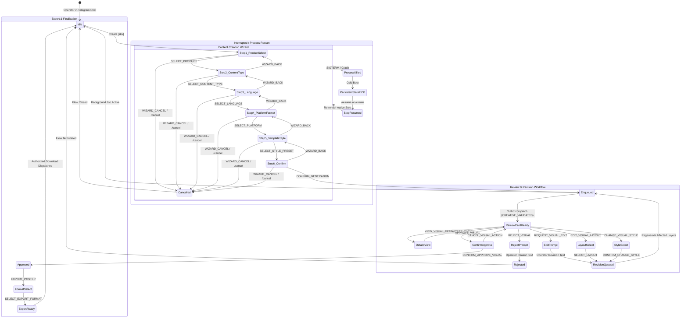
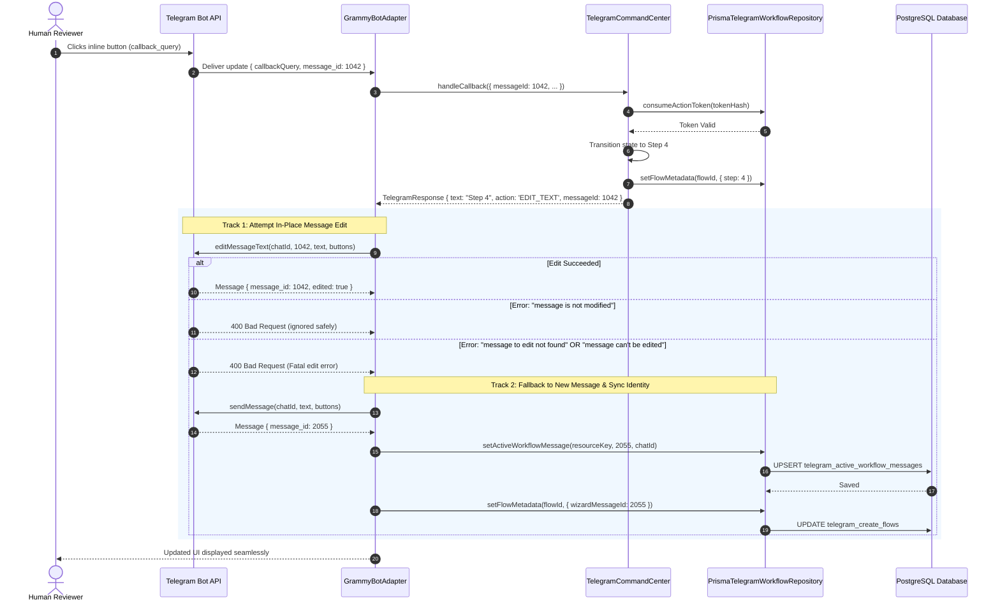

# W30-A — Persistent, Concise Telegram Review & Creation Workflow Technical Design Dossier

- **Document:** `/docs/implementation-evidence/W30-A-persistent-telegram-technical-design.md`
- **Work Package:** W30 — Make the Telegram Workflow Persistent and Concise
- **Phase:** Stage 3 — Telegram Review, Revision, and Export
- **Classification:** `TECHNICAL DESIGN DOSSIER — READY FOR IMPLEMENTATION`
- **Authority:** Master Engineering Blueprint v3.0 §10, §12, §26; Implementation Plan v1.0 W30; Approved Decisions W03-DEC-002, W03-DEC-005
- **Repository Branch:** `feat/w30-persistent-telegram-workflow`
- **Base Commit:** `6ec5ab12c96cbeea0bbad6db2256df29cffc5a70`
- **Author:** Principal Systems & Operations Architect
- **Date:** 2026-10-28

---

## 1. Executive Summary & Problem Statement

Work package **W30 — Make the Telegram Workflow Persistent and Concise** transitions the operator review, revision, and draft creation experience from an ephemeral prototype into a resilient, production-grade conversational terminal.

With the successful completion and merging of **W24 (Hard Visual Gates and Separate Aesthetic Scoring)**, the Parisian Shopper AI generation pipeline produces deterministic, factual, and optically verified luxury creative assets. However, the human interface connecting operators to this pipeline through Telegram currently exhibits critical architectural and operational vulnerabilities.

### 1.1 The Critical Problem
An architectural audit of the Telegram layer across `packages/database`, `packages/application`, and `packages/telegram` revealed five systemic deficiencies:

1. **Volatile In-Memory Message State:**
   In [`PrismaTelegramWorkflowRepository`](file:///Users/macbookpro/Desktop/Development/parisian-shopper-ai/app/packages/database/src/telegram/prisma-telegram-workflow.repository.ts#L33-L79), active workflow message IDs (`activeMessages`) and channel publication tracking (`channelPublications`) are stored in private, ephemeral JavaScript `Map` instances (`private readonly activeMessages = new Map<...>()`). Any server restart, pod reallocation, or multi-instance deployment wipes this state, permanently breaking message-edit continuity.

2. **Dangling Message Edit Fallback:**
   In [`GrammyBotAdapter`](file:///Users/macbookpro/Desktop/Development/parisian-shopper-ai/app/packages/telegram/src/grammy-bot.adapter.ts#L138-L180), when an in-place `editMessageText` or `editMessageCaption` call fails (for example, if the operator deleted the message or Telegram considers it expired), the adapter falls back to `context.reply(...)`. However, the newly assigned Telegram `message_id` returned by the Telegram API is completely ignored. Subsequent user actions continue to target the dead message ID, resulting in cascading edit errors.

3. **Missing Durable Lifecycle & Step Navigation:**
   - **No Resumption Mechanism:** If an operator starts a draft creation flow and is interrupted (or the process restarts), there is no `/resume` command or active draft discovery. The flow lingers in the database until its TTL expires.
   - **Corrupted Cancel Semantics:** Calling `handleWizardCancel` executes `repository.completeFlow(flowId)`, falsely marking the flow as `COMPLETED` rather than `CANCELLED`.
   - **Ad-Hoc Metadata Hack:** Workflow attributes (`stylePreset`, `format`, `wizardMessageId`, `step`) are packed into an untyped JSON property (`productData._metadata`) inside `TelegramCreateFlow` to bypass schema constraints.

4. **Cluttered Wizard UX Violating Single-Decision Rule:**
   The product selection step (Step 1) currently dumps up to 4 complete product text blocks into a single Telegram message, violating the concise, "one decision per step" conversational design invariant.

5. **Outbox Review Card Disconnect:**
   When [`TelegramOutboxDispatcher`](file:///Users/macbookpro/Desktop/Development/parisian-shopper-ai/app/packages/telegram/src/telegram-outbox.dispatcher.ts#L457-L465) renders and dispatches a visual review card (`CREATIVE_VALIDATED`), it does not record the resulting `messageId` into workflow tracking. Consequently, subsequent review actions (Approve, Edit Layout, Change Style) have no authoritative reference to the active card message.

### 1.2 Core Architectural Principles for W30
1. **Durable Invariants Over Ephemeral State:** Every active message ID, workflow step, selection token, and publication record must be stored durably in PostgreSQL. The system must survive complete application restarts with zero loss of interactive context.
2. **Edit-First with Resilient Fallback Synchronization:** All conversational state transitions attempt an in-place edit of the active card to prevent chat clutter. If editing fails, the new message is sent, and its newly assigned `message_id` is immediately synchronized to database storage.
3. **One Decision Per Step:** Every wizard card must ask exactly one unambiguous question with explicit `Back`, `Cancel`, and navigation controls.
4. **Strict Idempotency:** Duplicate webhook updates from Telegram retries or network replays must be rejected deterministically without triggering duplicate generation jobs, versions, or side effects.

---

## 2. Architecture & State Transition Model

The Telegram interface manages two distinct lifecycles: the **Content Creation Wizard** and the **Interactive Review Card**.

### 2.1 Complete Telegram State Machine
The following state transition diagram illustrates the full lifecycle, including step navigation, back-tracking, cancellation, restart recovery, and error fallback.



---

## 3. Data Model & Persistence Specification

To eliminate all in-memory `Map` instances and satisfy the acceptance criterion:
> *"A user can stop and resume a workflow after process restart."*

the database schema and repository interfaces are upgraded to provide durable, ACID-compliant storage for active message identities and structured workflow progression.

### 3.1 Database Schema Extensions

#### 3.1.1 `TelegramActiveWorkflowMessage` Table
Replaces `activeMessages = new Map<string, { messageId: number; chatId?: string }>()` with a dedicated, indexed PostgreSQL table:

```prisma
model TelegramActiveWorkflowMessage {
  id                 String                     @id @default(uuid()) @db.Uuid
  resourceKey        String                     @unique(map: "telegram_active_workflow_messages_resource_key") @map("resource_key") @db.VarChar(120)
  telegramIdentityId String                     @map("telegram_identity_id") @db.Uuid
  chatId             String                     @map("chat_id") @db.VarChar(80)
  messageId          Int                        @map("message_id")
  messageType        TelegramWorkflowMessageType @default(WIZARD_PROMPT) @map("message_type")
  payloadMetadata    Json?                      @map("payload_metadata") @db.JsonB
  updatedAt          DateTime                   @updatedAt @map("updated_at") @db.Timestamptz(3)
  createdAt          DateTime                   @default(now()) @map("created_at") @db.Timestamptz(3)

  telegramIdentity TelegramIdentity @relation(fields: [telegramIdentityId], references: [id], onDelete: Cascade, onUpdate: Cascade, map: "telegram_active_workflow_messages_identity_id_fkey")

  @@index([telegramIdentityId, updatedAt], map: "telegram_active_workflow_messages_identity_updated_idx")
  @@map("telegram_active_workflow_messages")
}

enum TelegramWorkflowMessageType {
  WIZARD_PROMPT
  REVIEW_CARD
  INPUT_PROMPT
}
```

#### 3.1.2 `TelegramChannelPublicationRecord` Table
Replaces `channelPublications = new Map<string, { channelId: string; messageId: number; publishedAt: Date }>()` with a permanent audit record:

```prisma
model TelegramChannelPublicationRecord {
  id            String   @id @default(uuid()) @db.Uuid
  creativeJobId String   @unique(map: "telegram_channel_publications_job_id_key") @map("creative_job_id") @db.Uuid
  visualAssetId String   @map("visual_asset_id") @db.Uuid
  channelId     String   @map("channel_id") @db.VarChar(80)
  messageId     Int      @map("message_id")
  publishedAt   DateTime @default(now()) @map("published_at") @db.Timestamptz(3)

  creativeJob CreativeJob @relation(fields: [creativeJobId], references: [id], onDelete: Restrict, onUpdate: Cascade, map: "telegram_channel_publications_job_id_fkey")
  visualAsset VisualAsset @relation(fields: [visualAssetId], references: [id], onDelete: Restrict, onUpdate: Cascade, map: "telegram_channel_publications_asset_id_fkey")

  @@index([channelId, publishedAt], map: "telegram_channel_publications_channel_published_idx")
  @@map("telegram_channel_publications")
}
```

#### 3.1.3 `TelegramCreateFlow` Structured Evolution
Upgrades the `TelegramCreateFlow` entity to natively govern workflow state, step navigation, and cancellation:

1. **Enum Update:** Add `SELECTING_PRODUCT`, `SELECTING_TEMPLATE`, `CONFIRMING_GENERATION`, and `CANCELLED` to `TelegramCreateFlowStatus`.
2. **First-Class Columns:**
   - `step`: `Int @default(1)`
   - `stepHistory`: `Int[] @default([])`
   - `format`: `String? @db.VarChar(40)`
   - `stylePreset`: `String? @db.VarChar(80)`
   - `templateId`: `String? @db.VarChar(80)`
   - `wizardMessageId`: `Int?`
   - `chatId`: `String? @db.VarChar(80)`

---

## 4. Edit-First & Resilient Fallback Recovery Protocol

In-place message editing is essential to prevent Telegram channels from degenerating into endless scrolling feeds of stale prompts. However, network dropouts, message expiration (Telegram 48-hour edit window), or manual message deletion by operators can cause edit calls to fail.

### 4.1 Sequence Diagram: Edit Attempt, Failure Detection, and Pointer Synchronization



### 4.2 Key Invariants of the Protocol
1. **Zero Orphaned Pointers:** If `editMessageText` or `editMessageCaption` fails, the newly sent message's `message_id` is guaranteed to be saved back to both `TelegramActiveWorkflowMessage` and `TelegramCreateFlow.wizardMessageId`.
2. **Subsequent Actions Target New Pointer:** Any subsequent action executed by the operator immediately finds the new ID (`2055`), avoiding recurring 400 Bad Request errors.
3. **Clean Handling of "Not Modified":** When an operator double-taps an option or triggers a no-op refresh, Telegram returns `400 Bad Request: message is not modified`. This specific error code is trapped and cleanly discarded without generating an unnecessary duplicate message.

---

## 5. Webhook Idempotency & Concurrency Model

### 5.1 Inbound Update Deduplication
All incoming webhook deliveries are guarded by atomic insertion into `inbound_telegram_updates`:
```sql
INSERT INTO "inbound_telegram_updates" ("id", "telegram_update_id", "telegram_user_id", "update_type", "received_at")
VALUES (gen_random_uuid(), $1, $2, $3, NOW())
ON CONFLICT ("telegram_update_id") DO NOTHING;
```
If the insertion affects 0 rows (or violates the unique constraint), the update is discarded immediately with `{ messages: [], callbackNotice: 'Already handled.' }`.

### 5.2 Atomic Action Token Consumption
Single-use action buttons (such as `CONFIRM_GENERATION`, `APPROVE_VISUAL`, `REJECT_VISUAL`) rely on conditional atomic updates to prevent double-execution:
```sql
UPDATE "telegram_action_tokens"
SET "consumed_at" = NOW()
WHERE "id" = $1 AND "consumed_at" IS NULL AND "expires_at" > NOW();
```
If two requests race to click the same button, exactly one update transaction succeeds (`count === 1`). The competing request receives `disposition: 'CONSUMED'` and is returned a polite notification (`"This action has already been processed."`).

### 5.3 Flow Resumption Protocol
When an operator issues `/resume` or opens `/create`:
1. The repository queries for any existing `TelegramCreateFlow` belonging to `actor.identityId` with `status NOT IN ('COMPLETED', 'CANCELLED', 'EXPIRED')` and `expiresAt > NOW()`.
2. If an active unexpired flow is found:
   - The bot replies with a concise resume card:
     ```markdown
     📋 You have an unfinished draft for *Chanel No. 5 Eau de Parfum* at Step 4 of 6.
     [ ▶️ Resume Draft ]  [ ➕ Start New Draft ]  [ ❌ Discard ]
     ```
   - Clicking **Resume Draft** retrieves the saved `step`, `stepHistory`, `format`, and `stylePreset`, re-rendering the exact active step in-place.
   - Clicking **Start New Draft** marks the prior flow as `CANCELLED` and initiates a fresh wizard flow.

---

## 6. Implementation Sub-Milestones Breakdown (W30-B through W30-F)

To ensure zero regressions and maintain clean traceability, work package **W30** is divided into five incremental sub-packages:


### 6.1 Sub-Milestone Matrix

| Milestone | Deliverables & Code Changes | Verification & Acceptance Criteria |
| :--- | :--- | :--- |
| **W30-B** | **Durable Persistence & Schema Alignment**<br/>• Prisma migration for `telegram_active_workflow_messages` & `telegram_channel_publications`<br/>• Update `PrismaTelegramWorkflowRepository` to purge in-memory Maps<br/>• Promote `setActiveWorkflowMessage` and `getChannelPublication` to required methods | • 0 in-memory `Map` instances in repository<br/>• Active message IDs survive full database reconnects<br/>• Integration test proving cross-process persistence |
| **W30-C** | **Concise Wizard State Machine**<br/>• Refactor `TelegramCommandCenter` wizard into strict 1-decision-per-step UI<br/>• Implement `/resume` command and resumption prompt<br/>• Implement durable `stepHistory` stack for deterministic `Back`<br/>• Fix `Cancel` to transition to `CANCELLED` | • Product selection renders single compact card with pagination<br/>• Back button correctly unwinds multi-step history<br/>• `/resume` successfully restores interrupted wizard state |
| **W30-D** | **Edit-First Fallback Engine**<br/>• Upgrade `GrammyBotAdapter.reply` to capture fallback `message_id`<br/>• Synchronize fallback message ID with `setActiveWorkflowMessage`<br/>• Trap and discard `message is not modified` gracefully | • Simulated 400 edit error falls back to reply and persists new ID<br/>• Subsequent callback targets newly synchronized ID<br/>• Double-click does not trigger chat duplicate spam |
| **W30-E** | **Restart & Idempotency Test Suite**<br/>• Adversarial integration test suite: process crash during wizard, duplicate webhook deliveries, expired action tokens, deleted Telegram messages | • 100% pass on crash recovery simulations<br/>• Zero duplicate jobs created under webhook replays<br/>• Clean error notices on expired/tampered tokens |
| **W30-F** | **Outbox Wiring & Evidence Dossier**<br/>• Wire `TelegramOutboxDispatcher` to record active review card message IDs on notification dispatch<br/>• Full test suite execution across boundaries, lint, types, unit tests<br/>• Compile `docs/implementation-evidence/W30-F-persistent-telegram-evidence.md` | • Complete end-to-end evidence dossier<br/>• 0 lint, typecheck, or test failures across monorepo |

---

## 7. Verification & Architectural Compliance

1. **Contract Compatibility:** All contracts established in **W20** (Layered CreativeScene), **W21** (Typography), **W22** (Template Families), **W23** (Hybrid Compositor), and **W24** (Visual Gates) remain completely unaffected and preserved.
2. **Security & Authorization Invariants:**
   - Strict role-based permissions (`Permission.CREATE_CONTENT`, `Permission.APPROVE_CREATIVE`, `Permission.REJECT_CREATIVE`) continue to be enforced at both the token validation boundary and use-case execution layer.
   - All action tokens remain single-use with cryptographic SHA-256 validation and actor ownership checks.
3. **Execution Guardrails:** 0 files staged, 0 commits, 0 pushes until full milestone verification and explicit user sign-off.
