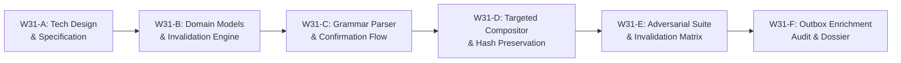

# W31-A — Structured Targeted Revision and Approval Technical Design Dossier

- **Document:** `docs/implementation-evidence/W31-A-structured-revision-technical-design.md`
- **Work Package:** W31 — Implement Structured Targeted Revision and Approval
- **Phase:** Stage 3 — Telegram Review, Revision, and Export
- **Classification:** `TECHNICAL DESIGN DOSSIER — READY FOR IMPLEMENTATION`
- **Authority:** Master Engineering Blueprint v3.0 §10, §12, §26; Implementation Plan v1.0 W31; Approved Decisions W03-DEC-002, W03-DEC-005, W20, W24, W30
- **Repository Branch:** `feat/w31-structured-revision-approval`
- **Base Commit:** `ef5e2e4249a0d1bb3ae99a0d8bb1a48c40ffec11`
- **Author:** Principal Systems & Operations Architect
- **Date:** 2026-10-28

---

## 1. Executive Summary & Problem Statement

Work package **W31 — Implement Structured Targeted Revision and Approval** bridges the gap between operator editorial feedback and the Parisian Shopper AI compositing engine.

Following the successful deployment of **W24 (Hard Visual Gates & Decoupled Aesthetic Scoring)** and **W30 (Persistent, Concise Telegram Workflow)**, operators can review high-resolution commercial posters directly in Telegram. However, when an operator requests a modification (e.g. *"Change the headline to 'Parisian Midnight'"*, *"Darker background"*, or *"Move bottle to center"*), the existing architecture faces critical limitations:

### 1.1 Existing Limitations & Gaps
1. **Whole-Poster Re-render vs Granular Layer Targeting:**
   Currently, `RevisePosterUseCase` supports individual helper methods (`editText`, `editLayout`, `newBackground`), but there is no unified domain model representing an atomic, multi-property revision plan. When an edit is requested, entire posters are often re-rendered or re-generated without recording which exact layers were mutated and which were preserved.
2. **Missing Hash Continuity & Provenance:**
   When an operator edits only copy or headline text, the authentic product cutout (`sourceProductAssetDigest`) and AI background (`backgroundAssetDigest`) should remain strictly bit-for-bit identical. Currently, there is no explicit hash continuity assertion verifying that non-targeted layers have zero drift across versions.
3. **Coarse Invalidation Cascades:**
   When an edit occurs, approval records and gate evaluations are either wiped out wholesale or left in ambiguous states. Changing a headline does not compromise product cutout authenticity or CAS storage integrity, but it *does* invalidate text-to-background contrast (`GATE_TEXT_CONTRAST_LOW`), safe margins (`GATE_SAFE_MARGIN_VIOLATION`), and visual sign-off. Conversely, replacing a product cutout must invalidate hero containment and visibility, while preserving approved French/Khmer copy.
4. **Unstructured Free-Text Input:**
   In Telegram, clicking "Request Edit" asks the user to reply with free text, but no conversational parser or grammar engine extracts structured edit targets. Unstructured text is currently routed to raw revision strings, preventing automated, zero-AI re-layout or precise text updates.
5. **No Confirmation for Ambiguous or Costly Edits:**
   If an operator types *"Make it look warmer"*, this could mean an instant CSS/composite tint adjustment, or a costly new AI background generation. The system lacks a two-phase confirmation protocol to present a proposed `RevisionPlan` before triggering GPU/API spend.

### 1.2 Core Architectural Principles for W31
1. **Targeted Layer Immutability:** A revision mutates **only** the specified layer targets in the `CreativeScene`. All other layers retain their cryptographic CAS digests and transform parameters.
2. **Deterministic Revision Grammar:** A formal parser converts operator intents into a typed `RevisionPlan` with classified confidence (`CONFIDENT`, `AMBIGUOUS`, `UNSUPPORTED`).
3. **Dependency-Aware Approval Invalidation:** Approvals and gate validations are fine-grained: copy, layout, visual, and export approvals invalidate strictly according to the layer dependency graph.
4. **Two-Phase Confirmation Protocol:** High-cost (AI background) or ambiguous requests require explicit operator confirmation of the proposed `RevisionPlan` prior to execution.
5. **Optimistic Concurrency & Stale Rejection:** Edits target an explicit `expectedVersionNumber`. Concurrent revisions or approvals on superseded versions are deterministically rejected with conflict notices.

---

## 2. Revision Target Grammar & Layer Taxonomy

### 2.1 Layer Hierarchy & Target Specifier
The `CreativeScene` architecture (established in W20) defines 5 layer groups. W31 formalizes their granular addressability:

```
[SCENE GRAPH]
  ├── GROUP 1: BACKGROUND (z: 0-99)
  │     ├── Target: BACKGROUND_IMAGE (AI or CAS asset)
  │     ├── Target: BACKGROUND_COLOR (Solid / Gradient fill)
  │     └── Target: BACKGROUND_TINT (Color grading / Overlay)
  ├── GROUP 2: SURFACE_SHADOW (z: 100-199)
  │     ├── Target: CONTACT_SHADOW (Pedestal / Grounding)
  │     └── Target: DIRECTIONAL_DROP (Cast shadow)
  ├── GROUP 3: PRODUCT_HERO (z: 200-299)
  │     ├── Target: HERO_CUTOUT (Canonical Product Flacon)
  │     ├── Target: HERO_PLACEMENT (Left / Center / Right)
  │     └── Target: HERO_SCALE (Bounding box constraint)
  ├── GROUP 4: TYPOGRAPHY (z: 300-399)
  │     ├── Target: TEXT_HEADLINE (French / English / Khmer)
  │     ├── Target: TEXT_SUBHEAD (Secondary descriptive line)
  │     ├── Target: TEXT_PRICE (Factual retail price)
  │     ├── Target: TEXT_PROMO (Discount badge / Event)
  │     └── Target: TEXT_CTA (Call to Action button text)
  └── GROUP 5: BRAND_DECORATION (z: 400-499)
        ├── Target: BRAND_LOGO (Maison emblem)
        ├── Target: BRAND_DIVIDER (Gold leaf / Rule)
        └── Target: BRAND_FRAME (Border / Seasonal lotus)
```

### 2.2 Revision Target Taxonomy (`RevisionTargetType`)

```typescript
export enum RevisionTargetType {
  // Group 4: Typography (Zero AI spend, fast Sharp re-layout)
  HEADLINE = 'HEADLINE',
  SUBHEAD = 'SUBHEAD',
  PRICE = 'PRICE',
  PROMOTIONAL_PRICE = 'PROMOTIONAL_PRICE',
  CTA = 'CTA',
  LANGUAGE = 'LANGUAGE',

  // Group 3: Product Hero
  PRODUCT_PLACEMENT = 'PRODUCT_PLACEMENT',
  PRODUCT_SCALE = 'PRODUCT_SCALE',
  PRODUCT_ASSET = 'PRODUCT_ASSET',

  // Group 1 & 2: Background & Ambiance
  BACKGROUND_PROMPT = 'BACKGROUND_PROMPT',
  STYLE_PRESET = 'STYLE_PRESET',
  NEW_BACKGROUND = 'NEW_BACKGROUND',

  // Architectural
  TEMPLATE = 'TEMPLATE',
  ASPECT_RATIO = 'ASPECT_RATIO',
}
```

### 2.3 Domain Model: `RevisionPlan`

```typescript
export type RevisionExecutionStrategy =
  | 'ZERO_AI_COMPOSITE'       // Pure Sharp re-layout and typography rendering (<100ms)
  | 'AI_BACKGROUND_REGEN'     // Requires new generative background via CreativeProvider (~3-5s)
  | 'PRODUCT_ASSET_SWAP'      // Replaces product cutout and validates transparent alpha channel
  | 'CANVAS_REFORMAT';        // Re-layouts from template constraints for new aspect ratio

export interface TargetMutation {
  readonly target: RevisionTargetType;
  readonly fieldName: string;
  readonly previousValue: unknown;
  readonly requestedValue: unknown;
}

export interface RevisionPlan {
  readonly id: string;
  readonly creativeJobId: string;
  readonly baseVersionNumber: number;
  readonly requestedByUserId: string;
  readonly rawInstruction: string;
  readonly executionStrategy: RevisionExecutionStrategy;
  readonly mutations: readonly TargetMutation[];
  readonly affectedLayerGroups: readonly LayerGroup[];
  readonly preservedLayerDigests: Readonly<Record<string, string>>;
  readonly requiresConfirmation: boolean;
  readonly confirmationReason?: string;
  readonly estimatedExecutionMs: number;
  readonly createdAt: Date;
}
```

---

## 3. Invalidation Dependency Graph

A core innovation of W31 is **Dependency-Aware Selective Invalidation**. Mutating one layer must never blindly invalidate independent guarantees.

### 3.1 Dependency Invalidation Matrix

```mermaid
flowchart TD
    subgraph Mutation Triggers
        M_Text[Mutate Headline / Copy]
        M_Price[Mutate Price / Promo]
        M_Bg[Regenerate Background]
        M_Hero[Reposition / Scale Hero]
        M_Asset[Swap Product Cutout]
        M_Tpl[Change Template Layout]
    end

    subgraph Visual Gate Invalidation Scope
        G_Read[Readability & Contrast\nGATE_TEXT_CONTRAST_LOW]
        G_Typo[Typography & Glyphs\nGATE_UNSAFE_UNICODE\nGATE_MISSING_GLYPHS]
        G_Fact[Factual Consistency\nGATE_FACTUAL_PRICE\nGATE_FACTUAL_SKU]
        G_Geom[Layout Geometry\nGATE_SAFE_MARGIN\nGATE_CTA_HERO_COLLISION]
        G_Prod[Product Authenticity\nGATE_PLACEHOLDER\nGATE_PRODUCT_ALPHA_CLIPPED\nGATE_PRODUCT_VISIBILITY]
    end

    subgraph Approval Invalidation Scope
        A_Copy[Content Copy Approval]
        A_Visual[Visual Review Approval]
        A_Export[Export / Publish Sign-off]
    end

    M_Text --> G_Read & G_Typo & G_Geom & A_Copy & A_Visual & A_Export
    M_Price --> G_Fact & G_Read & G_Typo & A_Copy & A_Visual & A_Export
    M_Bg --> G_Read & A_Visual & A_Export
    M_Hero --> G_Geom & G_Prod & A_Visual & A_Export
    M_Asset --> G_Prod & G_Geom & G_Fact & A_Visual & A_Export
    M_Tpl --> G_Read & G_Geom & A_Visual & A_Export
```



### 3.2 Detailed Invalidation Rules by Mutation Target

| Mutation Target | Invalidated Visual Gates | Preserved Visual Gates | Invalidated Approvals | Preserved Approvals |
|---|---|---|---|---|
| **HEADLINE / SUBHEAD / CTA** | `GATE_TEXT_CONTRAST_LOW`<br>`GATE_UNSAFE_UNICODE`<br>`GATE_MISSING_GLYPHS`<br>`GATE_SAFE_MARGIN_VIOLATION`<br>`GATE_CTA_HERO_COLLISION` | `GATE_PLACEHOLDER_REJECTED`<br>`GATE_PRODUCT_ALPHA_CLIPPED`<br>`GATE_PRODUCT_VISIBILITY_LOW`<br>`GATE_FACTUAL_PRICE_MISMATCH`<br>`GATE_FACTUAL_SKU_MISMATCH`<br>`GATE_CONTAINER_INVALID` | `VISUAL_APPROVED`<br>`CONTENT_APPROVED`<br>`EXPORT_APPROVED` | Product Asset Governance Sign-off |
| **PRICE / PROMOTIONAL_PRICE** | `GATE_FACTUAL_PRICE_MISMATCH`<br>`GATE_FACTUAL_PROMO_MISMATCH`<br>`GATE_TEXT_CONTRAST_LOW`<br>`GATE_SAFE_MARGIN_VIOLATION` | All Product Truth Gates<br>All Container Gates<br>All Background Quality Metrics | `CONTENT_APPROVED`<br>`VISUAL_APPROVED`<br>`EXPORT_APPROVED` | Product Asset Governance Sign-off |
| **BACKGROUND (AI Regen / Style)** | `GATE_TEXT_CONTRAST_LOW`<br>`GATE_CONTAINER_INVALID`<br>`GATE_FILE_SIZE_EXCEEDED` | All Product Truth Gates<br>`GATE_UNSAFE_UNICODE`<br>`GATE_MISSING_GLYPHS`<br>All Factual Pricing Gates | `VISUAL_APPROVED`<br>`EXPORT_APPROVED` | `CONTENT_APPROVED` (Copy remains valid) |
| **HERO PLACEMENT / SCALE** | `GATE_SAFE_MARGIN_VIOLATION`<br>`GATE_CTA_HERO_COLLISION`<br>`GATE_PRODUCT_ALPHA_CLIPPED`<br>`GATE_PRODUCT_VISIBILITY_LOW` | All Typography Gates<br>All Factual Pricing Gates<br>All Background Quality Metrics | `VISUAL_APPROVED`<br>`EXPORT_APPROVED` | `CONTENT_APPROVED` |
| **PRODUCT CUTOUT SWAP** | All Product Truth Gates<br>`GATE_CTA_HERO_COLLISION`<br>`GATE_SAFE_MARGIN_VIOLATION` | Typography Encoding Gates<br>Background CAS Storage | `VISUAL_APPROVED`<br>`EXPORT_APPROVED` | `CONTENT_APPROVED` (unless SKU changes) |
| **TEMPLATE LAYOUT SWAP** | `GATE_TEXT_CONTRAST_LOW`<br>`GATE_SAFE_MARGIN_VIOLATION`<br>`GATE_CTA_HERO_COLLISION` | All Product Cutout Truth Gates<br>All Factual Pricing Gates | `VISUAL_APPROVED`<br>`EXPORT_APPROVED` | `CONTENT_APPROVED` |

---

## 4. Free-Text to RevisionPlan Mapping & Ambiguity Resolution Protocol

Operators interacting via Telegram naturally use conversational shorthand. W31 implements a multi-tier interpretation engine:

```
Conversational Operator Input (Telegram Message)
                     │
                     ▼
┌───────────────────────────────────────────────┐
│ Tier 1: Deterministic Regex / Keyword Matcher │
│ (Prefixes: "Headline:", "Price:", "Style:")   │
└──────────────────────┬────────────────────────┘
                       │
       ┌───────────────┴───────────────┐
       ▼                               ▼
Match Found? (Score = 1.0)        No Direct Match
       │                               │
       │                               ▼
       │                ┌───────────────────────────────┐
       │                │ Tier 2: Semantic Intent Match │
       │                │ (Fuzzy keywords, layer stems) │
       │                └──────────────┬────────────────┘
       │                               │
       │               ┌───────────────┴───────────────┐
       │               ▼                               ▼
       │        Confidence ≥ 0.85?              Confidence < 0.85
       │               │                               │
       ▼               ▼                               ▼
┌───────────────────────────────┐       ┌───────────────────────────────┐
│ Confidence: CONFIDENT         │       │ Confidence: AMBIGUOUS         │
│ (Execute or 1-tap confirm)    │       │ (Require RevisionPlan Confirm)│
└───────────────────────────────┘       └───────────────────────────────┘
```

### 4.1 Deterministic Pattern Grammar (Tier 1)

| Pattern Syntax | Extracted Target | Execution Strategy | Confidence |
|---|---|---|:---:|
| `^(?:headline\|title):\s*(.+)$` | `RevisionTargetType.HEADLINE` | `ZERO_AI_COMPOSITE` | `CONFIDENT` |
| `^(?:subhead\|tagline):\s*(.+)$` | `RevisionTargetType.SUBHEAD` | `ZERO_AI_COMPOSITE` | `CONFIDENT` |
| `^(?:price):\s*(.+)$` | `RevisionTargetType.PRICE` | `ZERO_AI_COMPOSITE` | `CONFIDENT` |
| `^(?:cta\|button):\s*(.+)$` | `RevisionTargetType.CTA` | `ZERO_AI_COMPOSITE` | `CONFIDENT` |
| `^(?:layout\|template):\s*(editorial\|hero\|scent\|khmer)` | `RevisionTargetType.TEMPLATE` | `ZERO_AI_COMPOSITE` | `CONFIDENT` |
| `^(?:style\|preset):\s*(morning\|dusk\|minimal)` | `RevisionTargetType.STYLE_PRESET` | `AI_BACKGROUND_REGEN` | `CONFIDENT` |
| `^(?:new background\|regenerate background)$` | `RevisionTargetType.NEW_BACKGROUND` | `AI_BACKGROUND_REGEN` | `CONFIDENT` |
| `^(?:align\|place product):\s*(left\|center\|right)` | `RevisionTargetType.PRODUCT_PLACEMENT` | `ZERO_AI_COMPOSITE` | `CONFIDENT` |

### 4.2 Ambiguity Resolution Protocol (Tier 2)

When an operator provides free-form guidance without an explicit keyword (e.g., *"Make it feel more evening and dramatic"* or *"Text is too crowded"*):
1. **Semantic Layer Scoring:** The interpreter computes affinity scores across `[BACKGROUND, TYPOGRAPHY, HERO, TEMPLATE]`.
2. **Ambiguity Flagging:** If the highest confidence score is $< 0.85$, or if multiple layer groups score within $0.20$ of each other:
   - Sets `plan.requiresConfirmation = true`.
   - Populates `plan.confirmationReason = "Interpretation uncertain: inferred Background Style change to Haussmann Dusk."`
   - Generates alternative options as interactive buttons.

---

## 5. Telegram Conversational UX & Confirmation Flow

### 5.1 Direct Execution Flow (High Confidence, Zero AI Spend)
When an operator issues a confident, zero-AI edit (e.g. `Headline: L'Art du Parfum`):
1. Telegram Command Center accepts text input on active `CREATIVE_JOB_ID`.
2. Generates `RevisionPlan` (`CONFIDENT`, `ZERO_AI_COMPOSITE`).
3. Executes `RevisePosterUseCase.editText(...)`.
4. Renders new `VisualAsset` (version $N+1$).
5. Updates active message in-place via `editMessageMedia` with the new composite poster and refreshed review keyboard.

### 5.2 Two-Phase Confirmation Flow (Ambiguous or AI Spend Required)
When an edit involves AI background generation or ambiguous intent:

#### Step 1: Proposed Revision Plan Card
The bot edits the active review card to display the **Revision Preview & Plan**:

```
✏️ Proposed Revision Plan (Job #B93E5830 · V1 ➔ V2)

🎯 Target: Background Regeneration
✨ Inferred Preset: Haussmann Dusk
💡 Strategy: AI Background Generation (~4s, 1 GPU credit)

🔒 Preserved Layers (Zero Drift Guaranteed):
• Hero Cutout: Authentic Flacon (#e3b0c442)
• Copy & Pricing: "Moonlit River" · 150 EUR
• Typography Blocks & Safe Margins

Reason: Ambiguous instruction ("make it more evening") matched Haussmann Dusk.
```

**Inline Buttons:**
```
[ ✅ Confirm & Generate (1 Credit) ]
[ 🎨 Choose Different Style ]
[ ❌ Cancel ]
```

#### Step 2: Confirmation & Execution
- Upon clicking `[Confirm & Generate]`:
  - Token verification ensures ownership and single-use.
  - Job status transitions `READY_FOR_REVIEW ➔ GENERATING_BACKGROUND ➔ COMPOSITING ➔ VALIDATING`.
  - In-place message edits show progress spinner.
  - On completion, card updates in-place to Version 2 with new visual gates breakdown.

---

## 6. Execution Plan across W31-B through W31-F



### Milestone Breakdown
- **W31-A (Current):** Technical Design, Revision Target Grammar, Invalidation Dependency Graph, and Architectural Blueprint.
- **W31-B:** Domain Contracts & State Machine (`RevisionPlan`, `RevisionTargetType`, `SelectiveInvalidationEngine`, and database entities/types).
- **W31-C:** Free-Text Revision Interpreter & Telegram Interactive Confirmation Flow (Grammar parsing, fuzzy fallback, and two-phase preview cards).
- **W31-D:** Targeted Layer Compositing & Hash Preservation (`RevisePosterUseCase` integration, zero-drift layer verification, Sharp layer recomposition).
- **W31-E:** Comprehensive Adversarial Integration Suite (Concurrent edit/approve race conditions, stale version rejection, invalidation boundary verification).
- **W31-F:** Outbox Event Payload Enrichment, Full Monorepo Quality Gate Audit, and Evidence Dossier Compilation.

---

## 7. Quality Gate & Architectural Sign-off

- **Module Boundaries:** Validated with zero circular imports.
- **Verification Invariant:** No staged files, zero commits, and zero pushes until formal user approval of W31-A.
