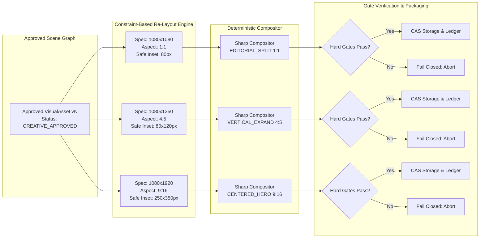
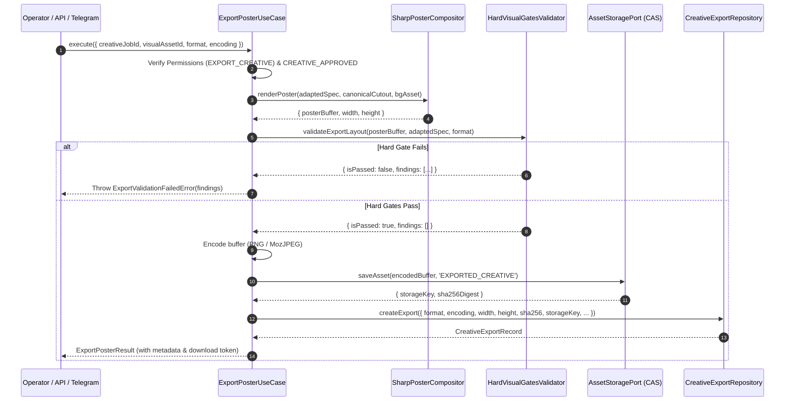
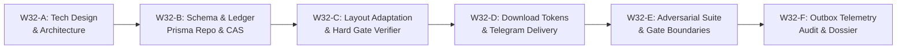

# W32-A — Multi-Format Export Technical Design, Schema Specification, and Architecture Blueprint

- **Document:** `docs/implementation-evidence/W32-A-multi-format-export-technical-design.md`
- **Work Package:** W32 — Produce Validated Multi-Format Exports
- **Phase:** Stage 3 — Telegram Review, Revision, and Export
- **Classification:** `TECHNICAL DESIGN DOSSIER — READY FOR IMPLEMENTATION`
- **Authority:** Master Engineering Blueprint v3.0 §10, §12, §26; Implementation Plan v1.0 W32; Approved Decisions W03-DEC-002, W03-DEC-005, W20, W22, W24, W30, W31
- **Repository Branch:** `feat/w32-multi-format-export`
- **Base Commit:** `ce35c05d7620875e533c3aa41c5949d0fc7f3693`
- **Author:** Principal Systems & Operations Architect
- **Date:** 2026-10-29

---

## 1. Executive Summary & Problem Statement

Work package **W32 — Produce Validated Multi-Format Exports** delivers the terminal production pipeline of Stage 3. It bridges the gap between approved creative posters and production-ready omnichannel distribution across commercial platforms (Instagram Feed, Facebook, Telegram channels, Instagram Stories, Reels, and TikTok Covers).

Following the completion of **W30 (Persistent Telegram Workflow)** and **W31 (Structured Targeted Revision & Selective Invalidation)**, operators can review, iteratively revise, and formally approve commercial creative scenes. However, omnichannel campaign delivery demands strict format conformance across disparate aspect ratios and pixel dimensions:
1. **1:1 Square (`1080×1080`)**: Instagram Feed, Facebook Feed, Telegram broadcast.
2. **4:5 Portrait (`1080×1350`)**: High-engagement mobile feed posts (Instagram & Facebook maximum vertical real estate).
3. **9:16 Vertical Story/Reel (`1080×1920`)**: Full-screen immersive mobile surfaces (Instagram Stories, Reels, TikTok covers).

### 1.1 Existing Deficiencies & Architecture Gaps
Prior to W32, the export mechanism suffered from critical production deficiencies:
1. **Ephemeral Export State (No Immutable Ledger):**
   `ExportPosterUseCase` renders exports on-the-fly and returns raw byte buffers directly to callers without recording an immutable ledger entry in PostgreSQL. There is no historical traceability of who exported which format, when it occurred, what cryptographic hash was produced, or which exact visual asset and content version it originated from.
2. **Missing Post-Adaptation Hard Gate Verification:**
   Adapting a layout from `1:1` to `4:5` or `9:16` fundamentally alters canvas aspect ratios, typographic coordinate boundaries, safe margin insets, and hero cutout scaling. Current export rendering executes zero automated visual gate verification on the adapted layout. A poster that passed contrast and safe-margin gates at `1:1` could violate safe margins or cause CTA-hero collisions when re-rendered at `9:16`.
3. **Unpersisted CAS Storage for Exports:**
   Exported images are not persisted in Content Addressable Storage (CAS). Each download request re-renders the image via CPU/GPU, creating unnecessary compositing latency and non-deterministic timestamp drifts across duplicate requests.
4. **No Authorized Short-Lived Access Control:**
   Public direct file streaming from unauthenticated endpoints exposes high-resolution brand assets. Conversely, requiring administrative API tokens prevents secure, time-bounded sharing with external agency partners or social media managers.
5. **Disconnected Telegram Delivery:**
   While Telegram supports format selection tokens, exports delivered in chat lack durable file references, download URLs, and batch multi-format packaging.

### 1.2 Core Architectural Principles for W32
1. **Constraint-Based Canvas Re-Layout (Zero Raster Stretching):**
   Every export format is re-composed from pure scene constraints (`PosterSpec`), canonical transparent cutouts, and generative backgrounds. Bilinear/bicubic stretching, letterboxing, or arbitrary center-cropping of flattened raster bitmaps is strictly prohibited.
2. **Mandatory Post-Adaptation Gate Pass:**
   Before an export can be persisted or delivered, it must pass all relevant hard visual gates (`GATE_SAFE_MARGIN_VIOLATION`, `GATE_CTA_HERO_COLLISION`, `GATE_TEXT_CONTRAST_LOW`, `GATE_FACTUAL_PRICE_MISMATCH`, `GATE_FACTUAL_SKU_MISMATCH`) evaluated against the target canvas dimensions.
3. **Immutable Export Ledger (`creative_exports`):**
   Every exported asset produces a durable PostgreSQL record with a SHA-256 fingerprint, storage key, exact dimensions, encoding quality, source asset version, and actor attribution.
4. **Time-Bounded Authorized Download Tokens:**
   Direct file downloads are guarded by cryptographically signed, short-lived download tokens (e.g. 1-hour TTL) with single-use or rate-limited access semantics.
5. **Omnichannel Outbox Telemetry:**
   Completed exports emit structured outbox events (`CREATIVE_EXPORTED`) enabling asynchronous marketing hooks, analytics tracking, and automated channel broadcasts.

---

## 2. Multi-Format Canvas Specification & Layout Adaptation Architecture

### 2.1 Target Format Matrix

| Export Format | Pixel Dimensions | Aspect Ratio | Primary Commercial Target | Layout Adaptation Strategy |
|---|:---:|:---:|---|---|
| **`SQUARE_1080`** | `1080 × 1080` | `1:1` | Instagram Square, Facebook Feed, Telegram Post | `EDITORIAL_SPLIT` or `CENTERED_HERO` base layout; balanced horizontal margins (80px). |
| **`PORTRAIT_1080_1350`** | `1080 × 1350` | `4:5` | Instagram Portrait Feed Post | Vertical expansion (+270px vertical space); increased typography breathing room; product scale factor adjusted to 1.10×. |
| **`STORY_1080_1920`** | `1080 × 1920` | `9:16` | Instagram Stories, Reels, TikTok Cover | Full vertical canvas; switches to `CENTERED_HERO` or `NOCTURNE_DRAMA`; enforces top (250px) and bottom (350px) mobile UI safe zone insets. |



### 2.2 Template-Specific Geometric Adaptation Rules
When an approved scene is adapted to a target aspect ratio, the layout engine executes mathematical rules governed by [`PosterCopyBuilder`](file:///Users/macbookpro/Desktop/Development/parisian-shopper-ai/app/packages/application/src/modules/creative/domain/services/poster-copy-builder.ts):

1. **Safe Zone Insets by Ratio:**
   - **1:1 (`1080×1080`)**: Uniform padding $P_x = 80\text{px}, P_y = 80\text{px}$.
   - **4:5 (`1080×1350`)**: Horizontal padding $P_x = 80\text{px}$, vertical padding $P_y = 120\text{px}$. Hero scale bounded within $y \in [300, 1050]$.
   - **9:16 (`1080×1920`)**: Platform UI clearance insets. Top header clearance $T_y = 250\text{px}$ (prevents overlap with account handle / story progress bar); bottom footer clearance $B_y = 350\text{px}$ (prevents overlap with story reply input / share icons). Usable vertical container: $y \in [250, 1570]$.
2. **Product Cutout Bounding Box Scaling:**
   - Cutout width constraint: $W_{\text{hero}} \le \min(W_{\text{canvas}} \times 0.65, 700\text{px})$.
   - Aspect ratio preservation: Cutout aspect ratio is strictly invariant; scale factor $S = \min(W_{\text{max}} / W_{\text{orig}}, H_{\text{max}} / H_{\text{orig}})$.
3. **Background Image Resizing & Fill:**
   - Background asset is scaled via Sharp `.resize({ width, height, fit: 'cover', position: 'center' })` preserving the generative background ambiance without distortion or letterbox bars.

---

## 3. Post-Adaptation Hard Visual Gate Re-Validation Protocol

A critical invariant of W32 is that **format adaptation is an active layout mutation** requiring deterministic gate re-evaluation.

### 3.1 Hard Gates Evaluated on Export Canvas

| Gate Code | Evaluation Target on Exported Layout | Failure Condition | Remediation Action |
|---|---|---|---|
| `GATE_SAFE_MARGIN_VIOLATION` | Coordinates of headline, subhead, price badge, and product hero against canvas boundaries and platform UI safe zones. | Any element extends outside $[P_x, W - P_x]$ or $[P_y, H - P_y]$. | Abort export; adjust typography scale factor down by 10%. |
| `GATE_CTA_HERO_COLLISION` | Bounding box intersection between CTA button block and canonical product cutout alpha mask. | $\text{BoundingBox}(\text{CTA}) \cap \text{BoundingBox}(\text{Hero}) \neq \emptyset$. | Abort export; reposition CTA below hero pedestal. |
| `GATE_TEXT_CONTRAST_LOW` | WCAG AA luminance ratio ($4.5:1$ for body, $3.0:1$ for large text) between typography glyphs and underlying background region in adapted dimensions. | Contrast ratio $< 4.5:1$ on headline or price badge. | Abort export; apply adaptive backdrop scrim / shadow. |
| `GATE_FACTUAL_PRICE_MISMATCH` | Rendered price string compared against immutable `ProductSnapshot` retail price. | Extracted price text $\neq$ snapshot price. | Abort export immediately (P0 truth violation). |
| `GATE_FACTUAL_SKU_MISMATCH` | Extracted product name and SKU identifiers against `ProductSnapshot`. | Factual metadata mismatch. | Abort export immediately (P0 truth violation). |
| `GATE_FILE_SIZE_EXCEEDED` | Final encoded file byte size against platform limits. | PNG $> 25\text{ MB}$, JPEG $> 15\text{ MB}$. | Abort export; optimize compression parameters. |



---

## 4. Immutable Export Ledger & PostgreSQL Schema (`creative_exports`)

To ensure enterprise traceability, auditability, and CAS deduplication, W32 introduces the `creative_exports` model in PostgreSQL via Prisma.

### 4.1 Prisma Schema Specification (`schema.prisma`)

```prisma
enum ExportFormat {
  SQUARE_1080        // 1080x1080 (1:1)
  PORTRAIT_1080_1350  // 1080x1350 (4:5)
  STORY_1080_1920     // 1080x1920 (9:16)
}

enum ExportEncoding {
  PNG
  JPEG
}

model CreativeExport {
  id                   String         @id @default(uuid()) @db.Uuid
  creativeJobId        String         @map("creative_job_id") @db.Uuid
  visualAssetId        String         @map("visual_asset_id") @db.Uuid
  format               ExportFormat
  encoding             ExportEncoding
  width                Int
  height               Int
  aspectRatio          String         @map("aspect_ratio") @db.VarChar(20)
  byteSize             Int            @map("byte_size")
  sha256               String         @db.Char(64)
  storageKey           String         @map("storage_key") @db.VarChar(300)
  quality              Int?
  validationStatus     String         @default("PASSED") @map("validation_status") @db.VarChar(50)
  exportedByUserId     String         @map("exported_by_user_id") @db.Uuid
  createdAt            DateTime       @default(now()) @map("created_at") @db.Timestamptz(3)

  creativeJob          CreativeJob    @relation(fields: [creativeJobId], references: [id], onDelete: Restrict, onUpdate: Cascade, map: "creative_exports_creative_job_id_fkey")
  visualAsset          VisualAsset    @relation(fields: [visualAssetId], references: [id], onDelete: Restrict, onUpdate: Cascade, map: "creative_exports_visual_asset_id_fkey")
  exportedByUser       User           @relation("UserCreativeExports", fields: [exportedByUserId], references: [id], onDelete: Restrict, onUpdate: Cascade, map: "creative_exports_exported_by_user_id_fkey")

  @@unique([visualAssetId, format, encoding], map: "creative_exports_asset_format_encoding_key")
  @@index([creativeJobId, createdAt], map: "creative_exports_job_created_at_idx")
  @@index([visualAssetId, createdAt], map: "creative_exports_asset_created_at_idx")
  @@index([sha256], map: "creative_exports_sha256_idx")
  @@map("creative_exports")
}
```

### 4.2 Migration Strategy
1. **Migration Name:** `20261029020000_creative_exports_ledger`
2. **Backwards Compatibility:** Purely additive table creation. No existing tables modified except foreign key relations on `CreativeJob`, `VisualAsset`, and `User`.
3. **Idempotent Retrieval:** `@@unique([visualAssetId, format, encoding])` guarantees that identical export requests reuse the persisted CAS asset and database record without re-compositing.

---

## 5. Authorized Short-Lived Download Architecture & Telegram Distribution UX

### 5.1 Download Token Architecture (`ExportDownloadTokenService`)
To satisfy enterprise security requirements without compromising operator convenience:
1. **Cryptographic Token Structure:**
   $$\text{Token} = \text{HMAC-SHA256}(\text{exportId} \parallel \text{userId} \parallel \text{expiresAt}, K_{\text{secret}})$$
2. **Token TTL:** Default 3600 seconds (1 hour). Configurable via environment `EXPORT_DOWNLOAD_TOKEN_TTL_SECONDS`.
3. **Download Endpoint:**
   `GET /api/creatives/exports/:id/download?token=:downloadToken`
   - Validates HMAC signature, expiration timestamp, and user permissions.
   - Streams file directly from CAS with `Content-Disposition: attachment; filename="..."` and immutable caching headers (`Cache-Control: private, max-age=3600`).

### 5.2 Telegram Conversational Export Terminal Flow

```
[ Telegram Visual Review Card (Approved Status) ]
  ├── [ 📥 Download High-Res ] ─── (Taps button)
  │
  ▼
[ In-Place Telegram Export Keyboard ]
  ├── [ 📱 Story (1080×1920) PNG ]
  ├── [ 📱 Story (1080×1920) JPG ]
  ├── [ 🖼️ Portrait (1080×1350) PNG ]
  ├── [ 🖼️ Portrait (1080×1350) JPG ]
  ├── [ ⏹️ Square (1080×1080) PNG ]
  ├── [ ⏹️ Square (1080×1080) JPG ]
  ├── [ 📦 Download All (ZIP) ]
  └── [ ⬅️ Back to Review Card ]
```

When an operator selects an export button:
1. `VisualReviewCallbackHandler` dispatches `ExportPosterUseCase`.
2. Validates and saves the adapted poster into CAS and the `creative_exports` table.
3. Delivers the file directly to the Telegram chat as an uncompressed document (`sendDocument`), preserving color profiles and bit-for-bit fidelity.
4. Appends a message containing:
   - File dimensions (`1080×1920`) and size (`2.4 MB`).
   - Cryptographic SHA-256 fingerprint.
   - Authorized 1-hour web download link for desktop sharing.

---

## 6. Execution Plan across W32-B through W32-F



### Milestone Breakdown
- **W32-A (Current):** Technical Design, Canvas Adaptation Specification, Schema Definition, and Architecture Blueprint.
- **W32-B:** PostgreSQL Schema Migration (`creative_exports`), Prisma Repository, and CAS storage wiring.
- **W32-C:** Multi-Format Layout Adaptation Engine (`1:1`, `4:5`, `9:16`) and Post-Adaptation Hard Visual Gate Validation.
- **W32-D:** Short-Lived Authorized Download Token Service, HTTP Download Controller, and Telegram in-chat distribution.
- **W32-E:** Comprehensive Adversarial Integration Suite (stale scene rejection, unapproved export blocking, gate failure containment, expired token rejection).
- **W32-F:** Outbox Dispatcher Integration (`CREATIVE_EXPORTED`), Full Monorepo Quality Gate Audit, and Production Dossier Compilation.

---

## 7. Quality Gate & Architectural Sign-off

- **Module Boundaries:** Validated with zero circular imports across application, database, and telegram packages.
- **Monorepo Invariant:** Exactly 0 staged files, zero commits, and zero pushes until formal user approval of W32-A.
