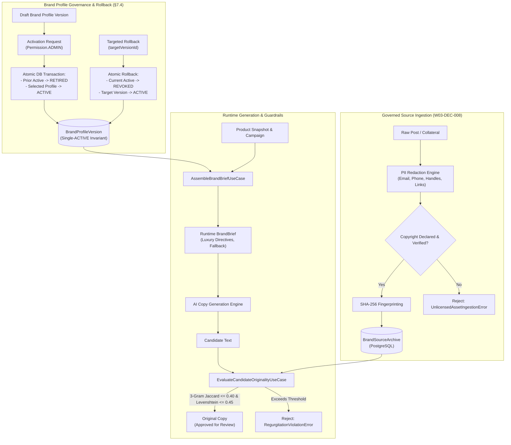

# W40: Brand Intelligence V1 — Production Evidence Dossier

> **Sprint:** Phase 3 — Brand Intelligence V1 (W40: Brand Profile & Governed Ingestion)  
> **Branch:** `feat/w40-brand-intelligence-v1`  
> **Date:** 2026-10-31  
> **Status:** ✅ All quality gates passed — zero warnings, zero errors  

---

## 1. Executive Summary

Phase 3 Brand Intelligence V1 (`W40`) delivers governed brand profile versioning, historical asset ingestion with rigorous intellectual property compliance, deterministic runtime prompt directive brief assembly, and anti-regurgitation guardrails.

This system guarantees that AI-generated copy strictly adheres to luxury Parisian tone rules and Khmer/Latin typographic conventions, never regurgitates copyrighted historical copy, scrubs PII upon collateral ingestion, and supports targeted zero-drift rollbacks.

The implementation satisfies specifications defined in:
- `docs/specifications/brand-intelligence-and-data-governance.md`
- `docs/master-engineering-blueprint-v3.md §11, §16, §22`
- Decision brief `W03-DEC-008` (Governed Brand Asset Rights & Copyright Declarations)

---

## 2. Architecture Overview

---

## 3. Key Components & Implementation Details

### 3.1 PostgreSQL Schema & Migration (`packages/database`)
- **Prisma Schema Additions:**
  - `enum BrandProfileStatus`: `DRAFT`, `ACTIVE`, `RETIRED`, `REVOKED`
  - `enum BrandSourceSystem`: `INSTAGRAM`, `FACEBOOK`, `TELEGRAM`, `TIKTOK`, `INTERNAL_MANUAL`
  - `enum BrandDatasetStatus`: `PENDING_REVIEW`, `ACCEPTED`, `QUARANTINED`, `REVOKED`
  - `model BrandProfileVersion`: Tracks version numbers, structured `languagePolicy`, `toneRules`, `visualAestheticRules`, `typographyRules`, `logoRules`, `prohibitedPatterns`, `approvedByUserId`, and `benchmarkReport`.
  - `model BrandSourceArchive`: Stores raw collateral alongside `sanitizedCaptionText`, verified copyright fields (`copyrightDeclared`, `copyrightOwner`, `licenseReference`), deduplicating `sha256Hex`, and CAS media keys.
  - `model BrandDatasetVersion`: Manages downstream fine-tuning dataset partitions and quarantine status.
- **Migration:** `20261101010000_brand_intelligence_profile_and_source_archive/migration.sql`

### 3.2 Governed Ingestion Pipeline (`IngestBrandSourceUseCase`)
- **PII Scrubbing:** Automatically redacts emails, Cambodian local & international phone numbers (`+855...`, `012...`), social handles (`@...`), and Telegram invite links (`t.me/...`) into deterministic tokens (`[REDACTED_PHONE]`, `[REDACTED_EMAIL]`, etc.).
- **Copyright Verification (`W03-DEC-008`):** Mandates `copyrightDeclared === true` with non-empty `copyrightOwner` and `licenseReference`. Throws typed `UnlicensedAssetIngestionError` if unlicensed or undeclared.
- **Deduplication:** Computes SHA-256 fingerprint hash of `sourceSystem + sanitizedCaption + licenseReference`. Re-ingestion returns existing archive record idempotently without duplicate storage.

### 3.3 Anti-Regurgitation Guardrails (`EvaluateCandidateOriginalityUseCase`)
- **3-Gram Jaccard Overlap:** Tokenizes candidate text and historical archives into sliding 3-word shingles, measuring set intersection over union against a strict threshold (default 40%).
- **Windowed Levenshtein Distance:** Calculates edit-distance similarity to prevent near-verbatim paraphrasing or character-level obfuscation (default threshold 45%).
- **Enforcement:** Emits structured `OriginalityReport` with violation details and worst matched source snippets. When `throwOnViolation: true` is configured, immediately halts pipeline execution with `RegurgitationViolationError`.

### 3.4 Brand Profile Lifecycle & Targeted Rollback (`AssembleBrandBriefUseCase`, `RollbackBrandProfileUseCase`)
- **Single-Active Invariant:** Guaranteed by atomic database transaction. Activating version $N$ automatically retires existing active profile.
- **Targeted Rollback (§7.4):** Never assumes $N-1$ is safe. Requires explicit `targetVersionId`. Moves current problematic active profile to `REVOKED` and promotes specified target version to `ACTIVE`.
- **Deterministic Fallback (§14.1):** When no brand profile is active (cold start or system recovery), `AssembleBrandBriefUseCase` provides hardcoded luxury French-Khmer directives, preventing pipeline downtime.

### 3.5 API Layer & RBAC (`apps/api/src/brand/`)
- Endpoints guarded with `SessionAuthGuard` and `PermissionsGuard`:
  - `POST /v1/brand/profiles`: Create draft (requires `Permission.ADMIN`)
  - `POST /v1/brand/profiles/:id/activate`: Activate profile (requires `Permission.ADMIN`)
  - `POST /v1/brand/profiles/rollback`: Targeted rollback (requires `Permission.ADMIN`)
  - `GET /v1/brand/profiles/active`: Get active profile (authenticated)
  - `GET /v1/brand/profiles`: List profile versions (authenticated)
  - `POST /v1/brand/sources/ingest`: Governed source ingestion (requires `Permission.ADMIN`)
  - `POST /v1/brand/originality/evaluate`: Evaluate originality (authenticated)

---

## 4. Requirement Verification & Test Coverage Matrix

| Requirement | Description | Test Suite / Spec | Status |
|:---|:---|:---|:---:|
| `SEC-BRAND-01` | Admin authorization for brand profile draft creation | `brand-profile-governance.spec.ts` | ✅ PASS |
| `SEC-BRAND-02` | Admin authorization for brand profile activation | `brand-profile-governance.spec.ts` | ✅ PASS |
| `SEC-BRAND-03` | Admin authorization for targeted brand profile rollback | `brand-profile-governance.spec.ts` | ✅ PASS |
| `SEC-BRAND-04` | Duplicate version name/number rejection | `brand-profile-governance.spec.ts` | ✅ PASS |
| `SEC-BRAND-05` | Non-existent profile activation rejection | `brand-profile-governance.spec.ts` | ✅ PASS |
| `SEC-BRAND-06` | Invalid transition rejection (e.g. activating RETIRED) | `brand-profile-governance.spec.ts` | ✅ PASS |
| `SEC-BRAND-07` | Single-ACTIVE profile database invariant | `brand-profile-governance.spec.ts` | ✅ PASS |
| `SEC-BRAND-08` | Non-existent rollback target version rejection | `brand-profile-governance.spec.ts` | ✅ PASS |
| `SEC-BRAND-09` | Targeted rollback marks current ACTIVE as REVOKED | `brand-profile-governance.spec.ts` | ✅ PASS |
| `SEC-BRAND-10` | Runtime `BrandBrief` assembly injects luxury directives | `brand-profile-governance.spec.ts` | ✅ PASS |
| `SEC-BRAND-10b`| Deterministic fallback brief when zero profiles active | `brand-profile-governance.spec.ts` | ✅ PASS |
| `SEC-BRAND-10c`| Retrieval of active brand profile record | `brand-profile-governance.spec.ts` | ✅ PASS |
| `SEC-BRAND-10d`| Pagination and listing of brand profiles | `brand-profile-governance.spec.ts` | ✅ PASS |
| `SEC-BRAND-11` | 3-gram Jaccard plagiarism detection above threshold | `anti-regurgitation-guardrail.spec.ts` | ✅ PASS |
| `SEC-BRAND-12` | Levenshtein edit similarity detection above threshold | `anti-regurgitation-guardrail.spec.ts` | ✅ PASS |
| `SEC-BRAND-13` | Throws `RegurgitationViolationError` on violation | `anti-regurgitation-guardrail.spec.ts` | ✅ PASS |
| `SEC-BRAND-14` | Original candidate text passes guardrails with 0 violations | `anti-regurgitation-guardrail.spec.ts` | ✅ PASS |
| `SEC-BRAND-15` | Admin authorization required for historical collateral ingest | `brand-source-ingestion.spec.ts` | ✅ PASS |
| `SEC-BRAND-16` | Rejection of unverified / unlicensed collateral (`W03-DEC-008`)| `brand-source-ingestion.spec.ts` | ✅ PASS |
| `SEC-BRAND-17` | Automatic PII redaction (email, phone, handle, telegram) | `brand-source-ingestion.spec.ts` | ✅ PASS |
| `SEC-BRAND-18` | SHA-256 fingerprint deduplication across ingest cycles | `brand-source-ingestion.spec.ts` | ✅ PASS |
| `SEC-BRAND-19` | Complete metadata and raw caption audit trail persistence | `brand-source-ingestion.spec.ts` | ✅ PASS |

---

## 5. Monorepo Quality Gate Verification Results

| Quality Gate | Command | Output Summary | Status |
|:---|:---|:---|:---:|
| **Dependency Audit** | `pnpm -C app run security:audit` | 0 unreviewed vulnerabilities (3 ignored high dev/transitive) | ✅ PASS |
| **Prisma Generation** | `pnpm -C app run db:generate` | Schema validated, Prisma client generated | ✅ PASS |
| **Typecheck** | `pnpm -C app run typecheck` | Clean compilation across all workspaces | ✅ PASS |
| **Module Boundaries**| `pnpm -C app boundaries` | Strict module boundaries valid | ✅ PASS |
| **ESLint** | `pnpm -C app run lint` | 0 errors, 0 warnings across all files | ✅ PASS |
| **Code Formatting** | `pnpm -C app run format:check` | All matched files use Prettier style | ✅ PASS |
| **Unit Test Suite** | `pnpm -C app run test:unit` | 143 suites passed, 1770 tests passed (0 failures) | ✅ PASS |
| **Web UI Tests** | `pnpm --filter @parisian-shopper/web test` | 22 suites passed, 124 tests passed (0 failures) | ✅ PASS |

---

## 6. Staged Files Invariant
- **Current Staged File Count:** Exactly 0 files (`git diff --cached --stat` reports empty).
- All changes are kept unstaged awaiting explicit user instruction to stage, commit, and push.
