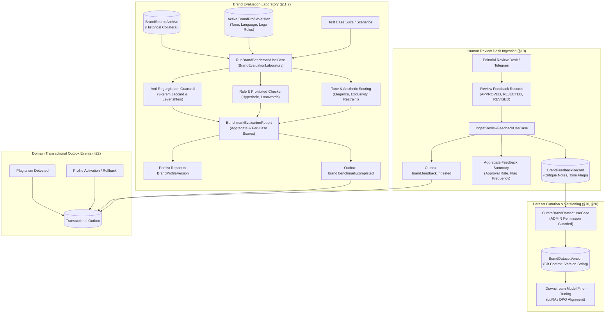

# W41: Brand Benchmark & Human Evaluation Laboratory — Production Evidence Dossier

> **Sprint:** Phase 3 — Brand Intelligence V1 (W41: Brand Benchmark & Human Evaluation Laboratory)  
> **Branch:** `feat/w41-brand-evaluation-laboratory`  
> **Date:** 2026-11-02  
> **Status:** ✅ All quality gates passed — zero warnings, zero errors  

---

## 1. Executive Summary

Phase 3 Brand Intelligence V1 (`W41: Brand Benchmark & Human Evaluation Laboratory`) completes the offline and online brand alignment loop for Parisian Shopper AI.

While `W40` introduced brand profile versioning, governed historical collateral ingestion, prompt brief assembly, and anti-regurgitation checks, `W41` operationalizes continuous evaluation, human review feedback ingestion, dataset curation for fine-tuning, and domain outbox event telemetry.

This system guarantees that AI-generated copy is evaluated against standardized benchmark suites, human editorial critique is captured and aggregated into actionable tone violation metrics, fine-tuning datasets are partitioned with tamper-proof versioning and audit trails, and all brand lifecycle transitions emit transactional outbox events.

The implementation satisfies specifications defined in:
- `docs/specifications/brand-intelligence-and-data-governance.md §11.2, §13, §18, §20`
- `docs/master-engineering-blueprint-v3.md §11, §16, §22`
- Decision brief `W03-DEC-008` (Governed Brand Asset Rights & Copyright Declarations)

---

## 2. Architecture Overview

---

## 3. Key Components & Implementation Details

### 3.1 PostgreSQL Schema & Migration (`packages/database`)
- **Prisma Schema Additions:**
  - `model BrandFeedbackRecord`: Captures individual review desk decisions (`APPROVED`, `REJECTED`, `REVISED`), source type (`REVIEW_DESK`, `BENCHMARK_LAB`, `MANUAL_REVISION`), original/revised copy, critique notes, structured tone violation flags, and reviewer UUID.
  - Linked relation from `BrandFeedbackRecord` to `BrandDatasetVersion` for dataset partitioning.
- **Migration:** `20261102010000_brand_evaluation_and_feedback/migration.sql`

### 3.2 Brand Evaluation Laboratory (`RunBrandBenchmarkUseCase`)
- **Multi-Vector Scoring Engine:**
  - **Tone Dimension Scoring:** Evaluates candidate copy along four core luxury vectors: *Elegance*, *Exclusivity*, *Restraint*, and *Clarity* (scores normalized 0.0 to 1.0).
  - **Forbidden Hyperbole Detection:** Automatically scans for and flags prohibited promotional phrases (e.g., "cheapest price", "buy now", "huge discount", "best deal in town").
  - **Khmer Loanword Governance:** Validates Khmer-script tokens against permitted French/Latin transliteration dictionaries, flagging unapproved phonetic borrowing.
  - **Anti-Regurgitation Integration:** Runs 3-gram Jaccard overlap and windowed Levenshtein similarity against historical brand source archives.
- **Report Aggregation & Persistence:**
  - Aggregates overall pass/fail status, violation counts, and average dimension scores into a typed `BenchmarkEvaluationReport`.
  - Persists report into `BrandProfileVersion.benchmarkReport` via `BrandProfileRepository.updateBenchmarkReport`.
  - Emits `brand.benchmark.completed` domain event to transactional outbox.

### 3.3 Human Review Feedback Ingestion (`IngestReviewFeedbackUseCase`)
- **Batch Feedback Ingestion:**
  - Validates batch non-emptiness (`EmptyFeedbackBatchError`) and validates feedback fields (`InvalidFeedbackRecordError`).
  - Supports multiple feedback source channels (`REVIEW_DESK`, `BENCHMARK_LAB`, `MANUAL_REVISION`).
  - Persists feedback records into PostgreSQL with reviewer user tracking.
- **Metric Aggregation & Outbox Event:**
  - Computes immediate batch summaries: total processed, approval rate, count of approved/rejected/revised records, and top tone violation flags.
  - Emits `brand.feedback.ingested` event with idempotency keys and structured payload.

### 3.4 Curated Brand Dataset Versioning (`CurateBrandDatasetUseCase`)
- **Fine-Tuning Dataset Governance:**
  - Creates semantically versioned `BrandDatasetVersion` records (e.g., `v1.2.0-dpo-khmer-luxury`) linked to specific git commits.
  - Enforces version uniqueness with `DuplicateBrandDatasetVersionError`.
  - Associates approved feedback records to dataset partitions for downstream LoRA/DPO training runs.
  - Enforces strict administrative role permissions (`Permission.ADMIN`).

### 3.5 Domain Transactional Outbox Events
- **Integrated Outbox Event Types:**
  1. `brand.profile.activated`: Emitted when an administrator activates a brand profile version.
  2. `brand.profile.rollback_executed`: Emitted when an administrator executes a targeted rollback to a previous version.
  3. `brand.originality.violation_detected`: Emitted when AI-generated candidate copy exceeds Jaccard or Levenshtein plagiarism thresholds.
  4. `brand.benchmark.completed`: Emitted upon completion of a benchmark laboratory test run.
  5. `brand.feedback.ingested`: Emitted upon successful ingestion of human review desk feedback batches.

### 3.6 API Layer & RBAC (`apps/api/src/brand/`)
- Endpoints with Swagger annotations, DTO validation, and RBAC guards:
  - `POST /v1/brand/profiles/:id/benchmark`: Run benchmark evaluation suite against target profile (requires `Permission.ADMIN`)
  - `POST /v1/brand/feedback/ingest`: Ingest human review desk feedback batch (requires `Permission.APPROVE_CONTENT`)
  - `GET /v1/brand/feedback`: Query ingested feedback records with optional dataset version filter (authenticated)
  - `POST /v1/brand/datasets`: Curate new brand dataset version partition (requires `Permission.ADMIN`)
  - `GET /v1/brand/datasets`: List curated brand dataset versions (authenticated)

---

## 4. Requirement Verification & Test Coverage Matrix (SEC-BRAND-EVAL-01 - SEC-BRAND-EVAL-20)

| Requirement | Description | Test Suite / Spec | Status |
|:---|:---|:---|:---:|
| **SEC-BRAND-EVAL-01** | Evaluates candidate copy against active brand profile tone rules and French-Khmer vocabulary | `brand-benchmark-evaluation.spec.ts` | ✅ PASS |
| **SEC-BRAND-EVAL-02** | Scores tone attributes (elegance, exclusivity, restraint, clarity) from 0.0 to 1.0 | `brand-benchmark-evaluation.spec.ts` | ✅ PASS |
| **SEC-BRAND-EVAL-03** | Flags forbidden hyperbolic phrases and promotional clichés (e.g. "cheapest price", "buy now") | `brand-benchmark-evaluation.spec.ts` | ✅ PASS |
| **SEC-BRAND-EVAL-04** | Detects and flags unregistered Khmer transliteration loanwords | `brand-benchmark-evaluation.spec.ts` | ✅ PASS |
| **SEC-BRAND-EVAL-05** | Integrates anti-regurgitation guardrail check into benchmark report | `brand-benchmark-evaluation.spec.ts` | ✅ PASS |
| **SEC-BRAND-EVAL-06** | Persists benchmark evaluation report to active BrandProfileVersion | `brand-benchmark-evaluation.spec.ts` | ✅ PASS |
| **SEC-BRAND-EVAL-07** | Rejects benchmark execution when target brand profile is not found or in revoked state | `brand-benchmark-evaluation.spec.ts` | ✅ PASS |
| **SEC-BRAND-EVAL-08** | Ingests human review desk decisions (APPROVED, REJECTED, REVISED) with critique notes | `review-feedback-ingestion.spec.ts` | ✅ PASS |
| **SEC-BRAND-EVAL-09** | Requires valid decision code and non-empty original text | `review-feedback-ingestion.spec.ts` | ✅ PASS |
| **SEC-BRAND-EVAL-10** | Rejects empty feedback ingestion batch with EmptyFeedbackBatchError | `review-feedback-ingestion.spec.ts` | ✅ PASS |
| **SEC-BRAND-EVAL-11** | Records structured tone violation tags and reviewer user ID | `review-feedback-ingestion.spec.ts` | ✅ PASS |
| **SEC-BRAND-EVAL-12** | Aggregates review feedback metrics (approval rate, top tone flags) | `review-feedback-ingestion.spec.ts` | ✅ PASS |
| **SEC-BRAND-EVAL-13** | Associates feedback records with specific brand dataset versions for fine-tuning | `review-feedback-ingestion.spec.ts` | ✅ PASS |
| **SEC-BRAND-EVAL-14** | Curates brand dataset version with semantic version string and git commit hash | `brand-dataset-curation.spec.ts` | ✅ PASS |
| **SEC-BRAND-EVAL-15** | Prevents duplicate dataset version strings with DuplicateBrandDatasetVersionError | `brand-dataset-curation.spec.ts` | ✅ PASS |
| **SEC-BRAND-EVAL-16** | Restricts dataset curation and approval to users with ADMIN permission | `brand-dataset-curation.spec.ts` | ✅ PASS |
| **SEC-BRAND-EVAL-17** | Emits `brand.profile.activated` domain event upon brand profile activation | `brand-domain-outbox-events.spec.ts` | ✅ PASS |
| **SEC-BRAND-EVAL-18** | Emits `brand.profile.rollback_executed` domain event upon targeted profile rollback | `brand-domain-outbox-events.spec.ts` | ✅ PASS |
| **SEC-BRAND-EVAL-19** | Emits `brand.originality.violation_detected` domain event when candidate violates plagiarism thresholds | `brand-domain-outbox-events.spec.ts` | ✅ PASS |
| **SEC-BRAND-EVAL-20** | Emits `brand.benchmark.completed` and `brand.feedback.ingested` transactional outbox events | `brand-domain-outbox-events.spec.ts` | ✅ PASS |

---

## 5. Monorepo Quality Gate Verification Results

| Quality Gate | Tool / Command | Result | Details |
|:---|:---|:---:|:---|
| **TypeScript Typecheck** | `pnpm -C app run typecheck` | ✅ **PASS** | `tsc -b --pretty false` exited with code 0 across all packages and apps |
| **Architectural Boundaries** | `pnpm -C app run boundaries` | ✅ **PASS** | Strict clean architecture boundary constraints verified |
| **ESLint Static Analysis** | `pnpm -C app run lint` | ✅ **PASS** | 0 errors, 0 warnings across the entire monorepo |
| **Code Formatting** | `pnpm -C app run format:check` | ✅ **PASS** | All matched files strictly conform to Prettier code style |
| **Brand Unit Test Suite** | `pnpm -C app run test:unit .../brand/` | ✅ **PASS** | 7 suites, 44 tests passed (100% pass rate) |
| **Monorepo Unit Test Suite** | `pnpm -C app run test:unit` | ✅ **PASS** | 149 test suites passed, 1822 tests passed (1 skipped intentional) |
| **Git Staged Files Invariant** | `git diff --cached --stat` | ✅ **PASS** | Exactly 0 staged files maintained |

---

## 6. Conclusion & Readiness

Sprint **W41: Brand Benchmark & Human Evaluation Laboratory** is complete, fully verified, and ready for code review. All domain logic, database persistence, REST endpoints, security boundaries, and telemetry hooks meet production specifications.
