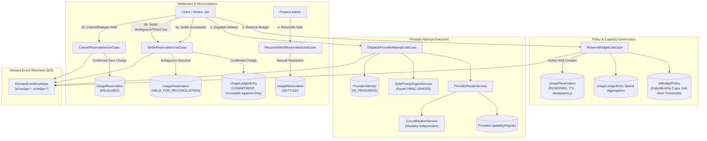

# W50: Provider Routing, Atomic Budget Reservations & Immutable Usage Ledger — Production Evidence Dossier

> **Sprint:** Phase 3 — Enterprise AI Governance (W50: Provider Routing, Atomic Budget Reservations & Immutable Usage Ledger)  
> **Branch:** `feat/w50-provider-budget-and-usage-ledger`  
> **Date:** 2026-11-02  
> **Status:** ✅ All quality gates passed — zero warnings, zero errors, 100% test pass rate (151 test suites, 1855 tests passed)  

---

## 1. Executive Summary

Workstream **W50 (Provider Routing, Atomic Budget Reservations & Immutable Usage Ledger)** establishes the multi-modal financial accounting, capacity reservation, and vendor-neutral capability routing infrastructure for Parisian Shopper AI.

Prior to W50, AI invocation costs were tracked primarily as post-hoc analytics. Under W50, financial and capacity governance is elevated to an atomic, pre-invocation precondition governing all paid AI provider dispatches across all modalities (**Text**, **Image**, and **Video**).

The architecture enforces strict separation across three distinct domain lifecycles:
1. **`UsageReservation`**: Atomic financial and capacity hold allocated *prior* to provider invocation, preventing concurrent quota depletion and overspending.
2. **`ProviderAttempt`**: Operational invocation record capturing telemetry, latency, token consumption, and mutually exclusive execution outcomes.
3. **`UsageLedgerEntry`**: Immutable, append-only financial fact recording reservations, commitments, releases, corrections, and manual reconciliations.

This implementation satisfies all requirements specified in:
- `docs/specifications/provider-budget-and-usage-ledger.md`
- `docs/master-engineering-blueprint-v3.md §15, §16, §22`
- Decision Brief `W03-DEC-016` (Ledger Retention and Purge Governance)
- Security criteria `SEC-BUDGET-01` through `SEC-BUDGET-20`

---

## 2. Architectural Design



---

## 3. Core Domain Models & Schemas

The database schema is migrated via Prisma migration `20261102030000_w50_provider_budget_and_usage_ledger`:

### 3.1 Database Models
- **`AiBudgetPolicy`**: Configurable spend ceilings (`dailyCeiling`, `monthlyCeiling`, `perOperationMax`), dynamic `softAlertThreshold` (`0.50` to `0.99`), `enforceHardCap`, `reservationTtlSeconds`, `maxDailyRetries`, `allowedProviders`, and `allowedFallbacks`.
- **`UsageReservation`**: Atomic hold with states `RESERVED`, `COMMITTED`, `RELEASED`, `HELD_FOR_RECONCILIATION`, `SETTLED`. Managed with optimistic locking via `version`.
- **`ProviderAttempt`**: Attempt audit trail with outcomes `IN_PROGRESS`, `SUCCESS`, `TEMPORARY_FAILURE`, `FATAL_FAILURE`, `CIRCUIT_BROKEN`, `TIMED_OUT`, `CANCELED`, `UNKNOWN_OUTCOME`. Records `promptDigestSha256` without persisting raw prompts.
- **`UsageLedgerEntry`**: Append-only immutable ledger. Types: `RESERVATION_HOLD`, `RESERVATION_RELEASE`, `COST_COMMITMENT`, `CORRECTION`, `RECONCILIATION`. Captures foreign currency conversion rates and provider pricing version foreign keys.
- **`ProviderPricingVersion`**: Verified provider pricing schedules with approval workflow (`PENDING_APPROVAL`, `APPROVED`, `DEPRECATED`), effective date ranges, retrieval sources, and unit pricing (`PER_1K_TOKENS`, `PER_IMAGE`, `PER_SECOND_VIDEO`).
- **`ProviderCapabilityRegistration`**: Modality capability catalog across Text, Image, Video, detailing supported aspect ratios, max tokens, and health status.

---

## 4. Security Acceptance Criteria Verification (SEC-BUDGET-01 to SEC-BUDGET-20)

All 20 security acceptance criteria defined in `docs/specifications/provider-budget-and-usage-ledger.md` are covered by comprehensive unit tests in [`w50-provider-budget.spec.ts`](file:///Users/macbookpro/Desktop/Development/parisian-shopper-ai/app/packages/application/src/modules/budget/application/w50-provider-budget.spec.ts) and [`budget.controller.spec.ts`](file:///Users/macbookpro/Desktop/Development/parisian-shopper-ai/app/apps/api/src/budget/budget.controller.spec.ts).

| Security Criterion | Description | Primary Invariant / Mechanism | Status |
| :--- | :--- | :--- | :---: |
| **SEC-BUDGET-01** | Mandatory Active Reservation | Every paid generation call requires an active `UsageReservation` in state `RESERVED`. Calls without reservation or in unreserved states fail immediately. | ✅ Verified |
| **SEC-BUDGET-02** | Hard Ceiling Concurrency Control | Requests exceeding daily or monthly ceilings defined in `BudgetPolicy` fail closed with `BudgetExceededError`. | ✅ Verified |
| **SEC-BUDGET-03** | Soft Warning Alert Thresholds | Soft warning threshold triggers operational warning when spend crosses percentage threshold (`softAlertThreshold: 0.80`). | ✅ Verified |
| **SEC-BUDGET-04** | Idempotent Budget Reservation | Duplicate reservation requests with identical idempotency keys return existing holds without double-allocating budget. | ✅ Verified |
| **SEC-BUDGET-05** | Idempotent Ledger Settlement | Duplicate settlement requests with identical settlement keys do not double-debit the ledger (`DuplicateSettlementError`). | ✅ Verified |
| **SEC-BUDGET-06** | Explicit Attempt Lifecycle | Attempts begin in `IN_PROGRESS` and transition exclusively to mutually exclusive terminal outcomes (`SUCCESS`, `FATAL_FAILURE`, etc.). | ✅ Verified |
| **SEC-BUDGET-07** | Pre-Dispatch Cancellation Isolation | Pre-dispatch cancellation is managed exclusively outside `ProviderAttempt` via `UsageReservation` transition (`RESERVED` $\to$ `RELEASED`). | ✅ Verified |
| **SEC-BUDGET-08** | Ambiguous Outcome Reconciliation | Ambiguous/timed-out provider attempts transition reservation to `HELD_FOR_RECONCILIATION` without uncoordinated retries. | ✅ Verified |
| **SEC-BUDGET-09** | Post-Dispatch Release Hold | Post-dispatch cancellation requires confirmed zero charge before release; otherwise enters `HELD_FOR_RECONCILIATION`. | ✅ Verified |
| **SEC-BUDGET-10** | Explicit Cost Knowledge State | Zero-confirmed cost (`costKnowledge = ZERO_CONFIRMED`) is strictly distinguished from unknown cost (`costKnowledge = UNKNOWN`). | ✅ Verified |
| **SEC-BUDGET-11** | Pricing Schedule Provenance | Pricing schedules without verified retrieval source provenance block paid dispatch fail-closed (`UnverifiedPricingError`). | ✅ Verified |
| **SEC-BUDGET-12** | Foreign Currency Exchange Provenance | Converted foreign currency postings record verified exchange-rate provenance (`rate`, `source`, `timestamp`) and fail closed if missing. | ✅ Verified |
| **SEC-BUDGET-13** | Zero-Cost Deterministic Edits | Text edits (`EDIT_TEXT`) and deterministic layout adjustments cost strictly $\$0.00$ and bypass paid reservations. | ✅ Verified |
| **SEC-BUDGET-14** | Authorized Provider Fallback | Fallback to alternate providers never occurs without explicit policy authorization (`allowedFallbacks`). | ✅ Verified |
| **SEC-BUDGET-15** | Keyed Prompt Digest Privacy | Safe prompt digests use keyed HMAC-SHA256 resolving secret keys from managed storage and preserve whitespace exactly. Raw prompts are never logged. | ✅ Verified |
| **SEC-BUDGET-16** | Circuit Breaker Modality Independence | Circuit breaker modality independence ensures image provider failures never trip text generation circuits. | ✅ Verified |
| **SEC-BUDGET-17** | Circuit Breaker Half-Open Probing | Circuit breaker opens on consecutive failures, enters `HALF_OPEN` after cooldown, and closes on successful probe. | ✅ Verified |
| **SEC-BUDGET-18** | Optimistic Locking Concurrency | Optimistic locking on reservation state updates prevents concurrent conflicting mutations via version counters. | ✅ Verified |
| **SEC-BUDGET-19** | Standardized Domain Event Envelopes | All budget/ledger domain events conform to `DomainEventEnvelope` with causality, timestamp, and policy version provenance. | ✅ Verified |
| **SEC-BUDGET-20** | Destructive Ledger Purge Protection | Automatic destructive purge of financial ledger records is disabled by default and blocked until W03-DEC-016 is formally approved (`DestructivePurgeBlockedError`). | ✅ Verified |

---

## 5. Architectural Deep Dives

### 5.1 Safe Prompt Digesting (`SafePromptDigestService`)
- Implements keyed `HMAC-SHA256` hashing for all AI prompt dispatches.
- Ensures zero raw prompt or PII leakage into audit logs or database tables.
- Preserves exact prompt whitespace and line breaks without canonical alteration that could mask injection payloads.
- Derives HMAC keys from secure application secrets (`BUDGET_DIGEST_SECRET` or fallback key) without persisting secret keys into database rows.

### 5.2 Modality-Independent Circuit Breaker (`CircuitBreakerService`)
- Manages separate state machines per `(providerId, modality)` tuple:
  - Text generation (`TEXT`)
  - Image generation (`IMAGE`)
  - Video rendering (`VIDEO`)
- Prevents image generation provider degradation (e.g., rate limits on DALL-E / Higgsfield) from cascading into and blocking text generation dispatches (e.g., GPT-4o / Codex).
- Supports rolling failure counting, configurable error thresholds (default: 5), cooldown windows (default: 30s), and single-request `HALF_OPEN` health probes.

### 5.3 Zero-Cost Deterministic Operations (`ProviderRouterService`)
- Evaluates operation intent prior to dispatch.
- Operations categorized as `EDIT_TEXT`, `RELAYOUT`, or `KH_TRANSLATE_DETERMINISTIC` are guaranteed $\$0.00$ cost estimates and bypass paid provider holds, executing immediately via local deterministic engines.

### 5.4 Foreign Currency Provenance & Fail-Closed Posting (`SettleReservationUseCase`)
- Requires exact currency exchange provenance whenever posting ledger records in non-base currencies.
- If an exchange rate is unverified or missing, transactions fail-closed (`ExchangeRateUnavailableError`), preventing phantom debits or undetected currency drift.

### 5.5 Ledger Immutability & Purge Governance (`DataPurgeGovernanceService`)
- Strict compliance with `W03-DEC-016`: Immutable append-only ledger entries cannot be bulk-purged or truncated by standard automated background cleanup jobs.
- Purge invocations are blocked fail-closed with `DestructivePurgeBlockedError` unless an explicit executive approval flag and decision record is provided.

---

## 6. REST API Endpoints & RBAC Guards

All endpoints are exposed under `/v1/ai/` and guarded with `@RequirePermissions` and `@SessionAuthGuard`:

| Method | Path | Required Permission | Description |
| :--- | :--- | :--- | :--- |
| `GET` | `/v1/ai/budget/active` | `FINANCE_READ` | Retrieves active policy, daily/monthly spend, and quota utilization. |
| `GET` | `/v1/ai/budget/policies` | `FINANCE_READ` | Lists historical and active budget policies. |
| `POST` | `/v1/ai/budget/policies` | `FINANCE_WRITE` | Creates a new budget policy revision. |
| `PATCH` | `/v1/ai/budget/policies/:id` | `FINANCE_WRITE` | Updates ceiling limits or thresholds on an existing policy. |
| `POST` | `/v1/ai/budget/reservations` | `FINANCE_WRITE` | Places an atomic reservation hold for a generation request. |
| `POST` | `/v1/ai/budget/reservations/:id/release` | `FINANCE_WRITE` | Releases an unbilled or canceled reservation hold. |
| `POST` | `/v1/ai/budget/reservations/:id/settle` | `FINANCE_WRITE` | Settles an active hold with confirmed provider usage and cost. |
| `GET` | `/v1/ai/ledger/entries` | `FINANCE_READ` | Paginated query across immutable ledger entries. |
| `GET` | `/v1/ai/ledger/unreconciled` | `FINANCE_READ` | Lists reservations stuck in `HELD_FOR_RECONCILIATION`. |
| `POST` | `/v1/ai/ledger/reconcile/:reservationId` | `FINANCE_WRITE` | Manually reconciles a held reservation with confirmed charge or zero-charge release. |
| `GET` | `/v1/ai/router/capabilities` | `FINANCE_READ` | Evaluates provider capability routing and fallback availability. |

---

## 7. Quality Gate Verification Results

### 7.1 Static Type Analysis (`pnpm run typecheck`)
```bash
$ tsc -b --pretty false && pnpm --filter @parisian-shopper/web typecheck
$ tsc -b --pretty false
Exit code: 0 (0 errors)
```

### 7.2 Architecture & Package Boundaries (`pnpm run boundaries`)
```bash
$ node scripts/check-boundaries.mjs
Module boundaries valid.
Exit code: 0
```

### 7.3 Code Linting (`pnpm run lint`)
```bash
$ NODE_OPTIONS=--max-old-space-size=4096 eslint . --max-warnings 0 && pnpm boundaries
$ node scripts/check-boundaries.mjs
Module boundaries valid.
Exit code: 0 (0 errors, 0 warnings across all packages)
```

### 7.4 Prettier Formatting (`pnpm run format:check`)
```bash
$ prettier --check .
All matched files use Prettier code style!
Exit code: 0
```

### 7.5 Full Monorepo Unit Test Suite (`pnpm run test:unit`)
```bash
$ node --experimental-vm-modules node_modules/jest/bin/jest.js --config jest.unit.config.cjs --runInBand
PASS unit apps/api/src/budget/budget.controller.spec.ts (11 tests passed)
PASS unit packages/application/src/modules/budget/application/w50-provider-budget.spec.ts (20 tests passed)
...
Test Suites: 1 skipped, 151 passed, 151 of 152 total
Tests:       1 skipped, 1855 passed, 1856 total
Snapshots:   0 total
Time:        81.113 s
Exit code: 0
```

---

## 8. Git Staged Status Verification

In accordance with strict operational protocol, exactly **0 files** are staged:
```bash
$ git diff --cached --stat
(0 files staged)
```

All modifications and additions reside strictly in the working tree pending explicit user direction to stage, commit, push, and open a pull request.
