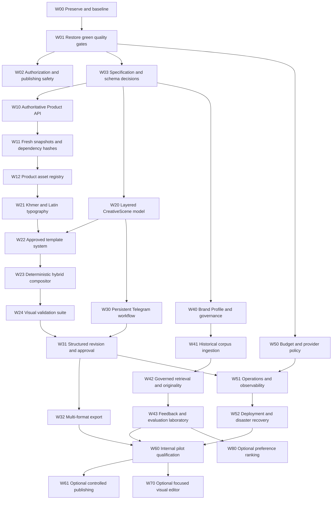

# Parisian Shopper AI — AI Implementation Plan v1.0

Status: Execution plan for AI-assisted engineering  
Created: 2026-10-16  
Authoritative product direction: [`master-engineering-blueprint-v3.md`](./master-engineering-blueprint-v3.md)  
Scope: Internal Telegram-first creative operations system for Parisian Shopper

## 1. Purpose

This document converts the Unified Master Engineering Blueprint into ordered, testable work packages that an AI coding agent can execute without guessing the product direction.

It is an implementation plan, not authorization to implement every phase at once. An agent must complete one small vertical work package, verify it, report the evidence, and stop for review before beginning the next package.

When this plan conflicts with an older roadmap, optimistic assessment, prototype, or demo behavior, the Unified Master Engineering Blueprint and this plan take precedence.

## 2. Current repository reality

The repository already contains a strong application foundation and active poster-development work:

- NestJS modular monolith with API and worker processes.
- Prisma/PostgreSQL, BullMQ/Valkey, transactional-outbox patterns, Telegram integration, provider ports, validation, review, and approval modules.
- Content generation, factual checks, product snapshots, immutable content versions, and Telegram workflows.
- Creative generation using verified product assets, backgrounds, style presets, Sharp composition, creative review actions, and poster prototypes.
- New or modified poster specifications, templates, typography helpers, compositors, provider integrations, tests, scripts, and assets are present in the working tree.

The repository is currently heavily modified and contains untracked work. Every agent must assume these changes belong to the user. It must not reset, overwrite, delete, mass-format, or reorganize unrelated files.

Known review findings that must be reverified at the start of implementation:

- Unit tests were not fully green; known failures involved compositor geometry and creative digest expectations.
- Formatting checks reported multiple files.
- The Product API production path was incomplete or fixture-backed.
- The creative renderer did not yet satisfy the full layered, editable scene requirements.
- Telegram persistence and edit-in-place behavior were incomplete.
- Visual callback authorization and approval-triggered publishing behavior required hardening.
- Khmer rendering assets and full glyph/layout evidence were incomplete.

The older `final-engineering-review.md` describes a narrower approval-only MVP and must not be used as evidence that the unified production product is complete.

## 3. Mandatory rules for every AI agent

1. Read this plan, the unified blueprint, repository instructions, and the files directly relevant to the selected work package.
2. Inspect the current working tree before editing. Preserve all unrelated user changes.
3. Work on exactly one work package unless the user explicitly authorizes a larger scope.
4. State the package ID, objective, dependencies, files likely to change, risks, and acceptance criteria before implementation.
5. Prefer a small vertical slice over broad scaffolding or speculative abstractions.
6. Keep domain rules in application/domain modules; Telegram, providers, database, and rendering libraries remain adapters.
7. Do not introduce a hidden mock, placeholder, silent fallback, or demo path and call it production behavior.
8. Do not weaken tests, authorization, factual validation, immutable versioning, approval, freshness, or budget gates to make a check pass.
9. Do not auto-publish. Publishing requires a separate, explicit, approved `PublishIntent` and qualified destination.
10. Never use generated product packaging or generated poster text as verified final content.
11. Run focused tests first and the required wider gates before claiming completion.
12. Report exact commands, results, changed files, migrations, remaining risks, and rollback notes.

## 4. Execution map



Only packages without an unfinished dependency may begin. Independent packages may be developed in parallel only when separate worktrees or clearly non-overlapping files are used and integration responsibility is assigned.

## 5. Work-package completion contract

Each package must produce:

- A concise design note or link to its approved specification.
- An inspectable, narrowly scoped diff.
- Unit tests for domain behavior and error paths.
- Integration or end-to-end evidence where the package crosses adapters.
- Security, authorization, failure, cost, and data-migration analysis as applicable.
- Updated documentation and operational instructions.
- A result classified as `complete`, `implemented but unverified`, or `blocked`.

`Complete` is allowed only when every acceptance criterion has evidence. Compilation or a screenshot alone is insufficient.

## 6. Stage 0 — protect the work and establish truth

### W00 — Preserve and inventory the current worktree

Priority: P0  
Size: S  
Depends on: none

Tasks:

- Record branch, commit, tracked modifications, untracked files, and relevant generated assets.
- Identify which changes belong to the poster work currently in progress.
- Map changed files to application modules and tests.
- Detect overlapping or contradictory implementations, especially the older hero compositor versus the newer poster compositor.
- Do not edit product code during this package.

Acceptance evidence:

- A current-state report with exact Git commands and no destructive operation.
- A file ownership/conflict map for upcoming packages.
- Confirmation that no user file was removed, reset, or overwritten.

### W01 — Restore the green engineering baseline

Priority: P0  
Size: M  
Depends on: W00

Tasks:

- Re-run format check, type check, unit tests, boundary checks, lint, build, and relevant security/license checks.
- Fix the underlying causes of all failures without changing intended business behavior merely to satisfy tests.
- Reconcile compositor geometry tests with the approved layout contract.
- Reconcile creative digest tests with the canonical digest contract.
- Apply formatting only to files in the package or already modified poster files; do not mass-format unrelated research or user work.
- Produce a truthful baseline report for integration and E2E prerequisites.

Required commands from `app/`:

```bash
pnpm format:check
pnpm typecheck
pnpm test:unit
pnpm boundaries
pnpm lint
pnpm build
pnpm security:check
pnpm check:licenses
```

Acceptance evidence:

- All listed gates pass, or each unavailable external prerequisite is documented separately.
- No skipped, focused, or weakened test is hidden.
- Known failures have regression tests explaining the intended behavior.

### W02 — Close authorization and publishing-safety gaps

Priority: P0  
Size: M  
Depends on: W01

Tasks:

- Enforce permissions inside visual review handlers and application use cases, not only in rendered buttons.
- Reject forged, replayed, stale, cross-user, and cross-campaign callbacks.
- Separate visual approval from publication.
- Disable approval-triggered channel posting by default and remove any path where `CREATIVE_APPROVED` automatically means publish.
- Introduce or confirm an explicit publication feature flag that cannot bypass a future `PublishIntent` policy.
- Add audit events for denied approval, export, and publication attempts.

Acceptance evidence:

- Unauthorized callback and direct-use-case tests fail closed.
- Approving content or a visual never posts externally.
- Existing legitimate review actions still work.
- The audit trail identifies actor, attempted action, target version, and denial reason.

### W03 — Approve the foundational specifications

Priority: P0  
Size: M  
Depends on: W01

Create the first implementation-ready versions of:

- `specifications/product-freshness-and-campaign-integrity.md`
- `specifications/layered-creative-scene-schema.md`
- `specifications/brand-intelligence-and-data-governance.md`
- `specifications/provider-budget-and-usage-ledger.md`

Each specification must define entities, invariants, state transitions, dependency invalidation, failure behavior, APIs, migrations, security, tests, and acceptance criteria. Unknown business choices must be explicit configuration or decision records, not guessed constants.

Acceptance evidence:

- Domain terminology and version semantics are consistent across all four specifications.
- No implementation package depends on an unresolved schema contradiction.
- Business-owner questions are collected in one decision register.

## 7. Stage 1 — real product and campaign truth

### W10 — Implement the authoritative Product API adapter

Status: Complete (Evidence: `/docs/implementation-evidence/W10-authoritative-product-api.md`)  
Priority: P0  
Size: L  
Depends on: W03 and owner-confirmed Product API contract

Tasks:

- Implement the existing Product Source port using the approved API contract.
- Add strict response validation, bounded timeouts/retries, authentication, host allowlisting, pagination, rate-limit handling, and error mapping.
- Keep fictional fixtures for deterministic tests but make provider selection explicit by environment.
- Fail closed when required fields or provenance are invalid.
- Never expose credentials or signed asset URLs in logs.

Acceptance evidence:

- Contract tests cover success, malformed data, timeout, rate limit, authorization failure, unknown SKU, pagination, and stale responses.
- Development can deliberately use fixtures; staging can use a sandbox; production cannot silently fall back to fixtures.
- Product API outage preserves existing drafts and returns a recoverable user message.

### W11 — Add freshness-aware snapshots and dependency hashes

Status: IMPLEMENTED — PRODUCTION ACTIVATION BLOCKED BY W03-DEC-002 (Evidence: `/docs/implementation-evidence/W11-freshness-aware-snapshots.md`)  
Priority: P0  
Size: L  
Depends on: W10

Tasks:

- Model catalog price, campaign-authorized price, stock, promotion dates, permanent facts, and source timestamps separately.
- Store immutable snapshots with canonical digests and field-level dependencies.
- Recheck relevant facts before final approval, export, and publication.
- Implement outcomes: `FRESH`, `NON_MATERIAL_CHANGE`, `MATERIAL_CHANGE`, `SOURCE_UNAVAILABLE`, `PROMOTION_EXPIRED`, and `OUT_OF_STOCK`.
- Invalidate only approvals affected by the changed dependency.

Acceptance evidence:

- Controlled tests prove price, stock, promotion, and asset changes invalidate the correct scopes.
- Historical versions remain immutable and explain what was true when created.
- The UI clearly distinguishes stale data from provider unavailability.

### W12 — Build the governed Product Asset registry

Status: IMPLEMENTED — W20 PRODUCTION ACTIVATION BLOCKED BY W03-DEC-004 (Evidence: `/docs/implementation-evidence/W12-governed-product-asset-registry.md`)  
Priority: P0  
Size: M  
Depends on: W11

Tasks:

- Register original product images, transparent cutouts, masks, fingerprints, dimensions, MIME type, source, rights, and approval state.
- Validate magic bytes, file size, pixel count, decode safety, transparency, and minimum product quality.
- Prohibit placeholder or AI-redrawn packaging in production poster generation.
- Use content-addressed storage and immutable asset references.

Acceptance evidence:

- Invalid, missing, corrupt, unsafe, or unapproved product assets fail before paid generation.
- A poster can be traced to its exact original product asset and transform.
- Asset replacement invalidates only dependent visual approvals.

## 8. Stage 2 — deterministic layered poster studio

### W20 — Implement the versioned CreativeScene model

Status: IMPLEMENTED — OWNER ACCEPTED (Evidence: `/docs/implementation-evidence/W20-versioned-layered-creative-scene-model.md`)  
Priority: P0  
Size: L  
Depends on: W03, W12, W03-DEC-004, W03-DEC-007

Tasks:

- Add `CreativeScene`, immutable `CreativeSceneVersion`, `SceneLayer`, `LayerDependency`, and render metadata.
- Support background, verified product, typography, brand, decoration, and metadata layer groups.
- Store normalized transforms, visibility, z-order, source references, token/template versions, and dependency hashes.
- Make the scene specification the authoritative editable artifact; PNG files are derivatives.
- Add safe migrations and repository ports/adapters.

Acceptance evidence:

- The same version and source assets render reproducibly.
- New edits create a new version without mutating the approved version.
- Individual layers can be changed while unaffected layer hashes remain stable.

### W21 — Complete Khmer and Latin typography

Priority: P0  
Size: L  
Depends on: W12 and approved font licensing

Tasks:

- Bundle or securely provision approved Khmer and Latin fonts with license records.
- Implement deterministic font loading, shaping, measurement, wrapping, line height, alignment, truncation policy, and safe-area constraints.
- Define bilingual hierarchy and fallback behavior that never silently substitutes an unapproved font.
- Validate glyph coverage before rendering.
- Add golden tests for Khmer, English, mixed text, numerals, currency, long product names, price, promotion, and CTA.

Acceptance evidence:

- Zero missing glyphs and zero undetected overflow in the approved golden corpus.
- Renders are stable in development, CI, staging, and production containers.
- Text is rendered by the deterministic engine, not by an image-generation provider.

### W22 — Implement five approved template families

Priority: P0  
Size: L  
Depends on: W20 and W21

Initial families:

1. Centered luxury product hero.
2. Editorial split layout.
3. Khmer seasonal or cultural campaign.
4. Scent pyramid or educational composition.
5. Promotion, price, and CTA composition.

Tasks:

- Define each template as versioned constraints and design tokens rather than hard-coded one-off coordinates.
- Support required product bounds, copy slots, logo safe area, decorative zones, and background intent.
- Produce 1:1 feed, 4:5 feed, and 9:16 story adaptations where the template is approved for them.
- Require brand-owner approval for template versions before production use.

Acceptance evidence:

- Each template passes golden rendering at all supported formats and languages.
- Long-copy and missing-optional-field cases fail gracefully.
- Template changes create new versions and do not alter historical scenes.

### W23 — Complete the deterministic hybrid compositor

Priority: P0  
Size: L  
Depends on: W22

Tasks:

- Reconcile the current hero and poster compositors into one supported architecture without deleting useful user work.
- Composite approved/generated backgrounds, verified product, deterministic shadows/reflections, typography, logo, badges, and decoration by scene layers.
- Preserve product geometry and packaging pixels except approved resize, crop, mask, color-management, and shadow operations.
- Persist render-engine version, inputs, output digest, dimensions, and color profile.
- Cache identical renders by content hash.

Acceptance evidence:

- Re-rendering identical inputs produces the expected deterministic digest or a documented platform-stable equivalence.
- No product hallucination, placeholder block, accidental crop, or hidden layer appears.
- Failure at one layer preserves the scene and supports retry from the failed stage.

### W24 — Add hard visual gates and separate aesthetic scoring

Priority: P0  
Size: M  
Depends on: W23

Hard gates:

- Exact dimensions and valid file format.
- Product containment and minimum visibility.
- Approved source asset and no placeholder.
- Text overflow, clipping, safe areas, contrast, glyph coverage, and required fields.
- Logo rules and prohibited content.
- Factual agreement between rendered price/promotion/copy and the active snapshot.

Soft scores:

- Hierarchy, balance, spacing, brand fit, novelty, and predicted reviewer preference.

Acceptance evidence:

- Aesthetic scores can rank candidates but cannot override a failed hard gate.
- Every failed gate has machine-readable evidence and a human-readable recovery action.
- Adversarial poster fixtures cover subtle cropping, low contrast, stale price, and fake placeholder cases.

## 9. Stage 3 — Telegram review, revision, and export

### W30 — Make the Telegram workflow persistent and concise

Priority: P0  
Size: M  
Depends on: W20

Tasks:

- Persist campaign, content type, language, platform, format, template, current version, and active Telegram message IDs.
- Render one decision per step with Back, Cancel, Resume, and Expired behavior.
- Edit an existing workflow message when safe instead of continuously appending large messages.
- Recover from restarts, duplicate updates, expired tokens, Telegram errors, and provider delays.
- Keep Telegram handlers thin and route business transitions through application use cases.

Acceptance evidence:

- A user can stop and resume a workflow after process restart.
- Duplicate updates do not duplicate jobs or versions.
- Message-edit failure safely falls back to a new message and updates persisted identity.

### W31 — Implement structured targeted revision and approval

Priority: P0  
Size: L  
Depends on: W24 and W30

Tasks:

- Capture structured edit targets such as headline, price, background, product position, template, decoration, or language.
- Convert free text into a proposed `RevisionPlan`; show the plan for confirmation before execution when interpretation is uncertain.
- Create a new immutable scene/content version and regenerate only affected layers.
- Keep content, visual, render, export, and publish approvals separate where dependencies differ.
- Enforce authorization, optimistic concurrency, stale-action rejection, and dependency-aware approval invalidation.

Acceptance evidence:

- “Change only the headline” leaves product/background layer hashes unchanged.
- “Replace the product image” invalidates the correct visual checks and approvals.
- Concurrent approve/edit/regenerate actions produce one valid state with no overwritten version.

### W32 — Produce validated multi-format exports

Priority: P0  
Size: M  
Depends on: W31

Tasks:

- Export approved scenes to their supported platform formats.
- Re-layout from scene constraints instead of stretching or cropping a flattened image.
- Re-run relevant hard gates after each format adaptation.
- Store immutable export records, fingerprints, scene version, dimensions, and download metadata.
- Provide short-lived authorized download access.

Acceptance evidence:

- 1:1, 4:5, and 9:16 outputs match their approved format rules.
- An export cannot be created from an unapproved or stale scene.
- Every output is traceable to exact content, scene, template, product, and render versions.

## 10. Stage 4 — Brand Intelligence V1

### W40 — Establish the manually approved Brand Profile

Priority: P1  
Size: M  
Depends on: W03 and brand-owner input

Tasks:

- Version tone, audience, Khmer/English policy, colors, typography, spacing, logo usage, product treatment, photography, CTA, seasonal cues, and prohibited patterns.
- Separate mandatory rules from preferences and campaign-specific overrides.
- Provide an approval workflow and rollback for Brand Profile versions.

Acceptance evidence:

- Every active rule has an owner, source, effective date, and classification.
- Generation records the exact Brand Profile version used.
- Unapproved profile drafts cannot influence production generation.

### W41 — Build governed historical-corpus ingestion

Priority: P1  
Size: L  
Depends on: W40

Tasks:

- Ingest only authorized Facebook posts, captions, images, campaign metadata, and performance data.
- Record rights, provenance, source URL/ID, date, campaign, language, product, content type, visual attributes, and approval quality.
- Validate files, strip unnecessary metadata, deduplicate, OCR for search only, and treat all extracted text as untrusted data.
- Support quarantine, deletion, retention, and exclusion from learning.

Acceptance evidence:

- No asset enters the approved corpus without provenance and rights state.
- Duplicate and near-duplicate records are identifiable.
- Prompt-like instructions in captions, OCR, metadata, or filenames cannot control the system.

### W42 — Add constrained retrieval and originality protection

Priority: P1  
Size: L  
Depends on: W41

Tasks:

- Retrieve approved examples by content type, product category, season, channel, language, and visual/copy attributes.
- Generate from current product/campaign truth plus structured brand guidance, not copied captions.
- Distinguish permitted company-template reuse from prohibited close copying of unrelated authored work.
- Add text and image similarity checks, diversity requirements, citations to internal sources, and deterministic fallback.

Acceptance evidence:

- Retrieval improves the fixed brand-fit benchmark without factual regression.
- Near-copy tests are blocked or routed to human review.
- The system explains which approved brand evidence influenced a candidate.

### W43 — Create the evaluation and feedback laboratory

Priority: P1  
Size: M  
Depends on: W42

Tasks:

- Create a versioned benchmark covering products, campaign types, Khmer/English, prices/promotions, and formats.
- Compare current human work, deterministic templates, hybrid generation, and targeted revisions using blind review where practical.
- Capture pairwise preference, decision, reason, edit distance, editing time, and campaign outcome.
- Prevent feedback from directly changing production policy; changes require offline evaluation and approval.

Acceptance evidence:

- Results are reproducible by benchmark version, reviewer rubric, provider/model, template, and Brand Profile.
- Reports include first-pass approval, editing time, factual errors, brand fit, cost per approved asset, and confidence intervals where appropriate.
- There is a rollback path for every ranking or profile update.

## 11. Stage 5 — cost, operations, and production qualification

### W50 — Enforce provider routing and hard budgets

Priority: P1  
Size: M  
Depends on: W01 and W03

Tasks:

- Implement `BudgetPolicy`, `UsageReservation`, `UsageLedgerEntry`, and provider price versions.
- Prefer deterministic templates and cached assets when they meet the brief.
- Reserve worst-case cost before paid work; reconcile actual cost afterward.
- Apply per-operation, user, campaign, provider, daily, and monthly limits with authorized overrides.
- Bound retries, variants, and revisions.

Acceptance evidence:

- Insufficient budget blocks a paid call before it starts.
- Concurrent jobs cannot overspend the same remaining budget.
- Failed and timed-out jobs correctly release or reconcile reservations.

### W51 — Add operator recovery and observability

Priority: P1  
Size: M  
Depends on: W31 and W50

Tasks:

- Provide structured logs, correlation IDs, metrics, and useful traces across workflow, job, scene, provider, approval, export, and delivery records.
- Add authorized operator views or CLI actions for stuck jobs, dead letters, provider attempts, reservations, validation failures, and safe retries.
- Persist completed stages so retries resume safely.
- Redact secrets, signed URLs, protected prompts, and unnecessary personal data.

Acceptance evidence:

- Failure simulations demonstrate recovery without duplicated versions, cost, approvals, or messages.
- Alerts cover queue age, error rate, provider outage, budget drift, authorization denials, and backup age.
- Each user-facing error explains what was preserved and the next safe action.

### W52 — Qualify deployment, rollback, backup, and restore

Priority: P1  
Size: L  
Depends on: W51

Tasks:

- Separate development, staging, and production credentials, bots, storage, databases, webhooks, and budgets.
- Build pinned immutable artifacts with migration compatibility checks, readiness probes, staged rollout, and rollback.
- Back up database and object assets as one recoverable system.
- Run a documented staging restoration and verify referential integrity between records and assets.
- Confirm or revise the provisional 24-hour RPO and 4-hour RTO with owners.

Acceptance evidence:

- A release candidate deploys and rolls back without losing committed work.
- A clean environment can be restored from backup and pass integrity checks.
- Deployed revision, migration, configuration version, and feature flags are visible to operators.

### W60 — Run internal pilot qualification

Priority: P1  
Size: L  
Depends on: W32, W43, and W52

Tasks:

- Execute the release matrix, threat-model review, failure simulations, benchmark, restore exercise, cost verification, and staff trial.
- Measure time to approved poster, first-pass approval, editing minutes, factual correction rate, Khmer issues, cost per approved asset, and staff preference.
- Record every waiver with owner, risk, mitigation, and expiry.

Acceptance evidence:

- All gates in Blueprint Section 20 have evidence or an explicit accountable waiver.
- No unresolved critical/high issue affects product truth, authorization, approval, asset safety, or recovery.
- Product, engineering, security, operations, and business owners sign the pilot decision.

## 12. Conditional post-pilot packages

These packages are not part of the initial production MVP and require a separate go/no-go decision.

### W61 — Optional controlled publishing

- Implement an explicit immutable `PublishIntent`, destination permissions, freshness recheck, idempotency key, receipt storage, `UNKNOWN` outcome, reconciliation, manual intervention, and kill switch.
- Never retry an unknown external outcome until reconciliation shows it is safe.

### W70 — Optional focused visual editor

- Build only product move/scale, text edit with overflow feedback, template/background switch, layer visibility, format preview, and save-as-new-version.
- Use the same authorization, scene, revision, approval, and audit APIs as Telegram.
- Do not build a general-purpose Canva replacement.

### W80 — Optional preference ranking or fine-tuning evaluation

- Begin only when the feedback laboratory contains sufficient licensed, representative, time-separated evidence.
- Compare against retrieval/template baselines and proceed only if measurable value exceeds cost and governance risk.
- Do not train on rejected, unlicensed, duplicated, or temporally leaking examples.

## 13. Required test matrix

Every applicable work package must add cases for:

| Area           | Minimum required evidence                                                           |
| -------------- | ----------------------------------------------------------------------------------- |
| Domain         | Invariants, state transitions, version immutability, dependency invalidation        |
| Authorization  | Allowed role, denied role, direct use-case call, stale/replayed/forged action       |
| Product truth  | Correct, changed, stale, expired, out-of-stock, unavailable source                  |
| Rendering      | Dimensions, containment, clipping, contrast, glyphs, overflow, deterministic inputs |
| Jobs           | Duplicate delivery, retry, timeout, crash, dead letter, restart, resume             |
| Providers      | Success, malformed output, refusal, rate limit, server error, unknown completion    |
| Cost           | Reserve, concurrent reserve, reconcile, release, retry cap, hard stop               |
| Storage        | Invalid MIME, corrupt image, oversized image, missing asset, unauthorized access    |
| Telegram       | Duplicate update, message-edit failure, callback expiry, resume after restart       |
| Approval       | Exact version, stale version, targeted invalidation, concurrent edit/approve        |
| Export/publish | Stale input, unauthorized destination, duplicate attempt, unknown outcome           |
| Operations     | Deploy, migration, rollback, backup, restore, alert, operator recovery              |

Integration and E2E tests must use fictional or sanitized data. Live provider smoke tests must be opt-in, budget-limited, and never required for deterministic unit tests.

## 14. AI work-package prompt template

Use this prompt to start each implementation task:

```text
You are implementing exactly one work package from:
docs/implementation-plan-v1.md

Selected package: <PACKAGE ID AND NAME>

Before editing:
1. Read docs/master-engineering-blueprint-v3.md and the selected package completely.
2. Inspect the current Git status and relevant code/tests. The working tree contains user changes; preserve all unrelated work.
3. Report the package objective, dependencies, assumptions, likely files, risks, acceptance criteria, and verification commands.
4. If a required business decision or contract is missing, stop and report the exact blocker. Do not invent it.

During implementation:
- Implement the smallest complete vertical slice for this package only.
- Preserve module boundaries, immutable versions, deterministic validation, authorization, auditability, recovery, and cost controls.
- Add or update tests before claiming success.
- Never introduce automatic publishing, hidden mocks, placeholder product assets, silent provider fallback, or AI-rendered final text.

Before completion:
1. Run focused tests, then every wider gate required by the package.
2. Inspect the final diff for unrelated changes, security issues, migration safety, failure recovery, and observability.
3. Report changed files, commands and results, acceptance evidence, remaining limitations, and rollback notes.
4. Mark the result complete only if every acceptance criterion is verified; otherwise say implemented but unverified or blocked.
5. Stop after this package and wait for review before starting another.
```

## 15. Progress tracker

Update this table only when evidence is linked in the final column.

| Package                             | Status                                                         | Evidence                                                                                                                                     |
| ----------------------------------- | -------------------------------------------------------------- | -------------------------------------------------------------------------------------------------------------------------------------------- |
| W00 Preserve and inventory          | Not started                                                    | —                                                                                                                                            |
| W01 Green baseline                  | Not started                                                    | —                                                                                                                                            |
| W02 Authorization/publishing safety | Not started                                                    | —                                                                                                                                            |
| W03 Foundational specifications     | Not started                                                    | —                                                                                                                                            |
| W10 Product API                     | Not started                                                    | —                                                                                                                                            |
| W11 Freshness and dependencies      | IMPLEMENTED — PRODUCTION ACTIVATION BLOCKED BY W03-DEC-002     | [/docs/implementation-evidence/W11-freshness-aware-snapshots.md](/docs/implementation-evidence/W11-freshness-aware-snapshots.md)             |
| W12 Product Asset registry          | IMPLEMENTED — W20 PRODUCTION ACTIVATION BLOCKED BY W03-DEC-004                                | [/docs/implementation-evidence/W12-governed-product-asset-registry.md](/docs/implementation-evidence/W12-governed-product-asset-registry.md) |
| W20 CreativeScene model             | IMPLEMENTED — OWNER ACCEPTED                                   | [/docs/implementation-evidence/W20-versioned-layered-creative-scene-model.md](/docs/implementation-evidence/W20-versioned-layered-creative-scene-model.md) |
| W21 Khmer/Latin typography          | COMPLETE — READY FOR OWNER ACCEPTANCE                          | [/docs/implementation-evidence/W21-deterministic-khmer-latin-typography.md](/docs/implementation-evidence/W21-deterministic-khmer-latin-typography.md) |
| W22 Template families               | Not started                                                    | —                                                                                                                                            |
| W23 Hybrid compositor               | Not started                                                    | —                                                                                                                                            |
| W24 Visual gates                    | Not started                                                    | —                                                                                                                                            |
| W30 Persistent Telegram workflow    | Not started                                                    | —                                                                                                                                            |
| W31 Revision and approval           | Not started                                                    | —                                                                                                                                            |
| W32 Multi-format export             | Not started                                                    | —                                                                                                                                            |
| W40 Brand Profile                   | Not started                                                    | —                                                                                                                                            |
| W41 Corpus ingestion                | Not started                                                    | —                                                                                                                                            |
| W42 Retrieval/originality           | Not started                                                    | —                                                                                                                                            |
| W43 Evaluation laboratory           | Not started                                                    | —                                                                                                                                            |
| W50 Budget governance               | Not started                                                    | —                                                                                                                                            |
| W51 Operations/observability        | Not started                                                    | —                                                                                                                                            |
| W52 Deployment/DR                   | Not started                                                    | —                                                                                                                                            |
| W60 Pilot qualification             | Not started                                                    | —                                                                                                                                            |
| W61 Controlled publishing           | Deferred                                                       | Requires post-pilot authorization                                                                                                            |
| W70 Focused editor                  | Deferred                                                       | Requires demonstrated demand                                                                                                                 |
| W80 Advanced learning               | Deferred                                                       | Requires sufficient evaluation data                                                                                                          |

## 16. First recommended AI task

Start with **W00 — Preserve and inventory the current worktree**.

The repository contains substantial active poster changes. Beginning with feature implementation before W00 and W01 would risk overwriting user work and building on an unverified baseline. After W00 is reviewed, execute W01. Do not begin Product API, Brand Intelligence, editor, or publishing work until their dependencies are satisfied.
