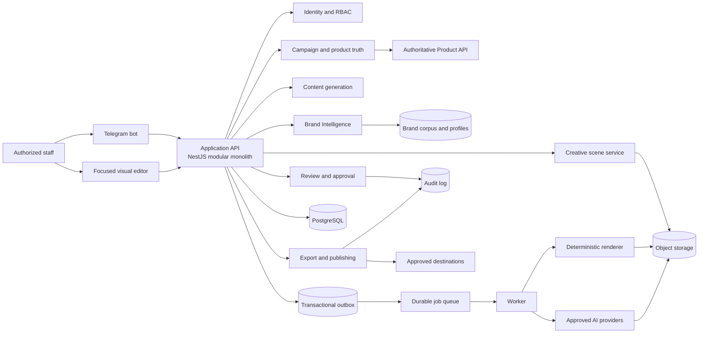
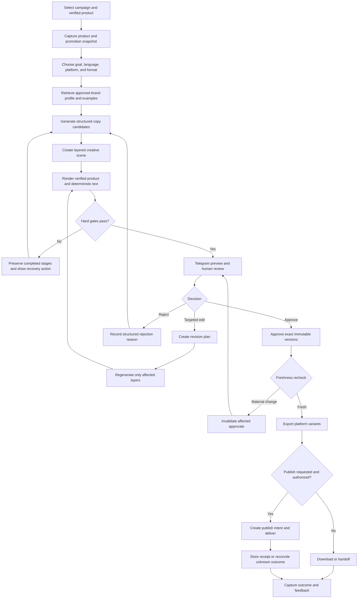
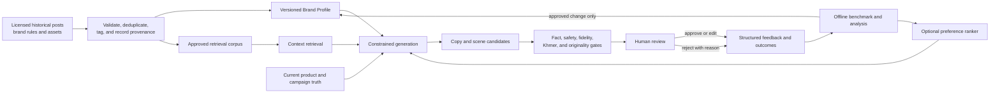
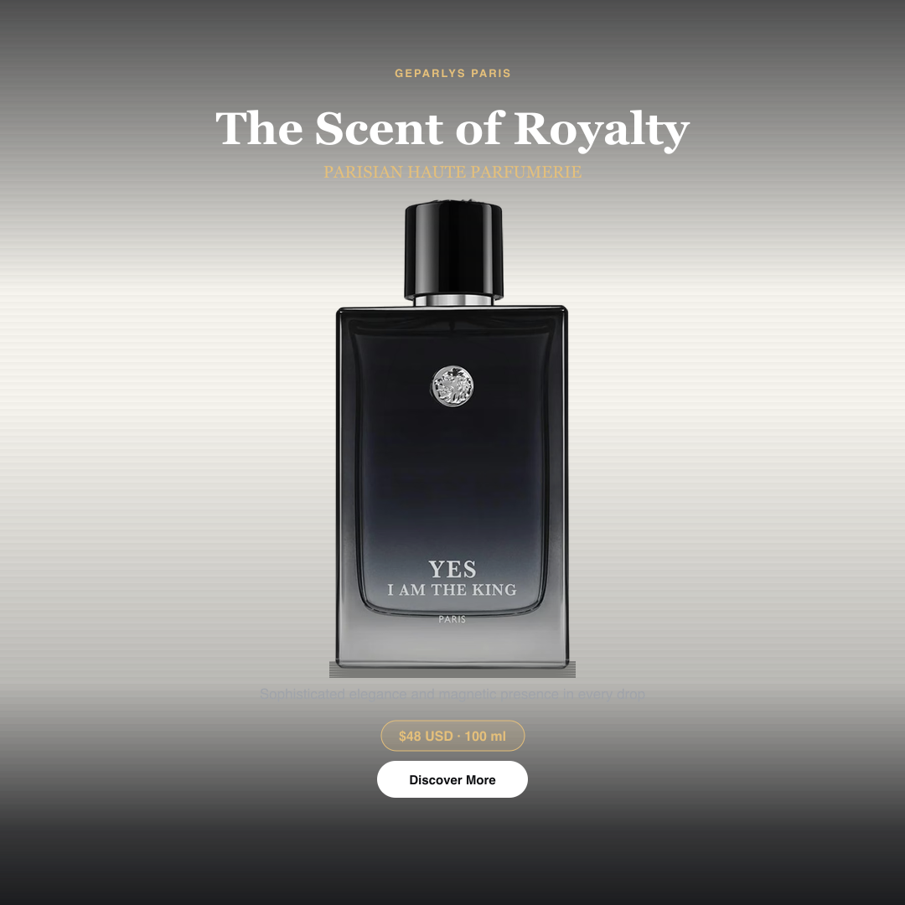
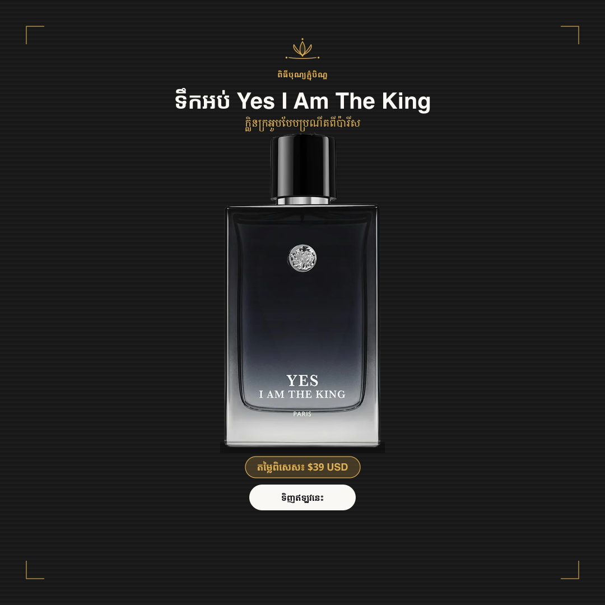

# Parisian Shopper AI — Unified Master Engineering Blueprint v3.0

Status: Engineering direction and execution contract  
Last consolidated: 2026-10-16  
Supersedes: Earlier Master Engineering Blueprint and separate Brand Intelligence plan  
Execution plan: [`implementation-plan-v1.md`](./implementation-plan-v1.md)  
Primary product: Internal creative operations system for Parisian Shopper  
Primary interface: Telegram, supported by an optional focused visual editor  
Primary outcome: Produce accurate, on-brand, editable, approval-ready social content faster and more economically than the current manual workflow

## 1. Purpose

This blueprint is the authoritative product and engineering direction for Parisian Shopper AI. It guides architects, developers, designers, operators, and AI coding agents. It does not claim that an item is already implemented merely because it is described here.

The system must turn verified company product information, approved brand knowledge, campaign intent, and reusable design components into high-quality social content and poster assets. It must preserve human approval, factual correctness, product fidelity, editability, auditability, and cost control.

The initial product is an internal company tool. Multi-tenancy, subscriptions, external customer billing, and general-purpose SaaS capabilities are explicitly deferred until real external demand exists.

## 2. Product thesis

Parisian Shopper AI is not a generic image generator and is not an autonomous social-media publisher. It is a controlled creative production system with four strengths:

1. It understands Parisian Shopper's approved brand language and visual system.
2. It uses verified product, price, stock, promotion, and campaign facts.
3. It creates reusable, editable creative scenes rather than disposable flattened pictures.
4. It learns from structured human decisions without blindly copying historical work.

The desired result should feel intentionally art-directed by a human designer: clean hierarchy, accurate Khmer and English typography, correct product imagery, controlled spacing, tasteful decoration, and platform-appropriate composition.

## 3. Business outcomes and product metrics

The project succeeds only when staff can produce acceptable work faster, more reliably, and at a justified cost.

Track these primary metrics:

- Median time from product selection to approved poster.
- First-pass approval rate.
- Median human editing minutes per approved asset.
- Cost per approved asset, not cost per generation.
- Percentage of generations that become approved assets.
- Approved-template and approved-asset reuse rate.
- Product, price, promotion, Khmer, and publication correction rates.
- Generation, render, export, and delivery success rates.
- Duplicate or unauthorized publication count.
- Staff satisfaction and preference versus the existing manual workflow.

Do not optimize for raw generation count. A smaller number of approved, reusable assets is more valuable than many rejected outputs.

Targets in this document are proposed release gates until validated using real company tasks and staff. They are not evidence of current performance.

## 4. Non-negotiable system invariants

1. No social publication occurs without an authorized human approving the exact publishable version.
2. Approval applies to immutable versions, never to a mutable draft.
3. Product identity, physical appearance, logo, packaging, price, stock, promotion, language, and destination are validated independently.
4. AI may generate an art-directed background or suggestions, but it must not redraw or hallucinate the actual product when a verified product image is required.
5. Khmer and English text are rendered deterministically with approved fonts; generated-image text is never trusted as final marketing copy.
6. A stale price, promotion, stock status, or product record blocks or reopens approval according to its dependency.
7. Failed jobs preserve all completed work and support safe retry from the failed stage.
8. Every paid operation is estimated, reserved, recorded, reconciled, and governed by a budget policy.
9. Historical posts, uploaded files, provider responses, metadata, and scraped content are untrusted inputs.
10. The system learns brand preferences from approved evidence but must not reproduce a historical poster as a disguised copy.
11. Safety and factual correctness are pass/fail gates; aesthetic quality is scored separately.
12. No work package is complete without executable verification and evidence tied to acceptance criteria.

## 5. Scope

### 5.1 In scope for the internal production product

- Secure Telegram staff authentication and role-based actions.
- Real Product API or approved product-data integration.
- Product, catalog price, campaign price, promotion, stock, and asset snapshots.
- Campaign briefs and channel/language/format selection.
- Bilingual Khmer/English copy generation and deterministic text rendering.
- Five or more company-approved reusable poster templates.
- Hybrid composition using verified product assets and optional AI-generated backgrounds.
- Layered creative scenes with targeted revisions.
- Review, version approval, export, download, and optional controlled publishing.
- Brand knowledge ingestion, tagging, retrieval, evaluation, and preference learning.
- Cost, security, audit, observability, backup, restore, and operational tooling.
- A focused visual editor for adjustments that are awkward in Telegram.

### 5.2 Explicitly deferred

- General-purpose Canva-style editing.
- Fully autonomous publishing.
- Training a foundation image model from scratch.
- Reinforcement learning before sufficient feedback data exists.
- SaaS subscriptions, tenant billing, and broad customer onboarding.
- Microservices unless measured scale or ownership boundaries require them.

## 6. Target architecture

Use a modular monolith first, with durable asynchronous jobs for expensive or failure-prone work.

### 6.1 Application modules

- Identity and authorization
- Telegram interaction
- Product catalog and freshness
- Campaign management
- Content generation
- Brand intelligence
- Asset ingestion and provenance
- Creative scene and template management
- Rendering and export
- Review, revision, and approval
- Publishing and delivery reconciliation
- AI provider routing and budgets
- Job orchestration and recovery
- Audit and observability
- Administration and evaluation

Modules communicate through explicit application services, domain events, and a transactional outbox. They must not reach into each other's database internals.

### 6.2 Runtime components

- API/application process.
- Telegram webhook or polling process.
- Durable job worker.
- Relational database for transactional state and audit records.
- Object storage for original assets, masks, rendered versions, exports, and backups.
- Queue or database-backed job system with idempotency.
- Short-lived content-addressed render cache.
- Optional authenticated web/Mini App for visual editing and administration.

### 6.3 Environments

Development, staging, and production must use separate credentials, storage, databases, webhooks, Telegram bots where practical, and provider budgets. Production data must not be copied into development without approved sanitization.

### 6.4 System architecture diagram

The application remains the policy boundary. Telegram, the editor, workers, providers, and publishing destinations may not bypass authorization, version checks, freshness gates, approval state, or budget enforcement.

## 7. Core domain model

The minimum durable entities are:

- `StaffUser`, `Role`, `Permission`, `Session`, `AuthEvent`
- `Product`, `ProductSnapshot`, `ProductAsset`, `AssetFingerprint`
- `Price`, `Promotion`, `PromotionAuthorization`, `StockSnapshot`
- `Campaign`, `CampaignBrief`, `CampaignProduct`, `CampaignChannel`
- `BrandSource`, `BrandExample`, `BrandTag`, `BrandProfileVersion`
- `Template`, `TemplateVersion`, `DesignTokenVersion`
- `CreativeScene`, `CreativeSceneVersion`, `SceneLayer`, `LayerDependency`
- `ContentDraft`, `ContentVersion`, `CopyVariant`
- `GenerationJob`, `RenderJob`, `ExportJob`, `DeliveryJob`
- `ValidationResult`, `QualityScore`, `HumanEvaluation`
- `RevisionRequest`, `Approval`, `ApprovalInvalidation`
- `PublishIntent`, `DeliveryReceipt`, `ReconciliationCase`
- `BudgetPolicy`, `UsageReservation`, `UsageLedgerEntry`
- `ProviderConfiguration`, `ProviderAttempt`
- `AuditEvent`, `Incident`, `BackupRecord`, `RestoreExercise`

All important versions must have stable identifiers, timestamps, actor identity, input hashes, dependency hashes, and provenance.

## 8. Campaign and product truth

### 8.1 Campaign

A campaign groups reusable intent rather than forcing staff to recreate it for every format. It includes:

- Name, goal, owner, start and end dates.
- Approved products and promotions.
- Channels, languages, target formats, and audiences.
- Campaign-specific message, CTA, seasonal cues, and design-token overrides.
- Generated scenes, copy versions, review state, and approved exports.
- Optional budget and outcome measurements.

One approved creative specification should generate coordinated Facebook, Instagram, Telegram, story, and feed variants while preserving channel-specific layout rules.

### 8.2 Product and promotion freshness

An immutable product snapshot is historical evidence, not proof that a fact is still current. Before final approval, export, and publication, the system compares the approved version's dependencies with current authoritative data.

Freshness rules must distinguish:

- Catalog price from campaign price.
- Current stock from historical stock.
- Permanent product facts from temporary promotions.
- Authorized promotion overrides from generated suggestions.
- Promotion effective dates, expiry, and destination restrictions.

If a relevant value changes, the dependency graph determines which validations and approvals become invalid. A price change should reopen price/copy/layout approval without automatically invalidating an unchanged background. A product image change may invalidate crop, containment, and visual approval.

## 9. Layered creative scene system

The canonical creative artifact is a reproducible scene specification, not only a flattened PNG.

### 9.1 Required layer groups

- Background/art-direction layer: approved stock, generated background, texture, lighting, and backdrop.
- Product layer: verified source asset, mask, crop, transform, shadow, reflection, and containment bounds.
- Typography layer: Khmer/English headline, body, price, promotion, CTA, font, size, line height, and overflow behavior.
- Brand layer: logo, badges, frames, separators, decorative motifs, and approved marks.
- Metadata layer: template version, design tokens, render engine, dimensions, color profile, and dependency hashes.

### 9.2 Scene requirements

- Every layer is independently editable, visible/hidden, versioned, and attributable.
- The same scene must render reproducibly from stored inputs.
- Targeted edits must not regenerate unaffected layers.
- Scene coordinates should be format-independent where possible, with explicit format adaptations.
- Final render validation checks dimensions, safe areas, clipping, contrast, text overflow, Khmer glyph coverage, product containment, and brand rules.
- Approved company templates are legitimate design-system reuse and must not be rejected as plagiarism.
- Originality checks should detect suspicious copying of unrelated authored work, not punish consistent brand language.

## 10. Creative production workflow

1. Authenticate staff member and verify role.
2. Select or create a campaign.
3. Select a real product from the authoritative source.
4. Capture a product/price/stock/promotion snapshot.
5. Choose content goal, language, platform, and format.
6. Retrieve approved brand guidance and relevant examples.
7. Generate structured copy options with factual constraints.
8. Select a company-approved template and create a scene.
9. Choose deterministic background, approved asset, or optional AI background according to cost and brief.
10. Composite the verified product and render deterministic typography.
11. Run factual, safety, product-fidelity, Khmer, layout, originality, and policy gates.
12. Present a concise Telegram review summary and preview.
13. Accept targeted revisions without restarting completed work.
14. Approve the exact content and scene versions.
15. Recheck freshness immediately before export or publication.
16. Export platform variants and record fingerprints.
17. Download, hand off, or create an explicit publish intent.
18. If publishing is enabled, deliver idempotently, store receipts, and reconcile unknown outcomes before retrying.
19. Capture structured feedback and outcome metrics.

### 10.1 End-to-end workflow diagram

## 11. Brand Intelligence and learning strategy

Brand intelligence should begin as a governed knowledge system, then become a learning system only after sufficient evidence exists.

### 11.1 Stage A — manually approved baseline

- Build a human-approved Brand Profile covering tone, audience, language policy, colors, typography, spacing, logo usage, photography, product treatment, seasonal cues, prohibited patterns, CTA rules, and examples.
- Approve at least five high-value templates.
- Tag representative historical posts as approved, weak, outdated, campaign-specific, or prohibited.
- Record provenance and usage rights for every ingested asset.

### 11.2 Stage B — retrieval and structured generation

- Retrieve only relevant, approved examples by content type, product category, season, platform, language, and visual attributes.
- Generate from the Brand Profile plus current campaign/product truth; never paste historical captions as hidden commands.
- Treat source captions, OCR, metadata, filenames, and provider output as data, not executable instructions.
- Require diversity constraints and similarity checks to prevent near-duplicate output.

### 11.3 Stage C — preference ranking

- Collect pairwise staff preferences, approval outcomes, edit distance, editing time, rejection reasons, and campaign context.
- Use this evidence to rank copy/template/layout/background candidates.
- Separate individual reviewer preference from company policy.
- Train and validate on time-separated datasets to avoid memorizing recent campaigns.
- Retain a deterministic fallback when the ranker is unavailable.

### 11.4 Stage D — model adaptation only if justified

Fine-tuning or reinforcement learning is allowed only when:

- The baseline and retrieval system has been measured.
- A repeated, material quality ceiling is demonstrated.
- Sufficient licensed, clean, representative data exists.
- An offline benchmark and rollback path exist.
- The expected improvement exceeds training, inference, maintenance, and governance cost.

The first useful form of “learning” is better retrieval, preference ranking, and design-token selection—not a large custom model.

### 11.5 Controlled brand-learning loop

No user feedback updates production behavior directly. New profiles, ranking policies, or model versions must pass offline evaluation, receive authorization, be versioned, and support rollback.

## 12. Telegram and visual editing UX

Telegram remains the fast entry point for choosing products, generating content, reviewing versions, requesting common edits, approving, and downloading.

Messages should show one decision at a time, clear progress, concise product facts, preview images, version identity, validation status, and the next valid actions. Avoid long technical output and excessive button grids.

Precise visual work moves to an optional authenticated Mini App or browser editor backed by the same APIs. Its initial scope is intentionally small:

- Move and scale the verified product.
- Edit text and inspect overflow.
- Switch approved templates or background options.
- Toggle layer visibility.
- Preview supported formats.
- Save a new scene version and return to Telegram for approval.

The editor is not a general-purpose design application.

## 13. Review, approval, and revision semantics

- Content approval and visual approval are separate records when their dependencies differ.
- Every approval stores the exact version hash, reviewer, timestamp, evidence, and scope.
- Revisions create new versions and never silently mutate approved versions.
- The dependency graph invalidates only affected approvals.
- Rejection requires a structured reason with optional free text.
- Approval confirmation clearly states what will happen next; approval alone does not imply publication.
- Authorized roles for generation, approval, export, and publication are independently configurable.

## 14. Publishing and delivery safety

Publishing is optional and disabled by default until qualified per destination.

- Require a separate explicit `PublishIntent` referencing approved immutable versions.
- Enforce destination allowlists and role permissions.
- Use an internal idempotency key for every delivery attempt.
- Store external post IDs and durable delivery receipts.
- Recognize that some providers do not guarantee external idempotency.
- Treat timeouts after submission as `UNKNOWN`, not automatically failed.
- Reconcile with the destination before retrying an unknown outcome.
- Escalate unresolved cases for manual intervention.
- Never publish if product/promotion freshness fails or approval has been invalidated.

## 15. Provider routing and hard cost governance

Provider selection is policy-driven, observable, and replaceable. Template rendering should be preferred when it meets the brief; paid image generation is used only when its expected value justifies its cost.

`BudgetPolicy` must support:

- Per-operation estimated maximum cost.
- Per-user, campaign, provider, and company limits.
- Monthly and optional daily spending caps.
- Maximum retries, variants, and revisions.
- Provider and feature allowlists.
- Soft warning thresholds and hard-stop thresholds.
- Manual override by an authorized role with a recorded reason.

`UsageLedger` must record estimated cost, reserved spend, actual cost, currency, provider, model, input/output usage, job, campaign, actor, and reconciliation status.

A paid job reserves budget before starting. It must not start if approved remaining budget is insufficient. Reservations are released or reconciled after completion. Provider prices are configuration with effective dates and must be verified against current vendor information before production use.

## 16. Security and privacy architecture

Create and maintain a threat model covering:

- Telegram account compromise and callback forgery.
- Unauthorized approval, export, or publication.
- Cross-user and cross-campaign asset access.
- Prompt injection in historical captions, OCR, documents, filenames, product fields, and provider output.
- SSRF and malicious remote asset URLs.
- Image decoder, metadata, archive, and decompression attacks.
- Secret leakage in logs, prompts, previews, and diagnostics.
- Provider data retention and privacy risks.
- Supply-chain and dependency compromise.
- Webhook replay, queue replay, and duplicate jobs.
- Path traversal and unsafe file handling.

Required controls include deny-by-default authorization, short-lived signed asset access, MIME and magic-byte validation, file-size/pixel limits, metadata stripping where appropriate, safe image-processing isolation, outbound network allowlists, webhook verification, rate limiting, encrypted transport, secret management, audit logs, redaction, dependency scanning, and incident response.

OWASP ASVS may be used as a verification reference. Do not claim certification without an independent certification process.

## 17. Reliability, recovery, and operations

### 17.1 Job behavior

- Jobs use explicit states, idempotency keys, bounded retries, timeouts, and dead-letter handling.
- Stage outputs are persisted so retries resume from the failed stage.
- User-facing failures explain what is safe and what action is available.
- Example: “Background creation failed. Your product, caption, and design are safe. Retry the background or choose an approved background.”

### 17.2 Operator console

Provide an authorized view of job history, queue status, provider attempts, cost reservations, delivery outcomes, validation failures, and safe retry/recovery actions.

### 17.3 Deployment

- Build immutable, pinned application artifacts.
- Run automated migrations with compatibility and rollback planning.
- Expose health and readiness checks.
- Use staged rollout and a documented rollback procedure.
- Keep production configuration validated and versioned without committing secrets.
- Record deployed revision, migration version, and feature flags.

### 17.4 Backup and disaster recovery

Back up the database and object assets as one recoverable system. Define retention, encryption, ownership, monitoring, restore procedures, and restoration exercises.

Initial pilot objectives, subject to business confirmation:

- Recovery point objective: 24 hours.
- Recovery time objective: 4 hours.

No backup control is considered complete until a staging restore has been demonstrated and documented.

## 18. Observability

Use structured logs, metrics, traces where valuable, correlation IDs, job IDs, campaign IDs, scene-version IDs, and provider-attempt IDs.

Dashboards and alerts should cover:

- Workflow success and latency by stage.
- Queue age, retry count, and dead-letter volume.
- Provider availability, latency, and cost.
- Validation failures by rule.
- Approval and revision funnel.
- Export and delivery outcomes.
- Unauthorized attempts and suspicious access.
- Budget consumption and reservation drift.
- Backup age and restore-exercise status.

Logs must not contain provider secrets, Telegram tokens, sensitive URLs, unnecessary personal data, or full prompts containing protected information.

## 19. Quality evaluation laboratory

Maintain a fixed, versioned benchmark of real Parisian Shopper tasks representing product categories, campaign types, Khmer/English copy, price/promotion cases, and target formats.

For each benchmark, compare when applicable:

- Existing human-designed company creative.
- Deterministic template-only output.
- Hybrid AI-background output.
- Revised hybrid output after targeted edits.

Use blind review where practical. Evaluate:

- Brand fit.
- Visual hierarchy and aesthetics.
- Khmer and English readability.
- Product identity and packaging fidelity.
- Factual accuracy.
- Originality without loss of brand consistency.
- Required editing effort.
- Approval confidence.

Automatic scores are diagnostic and must not replace human preference testing. Benchmark versions, reviewers, rubrics, and results must be recorded so progress is reproducible.

## 20. Proposed pilot release gates

These are target gates to validate, not claims about current implementation:

- 100% of critical end-to-end scenarios pass.
- Zero unresolved critical or high security findings without an approved, time-bounded mitigation.
- Zero incorrect SKU, price, or active-promotion results in a 100-case controlled product-accuracy set.
- Zero missing Khmer glyphs or text-overflow failures in the approved render test set.
- At least 99% successful supported generation workflows, excluding declared external-provider outages.
- Crash/restart simulation preserves all committed work and resumes or safely retries jobs.
- Zero unauthorized or duplicate publications in the simulated delivery-failure suite.
- At least 95% of template-only renders finish within 15 seconds on explicitly defined pilot hardware and load.
- A complete staging backup restoration succeeds.
- Company staff prefer or accept the system output at the agreed threshold in a controlled evaluation.
- Cost per approved asset stays within the approved business policy.

The final go/no-go decision requires product, engineering, security, operations, and business-owner sign-off.

## 21. Delivery roadmap

### Phase 0 — baseline stabilization (P0)

- Make the existing test, type-check, lint, and formatting gates green.
- Close authorization and production-configuration gaps.
- Establish CI, deployment, rollback, backup, restore, and incident procedures.
- Record a truthful baseline of current supported behavior.

Exit: the existing product is reproducibly buildable, testable, deployable, recoverable, and evidence-backed.

### Phase 1 — real products and deterministic poster studio (P0)

- Integrate the authoritative Product API/source.
- Implement product, price, promotion, stock, and asset snapshots.
- Validate verified product images and masks.
- Complete Khmer font/glyph/line-breaking support.
- Implement five company-approved templates and deterministic rendering.

Exit: staff can create a correct poster from a real product without paid image generation.

### Phase 2 — review, targeted revision, and export (P0)

- Complete Telegram workflows.
- Add scene versions, layers, dependency-aware approval, targeted edits, and reliable exports.
- Preserve completed stages across failure and retry.
- Add operator recovery tooling.

Exit: staff can take a real product from selection to approved downloadable asset without developer intervention.

### Phase 3 — Brand Intelligence V1 (P1)

- Create the approved Brand Profile.
- Ingest, license, tag, and curate representative company examples.
- Add constrained retrieval, originality controls, and structured feedback.
- Measure baseline versus brand-informed generation.

Exit: controlled human evaluation demonstrates a meaningful brand-fit improvement without unacceptable copying or factual regression.

### Phase 4 — production qualification and pilot (P1)

- Run staff trials, security review, failure simulations, restore exercise, cost verification, and benchmark evaluation.
- Implement freshness gates and any approved controlled publishing destination.
- Measure business metrics during a limited pilot.

Exit: every release gate is evidenced or explicitly waived by an accountable owner with risk and expiry.

### Phase 5 — focused visual editor and campaign scaling (P1/P2)

- Add the limited visual editor and reusable multi-format campaign workflow.
- Improve analytics, format adaptations, and template management based on pilot evidence.

Exit: staff editing time and campaign reuse improve measurably without weakening approval controls.

### Phase 6 — advanced optimization (P2/P3)

- Add preference ranking when sufficient feedback exists.
- Evaluate fine-tuning only after a measured baseline ceiling.
- Consider SaaS architecture only after confirmed external customers and a separate business decision.

## 22. Required specification set

Maintain these specifications under version control. Each must define requirements, constraints, entities, APIs, state transitions, failure behavior, security considerations, tests, metrics, and explicit acceptance criteria.

1. `docs/specifications/production-deployment-and-disaster-recovery.md` — Production Deployment and Disaster Recovery Specification.
2. `docs/specifications/product-freshness-and-campaign-integrity.md` — Product Freshness and Campaign Integrity RFC.
3. `docs/specifications/layered-creative-scene-schema.md` — Layered Creative Scene Schema.
4. `docs/specifications/brand-intelligence-and-data-governance.md` — Brand Intelligence, Dataset, and Asset Governance Specification.
5. `docs/specifications/provider-budget-and-usage-ledger.md` — Provider Routing, Budget Policy, and Usage Ledger Specification.
6. `docs/specifications/visual-editor-and-campaign-workflow.md` — Visual Editor and Campaign Workflow PRD.
7. `docs/specifications/quality-benchmark-and-human-evaluation.md` — Quality Benchmark and Human Evaluation Protocol.
8. `docs/specifications/reliability-slo-and-incident-response.md` — Reliability SLOs and Incident Response Runbook.
9. `docs/specifications/release-qualification-matrix.md` — Release Qualification and Acceptance Test Matrix.
10. `docs/specifications/product-analytics-and-business-roi.md` — Product Analytics and Business ROI Framework.

## 23. AI-assisted engineering execution contract

Any AI agent implementing this blueprint must follow this sequence:

1. Read the repository instructions, relevant architecture documents, and current implementation before proposing changes.
2. State the selected work package, its user value, dependencies, risks, and acceptance criteria.
3. Inspect current code and tests; do not assume blueprint features already exist.
4. Produce a small implementation plan mapped to concrete files and tests.
5. Preserve unrelated user changes and existing architectural boundaries.
6. Implement the smallest complete vertical slice.
7. Run targeted tests, then the relevant wider quality gates.
8. Review the actual diff for security, authorization, failure recovery, data migration, cost, and observability implications.
9. Report exact commands, results, remaining gaps, and evidence for each acceptance criterion.
10. Never claim completion based only on code generation, compilation, mock output, screenshots, or self-scoring.

An AI agent may mark a work package complete only when all of the following exist:

- An inspectable code diff.
- Executable test results.
- Acceptance-criterion evidence.
- Documentation or migration updates where required.
- No hidden fallback, mock, or demo path presented as production behavior.
- Known limitations and operational impact disclosed.

If verification cannot run, status is `implemented but unverified`, never `complete`.

## 24. Definition of project completion

The internal production project is complete only when:

- Authorized staff can select a real product and campaign.
- The system produces accurate bilingual copy and a professional layered poster.
- The product image and packaging remain faithful to approved source assets.
- Staff can make common revisions without regenerating everything.
- Exact versions can be reviewed, approved, exported, and audited.
- Current product and promotion facts are revalidated before use.
- Publishing, if enabled, is explicitly authorized, idempotent where possible, and reconciled safely.
- Cost limits are enforced and cost per approved asset is measurable.
- Failures preserve work and operators can recover jobs safely.
- Security, backup restoration, critical E2E, Khmer rendering, and release gates have evidence.
- Controlled staff evaluation shows useful time savings and acceptable or preferred creative quality.
- Operations can deploy, monitor, roll back, restore, and respond to incidents without relying on undocumented developer knowledge.

Until those conditions are met, the project may be a strong prototype or pilot, but it is not a complete production system.

## 25. Final strategic rule

Build reliability, editability, factual integrity, Khmer quality, and staff usefulness before increasing model sophistication. Brand intelligence becomes a competitive advantage only after the underlying creative production workflow works consistently with real products and real staff.

## 26. Current-state baseline

This section records the repository state observed during the 2026-10-16 blueprint review. It is a planning baseline, not a permanent claim. Future agents must re-inspect the code and replace stale findings with current evidence.

### 26.1 What already exists

- A NestJS modular-monolith application with API, worker, Prisma/PostgreSQL, BullMQ/Valkey, Telegram integration, provider abstractions, validation, review, and approval concepts.
- A working Telegram content workflow that selects a product, content type, language, and platform and produces a reviewable draft.
- Product snapshots, content versions, factual validation, approval records, audit-oriented state, and strict zero-auto-publishing intent.
- A creative generation path that uses a real product asset, selects a visual style, obtains or selects a background, and composites the product with Sharp.
- Style presets, local product images, generated poster prototypes, creative storage, review actions, and dimensions/product-containment checks.
- Unit, integration, and end-to-end test foundations plus extensive architecture, security, workflow, and operations documentation.

### 26.2 Material gaps

- The authoritative Product API is not yet the active production source; the current enabled path still depends on fixtures or incomplete integration.
- The poster compositor does not yet implement the full typography, brand, decorative, price, promotion, and CTA layer system required by this blueprint.
- The persisted creative model is not yet a complete editable scene graph with dependency-aware targeted revision.
- Khmer font files, glyph-coverage tests, line breaking, overflow rules, and bilingual layout evidence are incomplete.
- Telegram currently produces long multi-step messages and does not yet persist every wizard choice or reliably edit a single workflow message.
- Some visual review callbacks need authorization enforcement at the application/use-case boundary, not only at button-display time.
- Visual edit and regenerate behavior does not yet provide a complete structured revision lifecycle linked to immutable scene versions.
- Controlled publishing and delivery reconciliation need to replace any approval-triggered auto-post behavior before production publishing is enabled.
- Brand Intelligence ingestion, governed Brand Profile versions, retrieval, similarity policy, evaluation, and preference learning are planned but not production-complete.
- Cost reservation and reconciliation, operator recovery tooling, production deployment evidence, and joint database/object-store restore testing need completion.
- The current quality gates are not fully green; known test and formatting failures must be resolved before feature expansion is treated as production progress.

### 26.3 Directional completion estimate

The following percentages are rough planning estimates derived from repository inspection, not automated project metrics:

- Existing content-and-approval prototype: approximately 58% of its narrower original scope.
- Brand Intelligence foundation: approximately 50% at the design/documentation level, substantially less as production implementation.
- Complete production product defined by this unified blueprint: approximately 46% overall.

These values must never be used as release evidence. Phase exit criteria, tests, operational drills, and staff evaluation are the authoritative measures of completion.

### 26.4 Visual prototype gallery

These images document the current visual direction and compositor experiments. They are references for evaluation and iteration, not approved brand assets or evidence that the final rendering system is complete.

#### AI-assisted background concepts

| Pchum Ben direction                                                                                              | Luxury product direction                                                                                         |
| ---------------------------------------------------------------------------------------------------------------- | ---------------------------------------------------------------------------------------------------------------- |
|  |  |

The background concepts intentionally reserve space for a verified product, deterministic typography, brand marks, pricing, and campaign elements. AI-generated text or invented product packaging must not be accepted into the final design.

#### Deterministic compositor samples

| Centered hero composition                                                                                   | Khmer seasonal composition                                                                                    |
| ----------------------------------------------------------------------------------------------------------- | ------------------------------------------------------------------------------------------------------------- |
|  |  |

These samples demonstrate product placement and template geometry. They still require the full typography, brand-token, decoration, content, validation, and editability capabilities specified in this blueprint.

## 27. Immediate execution order

Future implementation should follow this order unless a documented dependency or incident requires otherwise:

1. Restore a green baseline: fix current tests, formatting, type checks, lint, and CI reporting without weakening assertions.
2. Close authorization and publishing-safety gaps, especially visual callbacks and approval-triggered delivery behavior.
3. Activate the real Product API/source and implement freshness-aware product, price, stock, promotion, and asset snapshots.
4. Define and implement the layered `CreativeScene` schema, immutable versioning, dependency hashes, and targeted approval invalidation.
5. Build the deterministic poster studio with approved Khmer/Latin fonts, text measurement, overflow behavior, five approved templates, and verified product compositing.
6. Improve Telegram into a persistent, resumable workflow with concise messages, edit-in-place behavior, structured revision requests, and clear recovery actions.
7. Add export variants, operator recovery tools, cost reservation/reconciliation, observability, deployment, rollback, and tested backup restoration.
8. Establish the manually approved Brand Profile and governed historical corpus before adding embedding retrieval or automated preference learning.
9. Run the fixed quality benchmark and limited internal pilot; use measured staff outcomes to decide whether the visual editor and advanced learning are justified.

Each item must be delivered as a small vertical work package with its own acceptance criteria and evidence. Agents must not attempt a repository-wide rewrite or implement all phases in one change.

## 28. Decisions intentionally postponed

Do not make these decisions prematurely:

- Fine-tuning, reinforcement learning, or training a custom image model before the retrieval/template baseline has been evaluated.
- Multi-tenant SaaS, subscription billing, or external customer onboarding before the internal workflow proves value.
- Microservice extraction before measured scale, reliability, deployment, or team-ownership needs justify it.
- A general-purpose visual editor before targeted revisions and the focused editor demonstrate real demand.
- Fully autonomous publishing or approval bypasses.
- A permanent AI provider commitment; providers remain replaceable behind capability and policy interfaces.

## 29. Open business decisions

The accountable Parisian Shopper owner must confirm and version these inputs:

- Authoritative product, stock, price, promotion, and product-asset sources.
- Which roles may generate, edit, approve content, approve visuals, export, and publish.
- Approved Khmer and Latin fonts and the licenses permitting server-side rendering.
- Logo variants, protected clear space, colors, typography, image treatment, tone, CTA, and seasonal brand rules.
- Rights and permitted uses for historical posts, photography, product images, stock assets, and generated backgrounds.
- Pilot channels, formats, languages, product categories, campaign types, and publishing destinations.
- Budget ceilings, provider allowlists, data-retention restrictions, and override authorities.
- Business acceptance thresholds for quality, time saved, first-pass approval, editing effort, and cost per approved asset.
- Backup retention, RPO/RTO, incident owners, and production support responsibilities.

Until these are confirmed, implementations must use explicit configuration and conservative defaults rather than silently encoding assumptions as permanent business rules.
