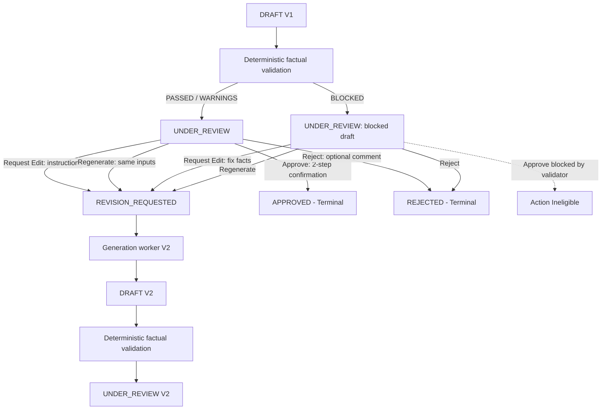

# Human review workflow

**Status:** Implemented in Phase 1F

The Human Review Workflow enables staff reviewers to inspect generated marketing drafts, request revisions (edit or regenerate), or reach terminal decisions (approve or reject) directly through Telegram. The workflow guarantees that AI content never bypasses human oversight and that canonical product facts remain completely immutable.

## State machine

| Source state         | Action / Transition                                                | Result state         | Terminal? |
| -------------------- | ------------------------------------------------------------------ | -------------------- | --------- |
| `DRAFT`              | Validation completes (`PASSED`, `PASSED_WITH_WARNINGS`, `BLOCKED`) | `UNDER_REVIEW`       | No        |
| `UNDER_REVIEW`       | `EDIT` or `REGENERATE` requested                                   | `REVISION_REQUESTED` | No        |
| `REVISION_REQUESTED` | Generation worker leases and begins revision generation            | `GENERATING`         | No        |
| `GENERATING`         | Generation worker completes draft (V2+)                            | `DRAFT`              | No        |
| `UNDER_REVIEW`       | Exact-version approval confirmed                                   | `APPROVED`           | **Yes**   |
| `UNDER_REVIEW`       | Exact-version rejection confirmed                                  | `REJECTED`           | **Yes**   |

`APPROVED` and `REJECTED` are strictly terminal states. Once a job reaches either state, further edits, regenerations, approvals, or rejections are rejected with `InvalidReviewStateError` or `ContentAlreadyApprovedError` / `ContentAlreadyRejectedError`.

## Telegram review actions

When a draft is ready, the Telegram outbox dispatcher delivers a review message with role-aware inline buttons:

1. **View Source (`VIEW_SOURCE`)**: Displays the verified canonical product facts from the immutable `ProductSnapshot`.
2. **View Validation (`VIEW_VALIDATION`)**: Displays detailed deterministic validation findings, severity levels, and rule codes.
3. **Request Edit (`REQUEST_EDIT`)**: Available to actors with `EDIT_CONTENT` permission. Initiates a durable interaction prompting the reviewer for revision instructions.
4. **Regenerate (`REQUEST_REGENERATE`)**: Available to actors with `REGENERATE_CONTENT` permission. Immediately triggers fresh generation using the same pinned snapshot and brand rules.
5. **Approve (`APPROVE_PROMPT`)**: Available to actors with `APPROVE_CONTENT` permission. Requires two-step confirmation (`CONFIRM_APPROVE`). The button is completely omitted if validation resulted in blocking findings (`BLOCKED`).
6. **Reject (`REJECT_PROMPT`)**: Available to actors with `REJECT_CONTENT` permission. Initiates a durable interaction allowing the reviewer to provide a rejection comment.
7. **Previous Versions (`VIEW_PREVIOUS`)**: Displayed on V2+ drafts, allowing reviewers to inspect version history and earlier draft headlines.

## Concurrency and integrity guarantees

- **PostgreSQL advisory locks:** Every review mutation (`createRevisionRequest`, `createApproval`, `beginGeneration`, `completeGeneration`) acquires a transactional advisory lock (`pg_advisory_xact_lock`) on the job ID, preventing race conditions between concurrent approvers or simultaneous edits.
- **Stale version protection:** Approvals and revision requests must target the latest version number. If an approver acts on V1 after V2 has been generated, the request fails with `StaleContentVersionError`.
- **Single active pending revision:** Only one pending revision request can exist per job at any time. Concurrent revision attempts fail with `ActiveRevisionConflictError`.
- **Database immutability triggers:** All rows in `approval_events` are append-only (updates and deletes raise exceptions). Core fields on `revision_requests` are immutable.
