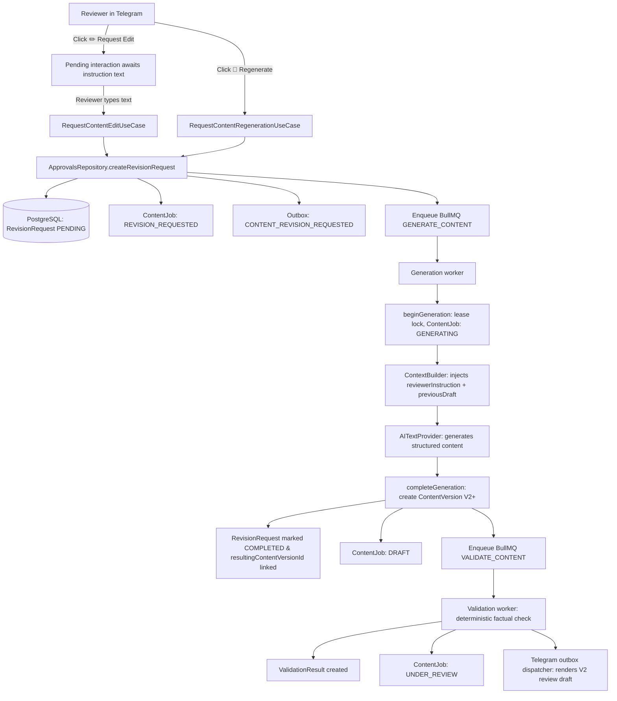

# Revision workflow (Edit & Regenerate)

**Status:** Implemented in Phase 1F

The revision workflow allows reviewers to request iterative improvements to drafts while preserving the factual integrity of canonical product facts and version history.

## Revision types

### 1. Request Edit (`EDIT`)

- **Intent:** Incorporate specific editorial feedback into the next revision.
- **Workflow:** Reviewer clicks `✏️ Request Edit`. Telegram initiates a pending interaction (`action: EDIT`) that listens for the reviewer's text response. The instruction text is validated (trimmed, non-empty, max 1,000 characters).
- **Prompt injection:** The generation worker loads the previous draft's structured output and reviewer instruction. The prompt builder incorporates these under a dedicated prompt section, instructing the model to refine the previous draft according to reviewer feedback while strictly maintaining facts.

### 2. Regenerate (`REGENERATE`)

- **Intent:** Produce a fresh draft from scratch with the same inputs when the previous generation was unsatisfactory.
- **Workflow:** Reviewer clicks `🔄 Regenerate`. Generation is enqueued immediately without requiring additional input.
- **Prompt context:** The model receives canonical product snapshot facts and brand rules without prior draft context, generating a new draft proposal.

## Non-negotiable snapshot and brand rule pinning

Throughout the entire revision lifecycle, the product data and brand rules remain permanently pinned to the original job:

$$\text{ContentVersion}_{N+1}.\text{productSnapshotId} = \text{ContentJob}.\text{productSnapshotId}$$
$$\text{ContentVersion}_{N+1}.\text{brandRuleVersionId} = \text{ContentJob}.\text{brandRuleVersionId}$$

- **No re-fetching:** The system never queries the Product API during revisions. If canonical product details (price, scent notes, name) changed upstream, the active job remains anchored to its immutable `ProductSnapshot`.
- **No rule drift:** The active `BrandRuleVersion` remains fixed, preventing sudden stylistic or vocabulary rule shifts mid-workflow.
- **Append-only versions:** Version numbers increment sequentially ($1 \to 2 \to 3$). Previous versions are never mutated or replaced.

## Concurrency and conflict rules

1. **Single active pending revision:** A job may not have multiple concurrent revision requests. A partial unique index (`revision_requests_one_pending_per_job`) enforces that only one row per job has `status = 'PENDING'`. Concurrent attempts fail with `ActiveRevisionConflictError`.
2. **Stale version revision protection:** Revision requests must reference the latest existing version of the job. Submitting a revision against an outdated draft version throws `StaleContentVersionError`.
3. **Database immutability:** PostgreSQL triggers prevent deletion of `revision_requests` and reject mutations to core fields (`content_job_id`, `source_content_version_id`, `requested_by_user_id`, `type`, `instruction`, `created_at`). Only lifecycle progression (`status`, `resulting_content_version_id`) is mutable.
