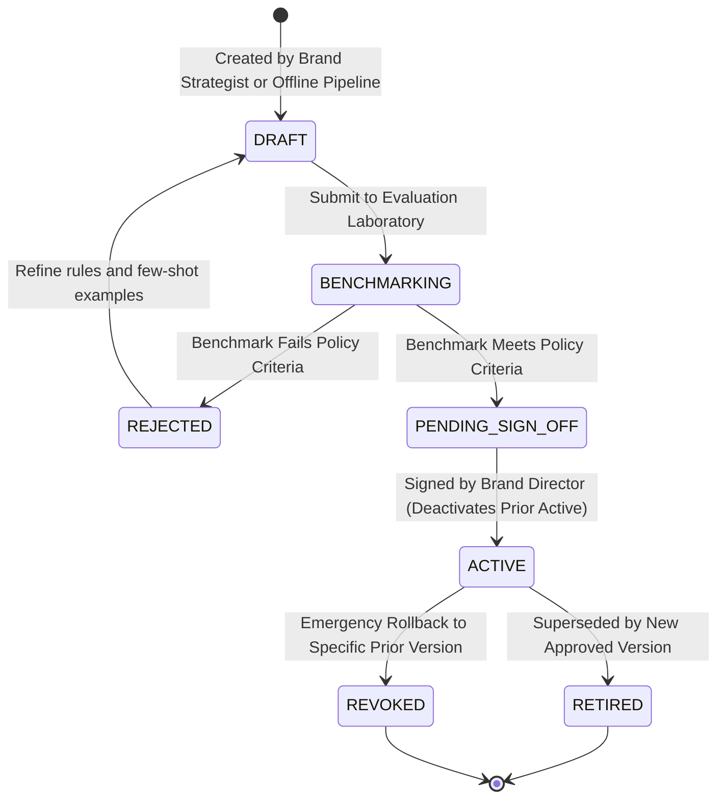

# Specification 3: Brand Intelligence and Data Governance

**Document:** `/docs/specifications/brand-intelligence-and-data-governance.md`  
**Phase:** W03 — Foundational Specifications & Architecture  
**Status:** Foundational Specification Ready for Owner Business Decisions  
**Authority:** Master Engineering Blueprint v3.0 §11, §16, §22  
**Target Packages:** W40 (Brand Profile & Ingestion), W41 (Governed Retrieval), W42 (Offline Preference Ranking)

---

## 1. Purpose and Scope

### 1.1 Purpose

This specification establishes the architectural, algorithmic, and governance framework for **Brand Intelligence** in Parisian Shopper AI. The system learns and operationalizes Parisian Shopper’s luxury brand identity, visual aesthetics, Khmer-English voice, and seasonal storytelling conventions. Crucially, the system is designed to **learn the brand's style without plagiarizing or regurgitating historical posters or copyrighted copywriting**.

### 1.2 Scope

- Governed ingestion pipeline for historical social media posts (Facebook, Instagram) and brand guidelines, requiring verified copyright and ownership declarations before ingestion (tied to `W03-DEC-008`).
- End-to-end data lifecycle:  
  `Source Archive` → `Normalized Dataset` → `Embeddings/Features` → `Approved BrandProfileVersion` → `Per-Generation BrandBrief` → `Candidate Poster` → `Reviewer Feedback` → `Offline Evaluation` → `Production Approval`.
- Anti-regurgitation guardrails, novelty evaluations, and copy similarity scoring defined under versioned policy (with candidate benchmark examples under `W03-DEC-009`).
- Strict separation between deterministic hard validation gates and calibrated soft evaluation metrics.
- Controlled offline learning and preference ranking cycles with mandatory human authorization; runtime feedback never directly updates production prompts, profiles, or models.
- Exclusion of external social engagement metrics unless explicitly approved via `W03-DEC-010`.
- Versioned `BrandProfileVersion` schema with targeted rollback to a specifically identified previously approved profile version.
- Multi-tier data isolation, PII sanitization, and cultural sensitivity review.

---

## 2. Explicit Non-Goals

1. **No Online Reinforcement Learning Directly in Production:** User feedback, approvals, and edits NEVER update production model weights or generation prompts in real time. All learning occurs in audited, offline evaluation cycles.
2. **No Unbounded Crawling or Web Scraping:** The system does NOT crawl external social media pages or competitor sites. Ingestion is strictly restricted to company-owned, verified historical archives with documented licensing.
3. **No Direct Copy-Pasting of Historical Captions:** The retrieval engine provides contextual stylistic guidance and vocabulary examples, but models are forbidden from outputting verbatim historical text.
4. **No Automated Self-Promotion of Rules:** No machine learning heuristic may modify or activate a `BrandProfileVersion` without formal review and cryptographic sign-off by the Brand Director.
5. **No External Engagement Optimization Without Approval:** Likes, shares, and external social metrics are excluded from training and preference ranking unless `W03-DEC-010` is formally approved.

---

## 3. Existing-System Alignment

The current codebase includes preliminary brand rule concepts:

- **`BrandRuleVersion` Prisma Model:** Stores JSON rules for `languageRules`, `toneRules`, `ctaRules`, `visualGuidance`, and `status`. This specification formalizes the ingestion, extraction, and evaluation pipeline that populates these rules.
- **`BrandRuleRepository`:** Provides database access to the active brand rule version.
- **`BrandKnowledgeBase` Document:** Outlines initial luxury tone placeholders. This specification replaces informal placeholders with rigorous data structures governed by versioned policies.

---

## 4. Terminology

- **Source Archive (`BrandSourceArchive`):** The immutable raw repository of ingested historical social posts, photography, captions, and marketing collateral.
- **Normalized Reference Dataset (`BrandDatasetVersion`):** Curated, deduplicated, and licensed historical examples tagged by season, product category, and quality tier.
- **Brand Profile Version (`BrandProfileVersion`):** The authoritative, immutable configuration artifact governing active AI generation prompts, visual tokens, and validation thresholds.
- **Generation Brand Brief (`BrandBrief`):** The runtime ephemeral payload assembled from the active `BrandProfileVersion`, current `ProductSnapshot`, and campaign context for a specific creative job.
- **Evaluation Policy (`EvaluationPolicy`):** A versioned specification of similarity thresholds, quality weights, and passing criteria (linked to `W03-DEC-009`).
- **Regurgitation Guardrail:** Cosine and string distance gates that reject candidate generations that too closely mimic any historical reference asset.
- **Preference Ranker:** An offline scoring heuristic trained on reviewer accept/reject outcomes to rank generation candidates.

---

## 5. Entities and Architectural Data Progression

The system enforces strict architectural separation across nine successive data stages:

```mermaid
flowchart TD
    subgraph DataProgression["Governed Brand Intelligence Progression"]
        T1["1. Source Archive<br/>(Immutable, Verified Licensing)"]
        T2["2. Normalized Dataset<br/>(Deduplicated, PII Scrubbed)"]
        T3["3. Embeddings & Features<br/>(Text Vectors, Style Embeddings)"]
        T4["4. Approved BrandProfileVersion<br/>(Immutable, Signed by Brand Director)"]
        T5["5. Per-Generation BrandBrief<br/>(Ephemeral Runtime Context)"]
        T6["6. Candidate Poster Generation<br/>(Text Copy & CreativeScene)"]
        T7["7. Reviewer Feedback Capture<br/>(Structured Decision Store)"]
        T8["8. Offline Evaluation Lab<br/>(Pairwise Preference Analysis)"]
        T9["9. Governed Production Approval<br/>(New Target Profile Version)"]
    end

    T1 --> T2 --> T3 --> T4 --> T5 --> T6 --> T7 --> T8 --> T9
    T9 -.->|Formal Activation| T4
```



---

## 6. Proposed Schemas

### 6.1 `BrandProfileVersion` Master Schema

| Field Name             | Type       | Required? | Constraints                                       | Description                                               |
| ---------------------- | ---------- | :-------: | ------------------------------------------------- | --------------------------------------------------------- |
| `id`                   | `UUID`     |  **YES**  | RFC 4122 v4 UUID                                  | Unique version identifier                                 |
| `versionNumber`        | `Integer`  |  **YES**  | Positive integer `>= 1`                           | Sequential version index                                  |
| `name`                 | `String`   |  **YES**  | 1–160 UTF-8 characters                            | Semantic label (e.g. `PARISIAN_LUXURY_V2_KHMER_NEW_YEAR`) |
| `status`               | `Enum`     |  **YES**  | `DRAFT`, `ACTIVE`, `RETIRED`, `REVOKED`           | Operational status of the profile                         |
| `evaluationPolicyId`   | `String`   |  **YES**  | References `EvaluationPolicy`                     | Configured similarity and quality thresholds              |
| `languagePolicy`       | `JsonB`    |  **YES**  | Conforms to `LanguagePolicySchema`                | Formality, pronouns, bilingual grammar rules              |
| `toneRules`            | `JsonB`    |  **YES**  | Conforms to `ToneRulesSchema`                     | Allowed adjectives, prohibited hyperbole, emoji rules     |
| `visualAestheticRules` | `JsonB`    |  **YES**  | Conforms to `VisualRulesSchema`                   | Approved palettes, lighting, textures, pedestals          |
| `typographyRules`      | `JsonB`    |  **YES**  | Conforms to `TypographyRulesSchema`               | Allowed font families, hierarchy, leading, tracking       |
| `logoRules`            | `JsonB`    |  **YES**  | Conforms to `LogoRulesSchema`                     | Clear space, placements, monochrome vs gold usage         |
| `approvedExampleIds`   | `Array`    |  **YES**  | Array of `UUID` references                        | Whitelisted few-shot examples for retrieval               |
| `prohibitedPatterns`   | `Array`    |  **YES**  | Array of string patterns                          | Negative prompts and blacklisted phrases                  |
| `benchmarkReport`      | `JsonB`    | OPTIONAL  | Conforms to `BenchmarkReportSchema`               | Offline benchmark laboratory test results                 |
| `approvedByUserId`     | `UUID`     |  **YES**  | References `User.id` (Must have Admin/Brand role) | Authorizing executive identity                            |
| `activatedAt`          | `DateTime` | OPTIONAL  | ISO 8601 UTC timestamp                            | Production activation timestamp                           |
| `createdAt`            | `DateTime` |  **YES**  | ISO 8601 UTC timestamp                            | Authoring timestamp                                       |

---

## 7. Invariants

1. **No Direct Production Learning:** Runtime approvals, revisions, or rejections never mutate active prompts or models directly. They write structured records to the evaluation store for scheduled batch analysis.
2. **Licensing Prerequisite:** Historical assets cannot be ingested into the training corpus until verified licensing and ownership declarations exist (tied to `W03-DEC-008`).
3. **Exclusion of Social Engagement Metrics:** External engagement metrics (likes, shares, viral CTR) remain completely excluded from the learning pipeline unless `W03-DEC-010` is approved.
4. **Targeted Rollback:** Rollback is defined as activating a specifically identified, previously approved profile version (`targetProfileVersionId`). The system does not assume version `N-1` is safe.
5. **Authenticity of Cultural Motifs:** Khmer cultural or seasonal ornaments (e.g. lotus motifs, Kbach borders) must originate from verified vector libraries. AI models are prohibited from freely hallucinating sacred religious iconography.
6. **Hard Gates vs. Calibrated Soft Metrics:** Deterministic hard gates (factual truth, bounding containment, safety patterns) are strictly separated from soft aesthetic metrics (brand voice similarity, visual harmony). Soft scores cannot override hard gate failures.

---

## 8. State Transitions: Brand Profile Lifecycle



---

## 9. Versioning Semantics

1. **Immutable Configuration:** Once activated, a `BrandProfileVersion` is permanently read-only.
2. **Dataset Versioning:** Reference datasets use semantic versioning (`DATASET-2026.10-V1`) bound to a git commit hash and CAS storage roots.
3. **Provenance Auditing:** Every poster generated stores the `brandProfileVersionId` and `datasetVersionId` used during its creation.

---

## 10. Dependency and Invalidation Rules

1. **Profile Deactivation:** Retiring a `BrandProfileVersion` does NOT invalidate previously approved posters. Historical approvals remain legally and commercially valid under the version active at time of sign-off.
2. **Active Job Re-pointing:** If a brand profile is rolled back while creative jobs are in `READY_FOR_REVIEW`, those open jobs are flagged with `BRAND_PROFILE_UPDATED` and require reviewer confirmation before final export.

---

## 11. Application/Service APIs

### 11.1 `BrandIntelligenceService`

```typescript
export interface BrandIntelligenceService {
  getActiveProfile(brandId: string): Promise<BrandProfileVersionRecord>;
  assembleBrandBrief(
    jobContext: GenerationJobContext,
  ): Promise<BrandBriefPayload>;
  retrieveRelevantExamples(
    query: ExampleRetrievalQuery,
  ): Promise<readonly BrandExampleRecord[]>;
  evaluateCandidateOriginality(
    candidateText: string,
    candidateImageCasKey: string,
    policyId: string,
  ): Promise<OriginalityReport>;
}
```

### 11.2 `BrandEvaluationLaboratory`

```typescript
export interface BrandEvaluationLaboratory {
  runBenchmark(
    profileId: string,
    testDatasetId: string,
    policyId: string,
  ): Promise<BenchmarkEvaluationReport>;
  ingestHumanFeedback(
    feedbackBatch: readonly ReviewFeedbackRecord[],
  ): Promise<FeedbackIngestionSummary>;
}
```

---

## 12. Repository and Persistence Contracts

```typescript
export interface BrandProfileRepository {
  createDraft(
    draft: BrandProfileVersionDraft,
  ): Promise<BrandProfileVersionRecord>;
  findActive(): Promise<BrandProfileVersionRecord | null>;
  findById(id: string): Promise<BrandProfileVersionRecord | null>;
  activateVersion(id: string, authorizedUserId: string): Promise<void>;
  rollbackToVersion(
    targetVersionId: string,
    authorizedUserId: string,
  ): Promise<void>;
}

export interface BrandSourceRepository {
  storeRawPost(post: RawHistoricalPostDraft): Promise<RawHistoricalPostRecord>;
  findSimilarAssets(
    embeddingVector: readonly number[],
    threshold: number,
  ): Promise<readonly SimilarAssetMatch[]>;
}
```

---

## 13. Events and Outbox Behavior

1. **`brand.profile.activated`:**
   - Payload: `{ profileId, versionNumber, activatedByUserId, activatedAt }`
2. **`brand.profile.rollback_executed`:**
   - Payload: `{ previousProfileId, restoredProfileId, reason, actorUserId }`
3. **`brand.originality.violation_detected`:**
   - Payload: `{ candidateId, similarityScore, matchedHistoricalAssetId, violatedRule }`

---

## 14. Failure Behavior and Recovery

1. **Retrieval Vector Store Outage:**
   - If the vector database is unreachable, the system falls back gracefully to deterministic default examples hardcoded in `BrandProfileVersion`. Generation never halts due to embedding server downtime.
2. **Regurgitation Gate Triggered:**
   - If a generation attempt exceeds similarity thresholds, it is automatically discarded. The generator re-prompts with elevated temperature and increased diversity penalties (up to 2 retries) before raising a job alert.
3. **Cultural Review Flag:**
   - Automated lexical filters flag sensitive keywords; flagged drafts require explicit human Brand Director review before proceeding. Automated regex checks alone do NOT guarantee cultural suitability; governed human review is mandatory for nuanced cultural and religious contexts.

---

## 15. Security and Authorization

1. **Prompt Injection Hardening:** Historical text, OCR extracts, and user input are strictly treated as inert data strings. They are sanitized through XML boundary markers and escaping before being supplied to LLMs.
2. **Executive Authorization (Exact permissions from `permissions.ts`):**
   - Activating or rolling back a `BrandProfileVersion` requires `Permission.ADMIN`.
   - Creating content requires `Permission.CREATE_CONTENT`.

---

## 16. Privacy, Ethics, and Data Governance

1. **PII Redaction:** Historical posts frequently mention customer names, usernames, or phone numbers in comments. Ingestion pipelines apply automated named-entity recognition (NER) to strip all PII before dataset storage.
2. **Cultural Sensitivity Governance:** Automated lexical screening is combined with governed human brand review to verify respectful representation of Cambodian traditions, royal symbols, and Buddhist motifs.
3. **Design Quality Principles:** Layout harmony is evaluated through geometric grid hierarchy, typography baseline rhythm, and WCAG AA contrast compliance, rather than speculative or unverified mathematical claims.

---

## 17. Migration and Backward-Compatibility Strategy

1. **Schema Migration:** In W40, `brand_profile_versions` table is introduced. Historical creative jobs reference `brandRuleVersionId` which is mapped to the initial default profile version.
2. **Backward Compatibility:** If an older job references an archived profile version, that historical profile remains accessible in read-only mode to guarantee reproducible audit trails.

---

## 18. Observability and Audit Evidence

1. **Prometheus Metrics:**
   - `brand_evaluation_benchmark_duration_seconds`
   - `brand_similarity_gate_rejections_total{type="text|visual"}`
   - `brand_profile_rollbacks_total`
2. **Audit Logging:**
   - Every profile activation or rollback emits an immutable audit event documenting `authorizedUserId`, `timestamp`, `targetProfileVersionId`, and `rationale`.

---

## 19. Testing Strategy

1. **Anti-Regurgitation Unit Tests:** Feed verbatim historical posts into the validation pipeline; assert that `evaluateCandidateOriginality` detects and blocks the candidate.
2. **Rollback Drills:** Automated test executing `activateVersion` followed by `rollbackToVersion`, verifying that subsequent creative jobs immediately receive the targeted restored profile.
3. **Synthetic Benchmark Suites:** Pre-compiled test datasets representing diverse product categories and seasons to benchmark candidate profiles before activation.

---

## 20. Acceptance Criteria

- [ ] Ingestion pipeline strips PII and enforces verified copyright declarations for all historical assets.
- [ ] Brand profiles are strictly versioned, immutable, and support rollback to a specifically identified prior approved version.
- [ ] Similarity and originality thresholds reside in a versioned `EvaluationPolicy` (tied to `W03-DEC-009`).
- [ ] Online production models NEVER update weights or prompts directly from user interactions.
- [ ] External social engagement metrics are excluded from learning pipelines pending `W03-DEC-010`.
- [ ] Vector database outage triggers transparent fallback to deterministic profile defaults.

---

## 21. Open Business Decisions

- **`W03-DEC-007`:** Approved Latin and Khmer Typography (BLOCKING for W21).
- **`W03-DEC-008`:** Brand Archive Licensing and Historical Ingestion Rights (BLOCKING for W40).
- **`W03-DEC-009`:** Visual and Copy Similarity Thresholds (Non-blocking).
- **`W03-DEC-010`:** Permissibility of External Social Engagement Metrics (Non-blocking).
- **`W03-DEC-016`:** Multi-Tiered Data Retention and Purge Policies (Non-blocking).
- **`W03-DEC-018`:** Separation of Approval and Publishing Roles (APPROVED based on accepted W02 RBAC implementation).

---

## 22. Explicit Dependencies on Later Work Packages

- **W40 (Brand Profile & Ingestion):** Implements the ingestion pipelines, dataset schemas, and Prisma models specified in §§5, 6, 12.
- **W41 (Governed Retrieval):** Implements the embedding storage and RAG retrieval mechanisms specified in §11.
- **W42 (Offline Preference Ranking):** Implements the pairwise preference ranker and Evaluation Laboratory test harness specified in §§11, 19.
