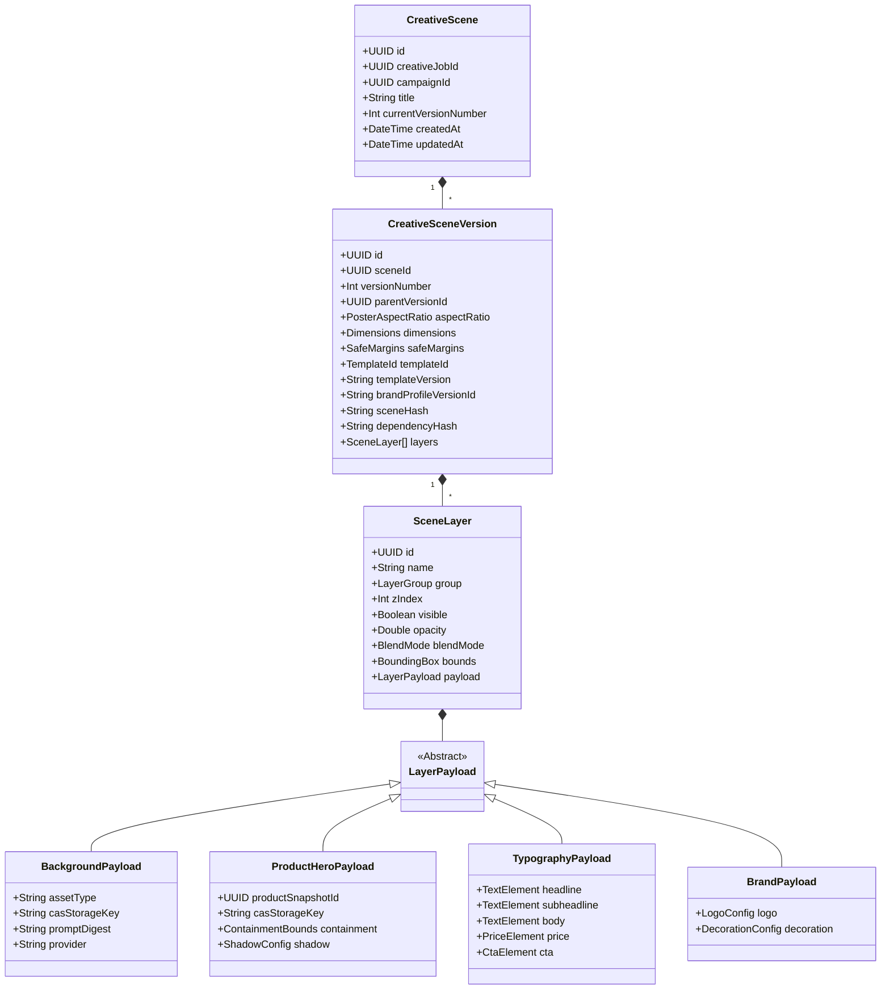
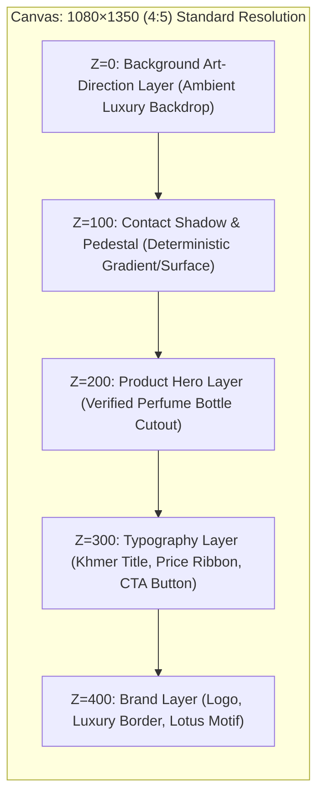
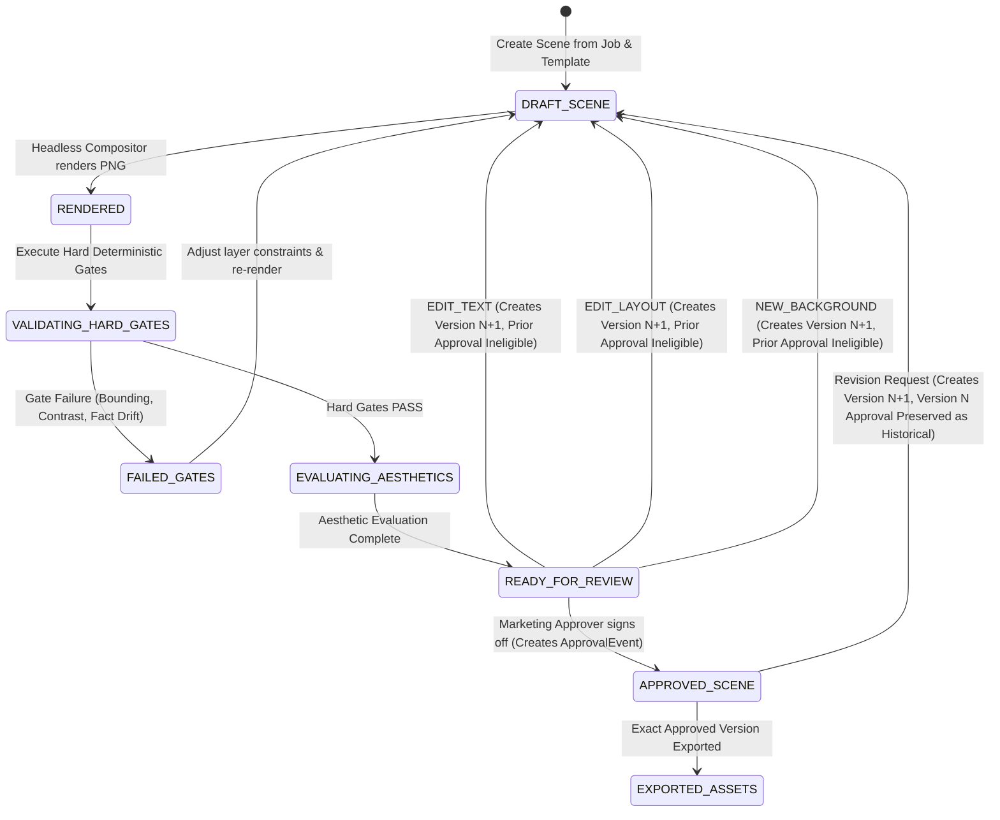

# Specification 2: Layered Creative Scene Schema

**Document:** `/docs/specifications/layered-creative-scene-schema.md`  
**Phase:** W03 — Foundational Specifications & Architecture  
**Status:** Foundational Specification Ready for Owner Business Decisions  
**Authority:** Master Engineering Blueprint v3.0 §9, §10, §22  
**Target Packages:** W20 (Layered CreativeScene Model), W21 (Poster Studio Compositor), W22 (Five Canonical Template Families)

---

## 1. Purpose and Scope

### 1.1 Purpose

This specification defines the canonical, provider-independent representation of a marketing poster before rendering: the **Layered Creative Scene** (`CreativeScene`). Rather than treating generated posters as monolithic, opaque raster bitmaps, Parisian Shopper AI models posters as structured, reproducible, multi-layer scene graphs. This architecture enables deterministic typography composition, authentic product preservation, targeted layer-level revisions without costly image regenerations, multi-format responsive adaptations, and immutable cryptographic approval tracking.

### 1.2 Scope

- Complete layer taxonomy across five functional layer groups: `Background`, `Surface/Shadow`, `Product Hero`, `Typography`, and `Brand/Decor`.
- Multi-format canvas geometry: 1:1 (Square Feed), 4:5 (Portrait Feed), and 9:16 (Vertical Stories/Reels) at a standard 1080px base coordinate system.
- Multilingual typography layout supporting English, Khmer Unicode script, and bilingual configurations.
- Five canonical template families conforming to Roadmap W22:
  1. `CENTERED_HERO` (Centered luxury product hero)
  2. `EDITORIAL_SPLIT` (Editorial split layout)
  3. `KHMER_SEASONAL` (Khmer seasonal or cultural campaign)
  4. `SCENT_STORY` (Scent pyramid or educational composition)
  5. `PROMOTION_PRICE_CTA` (Promotion, price and CTA composition)  
     _(Haussmann architectural styling is formalized as an optional style preset / visual treatment under `W03-DEC-006`)_.
- Strict separation between deterministic hard validation gates (`PASS`/`FAIL`) and calibrated aesthetic scoring.
- Immutable scene versioning, parent revision tracking, and dependency-aware approval invalidation following the canonical dependency chain:  
  `ProductSource` → `ProductSnapshotVersion` → `ContentVersion` → `BrandBrief` → `CreativeSceneVersion` → `RenderedVisualAsset` → `VisualValidationResult` → `CreativeApprovalEvent` → `ExportedPosterPackage` → `future PublishIntent`.
- Mapping of user edit operations to specific layer lifecycle transitions.
- Dedicated failure recovery, CAS error handling, and render pipeline resilience.

---

## 2. Explicit Non-Goals

1. **No Client-Side In-Browser Canvas Tooling in W03:** This specification defines the server-side data schema and headless rendering model. Building a browser-based drag-and-drop WYSIWYG editor is explicitly deferred to Phase 5.
2. **No General-Purpose Vector Drawing Format:** This is not SVG, PDF, or Figma. The schema is purposefully constrained to Parisian Shopper’s luxury brand rules and retail poster templates.
3. **No Direct Code Implementation in W03:** This specification provides the complete architectural contract. It must NOT be implemented in TypeScript or Prisma during Phase 0 / W03.
4. **No Free-Form Unconstrained AI Layout:** AI providers never decide raw pixel coordinates or absolute layer positions. Layout geometry is strictly governed by deterministic template code.
5. **Aesthetic Scores Never Override Hard Gates:** Aesthetic scores cannot authorize review dispatch or export if any hard validation gate has failed.

---

## 3. Existing-System Alignment

The current codebase features preliminary poster definitions that this specification formalizes:

- **`PosterSpec` (`poster-spec.ts`):** Flat configuration structure containing template ID, format, copy strings, and palette. This specification transforms `PosterSpec` into a hierarchical, multi-layer scene graph.
- **`SharpPosterCompositorAdapter`:** Renders background, product cutout, and SVG text overlay. This specification establishes the formal input schema that drives compositor execution.
- **`VisualAsset` Prisma Model:** Currently stores a single flat composited image. The scene schema links multiple layer assets (backgrounds, masks, overlays) under a unified scene root.

---

## 4. Terminology

- **Creative Scene (`CreativeScene`):** The logical container representing a marketing poster across all its revisions and platform adaptations.
- **Scene Version (`CreativeSceneVersion`):** An immutable, reproducible snapshot of the complete layer graph at a specific version index.
- **Layer Group:** A functional classification of visual elements:
  1. _Background Layer Group:_ Ambient setting, lighting, generated textures, or static luxury backdrops.
  2. _Product Layer Group:_ Verified product bottle cutout, contact shadow, reflection, and pedestal.
  3. _Typography Layer Group:_ Deterministically rendered headlines, body copy, price badges, and CTAs.
  4. _Brand Layer Group:_ Registered logos, heritage seals, botanical frames, and seasonal ornaments.
  5. _Metadata Layer Group:_ Template version, dimensions, safe areas, color profiles, and dependency hashes.
- **Z-Index:** The absolute vertical stacking order (0 to 1000) ensuring correct visual occlusion.
- **Safe Area (`SafeMargins`):** Inner bounding box protecting critical content from platform UI clipping.
- **Hard Validation Gate:** Deterministic binary check (`PASS` / `FAIL`) enforcing factual, physical, and legal constraints.
- **Aesthetic Scoring:** Continuous evaluation of design balance, hierarchy, and brand fit under a versioned `EvaluationPolicy`.

---

## 5. Entities and Value Objects



---

## 6. Proposed Schemas

### 6.1 `CreativeSceneVersion` Master Schema Table

| Field Name               | Type      | Required? | Constraints                                      | Description                                      |
| ------------------------ | --------- | :-------: | ------------------------------------------------ | ------------------------------------------------ |
| `id`                     | `UUID`    |  **YES**  | RFC 4122 v4 UUID                                 | Unique version identifier                        |
| `sceneId`                | `UUID`    |  **YES**  | References `CreativeScene.id`                    | Parent logical scene container                   |
| `versionNumber`          | `Integer` |  **YES**  | Positive integer `>= 1`                          | Monotonically increasing version counter         |
| `parentVersionId`        | `UUID`    | OPTIONAL  | References previous version                      | Null for version 1; tracks revision ancestry     |
| `outputFormat`           | `Object`  |  **YES**  | `aspectRatio`, `width`, `height`                 | Canvas physical dimensions in pixels             |
| `templateId`             | `Enum`    |  **YES**  | 1 of 5 canonical templates                       | Roadmap W22 template family                      |
| `templateVersion`        | `String`  |  **YES**  | Semantic version (e.g. `1.2.0`)                  | Deterministic layout engine release version      |
| `stylePresetId`          | `String`  | OPTIONAL  | Preset identifier (e.g. `HAUSSMANN_GOLD_PRESET`) | Optional visual treatment preset                 |
| `language`               | `Enum`    |  **YES**  | `EN`, `KM`, `BILINGUAL`                          | Editorial text language mode                     |
| `safeMargins`            | `Object`  |  **YES**  | `top`, `bottom`, `left`, `right` in px           | Unobstructed content safe zone                   |
| `brandProfileVersionId`  | `UUID`    |  **YES**  | References `BrandProfileVersion`                 | Governed brand styling rules applied             |
| `sourceContentVersionId` | `UUID`    |  **YES**  | References `ContentVersion`                      | Approved text copy source                        |
| `productSnapshotId`      | `UUID`    |  **YES**  | References immutable `ProductSnapshot`           | Authoritative commercial fact source             |
| `sceneHash`              | `String`  |  **YES**  | Exactly 64 hex characters (SHA-256)              | Cryptographic digest over complete scene JSON    |
| `dependencyHash`         | `String`  |  **YES**  | Exactly 64 hex characters (SHA-256)              | Digest over external inputs (Snapshot + Content) |
| `layers`                 | `Array`   |  **YES**  | Array of `SceneLayer` objects                    | Ordered visual layers composing the scene        |

### 6.2 Layer Hierarchy and Constraints



| Layer Group        | Allowed Types                               | Z-Index Range | Containment Rules                                         | Mutability Impact                                       |
| ------------------ | ------------------------------------------- | :-----------: | --------------------------------------------------------- | ------------------------------------------------------- |
| **Background**     | `IMAGE_CAS`, `COLOR_FILL`, `GRADIENT`       |   `0 – 99`    | Must cover 100% of canvas (`bleed=0`)                     | Modifying requires background generation or preset swap |
| **Surface/Shadow** | `PEDESTAL_SURFACE`, `CONTACT_SHADOW`        |  `100 – 199`  | Must align with bottom bounding box of hero product       | Deterministic recalculation when product scales         |
| **Product Hero**   | `PRODUCT_CUTOUT_PNG`                        |  `200 – 299`  | Governed by `TemplateConstraint` (e.g. 35%–60% dev range) | Replacing asset recomputes shadows & containment        |
| **Typography**     | `TEXT_BLOCK`, `PRICE_BADGE`, `CTA_BUTTON`   |  `300 – 399`  | Must reside 100% within `safeMargins`; zero overflow      | Modifying text requires SVG re-render; \$0 image cost   |
| **Brand/Decor**    | `LOGO_MARK`, `DIVIDER_LINE`, `CORNER_FRAME` |  `400 – 499`  | Must respect logo clear space under active brand rule     | Deterministic SVG overlay; \$0 image cost               |

### 6.3 Illustrative Scene JSON Schema Example

> [!NOTE]
> The following JSON snippet is an **illustrative schema example** demonstrating field relationships and layer nesting. Exact numeric values are configuration placeholders associated with `W03-DEC-005` and `W03-DEC-006`.

```json
{
  "$schema": "https://schema.parisianshopper.com/v1/creative-scene.json",
  "id": "7b8f9e2d-3c4a-4e5b-8f1a-9d2c3e4f5a6b",
  "sceneId": "1a2b3c4d-5e6f-7a8b-9c0d-1e2f3a4b5c6d",
  "versionNumber": 1,
  "parentVersionId": null,
  "outputFormat": {
    "aspectRatio": "4:5",
    "width": 1080,
    "height": 1350
  },
  "templateId": "EDITORIAL_SPLIT",
  "templateVersion": "1.2.0",
  "stylePresetId": "HAUSSMANN_GOLD_PRESET",
  "language": "KM",
  "safeMargins": {
    "top": 80,
    "bottom": 120,
    "left": 72,
    "right": 72
  },
  "brandProfileVersionId": "e3b0c442-98fc-1c14-9afb-f4c8996fb924",
  "sourceContentVersionId": "c4d5e6f7-a8b9-0c1d-2e3f-4a5b6c7d8e9f",
  "productSnapshotId": "f5e4d3c2-b1a0-9f8e-7d6c-5b4a3f2e1d0c",
  "sceneHash": "a1b2c3d4e5f67890abcdef1234567890abcdef1234567890abcdef1234567890",
  "dependencyHash": "9876543210fedcba0987654321fedcba0987654321fedcba0987654321fedcba",
  "layers": [
    {
      "id": "layer-bg-001",
      "name": "Luxury Marble Setting",
      "group": "BACKGROUND",
      "zIndex": 0,
      "visible": true,
      "opacity": 1.0,
      "blendMode": "NORMAL",
      "bounds": { "x": 0, "y": 0, "width": 1080, "height": 1350 },
      "payload": {
        "assetType": "GENERATED_BACKGROUND",
        "casStorageKey": "cas/8f/3a/8f3a9e2d...01.png",
        "sha256": "8f3a9e2d4c5b6a7b8c9d0e1f2a3b4c5d6e7f8a9b0c1d2e3f4a5b6c7d8e9f0123",
        "provider": "gemini",
        "model": "imagen-3",
        "promptVersion": "bg-luxury-atelier-v2"
      }
    },
    {
      "id": "layer-surface-002",
      "name": "Contact Shadow",
      "group": "SURFACE_SHADOW",
      "zIndex": 100,
      "visible": true,
      "opacity": 0.45,
      "blendMode": "MULTIPLY",
      "bounds": { "x": 180, "y": 880, "width": 720, "height": 120 },
      "payload": {
        "shadowType": "CONTACT_ELLIPSE",
        "blurRadius": 28,
        "color": "#1A1510"
      }
    },
    {
      "id": "layer-hero-003",
      "name": "CHANEL Classic Flap Bag",
      "group": "PRODUCT_HERO",
      "zIndex": 200,
      "visible": true,
      "opacity": 1.0,
      "blendMode": "NORMAL",
      "bounds": { "x": 240, "y": 380, "width": 600, "height": 600 },
      "payload": {
        "productSnapshotId": "f5e4d3c2-b1a0-9f8e-7d6c-5b4a3f2e1d0c",
        "casStorageKey": "cas/4a/1b/4a1b8c2d...02.png",
        "sha256": "4a1b8c2d3e4f5a6b7c8d9e0f1a2b3c4d5e6f7a8b9c0d1e2f3a4b5c6d7e8f9012",
        "scale": 0.444,
        "rotationDegrees": 0,
        "containmentPassed": true
      }
    },
    {
      "id": "layer-typo-004",
      "name": "Khmer Promotional Typography",
      "group": "TYPOGRAPHY",
      "zIndex": 300,
      "visible": true,
      "opacity": 1.0,
      "blendMode": "NORMAL",
      "bounds": { "x": 72, "y": 980, "width": 936, "height": 290 },
      "payload": {
        "headline": {
          "text": "ភាពទាក់ទាញបែបប៉ារីសពិតៗ",
          "fontFamily": "Noto Sans Khmer",
          "fontWeight": 700,
          "fontSize": 48,
          "color": "#1C1A17",
          "lineHeight": 1.3
        },
        "priceBadge": {
          "regularPrice": "$145.00",
          "promoPrice": "$116.00",
          "currency": "USD",
          "discountText": "-20%",
          "badgeBackground": "#C5A059",
          "badgeTextColor": "#FFFFFF"
        },
        "cta": {
          "text": "កម្ម៉ង់ទិញឥឡូវនេះ",
          "fontFamily": "Noto Sans Khmer",
          "fontWeight": 600,
          "fontSize": 20,
          "style": "OUTLINE_PILL"
        }
      }
    },
    {
      "id": "layer-brand-005",
      "name": "Parisian Shopper Header Seal",
      "group": "BRAND_DECORATION",
      "zIndex": 400,
      "visible": true,
      "opacity": 0.9,
      "blendMode": "NORMAL",
      "bounds": { "x": 390, "y": 80, "width": 300, "height": 60 },
      "payload": {
        "logoType": "VECTOR_EMBLEM",
        "color": "#1C1A17",
        "clearSpacePx": 32,
        "divider": "DOUBLE_LINE_DIAMOND"
      }
    }
  ]
}
```

---

## 7. Invariants

1. **Rendering Reproducibility:** Rendering a `CreativeSceneVersion` using identical pinned container environments, fonts, and asset binaries yields equivalent outputs. Platform-stable equivalence and golden-test tolerance are defined to account for minor cross-platform rasterization variations (e.g. font-hinting differences across OS kernels).
2. **Product Asset Sanctity:** The product layer must reference authentic photography from `ProductSnapshot`. No AI model may regenerate, alter, or replace the product bottle image.
3. **No Unbounded Typography:** All text elements must pass automated layout bounding box checks. Text truncation (`...`) is prohibited in approved luxury creative; text must wrap or scale down deterministically according to typographic scale.
4. **Approval Immutability:** A human approval event attaches exclusively to a specific `CreativeSceneVersion.id` and its corresponding rendered `VisualAsset.sha256`. It cannot authorize a revised scene version.
5. **Fail-Closed Aspect Ratio Enforcement:** Attempting to render a scene using unsupported dimensions throws `UnsupportedAspectRatioError`.
6. **Hard Gates vs. Aesthetic Scores:** Hard validation gates produce explicit pass/fail results. An aesthetic score must NEVER override a failed hard gate.

---

## 8. State Transitions and Revision Operations

Every edit operation maps to a deterministic lifecycle path, creating a new `CreativeSceneVersion`:

| Operation Code       | User Action                                       | Layers Modified        |   Requires Image Gen?   | Invalidates Prior Approval? | Invalidates Content Approval? |
| -------------------- | ------------------------------------------------- | ---------------------- | :---------------------: | :-------------------------: | :---------------------------: |
| **`EDIT_TEXT`**      | Correct headline, promo price, or CTA text        | Typography (`Z=300`)   |     **NO (\$0.00)**     |           **YES**           |            **YES**            |
| **`EDIT_LAYOUT`**    | Move text left/right, swap template geometry      | Typography, Brand      |     **NO (\$0.00)**     |           **YES**           |      NO (Copy unchanged)      |
| **`CHANGE_STYLE`**   | Change color palette, fonts, or decorative motifs | Typography, Brand      |     **NO (\$0.00)**     |           **YES**           |              NO               |
| **`NEW_BACKGROUND`** | Request new AI ambient background                 | Background (`Z=0`)     | **YES (Provider Call)** |           **YES**           |              NO               |
| **`CHANGE_PRODUCT`** | Select alternate approved bottle angle            | Product Hero (`Z=200`) |     **NO (\$0.00)**     |           **YES**           |              NO               |



### 8.1 Hard Validation Gates vs. Aesthetic Scoring

#### Mandatory Hard Validation Gates (Explicit PASS/FAIL)

Hard gates evaluate deterministic safety, physical correctness, and factual truth. A failure in ANY hard gate immediately halts the workflow and blocks review dispatch:

1. **Factual Agreement:** Text copy matches authoritative `ProductSnapshot` (price, currency, volume, brand).
2. **Exact Dimensions & Supported Format:** Resolution strictly matches approved canvas geometry (1080×1080, 1080×1350, 1080×1920).
3. **Canonical Product Asset Authenticity:** Product cutout matches verified CAS hash from snapshot; zero AI hallucination.
4. **Product Containment:** Hero cutout resides within safe containment boundary defined by `TemplateConstraint`.
5. **Text Overflow & Clipping:** Zero glyph overflow outside defined text bounding boxes.
6. **Glyph Coverage:** All characters renderable by local font assets without fallback to missing-glyph boxes (`.notdef`).
7. **Safe Areas:** Critical copy and badges reside strictly within `SafeMargins`.
8. **Contrast Minimums:** Text overlay meets minimum WCAG AA contrast ratio against underlying layer pixels.
9. **Required Fields:** Mandatory elements (brand logo, product title, price badge) present.
10. **Logo Integrity:** Brand logo respects clear-space margin; no occlusion.
11. **Prohibited Content:** Negative prompt and disallowed phrase filters pass.
12. **Product & Campaign Freshness Eligibility:** Linked `ProductSnapshot` evaluated as `FRESH` under active policy.

#### Soft Aesthetic Scoring (Continuous Metric)

Aesthetic scoring evaluates design balance, typographic hierarchy, and style fit under a versioned `EvaluationPolicy` (tied to `W03-DEC-009`):

- Hierarchy & balance.
- Spacing & baseline rhythm.
- Brand profile style fit.
- Visual novelty relative to recent campaigns.
- Predicted reviewer preference.

> [!IMPORTANT]
> An aesthetic score must NEVER override a failed hard gate. Hard gates must pass 100% before aesthetic scores are evaluated.

---

## 9. Versioning Semantics

1. **Linear Monotonicity:** Within a `CreativeScene`, `versionNumber` begins at `1` and increments by `1` with every revision operation.
2. **Immutability Guarantee:** A `CreativeSceneVersion` is permanently immutable once rendered.
3. **Approval Lifecycle:**
   - Approvals are immutable historical events (`CreativeApprovalEvent`) bound to exact `versionId` and rendered asset digest.
   - A revision creates a new scene version (`versionNumber N+1`).
   - The prior approval remains in the historical audit log but cannot authorize version `N+1`.
   - The revised version has NO approval until formally approved by an authorized actor.
   - Export requires verified approval for the exact scene and render version.
4. **Audit Traceability:** Every version record documents `requestedByUserId`, `changeReason`, `operationCode`, and `parentVersionId`.

---

## 10. Dependency and Invalidation Rules

1. **Snapshot Divergence:** If `ProductSnapshot.priceStockHash` changes, the scene status transitions to `STALE_FACTS`. The linked approval becomes ineligible for export.
2. **Content Divergence:** If `ContentVersion` copy is updated, typography layers are re-rendered and prior approval becomes ineligible for export, but background and product hero layers are preserved.
3. **Export Requirement:** `ExportPosterUseCase` requires that `scene.currentVersionNumber === visualAsset.versionNumber` and verifies an active, eligible approval for that exact pair.

### 10.1 Approval, Export, and Future Publishing Boundary

```mermaid
flowchart TD
    subgraph ApprovalBoundary["Step 1: Immutable Review & Approval"]
        CV["ContentVersion (Immutable)"]
        SV["CreativeSceneVersion (Immutable)"]
        VA["Rendered VisualAsset (SHA-256)"]
        CV & SV & VA --> HardGates{Mandatory Hard Gates<br/>(Factual, Bounding, Contrast, Freshness)}
        HardGates -- FAIL --> BlockReview[Review Disallowed]
        HardGates -- PASS --> SoftScores{Aesthetic Scoring<br/>(EvaluationPolicy)}
        SoftScores --> Reviewer[Human Marketing Approver]
        Reviewer --> AppEvt["CreativeApprovalEvent<br/>(Binds exact CV + SV + VA IDs)"]
    end

    subgraph ExportBoundary["Step 2: Export & Packaging (W02 Enforced)"]
        AppEvt --> PreExportCheck{Freshness & Asset Integrity Check}
        PreExportCheck -- Stale Facts / Version Mismatch --> RejectExport[Export Blocked Fail-Closed]
        PreExportCheck -- Verified Fresh & Approved --> Exporter[ExportPosterUseCase]
        Exporter --> ExpPkg["Exported Packaging<br/>(1:1, 4:5, 9:16 PNG/JPEG)"]
    end

    subgraph PublishingBoundary["Step 3: Future Publishing Boundary (W61 Pending)"]
        ExpPkg -.-> PubDecision{Publish Authorized?}
        PubDecision -- Default (W02/W03) --> Downloader["Manual Download / Local Asset Handoff<br/>(Publishing Fail-Closed)"]
        PubDecision -.->|Future W61 Only| Intent["Separate Immutable PublishIntent<br/>(Signed by Admin)"]
        Intent -.-> IdempotentWorker["Idempotent Social Broadcaster<br/>(Telegram / Facebook)"]
        Intent -.-> Receipt["Durable DeliveryReceipt"]
    end
```

---

## 11. Application/Service APIs

### 11.1 `CreativeSceneService`

```typescript
export interface CreativeSceneService {
  createInitialScene(
    input: CreateInitialSceneInput,
  ): Promise<CreativeSceneVersionRecord>;
  reviseText(input: ReviseSceneTextInput): Promise<CreativeSceneVersionRecord>;
  reviseLayout(
    input: ReviseSceneLayoutInput,
  ): Promise<CreativeSceneVersionRecord>;
  regenerateBackground(
    input: RegenerateBackgroundInput,
  ): Promise<CreativeSceneVersionRecord>;
  getSceneVersion(
    sceneId: string,
    versionNumber: number,
  ): Promise<CreativeSceneVersionRecord>;
}
```

### 11.2 `PosterCompositorPort`

```typescript
export interface PosterCompositorPort {
  renderScene(
    sceneVersion: CreativeSceneVersionRecord,
  ): Promise<RenderedPosterResult>;
  validateHardGates(
    sceneVersion: CreativeSceneVersionRecord,
  ): Promise<HardGateValidationReport>;
}
```

---

## 12. Repository and Persistence Contracts

```typescript
export interface CreativeSceneRepository {
  createScene(scene: CreativeSceneDraft): Promise<CreativeSceneRecord>;
  createVersion(
    version: CreativeSceneVersionDraft,
  ): Promise<CreativeSceneVersionRecord>;
  findById(sceneId: string): Promise<CreativeSceneRecord | null>;
  findVersionById(
    versionId: string,
  ): Promise<CreativeSceneVersionRecord | null>;
  findLatestVersionByJobId(
    creativeJobId: string,
  ): Promise<CreativeSceneVersionRecord | null>;
  listVersions(sceneId: string): Promise<readonly CreativeSceneVersionRecord[]>;
}
```

---

## 13. Events and Outbox Behavior

The scene service emits domain events via the transactional outbox:

1. **`creative.scene.version_created`:**
   - Payload: `{ sceneId, versionNumber, parentVersionId, operationCode, sceneHash }`
2. **`creative.scene.rendered`:**
   - Payload: `{ sceneId, versionNumber, visualAssetId, sha256, durationMs }`
3. **`creative.approval.rendered_ineligible`:**
   - Payload: `{ sceneId, priorVersionNumber, newVersionNumber, invalidatedApprovalId, reason }`

---

## 14. Failure Behavior and Recovery

The scene rendering and composition pipeline enforces strict failure containment:

1. **Render Failure (Compositor Crash / OOM):**
   - Headless compositor execution is isolated in worker processes with memory limits.
   - If rendering fails, the scene version remains in state `RENDER_FAILED`. The immutable scene data is preserved intact.
   - A retry task is dispatched from the rendering stage without modifying scene definitions.
2. **Missing Layer Assets (CAS Miss):**
   - If a layer references a CAS key that cannot be resolved on disk/storage, the compositor aborts with `MissingAssetStorageError`.
   - The scene is flagged with the missing CAS key; no incomplete composite is ever produced.
3. **Corrupted CAS Data (Hash Mismatch):**
   - Before compositing, asset bytes are hashed. If `SHA-256(bytes) !== casStorageKey`, an integrity alert is raised (`CorruptedAssetError`) and the asset is quarantined.
4. **Font / Glyph Failure:**
   - Font loading verifies glyph coverage for all characters in the text layer (especially Khmer Unicode).
   - If an unmapped character is detected, rendering fails closed with `UnsupportedGlyphError`, preventing the emission of `.notdef` boxes on luxury creative.
5. **Unsupported Dimensions:**
   - Attempting to construct or render a scene outside approved aspect ratios or dimensions fails immediately with `InvalidCanvasGeometryError`.
6. **Provider Background Failure:**
   - If an AI background generation call fails or times out, the background layer creation fails closed.
   - System rolls back to the prior background layer or offers pre-approved static CAS luxury backdrops (\$0.00 cost).
7. **Validation Failure (Hard Gate Rejection):**
   - If a hard gate fails (e.g. text bounding box overflow), the rendered asset is marked `GATES_FAILED`.
   - The failure report provides deterministic reason codes, enabling targeted correction without regenerating unaffected layers.

---

## 15. Security and Authorization

1. **Path Traversal & CAS Security:** All asset references must use validated `cas/xx/yy/sha256.ext` storage keys. Arbitrary file paths or external HTTP URLs inside layer payloads are strictly rejected.
2. **SVG Injection Prevention:** Vector overlays and divider paths are rendered through `SafeSvgRenderer` with strict XML escaping. Embedding `<script>` or external `xlink:href` entities throws `SvgSecurityException`.
3. **Role Enforcement (Exact permissions from `permissions.ts`):**
   - Creating scene revisions requires `Permission.EDIT_CREATIVE`.
   - Approving requires `Permission.APPROVE_CREATIVE`.
   - Exporting requires `Permission.EXPORT_CREATIVE`.

---

## 16. Privacy and Data Governance

1. **No Proprietary Geometry Leakage:** Exported images strip intermediate layer metadata and camera coordinates. Public assets contain only clean EXIF data specifying sRGB color space and brand copyright.
2. **Asset Provenance Storage:** The scene graph permanently logs which model and prompt synthesized the background, satisfying upcoming AI transparency disclosure mandates.

---

## 17. Migration and Backward-Compatibility Strategy

1. **Phase 1 Legacy Jobs:** Previous creative jobs contain only `VisualAsset` records without a linked `CreativeScene`.
2. **Virtual Scene Wrapper:** A backward-compatibility adapter wraps legacy jobs into a synthetic single-layer scene for export, preventing runtime crashes.
3. **Forward Migration:** W20 introduces the dedicated `creative_scenes` and `creative_scene_versions` tables without modifying existing `visual_assets` columns.

---

## 18. Observability and Audit Evidence

1. **Prometheus Metrics:**
   - `creative_scene_render_duration_seconds{template="editorial|centered", format="1:1|4:5"}`
   - `creative_scene_revisions_total{operation="edit_text|edit_layout|new_background"}`
   - `creative_layer_validation_failures_total{rule="containment|contrast|overflow"}`
2. **Audit Logging:**
   - Every revision logs `SCENE_REVISION_CREATED` with actor, scene ID, version number, and modified layer groups.

---

## 19. Testing Strategy

1. **Unit Tests:**
   - Validate layer collision and Z-index ordering algorithms.
   - Test text wrapping and Khmer Unicode line-breaking boundary cases.
   - Verify that `EDIT_TEXT` does NOT invoke mock image generation providers.
2. **Visual Regression Tests:**
   - Pixel-diff tests comparing Sharp compositor outputs against reference Golden Masters for all 5 template families.
   - Pinned Docker/Linux container golden master comparisons with platform tolerance thresholds for font rasterization.

---

## 20. Acceptance Criteria

- [ ] Complete scene graph schema validates with Zod and rejects negative coordinate spaces.
- [ ] Hard validation gates produce explicit binary pass/fail results; aesthetic scores never override failed hard gates.
- [ ] Text edits produce a new version with zero AI provider cost.
- [ ] Product hero containment checks enforce versioned `TemplateConstraint` rules.
- [ ] All 5 template families (`CENTERED_HERO`, `EDITORIAL_SPLIT`, `KHMER_SEASONAL`, `SCENT_STORY`, `PROMOTION_PRICE_CTA`) render deterministically across 1:1, 4:5, and 9:16 canvases.
- [ ] Modifying an approved scene creates version N+1 and marks prior approval ineligible for the new version.
- [ ] XML/SVG injection attacks in text headlines are neutralized by `SafeSvgRenderer`.

---

## 21. Open Business Decisions

- **`W03-DEC-004`:** Approved Product Image Sources and Cutout Policies (BLOCKING for W20).
- **`W03-DEC-005`:** Supported Initial Social Media Output Formats (Non-blocking).
- **`W03-DEC-006`:** Initial Five Template Families and Layout Geometry (Non-blocking).
- **`W03-DEC-007`:** Approved Latin and Khmer Typography (BLOCKING for W21).
- **`W03-DEC-009`:** Visual and Copy Similarity Thresholds (Non-blocking).
- **`W03-DEC-012`:** Acceptable Cost Ceilings per Generated Creative (Non-blocking).
- **`W03-DEC-018`:** Separation of Approval and Publishing Roles (APPROVED based on accepted W02 RBAC implementation).

---

## 22. Explicit Dependencies on Later Work Packages

- **W20 (Layered CreativeScene Model):** Implements the Prisma schema, Zod validators, and repository contracts specified in §§5, 6, 12.
- **W21 (Poster Studio Compositor):** Implements the multi-layer Sharp composition engine that renders `CreativeSceneVersion` into raster PNGs.
- **W22 (Five Canonical Template Families):** Implements the 5 layout generators adhering to the geometry and containment rules defined herein.
- **W30 (Khmer Typography & Localization):** Integrates approved Unicode fonts into the typography layer payload renderer.
- **W61 (Controlled Publishing):** Extracts finalized raster assets from approved scene versions for social broadcast.
