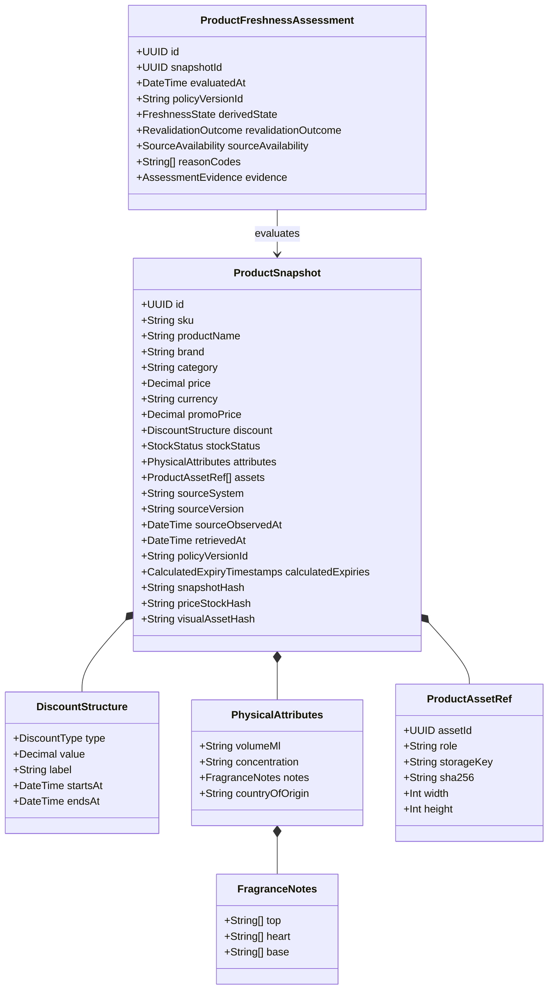
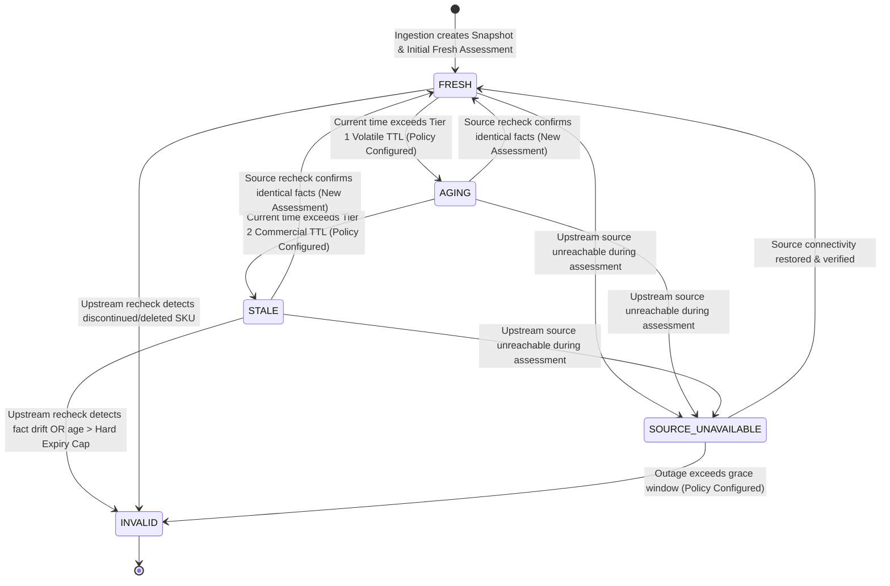
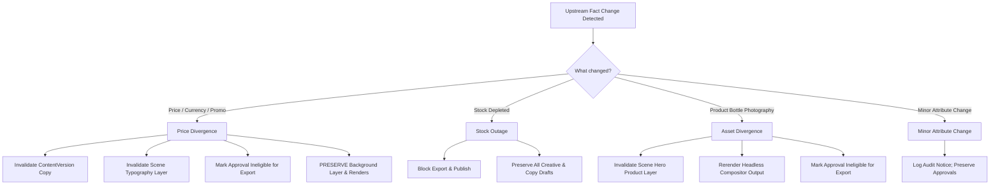

# Specification 1: Product Freshness and Campaign Integrity

**Document:** `/docs/specifications/product-freshness-and-campaign-integrity.md`  
**Phase:** W03 — Foundational Specifications & Architecture  
**Status:** Foundational Specification Ready for Owner Business Decisions  
**Authority:** Master Engineering Blueprint v3.0 §8, §10, §22  
**Target Packages:** W10 (Product API Adapter), W11 (Freshness-Aware Snapshots & Invalidation)

---

## 1. Purpose and Scope

### 1.1 Purpose

This specification establishes the authoritative architectural mechanisms by which Parisian Shopper AI ingests, normalizes, cryptographically snapshots, monitors, and evaluates commercial product facts, stock availability, pricing, promotional structures, and physical product attributes. It guarantees that marketing copy and visual poster assets generated across the platform strictly represent verified real-world retail truth, preventing commercial misrepresentation, illegal pricing claims, and out-of-stock promotions.

### 1.2 Scope

- Authoritative Product API interface and transport security.
- Distinction between `development` fixtures, `staging` sandbox, and `production` live sources.
- Deterministic, immutable, append-only `ProductSnapshot` creation, hashing, and provenance storage.
- Separate derived, append-only `ProductFreshnessAssessment` evaluations: `FRESH`, `AGING`, `STALE`, `INVALID`, `SOURCE_UNAVAILABLE`.
- Versioned `FreshnessPolicy` configuration (with safe development benchmark examples tied to `W03-DEC-002`).
- Targeted invalidation of downstream artifacts following the canonical dependency chain:  
  `ProductSource` → `ProductSnapshotVersion` → `ContentVersion` → `BrandBrief` → `CreativeSceneVersion` → `RenderedVisualAsset` → `VisualValidationResult` → `CreativeApprovalEvent` → `ExportedPosterPackage` → `future PublishIntent`.
- Fail-closed revalidation gates immediately preceding visual review approval, poster export, and social delivery.
- Provenance tracking and reviewer auditing interfaces.

---

## 2. Explicit Non-Goals

1. **No Master Catalog Editing:** Parisian Shopper AI is strictly a consumer of commercial product facts, never an editor or master catalog database. The system cannot create, modify, or delete products in the upstream catalog/ERP.
2. **No AI Fact Hallucination or Extrapolation:** AI providers are strictly prohibited from generating, guessing, completing, or correcting missing product specifications (e.g. guessing perfume concentration, olfactory notes, volume, or discount percentages).
3. **No Direct Production Publishing in W03:** This specification defines the freshness prerequisites for export and delivery, but does NOT enable automated social publishing, which remains permanently fail-closed pending W61.
4. **No Dynamic Client-Side In-Store Pricing:** Pricing is scoped to digital campaign social marketing in Cambodia/ASEAN; it does not handle real-time POS barcode scanning or multi-branch localized shelf-pricing logic.

---

## 3. Existing-System Alignment

The current codebase includes foundational models that this specification refines:

- **`ProductSnapshot` Prisma Model:** Contains base fields (`sku`, `productName`, `brand`, `category`, `price`, `currency`, `stockStatus`, `snapshotHash`). This specification formalizes that `ProductSnapshot` records are strictly immutable historical facts, while live freshness evaluations reside in a separate derived assessment entity (`ProductFreshnessAssessment`).
- **`ProductSourcePort`:** Currently implemented by `MockProductSource` (with fictional perfumes) and `DisabledProductSource`. This specification defines the production adapter interface implemented in W10.
- **Validation Engine:** `FactualValidator` checks candidate copy against `ProductSnapshot`. This specification extends validation to verify that the snapshot itself has a current `FRESH` evaluation before approval or export.

---

## 4. Terminology

- **Authoritative Source:** The configured upstream commercial catalog system hosting verified retail product data (identity configured per environment; see `W03-DEC-001`).
- **Product Snapshot (`ProductSnapshot`):** An immutable, append-only cryptographic capture of a product's commercial attributes, images, prices, and stock status at a specific point in time. Historical snapshots are never mutated.
- **Freshness Policy (`FreshnessPolicy`):** A versioned configuration document defining maximum tolerable staleness durations per fact volatility tier (referenced via `policyVersionId`; see `W03-DEC-002`).
- **Freshness Assessment (`ProductFreshnessAssessment`):** An append-only derived evaluation record evaluating a specific snapshot's currency against active policy at an evaluation timestamp.
- **Fact Volatility Tiers (Proposed benchmark candidates under `W03-DEC-002`):**
  - _Tier 1 (Volatile Stock):_ Stock availability and inventory levels (e.g. proposed candidate TTL: 5 minutes).
  - _Tier 2 (Commercial/Financial):_ Selling price, promo price, discount structure (e.g. proposed candidate TTL: 15 minutes).
  - _Tier 3 (Campaign/Promotional):_ Campaign validity window, seasonal discount banner (e.g. proposed candidate TTL: 1 hour).
  - _Tier 4 (Physical/Static):_ Brand, title, concentration, volume, olfactory notes, packaging photos (e.g. proposed candidate TTL: 24 hours).
  - _Hard Expiration Cap:_ Maximum tolerable snapshot age before mandatory re-fetch (e.g. proposed candidate TTL: 48 hours).
- **Dependency Hash (`dependencyHash`):** A SHA-256 digest computed exclusively over the subset of product fields upon which a specific downstream artifact depends (e.g. `priceStockHash`).
- **Targeted Invalidation:** Invalidation of only those specific downstream versions whose input dependency hash has diverged, preserving unaffected work.

---

## 5. Entities and Value Objects



---

## 6. Proposed Schemas

### 6.1 `ProductSnapshot` Schema (Immutable Fact Capture)

> [!IMPORTANT]
> `ProductSnapshot` is strictly immutable and append-only. No live freshness state is stored on this entity. All temporal evaluations are recorded in `ProductFreshnessAssessment`.

| Field Name                   | Type       | Required? | Constraints & Validation                                            | Description                                          |
| ---------------------------- | ---------- | :-------: | ------------------------------------------------------------------- | ---------------------------------------------------- |
| `id`                         | `UUID`     |  **YES**  | RFC 4122 v4 UUID                                                    | Primary immutable snapshot identifier                |
| `sku`                        | `String`   |  **YES**  | `^[A-Za-z0-9][A-Za-z0-9._/-]{0,63}$`                                | Authoritative stock-keeping unit                     |
| `productName`                | `String`   |  **YES**  | 1–300 UTF-8 characters                                              | Official catalog product title                       |
| `brand`                      | `String`   |  **YES**  | 1–120 UTF-8 characters                                              | Registered brand house (e.g. CHANEL)                 |
| `category`                   | `String`   |  **YES**  | Controlled taxonomy code                                            | E.g. `FRAGRANCE_WOMEN`, `SKINCARE`                   |
| `price`                      | `Decimal`  |  **YES**  | Non-negative, max 4 decimal places                                  | Base catalog retail price                            |
| `currency`                   | `String`   |  **YES**  | ISO 4217 3-letter code (`USD`, `KHR`, `EUR`)                        | Monetary unit for all pricing fields                 |
| `promoPrice`                 | `Decimal`  | OPTIONAL  | Non-negative; must be `<= price`                                    | Active promotional price if discounted               |
| `discount`                   | `JsonB`    | OPTIONAL  | Conforms to `DiscountStructureSchema`                               | Upstream promotional calculation details             |
| `stockStatus`                | `Enum`     |  **YES**  | `IN_STOCK`, `LOW_STOCK`, `OUT_OF_STOCK`, `PREORDER`, `DISCONTINUED` | Commercial fulfillment availability                  |
| `physicalAttributes`         | `JsonB`    |  **YES**  | Conforms to `PhysicalAttributesSchema`                              | Volume, concentration, notes, origin                 |
| `canonicalAssets`            | `JsonB`    |  **YES**  | Array of `ProductAssetRef` objects                                  | Verified bottle & packaging photography              |
| `sourceSystem`               | `String`   |  **YES**  | Configured source identifier (tied to `W03-DEC-001`)                | Originating data source identifier                   |
| `sourceVersion`              | `String`   | OPTIONAL  | Max 100 characters                                                  | ETag, sequence number, or commit ID from source      |
| `sourceObservedAt`           | `DateTime` | OPTIONAL  | ISO 8601 UTC timestamp                                              | When upstream source recorded or published the facts |
| `retrievedAt`                | `DateTime` |  **YES**  | ISO 8601 UTC timestamp                                              | Exact platform retrieval timestamp                   |
| `policyVersionId`            | `String`   |  **YES**  | Semantic policy ID (e.g. `freshness-policy-v1`)                     | Policy version active when snapshot was captured     |
| `calculatedExpiryTimestamps` | `JsonB`    | OPTIONAL  | Map of tier cutoff timestamps computed at snapshot creation         | Optional pre-computed tier timestamps under policy   |
| `snapshotHash`               | `String`   |  **YES**  | Exactly 64 hex characters (SHA-256)                                 | Digest over all canonical product fields             |
| `priceStockHash`             | `String`   |  **YES**  | Exactly 64 hex characters (SHA-256)                                 | Digest over price, currency, promo, stock            |
| `visualAssetHash`            | `String`   |  **YES**  | Exactly 64 hex characters (SHA-256)                                 | Digest over canonical asset digests                  |

### 6.2 `ProductFreshnessAssessment` Schema (Derived Append-Only Evaluation)

| Field Name           | Type       | Required? | Constraints                                                                                    | Description                                                  |
| -------------------- | ---------- | :-------: | ---------------------------------------------------------------------------------------------- | ------------------------------------------------------------ |
| `id`                 | `UUID`     |  **YES**  | RFC 4122 v4 UUID                                                                               | Assessment record identifier                                 |
| `snapshotId`         | `UUID`     |  **YES**  | References immutable `ProductSnapshot.id`                                                      | Target snapshot being evaluated                              |
| `evaluatedAt`        | `DateTime` |  **YES**  | ISO 8601 UTC timestamp                                                                         | Timestamp of assessment execution                            |
| `policyVersionId`    | `String`   |  **YES**  | Semantic policy ID (e.g. `development-v1`)                                                      | Freshness policy evaluated against                           |
| `derivedState`       | `Enum`     |  **YES**  | `FRESH`, `AGING`, `STALE`, `INVALID`, `SOURCE_UNAVAILABLE`                                     | Axis A: Evaluated freshness classification of stored facts   |
| `revalidationOutcome`| `Enum`     |  **YES**  | `FRESH`, `NON_MATERIAL_CHANGE`, `MATERIAL_CHANGE`, `SOURCE_UNAVAILABLE`, `PROMOTION_EXPIRED`, `OUT_OF_STOCK` | Axis B: Outcome of comparing stored snapshot to new facts    |
| `sourceAvailability` | `Enum`     |  **YES**  | `AVAILABLE`, `DEGRADED`, `UNREACHABLE`                                                         | Health status of authoritative upstream source               |
| `reasonCodes`        | `Array`    |  **YES**  | Array of string codes                                                                          | E.g. `PRICE_STALE`, `STOCK_DIVERGED`, `OK_FRESH`             |
| `evidence`           | `JsonB`    |  **YES**  | Structured audit evidence                                                                      | Evaluated age, latency, compared hashes, status              |

---

## 7. Invariants

1. **Immutable Historical Record:** Once written, a `ProductSnapshot` record is strictly append-only. No field may ever be mutated. Passing of time never mutates historical snapshots.
2. **Freshness via Derived Assessments:** Freshness is always evaluated dynamically or recorded as an append-only `ProductFreshnessAssessment`. It is never stored as mutable snapshot state.
3. **No Hallucinated Pricing:** If `promoPrice` is absent, the creative engine and copy generator are forbidden from asserting discounts, sale tags, or promotional claims.
4. **Currency Invariant:** `price` and `promoPrice` must share identical currency codes. Mixed-currency snapshots are rejected as `INVALID`.
5. **Authentic Imagery Requirement:** Every `canonicalAsset` must have a verified CAS storage key and valid SHA-256 matching raw bytes stored on disk. Synthetic product bottles are rejected by visual validation gates.
6. **No Production Fixture Fallback:** When `NODE_ENV === 'production'`, the system must strictly query the configured authoritative source. Silent fallback to fictional fixtures throws an unrecoverable `ConfigurationError`.
7. **Revalidation Outcomes:**
   - If upstream source confirms the **same facts/version**, a new `ProductFreshnessAssessment` is created linking to the existing `ProductSnapshot`.
   - If upstream source returns **changed facts/version**, a new `ProductSnapshot` is created and evaluated.
8. **Audit Integrity on Invalidation:** If product facts drift, historical `CreativeApprovalEvent` records remain immutable in the historical audit log; they become ineligible to authorize future export or publishing without modifying historical events.

---

## 8. State Transitions and The Two-Axis Freshness Model

### 8.1 The Two-Axis Model

To prevent semantic compression and preserve operational clarity, the platform distinguishes between two orthogonal evaluation concepts:

1. **Axis A — Freshness Assessment State (`derivedState` / `freshnessState`):**
   Describes whether currently stored facts are usable for a given operation according to elapsed time, validity windows, and source availability.
   - **`FRESH`:** All facts are within Tier 1 TTL according to active `FreshnessPolicy`. Eligible for generation, revision, approval, export, and publication.
   - **`AGING`:** Volatile stock facts have exceeded Tier 1 TTL, but commercial price and attributes remain within Tier 2 TTL. Permitted for drafting and visual compositing; triggers asynchronous background recheck.
   - **`STALE`:** Commercial pricing or campaign facts have exceeded Tier 2 TTL. Permitted for draft editing; BLOCKS approval confirmation, poster export, and publication until synchronous revalidation.
   - **`INVALID`:** Material discrepancy detected (price changed, stock depleted, SKU discontinued) OR age exceeds hard expiry cap. Associated approvals become ineligible for export; cannot be used for export or delivery.
   - **`SOURCE_UNAVAILABLE`:** Upstream source is unreachable due to timeout or network failure. Describes assessment/source health, NOT snapshot mutation. Drafts are safely preserved, but approval and export are blocked fail-closed.

2. **Axis B — Revalidation Outcome (`revalidationOutcome`):**
   Describes what happened when the stored snapshot was explicitly compared against freshly retrieved upstream facts.
   - **`FRESH`:** Upstream verified; all tracked business dependency hashes match the stored snapshot exactly.
   - **`NON_MATERIAL_CHANGE`:** Upstream returned data where provider metadata changed (e.g., retrieval timestamp, internal etag), but all tracked business dependency hashes remain identical. Stored snapshot is reused.
   - **`MATERIAL_CHANGE`:** One or more tracked dependency hashes diverged (e.g. price or attributes changed). A new immutable `ProductSnapshot` is captured.
   - **`SOURCE_UNAVAILABLE`:** Upstream source could not be reached (timeout, 5xx, auth failure, circuit breaker). Stored snapshot is preserved; no fake snapshot is created.
   - **`PROMOTION_EXPIRED`:** Promotion validity window has expired.
   - **`OUT_OF_STOCK`:** Normalized stock status indicates the item is out of stock.



### 8.2 Explicit Boundary Inclusivity and Precision Rules

To ensure completely deterministic evaluation across distributed workers, test suites, and audit ledgers, TTL boundary inclusivity is specified down to millisecond precision:

1. **Elapsed Time Calculation:**
   $$\text{elapsedMs} = \text{nowMs} - \text{retrievedAtMs}$$
   Where `nowMs` is the timestamp returned by the injected `Clock`, and `retrievedAtMs` is the snapshot's canonical `product.retrieved_at` timestamp.

2. **TTL Boundary Inclusivity:**
   - **Inclusive within boundary ($\le$):** Stored facts remain valid and within their current tier while $\text{elapsedMs} \le \text{ttlMs}$.
   - **Exclusive beyond boundary ($>$):** The moment $\text{elapsedMs} > \text{ttlMs}$ (even by $+1\,\text{ms}$), the tier boundary is exceeded and transitions to the next degradation state.
   - **Boundary States:**
     - $\text{elapsedMs} \le \text{stockTtlMs} \implies \mathbf{FRESH}$
     - $\text{stockTtlMs} < \text{elapsedMs} \le \text{commercialPriceTtlMs} \implies \mathbf{AGING}$
     - $\text{commercialPriceTtlMs} < \text{elapsedMs} \le \text{hardExpiryBoundaryMs} \implies \mathbf{STALE}$
     - $\text{elapsedMs} > \text{hardExpiryBoundaryMs} \implies \mathbf{INVALID}$ (`HARD_EXPIRY_EXCEEDED`)

3. **Promotion Window Boundaries:**
   - $\text{nowMs} < \text{startsAtMs} \implies$ Promotion not yet active.
   - $\text{startsAtMs} \le \text{nowMs} \le \text{endsAtMs} \implies$ Promotion is active.
   - $\text{nowMs} > \text{endsAtMs} \implies \mathbf{PROMOTION\_EXPIRED}$ (triggers material invalidation for promo-dependent artifacts).

4. **Provider Availability & Outage Behavior:**
   - Upstream unavailability assigns `SOURCE_UNAVAILABLE` while preserving stored snapshots without data loss.
   - If $\text{elapsedMs} > \text{hardExpiryBoundaryMs}$ during an outage, the hard expiration boundary takes precedence, transitioning the state to $\mathbf{INVALID}$ with reason `HARD_EXPIRY_EXCEEDED` and `UPSTREAM_UNAVAILABLE`.

### 8.3 Append-Only Policy Lifecycle

To resolve the mutation conflict between database-level immutability triggers and policy state transitions:
1. **`FreshnessPolicyVersion`:** Immutable policy configuration record defining TTLs for a specific `(policy_id, version)`. Protected by append-only database triggers (rejects `UPDATE` and `DELETE`).
2. **`FreshnessPolicyActivation`:** Append-only event ledger capturing environment activations (`APPROVED`, `RETIRED`).
3. **Active Policy Resolution:** Resolved at runtime from the latest activation event for the target environment. Production environment has no approved activation until confirmed by business decision `W03-DEC-002` (fails closed).

### 8.4 Compound Idempotency Scoping

Idempotency keys must be deterministically scoped to prevent cross-tenant, cross-user, or cross-environment collision:
$$\text{compoundKey} = \text{reval:}\{\text{env}\}:\{\text{skuOrSnapshotId}\}:\{\text{policyId}\}@\{\text{policyVersion}\}:\{\text{actorUserId}\}:\{\text{callerKey}\}$$
Replay of an idempotent request returns the exact snapshot and changed scopes recorded at original evaluation time.

---

## 9. Versioning Semantics

1. **Snapshot Identity:** Each snapshot has a unique immutable UUID (`snapshot.id`).
2. **Temporal Succession:** A product SKU points to an append-only succession of snapshots ordered by `retrievedAt`.
3. **Downstream Linking:** Downstream entities (`ContentVersion`, `CreativeSceneVersion`) store a foreign key directly to `productSnapshotId`, binding their creation to exact historical facts.
4. **Assessment Succession:** Multiple `ProductFreshnessAssessment` records may reference a single `ProductSnapshot`, providing a temporal audit log of freshness evaluations over time.

---

## 10. Dependency and Invalidation Rules

When product facts diverge upstream and a new snapshot is captured, downstream artifacts are invalidated selectively based on field dependencies following the canonical dependency chain:



### Invalidation Matrix

| Changed Fact             | Affected Downstream Layers             | Requires Regeneration? | Requires Human Re-approval? | Fail-Closed Block |
| ------------------------ | -------------------------------------- | :--------------------: | :-------------------------: | :---------------: |
| **Price / Promo Price**  | Copy text, poster price badge, CTA     | Text & Typography only | **YES** (Content & Visual)  | Export & Publish  |
| **Stock (OUT_OF_STOCK)** | Commercial validity                    |    None (Preserved)    |  **YES** (Publish blocked)  | Export & Publish  |
| **Bottle Image Asset**   | Product cutout, hero layer, shadows    |  Rerender Compositor   |  **YES** (Visual Approval)  | Export & Publish  |
| **Fragrance Notes**      | Scent pyramid text, background prompt  |  Optional Copy regen   | **YES** (If copy modified)  |       None        |
| **Product Title**        | Headline, typography overlay, alt text | Text & Typography only | **YES** (Content & Visual)  | Export & Publish  |

---

## 11. Application/Service APIs

### 11.1 `ProductSourcePort` (Application Boundary)

```typescript
export interface ProductSourcePort {
  getProductBySku(
    sku: string,
    context: RequestContext,
  ): Promise<AuthoritativeProductPayload>;
  searchProducts(
    query: ProductSearchQuery,
    context: RequestContext,
  ): Promise<ProductSearchResult>;
  checkSourceHealth(context: RequestContext): Promise<SourceHealthReport>;
}
```

### 11.2 `ProductFreshnessService`

```typescript
export interface ProductFreshnessService {
  /**
   * Retrieves latest snapshot or ingests a fresh one from authoritative source.
   */
  getOrFetchSnapshot(
    sku: string,
    actor: ActorContext,
  ): Promise<ProductSnapshotRecord>;

  /**
   * Evaluates freshness of a snapshot against active FreshnessPolicy.
   * If AGING or STALE, performs synchronous upstream recheck.
   */
  assessFreshness(
    snapshotId: string,
    policyVersionId?: string,
  ): Promise<ProductFreshnessAssessmentRecord>;

  /**
   * Enforces fail-closed gate before approval, export, or publication.
   * Throws StaleProductFactError if derived state is not FRESH.
   */
  assertFreshForOperation(
    snapshotId: string,
    operation: "APPROVAL" | "EXPORT" | "PUBLISH",
  ): Promise<void>;
}
```

---

## 12. Repository and Persistence Contracts

```typescript
export interface ProductSnapshotRepository {
  createSnapshot(
    snapshot: ProductSnapshotDraft,
  ): Promise<ProductSnapshotRecord>;
  findById(id: string): Promise<ProductSnapshotRecord | null>;
  findLatestBySku(sku: string): Promise<ProductSnapshotRecord | null>;
  findByHash(snapshotHash: string): Promise<ProductSnapshotRecord | null>;
}

export interface ProductFreshnessAssessmentRepository {
  createAssessment(
    assessment: ProductFreshnessAssessmentDraft,
  ): Promise<ProductFreshnessAssessmentRecord>;
  findLatestForSnapshot(
    snapshotId: string,
  ): Promise<ProductFreshnessAssessmentRecord | null>;
  listAssessments(
    snapshotId: string,
    limit: number,
  ): Promise<readonly ProductFreshnessAssessmentRecord[]>;
}
```

---

## 13. Events and Outbox Behavior

When product facts diverge or staleness gates trigger, events are written transactionally to the `outbox_events` table:

1. **`product.snapshot.created`:**
   - Payload: `{ snapshotId, sku, snapshotHash, priceStockHash, retrievedAt }`
2. **`product.freshness.evaluated`:**
   - Payload: `{ assessmentId, snapshotId, derivedState, reasonCodes, evaluatedAt }`
3. **`approval.rendered_ineligible_by_fact_change`:**
   - Payload: `{ creativeJobId, visualAssetId, approvalEventId, reason: 'PRICE_DIVERGENCE', details }`
4. **`product.source.outage_detected`:**
   - Payload: `{ sourceSystem, errorName, failureCount, status: 'SOURCE_UNAVAILABLE' }`

---

## 14. Failure Behavior and Recovery

1. **Upstream Timeout / 5xx Error:**
   - Adapter applies exponential backoff with jitter (initial: 250ms, max: 2000ms, max attempts: 3).
   - If upstream remains unreachable, the assessment records `SOURCE_UNAVAILABLE`.
   - The user interface displays: _"Product catalog temporarily unreachable. Your creative drafts are safely preserved. Approval and export will resume once catalog connectivity is restored."_
2. **Malformed Upstream Payload:**
   - Fails closed with `MalformedProductSourceDataError`. Rejection logged with payload hash (never logging unredacted sensitive tokens).
3. **Silent Fallback Prevention:**
   - The system checks `NODE_ENV`. If `production`, attempting to instantiate or query `MockProductSource` throws an immediate `FatalConfigurationError` preventing application startup.

---

## 15. Security and Authorization

1. **Transport Security:** All communication with the configured Authoritative Product API must use TLS 1.3 with strict host allowlisting configured in `AppConfigService`.
2. **Credential Management:** Upstream API keys and bearer tokens are stored in environment secrets (`PRODUCT_API_KEY`, `PRODUCT_API_SECRET`) and injected via configuration services. Credentials must never be logged or exposed in client payloads.
3. **Actor Permissions (Exact permissions from `permissions.ts`):**
   - Ingesting or refreshing snapshots requires `Permission.CREATE_CONTENT` or `Permission.EDIT_CREATIVE`.
   - Bypassing freshness checks is strictly prohibited across all roles, including `ADMIN`.

---

## 16. Privacy and Data Governance

1. **No Customer PII:** Product snapshots contain exclusively commercial retail data (SKU, brand, descriptions, pricing). No customer identities or retail transaction records are ingested.
2. **Supplier Confidentiality:** Cost prices, wholesale margins, and private supplier notes must never be ingested into the snapshot schema. Snapshots contain only public customer-facing retail prices.

---

## 17. Migration and Backward-Compatibility Strategy

1. **Existing Snapshots in Database:** Existing `product_snapshots` records lack `policyVersionId` and `priceStockHash`.
2. **Prisma Migration (Safe Schema Evolution):**
   - Add nullable columns (`policyVersionId`, `priceStockHash`, `sourceObservedAt`) without guessing fixed production interval defaults.
   - Do NOT add database columns with guessed fixed production TTL intervals while `W03-DEC-002` remains unresolved.
3. **Backfill Script:** An idempotent script reads active `FreshnessPolicy` configuration to compute `priceStockHash` and backfill initial `ProductFreshnessAssessment` records for historical snapshots.

---

## 18. Observability and Audit Evidence

1. **Prometheus Metrics:**
   - `product_snapshot_fetch_total{status="success|failure", source="api|fixture"}`
   - `product_freshness_assessment_total{state="fresh|aging|stale|invalid|source_unavailable"}`
   - `product_fact_invalidation_total{reason="price|stock|asset|promo"}`
2. **Structured Audit Logs:**
   - Every freshness denial logs `PRODUCT_FRESHNESS_DENIED` to `AuditEvent` with actor, SKU, snapshot ID, and diverged fields.

---

## 19. Testing Strategy

1. **Contract Tests (`packages/application/test/contracts/product-source.contract-spec.ts`):** Validate adapter against JSON schema fixtures.
2. **Unit Tests:**
   - Test assessment evaluation across all volatility tiers under versioned `FreshnessPolicy`.
   - Test deterministic hash generation (identical inputs produce identical SHA-256).
   - Test targeted invalidation logic (changing price leaves background layer untouched).
3. **Integration Tests (PostgreSQL Testcontainers):**
   - Verify transaction boundary when snapshot creation writes outbox events.
   - Verify fail-closed behavior when approval and export use cases reject stale snapshots.

---

## 20. Acceptance Criteria

- [ ] `ProductSnapshot` is strictly immutable; live freshness state is stored exclusively in `ProductFreshnessAssessment`.
- [ ] Tiered freshness assessments reference a versioned `FreshnessPolicy` (tied to `W03-DEC-002`).
- [ ] `assertFreshForOperation` blocks approval, export, and publication if assessment state is not `FRESH`.
- [ ] Price changes invalidate copy and typography approvals while preserving unaffected background layers.
- [ ] Production environment crashes on startup if configured to fall back to fictional fixtures.
- [ ] Outbox emits `approval.rendered_ineligible_by_fact_change` whenever upstream changes break an active approval.

---

## 21. Open Business Decisions

- **`W03-DEC-001`:** Authoritative Product API Identity, Network Endpoints, and Credentials (BLOCKING for W10).
- **`W03-DEC-002`:** Product Fact Freshness TTLs and Maximum Tolerable Staleness (BLOCKING for W11).
- **`W03-DEC-003`:** Campaign Validity Windows and Promotion Stacking Rules (Non-blocking).
- **`W03-DEC-004`:** Approved Product Image Sources and Cutout Policies (BLOCKING for W20).
- **`W03-DEC-016`:** Multi-Tiered Data Retention and Purge Policies (Non-blocking).
- **`W03-DEC-017`:** Production Publishing Destinations (Non-blocking).
- **`W03-DEC-018`:** Separation of Approval and Publishing Roles (APPROVED based on accepted W02 RBAC implementation).

---

## 22. Explicit Dependencies on Later Work Packages

- **W10 (Authoritative Product API):** Implements `ProductSourcePort` adhering to the network security, rate-limiting, and error-mapping rules defined herein.
- **W11 (Freshness Snapshots & Hashes):** Implements the Prisma schema migration, `ProductFreshnessService`, `ProductFreshnessAssessment` persistence, and outbox events specified in §§6, 10, 13.
- **W20 (Layered CreativeScene Model):** Consumes `ProductAssetRef` and `priceStockHash` to construct the scene dependency graph.
- **W61 (Controlled Publishing):** Enforces synchronous freshness verification immediately before social channel broadcast.
