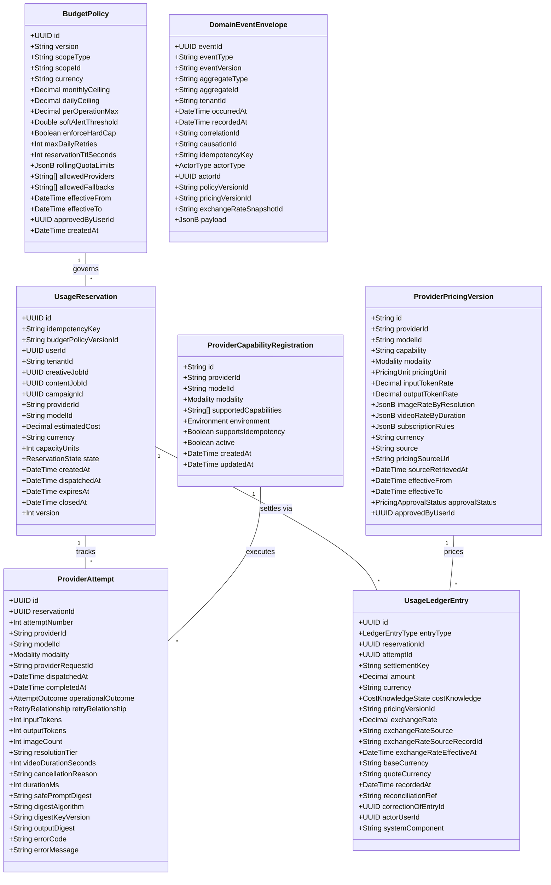
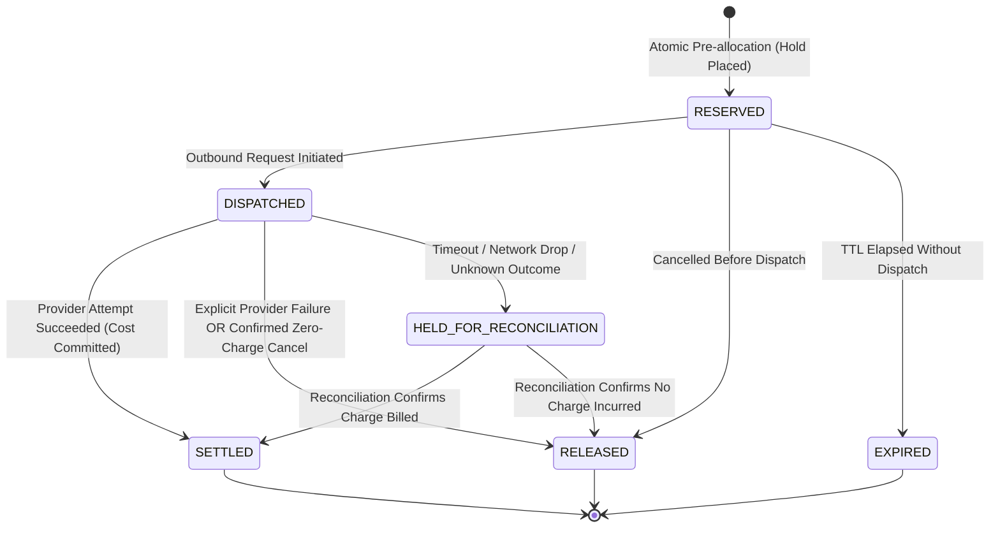
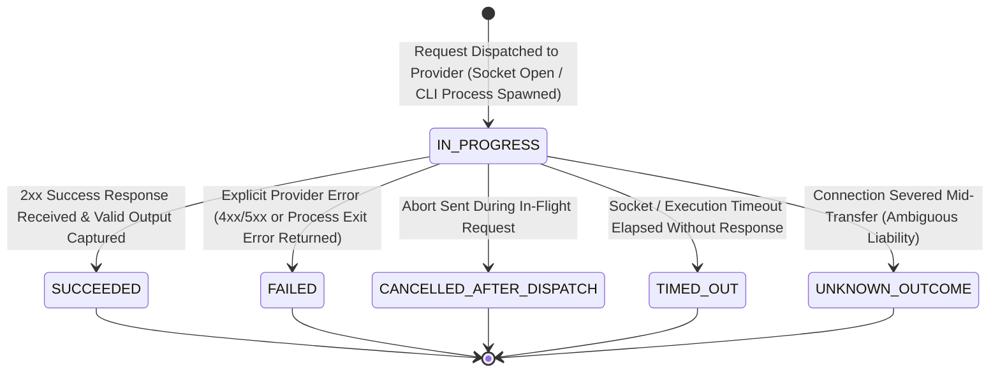

# Specification 4: Provider Budget and Usage Ledger

**Document:** `/docs/specifications/provider-budget-and-usage-ledger.md`  
**Phase:** W03 — Foundational Specifications & Architecture  
**Status:** Foundational Specification Ready for Owner Business Decisions  
**Authority:** Master Engineering Blueprint v3.0 §15, §16, §22  
**Target Packages:** W50 (Provider Routing & Usage Ledger)

---

## 1. Purpose and Scope

### 1.1 Purpose

This specification establishes a provider-neutral financial accounting, quota governance, and operational routing architecture for all artificial intelligence services across Parisian Shopper AI. It governs text generation (LLMs), image synthesis (background generation), and future video generation. The system models an **immutable provider usage and cost ledger with atomic budget reservations**, guaranteeing that **no generation request can run without an active budget reservation**. It enforces spending limits across daily, monthly, campaign, and user scopes, ensuring the platform is **vendor-independent and never locked into a single provider (such as OpenAI)**, supporting seamless capability routing across local CLI tools, subscription services, and enterprise cloud APIs.

### 1.2 Scope

- Unified provider abstraction across modalities: Text, Image, and Video.
- Three strictly separated lifecycles:
  1. **`UsageReservation`**: Atomic temporary capacity/budget hold preventing concurrent overspending.
  2. **`ProviderAttempt`**: Operational invocation audit record preserving attempt number, provider request ID, duration, and operational outcome.
  3. **`UsageLedgerEntry`**: Immutable append-only financial fact recording reservation creation, release, cost commitment, correction, hold, or reconciliation.
- Provider Capability Registry referencing arbitrary registered providers (`providerId`) and models (`modelId`) without closed vendor enums.
- Pre-execution cost estimation, atomic reservation, and settlement lifecycle with optimistic locking and concurrency control.
- Hard budget ceilings, soft warning alert thresholds, and circuit-breaker tripping defined under versioned `BudgetPolicy` (tied to `W03-DEC-011` and `W03-DEC-014`).
- Comprehensive audit ledger tracking text input/output tokens, image resolution/quality tiers, video duration/seconds, retries, cancellations, timeouts, unknown provider outcomes, exchange-rate provenance, provider request IDs, and safe prompt digests.
- Distinction between exact costs, estimated costs, zero-confirmed costs (local/mock/subscription), and unknown costs (`CostKnowledgeState`).
- Unknown-completion behavior preventing duplicate billing on timed-out or dropped provider requests.
- Idempotent reservation and settlement keys.
- Fail-closed fallback governance.

---

## 2. Explicit Non-Goals

1. **No External Client Billing / Stripe Integration:** This system manages internal cost allocation and vendor budget controls for Parisian Shopper. It is not an external multi-tenant SaaS credit/payment gateway.
2. **No Real-Time Arbitrage or Live Auction Bidding:** The router selects providers based on static, versioned policy matrices and verified quality capabilities, not real-time dynamic spot-market pricing.
3. **No Secret Ingestion in the Ledger:** The ledger records keyed HMAC-SHA256 prompt digests with key versioning, token counts, and operational metadata, NEVER raw API keys or plain-text access tokens.
4. **No Double-Entry Journaling Claims:** The ledger is an immutable transaction log with atomic reservations and settlements; it does not claim double-entry balanced debit/credit accounting without formal general ledger accounts.

---

## 3. Existing-System Alignment

The current codebase includes preliminary provider foundations:

- **`CreativeProvider` & `CreativeVideoProvider` Ports:** Define image and video generation contracts.
- **`CreativeProvidersModule` & `factory.ts`:** Implements initial routing between providers (`openai`, `codex_cli`, and `fake`).
- **`AppConfigService`:** Loads provider configuration and environment flags.
- **`PrometheusMetricsService`:** Emits preliminary AI job durations and attempt counts.
  This specification formalizes the immutable reservation ledger and hard budget policy required by Blueprint v3.0.

---

## 4. Terminology

- **Provider Capability:** An attested modality and quality tier supported by a provider (e.g. `IMAGE_GENERATION_1024`, `TEXT_KHMER_REASONING`).
- **Usage Reservation (`UsageReservation`):** An atomic temporary hold on an allocated budget ceiling prior to dispatching an external provider request.
- **Provider Attempt (`ProviderAttempt`):** An operational audit record capturing each discrete physical invocation of an upstream provider API.
- **Usage Ledger Entry (`UsageLedgerEntry`):** An immutable, append-only financial record documenting verified resource consumption, provider request IDs, and actual costs.
- **Cost Knowledge State (`CostKnowledgeState`):** Categorization of monetary certainty:
  - `EXACT`: Cost confirmed by official provider response token metrics or itemized billing receipt.
  - `ESTIMATED`: Pre-dispatch reservation estimation derived from pricing policy.
  - `ZERO_CONFIRMED`: Verified zero-cost execution (e.g. local CLI, mock provider, or covered under flat subscription).
  - `UNKNOWN`: Provider call completed ambiguously (e.g. timeout or connection drop); financial liability unverified.
- **Budget Policy (`BudgetPolicy`):** A versioned configuration record establishing monetary limits, alert thresholds, rolling quota windows, and allowed fallback paths (linked to `W03-DEC-011` and `W03-DEC-014`).
- **Circuit Breaker:** An automated safety switch that halts traffic to a failing or cost-runaway provider after a threshold of consecutive errors.
- **Safe Prompt Digest:** A keyed HMAC-SHA256 digest computed over canonically serialized finalized prompt content and model metadata using a secret cryptographic key resolved from managed secret storage via its version identifier (`digestKeyVersion`), enabling tamper evidence and deduplication without storing proprietary text.
- **Rolling Quota Window:** A time-bound usage window (e.g. rolling 5-hour limit) utilized for subscription-backed tools where monetary costs are zero but request rate limits apply.

---

## 5. Entities and Value Objects



---

## 6. Proposed Schemas

### 6.1 `BudgetPolicy` Schema Table

| Field Name              | Type       | Required? | Constraints                                      | Purpose                                                       |
| ----------------------- | ---------- | :-------: | ------------------------------------------------ | ------------------------------------------------------------- |
| `id`                    | `UUID`     |  **YES**  | RFC 4122 v4 UUID                                 | Primary stable identifier for budget policy                   |
| `version`               | `String`   |  **YES**  | SemVer format (e.g. `1.0.0`)                     | Policy revision indicator                                     |
| `scopeType`             | `Enum`     |  **YES**  | `GLOBAL`, `TENANT`, `CAMPAIGN`, `USER`           | Level of aggregation enforced                                 |
| `scopeId`               | `String`   |  **YES**  | Identifier corresponding to scope, or `'GLOBAL'` | Specific target entity of budget constraint                   |
| `currency`              | `String`   |  **YES**  | ISO 4217 3-letter code (`USD`, `EUR`, `KHR`)     | Currency of defined spending limits                           |
| `monthlyCeiling`        | `Decimal`  |  **YES**  | Non-negative, precision `(12, 4)`                | Hard maximum monetary spend allowed per calendar month        |
| `dailyCeiling`          | `Decimal`  |  **YES**  | Non-negative, precision `(12, 4)`                | Hard maximum monetary spend allowed per calendar day          |
| `perOperationMax`       | `Decimal`  |  **YES**  | Non-negative, precision `(12, 4)`                | Maximum estimated cost allowed for a single operation         |
| `softAlertThreshold`    | `Double`   |  **YES**  | Range `0.50` to `0.99` (e.g. `0.80`)             | Spend percentage triggering operational warning notification  |
| `enforceHardCap`        | `Boolean`  |  **YES**  | Boolean                                          | When true, requests over ceiling fail closed immediately      |
| `maxDailyRetries`       | `Integer`  |  **YES**  | Non-negative integer (e.g. `3`)                  | Maximum automated retries permitted per day per job           |
| `reservationTtlSeconds` | `Integer`  |  **YES**  | Positive integer (e.g. `300`)                    | Duration after which an uncompleted reservation expires       |
| `rollingQuotaLimits`    | `JsonB`    | OPTIONAL  | Conforms to `RollingQuotaSchema`                 | Rate limits for zero-cost subscription/CLI tools (calls/time) |
| `allowedProviders`      | `Array`    |  **YES**  | Array of provider ID strings                     | Providers authorized for execution under this policy          |
| `allowedFallbacks`      | `Array`    |  **YES**  | Array of fallback capability strings             | Authorized degradation routes when primary provider fails     |
| `effectiveFrom`         | `DateTime` |  **YES**  | ISO 8601 UTC timestamp                           | Start of policy applicability                                 |
| `effectiveTo`           | `DateTime` | OPTIONAL  | ISO 8601 UTC timestamp                           | End of policy applicability (null if active)                  |
| `approvedByUserId`      | `UUID`     |  **YES**  | References `User.id`                             | Authorizing executive identity                                |
| `createdAt`             | `DateTime` |  **YES**  | ISO 8601 UTC timestamp                           | Policy creation timestamp                                     |

### 6.2 `UsageReservation` Schema Table

| Field Name              | Type       | Required? | Constraints                                                                           | Purpose                                               |
| ----------------------- | ---------- | :-------: | ------------------------------------------------------------------------------------- | ----------------------------------------------------- |
| `id`                    | `UUID`     |  **YES**  | RFC 4122 v4 UUID                                                                      | Primary stable reservation identifier                 |
| `idempotencyKey`        | `String`   |  **YES**  | Unique per caller/job request                                                         | Prevents duplicate reservation holds on client retry  |
| `budgetPolicyVersionId` | `String`   |  **YES**  | References `BudgetPolicy.id` + version                                                | Identifies governing policy at reservation time       |
| `userId`                | `UUID`     |  **YES**  | References `User.id`                                                                  | Requesting staff member identity                      |
| `tenantId`              | `String`   |  **YES**  | Multi-tenant partition key (e.g. `PARISIAN_FRAGRANCE`)                                | Brand or tenant identity                              |
| `creativeJobId`         | `UUID`     | OPTIONAL  | References `CreativeJob.id`                                                           | Associated visual creative job                        |
| `contentJobId`          | `UUID`     | OPTIONAL  | References `ContentJob.id`                                                            | Associated text content job                           |
| `campaignId`            | `UUID`     | OPTIONAL  | References `Campaign.id`                                                              | Marketing campaign allocation                         |
| `providerId`            | `String`   |  **YES**  | Registered provider capability string                                                 | Intended provider service                             |
| `modelId`               | `String`   |  **YES**  | Registered model capability string                                                    | Intended model version                                |
| `estimatedCost`         | `Decimal`  |  **YES**  | Non-negative, precision `(12, 4)`                                                     | Pre-allocated budget hold amount                      |
| `currency`              | `String`   |  **YES**  | ISO 4217 code                                                                         | Currency of reservation                               |
| `capacityUnits`         | `Integer`  | OPTIONAL  | Non-negative integer                                                                  | Count of capacity units held for subscription quotas  |
| `state`                 | `Enum`     |  **YES**  | `RESERVED`, `DISPATCHED`, `RELEASED`, `EXPIRED`, `HELD_FOR_RECONCILIATION`, `SETTLED` | Current lifecycle state of the reservation            |
| `createdAt`             | `DateTime` |  **YES**  | ISO 8601 UTC timestamp                                                                | Reservation creation timestamp                        |
| `dispatchedAt`          | `DateTime` | OPTIONAL  | ISO 8601 UTC timestamp                                                                | When outbound request was dispatched to provider      |
| `expiresAt`             | `DateTime` |  **YES**  | ISO 8601 UTC timestamp                                                                | Timestamp after which uncommitted reservation expires |
| `closedAt`              | `DateTime` | OPTIONAL  | ISO 8601 UTC timestamp                                                                | When reservation reached terminal state               |
| `version`               | `Integer`  |  **YES**  | Positive integer                                                                      | Optimistic concurrency locking version                |

### 6.3 `ProviderAttempt` Schema Table

| Field Name             | Type       | Required? | Constraints                                                                                      | Purpose                                                                               |
| ---------------------- | ---------- | :-------: | ------------------------------------------------------------------------------------------------ | ------------------------------------------------------------------------------------- |
| `id`                   | `UUID`     |  **YES**  | RFC 4122 v4 UUID                                                                                 | Primary stable attempt record ID                                                      |
| `reservationId`        | `UUID`     |  **YES**  | References `UsageReservation.id`                                                                 | Parent reservation under which attempt ran                                            |
| `attemptNumber`        | `Integer`  |  **YES**  | Positive integer `>= 1`                                                                          | 1-based attempt sequence index                                                        |
| `providerId`           | `String`   |  **YES**  | Capability registry provider ID                                                                  | Concrete provider invoked                                                             |
| `modelId`              | `String`   |  **YES**  | Capability registry model ID                                                                     | Concrete model invoked                                                                |
| `modality`             | `Enum`     |  **YES**  | `TEXT`, `IMAGE`, `VIDEO`                                                                         | Media modality of attempt                                                             |
| `providerRequestId`    | `String`   | OPTIONAL  | Upstream provider tracking ID (null if dropped before headers)                                   | Vendor request identifier for cross-audit                                             |
| `dispatchedAt`         | `DateTime` |  **YES**  | ISO 8601 UTC timestamp                                                                           | When HTTP/CLI execution commenced                                                     |
| `completedAt`          | `DateTime` | OPTIONAL  | ISO 8601 UTC timestamp (null while `IN_PROGRESS`, populated upon reaching terminal outcome)      | When HTTP/CLI execution finished                                                      |
| `operationalOutcome`   | `Enum`     |  **YES**  | `IN_PROGRESS`, `SUCCEEDED`, `FAILED`, `CANCELLED_AFTER_DISPATCH`, `TIMED_OUT`, `UNKNOWN_OUTCOME` | Execution lifecycle state (initialized to `IN_PROGRESS`, terminal outcomes exclusive) |
| `retryRelationship`    | `Enum`     |  **YES**  | `INITIAL_ATTEMPT`, `RETRY_OF_FAILURE`, `NONE`                                                    | Retry lineage indicator                                                               |
| `inputTokens`          | `Integer`  | OPTIONAL  | Non-negative integer (null for image/video)                                                      | Prompt tokens billed                                                                  |
| `outputTokens`         | `Integer`  | OPTIONAL  | Non-negative integer (null for image/video)                                                      | Completion tokens billed                                                              |
| `imageCount`           | `Integer`  | OPTIONAL  | Non-negative integer (null for text/video)                                                       | Visual frames synthesized                                                             |
| `resolutionTier`       | `String`   | OPTIONAL  | E.g. `1024x1024_STANDARD` (null for text)                                                        | Rendered quality tier                                                                 |
| `videoDurationSeconds` | `Integer`  | OPTIONAL  | Non-negative integer (null for text/image)                                                       | Synthesized video clip length in seconds                                              |
| `cancellationReason`   | `String`   | OPTIONAL  | Max 255 characters                                                                               | Explanatory reason if attempt was cancelled                                           |
| `durationMs`           | `Integer`  | OPTIONAL  | Non-negative integer (null while in-flight or if socket dropped before connect)                  | Round-trip network and execution latency                                              |
| `safePromptDigest`     | `String`   |  **YES**  | Exactly 64 hex characters (HMAC-SHA256)                                                          | Keyed digest of canonical prompt + parameters + metadata                              |
| `digestAlgorithm`      | `String`   |  **YES**  | `HMAC-SHA256`                                                                                    | Cryptographic algorithm for prompt digest                                             |
| `digestKeyVersion`     | `String`   |  **YES**  | Non-secret key version identifier (e.g. `2026-v1`)                                               | Non-secret identifier used to resolve HMAC secret key from managed storage            |
| `outputDigest`         | `String`   | OPTIONAL  | Exactly 64 hex characters (SHA-256, null while in-progress or on failure/unknown)                | CAS hash of synthesized asset                                                         |
| `errorCode`            | `String`   | OPTIONAL  | Controlled error category (e.g. `HTTP_503`, `RATE_LIMIT`)                                        | Upstream error classification                                                         |
| `errorMessage`         | `String`   | OPTIONAL  | Sanitized error message (secrets redacted)                                                       | Operational diagnosis message                                                         |

### 6.4 `UsageLedgerEntry` Schema Table (Immutable Financial Fact)

| Field Name                   | Type       | Required? | Constraints                                                                                                                                                         | Purpose                                                    |
| ---------------------------- | ---------- | :-------: | ------------------------------------------------------------------------------------------------------------------------------------------------------------------- | ---------------------------------------------------------- |
| `id`                         | `UUID`     |  **YES**  | RFC 4122 v4 UUID                                                                                                                                                    | Primary stable ledger record ID                            |
| `entryType`                  | `Enum`     |  **YES**  | `RESERVATION_CREATED`, `RESERVATION_RELEASED`, `USAGE_COMMITTED`, `USAGE_CORRECTION`, `UNKNOWN_OUTCOME_HOLD`, `RECONCILIATION_CONFIRMED`, `RECONCILIATION_RELEASED` | Exact financial posting type                               |
| `reservationId`              | `UUID`     |  **YES**  | References `UsageReservation.id`                                                                                                                                    | Associated reservation record                              |
| `attemptId`                  | `UUID`     | OPTIONAL  | References `ProviderAttempt.id` (null for pure reservation/expiry)                                                                                                  | Operational attempt that triggered posting                 |
| `settlementKey`              | `String`   |  **YES**  | Unique settlement idempotency key                                                                                                                                   | Prevents duplicate ledger commits                          |
| `amount`                     | `Decimal`  |  **YES**  | Precision `(12, 4)`. Positive for hold/charge, negative/offset for release/correction                                                                               | Monetary amount posted                                     |
| `currency`                   | `String`   |  **YES**  | ISO 4217 code                                                                                                                                                       | Billing currency                                           |
| `costKnowledge`              | `Enum`     |  **YES**  | `EXACT`, `ESTIMATED`, `ZERO_CONFIRMED`, `UNKNOWN`                                                                                                                   | Degree of financial certainty of `amount`                  |
| `pricingVersionId`           | `String`   | OPTIONAL  | References `ProviderPricingVersion.id`                                                                                                                              | Pricing model used to compute `amount`                     |
| `exchangeRate`               | `Decimal`  | OPTIONAL  | Precision `(12, 6)` (null if transaction matches base currency)                                                                                                     | Multiplier applied for foreign currency conversion         |
| `exchangeRateSource`         | `String`   | OPTIONAL  | E.g. `EUROPEAN_CENTRAL_BANK`, `NATIONAL_BANK_OF_CAMBODIA`                                                                                                           | Authoritative source institution of currency exchange rate |
| `exchangeRateSourceRecordId` | `String`   | OPTIONAL  | E.g. `FX-EUR-USD-2026-10-18`                                                                                                                                        | Specific rate fixture or batch identifier                  |
| `exchangeRateEffectiveAt`    | `DateTime` | OPTIONAL  | ISO 8601 UTC timestamp                                                                                                                                              | Official timestamp of exchange rate quotation              |
| `baseCurrency`               | `String`   | OPTIONAL  | ISO 4217 code (e.g. `USD`)                                                                                                                                          | Base currency in currency conversion                       |
| `quoteCurrency`              | `String`   | OPTIONAL  | ISO 4217 code (e.g. `EUR`, `KHR`)                                                                                                                                   | Quote currency in currency conversion                      |
| `recordedAt`                 | `DateTime` |  **YES**  | ISO 8601 UTC timestamp                                                                                                                                              | Immutable posting timestamp                                |
| `reconciliationRef`          | `String`   | OPTIONAL  | External invoice ID or reconciliation ticket reference                                                                                                              | Audit trail link for reconciliation entries                |
| `correctionOfEntryId`        | `UUID`     | OPTIONAL  | References prior `UsageLedgerEntry.id`                                                                                                                              | Link to prior entry if this posting reverses or adjusts it |
| `actorUserId`                | `UUID`     | OPTIONAL  | References `User.id` (null if system automated)                                                                                                                     | Human actor who initiated posting                          |
| `systemComponent`            | `String`   |  **YES**  | E.g. `usage-ledger-worker`, `reconciliation-cron`                                                                                                                   | System service that generated posting                      |

### 6.5 `ProviderPricingVersion` Schema Table

| Field Name              | Type       | Required? | Constraints                                                                            | Purpose                                             |
| ----------------------- | ---------- | :-------: | -------------------------------------------------------------------------------------- | --------------------------------------------------- |
| `id`                    | `String`   |  **YES**  | Semantic ID (e.g. `pricing-example-v1`)                                                | Primary stable pricing version identifier           |
| `providerId`            | `String`   |  **YES**  | Capability registry provider ID                                                        | Provider service identity                           |
| `modelId`               | `String`   |  **YES**  | Capability registry model ID                                                           | Model version identity                              |
| `capability`            | `String`   |  **YES**  | Capability string (e.g. `IMAGE_GENERATION_1024`)                                       | Operational capability priced                       |
| `modality`              | `Enum`     |  **YES**  | `TEXT`, `IMAGE`, `VIDEO`                                                               | Media modality                                      |
| `pricingUnit`           | `Enum`     |  **YES**  | `PER_1K_TOKENS`, `PER_1M_TOKENS`, `PER_IMAGE`, `PER_VIDEO_SECOND`, `SUBSCRIPTION_FLAT` | Billing unit for calculation                        |
| `inputTokenRate`        | `Decimal`  | OPTIONAL  | Non-negative, precision `(12, 6)`                                                      | Monetary rate per input token unit                  |
| `outputTokenRate`       | `Decimal`  | OPTIONAL  | Non-negative, precision `(12, 6)`                                                      | Monetary rate per output token unit                 |
| `imageRateByResolution` | `JsonB`    | OPTIONAL  | Map of resolution to cost                                                              | Cost per image for visual models                    |
| `videoRateByDuration`   | `JsonB`    | OPTIONAL  | Map of resolution/framerate to cost per second                                         | Cost per second of synthesized video                |
| `subscriptionRules`     | `JsonB`    | OPTIONAL  | Rules for zero-cost flat quota windows                                                 | Quota consumption definitions                       |
| `currency`              | `String`   |  **YES**  | ISO 4217 code                                                                          | Billing currency of pricing                         |
| `source`                | `String`   |  **YES**  | Authoritative source organization                                                      | Documenting provenance entity                       |
| `pricingSourceUrl`      | `String`   |  **YES**  | Valid URL to official pricing documentation                                            | Verifiable audit link                               |
| `sourceRetrievedAt`     | `DateTime` |  **YES**  | ISO 8601 UTC timestamp                                                                 | When pricing was verified from source documentation |
| `effectiveFrom`         | `DateTime` |  **YES**  | ISO 8601 UTC timestamp                                                                 | Start of price schedule validity                    |
| `effectiveTo`           | `DateTime` | OPTIONAL  | ISO 8601 UTC timestamp                                                                 | End of price schedule validity (null if current)    |
| `approvalStatus`        | `Enum`     |  **YES**  | `PROPOSED`, `APPROVED`, `SUPERSEDED`, `REJECTED`                                       | Administrative governance status                    |
| `approvedByUserId`      | `UUID`     | OPTIONAL  | References `User.id`                                                                   | Authorizing executive identity                      |

### 6.6 `ProviderCapabilityRegistration` Schema Table

| Field Name              | Type       | Required? | Constraints                            | Purpose                                                       |
| ----------------------- | ---------- | :-------: | -------------------------------------- | ------------------------------------------------------------- |
| `id`                    | `String`   |  **YES**  | Semantic ID (e.g. `cap-gemini-img-v1`) | Primary capability identifier                                 |
| `providerId`            | `String`   |  **YES**  | Provider identifier                    | Abstract provider key                                         |
| `modelId`               | `String`   |  **YES**  | Model identifier                       | Model version identifier                                      |
| `modality`              | `Enum`     |  **YES**  | `TEXT`, `IMAGE`, `VIDEO`               | Modality supported                                            |
| `supportedCapabilities` | `Array`    |  **YES**  | Array of strings                       | Supported feature flags (e.g. `['ASPECT_4_5', 'INPAINTING']`) |
| `environment`           | `Enum`     |  **YES**  | `DEVELOPMENT`, `STAGING`, `PRODUCTION` | Target runtime environment                                    |
| `supportsIdempotency`   | `Boolean`  |  **YES**  | Boolean                                | Whether upstream API accepts client idempotency keys          |
| `active`                | `Boolean`  |  **YES**  | Boolean                                | Whether capability is enabled for router selection            |
| `createdAt`             | `DateTime` |  **YES**  | ISO 8601 UTC timestamp                 | Registration timestamp                                        |
| `updatedAt`             | `DateTime` |  **YES**  | ISO 8601 UTC timestamp                 | Last update timestamp                                         |

### 6.7 `DomainEventEnvelope` Schema Table

Every domain event emitted across budget management, reservation lifecycles, and provider usage ledger tracking conforms to a single shared envelope:

| Field Name               | Type       | Required? | Constraints                                                                           | Purpose                                                                             |
| ------------------------ | ---------- | :-------: | ------------------------------------------------------------------------------------- | ----------------------------------------------------------------------------------- |
| `eventId`                | `UUID`     |  **YES**  | RFC 4122 v4 UUID                                                                      | Globally unique identifier for event instance                                       |
| `eventType`              | `String`   |  **YES**  | Standardized domain event dot-notation (e.g. `usage.reservation.created`)             | Categorical type of the event                                                       |
| `eventVersion`           | `String`   |  **YES**  | Semantic version string (e.g. `1.0.0`)                                                | Event payload schema version supporting evolution                                   |
| `aggregateType`          | `String`   |  **YES**  | `UsageReservation`, `ProviderAttempt`, `UsageLedgerEntry`, `BudgetPolicy`             | Aggregate boundary that produced the event                                          |
| `aggregateId`            | `String`   |  **YES**  | Stable aggregate root identifier (e.g. reservation ID)                                | Primary identifier of the aggregate instance                                        |
| `tenantId`               | `String`   |  **YES**  | E.g. `parisian-shopper-default`                                                       | Tenant boundary identifier for data isolation                                       |
| `occurredAt`             | `DateTime` |  **YES**  | ISO 8601 UTC timestamp                                                                | Exact wall-clock time the business event occurred in domain                         |
| `recordedAt`             | `DateTime` |  **YES**  | ISO 8601 UTC timestamp                                                                | Durable database persistence timestamp in transactional outbox                      |
| `correlationId`          | `String`   |  **YES**  | UUID or tracing correlation identifier                                                | Connects all operations belonging to one workflow across systems                    |
| `causationId`            | `String`   |  **YES**  | UUID of causing command or preceding event                                            | Direct causal trigger identifier for distributed audit tracing                      |
| `idempotencyKey`         | `String`   |  **YES**  | Deterministic domain idempotency key                                                  | Retried operations reuse this key; consumers deduplicate on `eventId` or this key   |
| `actorType`              | `Enum`     |  **YES**  | `SYSTEM`, `USER`, `WORKER`, `ADMIN`                                                   | Security actor category that initiated the action                                   |
| `actorId`                | `UUID`     | OPTIONAL  | RFC 4122 v4 UUID (null if actor is automated `SYSTEM` or background `WORKER`)         | Specific user or admin ID responsible for triggering action                         |
| `policyVersionId`        | `String`   | OPTIONAL  | References `BudgetPolicy.id` (null only when genuinely not applicable)                | Active budget policy version evaluated for the decision                             |
| `pricingVersionId`       | `String`   | OPTIONAL  | References `ProviderPricingVersion.id` (null only when non-chargeable/not applicable) | Active pricing schedule version evaluated for the cost decision                     |
| `exchangeRateSnapshotId` | `String`   | OPTIONAL  | References FX rate snapshot record (null only when base currency or non-chargeable)   | Authoritative foreign exchange rate snapshot applied for currency conversion        |
| `payload`                | `JsonB`    |  **YES**  | Strongly-typed event-specific data payload                                            | Domain event details (excludes secrets, raw prompt text, customer PII, image bytes) |

---

## 7. Invariants

1. **Active Reservation Prerequisite:** No outbound network request or CLI execution to a provider may be initiated without an active `UsageReservation` in state `RESERVED`.
2. **Hard Budget Ceiling Enforcement:** When active spend + outstanding reservations exceeds `BudgetPolicy.monthlyCeiling` or `dailyCeiling`, subsequent generation requests MUST fail closed immediately with `BudgetExceededError`.
3. **Verified Pricing Provenance:** Model pricing is NEVER hardcoded in application logic. Paid dispatch requires an active, approved `ProviderPricingVersion` documenting retrieval date and source URL. Expired or unverified pricing blocks paid dispatch fail-closed.
4. **Subscription Quota Protection:** For tools backed by flat-rate subscriptions or local CLI tools, the system enforces configurable rolling quota windows (e.g. max calls per rolling window under `W03-DEC-011`) to prevent rate-limit lockouts.
5. **Circuit Breaker Modality Independence:** Consecutive failures on an image provider must NEVER trip the circuit breaker for text generation or local compositing.
6. **Fail-Closed Fallback:** Provider fallback is strictly fail-closed unless explicitly authorized by active `BudgetPolicy.allowedFallbacks`. The system never silently falls back to an unvetted paid model.
7. **Idempotency Guarantees:** Reservations require an `idempotencyKey` and ledger postings require a `settlementKey`. Duplicate submissions return the existing record without double-debiting.
8. **Distinction Between Zero Cost and Unknown Cost:** A zero-cost operation (local CLI, mock, or subscription-covered) is recorded with `costKnowledge = ZERO_CONFIRMED`. An ambiguous or unverified completion is recorded with `costKnowledge = UNKNOWN` and `amount = null` (or reservation hold amount held pending reconciliation). Zero cost is NEVER assumed for missing data.
9. **Unknown Outcome Hold and Non-Retry Rule:** When an operational attempt completes with `TIMED_OUT` or `UNKNOWN_OUTCOME`, the reservation transitions to `HELD_FOR_RECONCILIATION`. The system MUST NOT automatically retry the request without guaranteed upstream idempotency, preventing duplicate provider billing.
10. **Cancellation Protocol:**
    - Cancellation _before dispatch_ transitions reservation to `RELEASED` and posts `RESERVATION_RELEASED`.
    - Cancellation _after dispatch_ with confirmed provider cancellation (zero charge) transitions reservation to `RELEASED`.
    - Cancellation _after dispatch_ with unknown provider charge status transitions reservation to `HELD_FOR_RECONCILIATION`. Funds are NOT automatically released until provider confirmation is obtained.

---

## 8. State Machines & Allowed Transitions

### 8.1 `UsageReservation` State Machine



### 8.2 `ProviderAttempt` State Machine

A `ProviderAttempt` record is created only when an outbound request is physically dispatched to an upstream provider. The lifecycle begins at dispatch in the non-terminal `IN_PROGRESS` state. Pre-dispatch cancellation is managed exclusively within `UsageReservation` (`RESERVED` → `RELEASED`) and never creates or transitions a `ProviderAttempt`.



### 8.3 Allowed Transitions Table

| Entity             | From State                | To State                   | Trigger / Condition                                                                   |
| :----------------- | :------------------------ | :------------------------- | :------------------------------------------------------------------------------------ |
| `UsageReservation` | `[*] `                    | `RESERVED`                 | User or worker calls `reserveBudget` with valid headroom under `BudgetPolicy`.        |
| `UsageReservation` | `RESERVED`                | `DISPATCHED`               | Router begins physical connection dispatch to upstream provider.                      |
| `UsageReservation` | `RESERVED`                | `RELEASED`                 | Client aborts job before network socket dispatch; hold immediately released.          |
| `UsageReservation` | `RESERVED`                | `EXPIRED`                  | Wall-clock time exceeds `reservation.expiresAt` without dispatch.                     |
| `UsageReservation` | `DISPATCHED`              | `SETTLED`                  | Provider attempt succeeds; exact or confirmed cost posted via `USAGE_COMMITTED`.      |
| `UsageReservation` | `DISPATCHED`              | `RELEASED`                 | Provider returns explicit non-billable failure or confirmed zero-charge cancellation. |
| `UsageReservation` | `DISPATCHED`              | `HELD_FOR_RECONCILIATION`  | Provider attempt times out, cancels ambiguously, or drops; liability is ambiguous.    |
| `UsageReservation` | `HELD_FOR_RECONCILIATION` | `SETTLED`                  | Manual review or provider log audit confirms request was executed and billed.         |
| `UsageReservation` | `HELD_FOR_RECONCILIATION` | `RELEASED`                 | Manual review or provider log audit confirms request was dropped without charge.      |
| `ProviderAttempt`  | `[*] `                    | `IN_PROGRESS`              | Outbound HTTP request initiated or CLI subprocess spawned upon dispatch.              |
| `ProviderAttempt`  | `IN_PROGRESS`             | `SUCCEEDED`                | Upstream provider returns 2xx response / valid output successfully captured.          |
| `ProviderAttempt`  | `IN_PROGRESS`             | `FAILED`                   | Upstream provider returns definitive 4xx/5xx error or non-zero exit code.             |
| `ProviderAttempt`  | `IN_PROGRESS`             | `CANCELLED_AFTER_DISPATCH` | Cancellation requested while network socket is actively in-flight.                    |
| `ProviderAttempt`  | `IN_PROGRESS`             | `TIMED_OUT`                | Upstream socket or process execution deadline exceeded with no response.              |
| `ProviderAttempt`  | `IN_PROGRESS`             | `UNKNOWN_OUTCOME`          | Connection severed or dropped mid-transfer; provider liability unconfirmed.           |

---

## 9. Pricing and Exchange-Rate Provenance

### 9.1 Fictional Illustrative Pricing Schema Example

> [!WARNING]
> The following pricing record is **purely illustrative test data** designed to demonstrate schema structure. It does NOT represent authentic production pricing. Production pricing must be ingested and approved via formal administrative workflows.

```json
{
  "id": "pricing-example-test-data",
  "providerId": "EXAMPLE_PROVIDER",
  "modelId": "EXAMPLE_IMAGE_MODEL",
  "capability": "IMAGE_GENERATION_1024",
  "modality": "IMAGE",
  "pricingUnit": "PER_IMAGE",
  "inputTokenRate": null,
  "outputTokenRate": null,
  "imageRateByResolution": {
    "1024x1024_STANDARD": "0.040000",
    "1024x1792_HD": "0.080000"
  },
  "videoRateByDuration": null,
  "subscriptionRules": null,
  "currency": "USD",
  "source": "Example Provider Documentation (Fictional Test Data)",
  "pricingSourceUrl": "https://example.invalid/pricing",
  "sourceRetrievedAt": "2026-10-18T00:00:00Z",
  "effectiveFrom": "2026-01-01T00:00:00Z",
  "effectiveTo": null,
  "approvalStatus": "PROPOSED",
  "approvedByUserId": null
}
```

### 9.2 Currency Conversion and Exchange-Rate Provenance

1. **Foreign Currency Governance:** When an operation incurs costs in a currency differing from the budget policy currency (e.g. provider bills in `EUR` while policy ceiling is in `USD`), conversion requires an authoritative, approved exchange rate.
2. **Provenance Fields:** Every converted ledger entry must record:
   - `exchangeRate`: Conversion rate applied.
   - `exchangeRateSource`: Authoritative publishing institution (e.g. `EUROPEAN_CENTRAL_BANK`, `NATIONAL_BANK_OF_CAMBODIA`).
   - `exchangeRateSourceRecordId`: Unique snapshot ID of the FX rate feed.
   - `exchangeRateEffectiveAt`: Publication timestamp of the FX rate.
   - `baseCurrency` and `quoteCurrency`.
3. **No Unverified Conversion:** If currency conversion rates for the billing date are unavailable or unverified, dispatch is blocked fail-closed. Conversion errors never default to zero cost.

---

## 10. Dependency and Invalidation Rules

The usage ledger integrates into the platform's canonical dependency chain:

$$\text{ProductSource} \longrightarrow \text{ProductSnapshotVersion} \longrightarrow \text{ContentVersion} \longrightarrow \text{BrandBrief} \longrightarrow \text{CreativeSceneVersion} \longrightarrow \text{RenderedVisualAsset} \longrightarrow \text{VisualValidationResult} \longrightarrow \text{CreativeApprovalEvent} \longrightarrow \text{ExportedPosterPackage} \longrightarrow \text{future PublishIntent}$$

1. **Draft Revisions:** Re-running a prompt or generating an AI background executes a new reservation and billable attempt. Text revisions (`EDIT_TEXT`) and deterministic layout adjustments cost \$0.00 (`ZERO_CONFIRMED`).
2. **Job Failure Refunds:** If a job fails due to an internal system defect after an external call succeeded, the cost remains posted as `USAGE_COMMITTED` for provider accounting, while an offsetting `USAGE_CORRECTION` entry restores the user's daily quota headroom.

---

## 11. Application/Service APIs

### 11.1 `UsageLedgerService`

```typescript
export interface UsageLedgerService {
  reserveBudget(input: ReserveBudgetInput): Promise<UsageReservationRecord>;
  recordAttempt(input: RecordAttemptInput): Promise<ProviderAttemptRecord>;
  commitUsage(input: CommitUsageInput): Promise<UsageLedgerEntryRecord>;
  releaseReservation(reservationId: string, reason: string): Promise<void>;
  holdForReconciliation(
    reservationId: string,
    details: UnknownOutcomeInput,
  ): Promise<UsageLedgerEntryRecord>;
  reconcileReservation(
    input: ReconcileReservationInput,
  ): Promise<UsageLedgerEntryRecord>;
  checkQuota(scope: BudgetScope): Promise<QuotaStatusReport>;
}
```

### 11.2 `ProviderRouterPort`

```typescript
export interface ProviderRouterPort {
  selectProvider(
    modality: Modality,
    capability: CapabilityRequirement,
  ): Promise<ProviderConfig>;
  executeWithBudget<T>(
    operation: (provider: ProviderClient) => Promise<T>,
    context: GenerationContext,
  ): Promise<T>;
}
```

---

## 12. Repository and Persistence Contracts

```typescript
export interface UsageReservationRepository {
  createReservation(
    reservation: UsageReservationDraft,
  ): Promise<UsageReservationRecord>;
  updateState(
    id: string,
    state: ReservationState,
    version: number,
  ): Promise<UsageReservationRecord>;
  findById(id: string): Promise<UsageReservationRecord | null>;
  findByIdempotencyKey(key: string): Promise<UsageReservationRecord | null>;
  listExpired(cutoff: Date): Promise<readonly UsageReservationRecord[]>;
}

export interface ProviderAttemptRepository {
  createAttempt(attempt: ProviderAttemptDraft): Promise<ProviderAttemptRecord>;
  updateAttempt(
    id: string,
    update: ProviderAttemptUpdate,
  ): Promise<ProviderAttemptRecord>;
  findById(id: string): Promise<ProviderAttemptRecord | null>;
  listByReservationId(
    reservationId: string,
  ): Promise<readonly ProviderAttemptRecord[]>;
}

export interface UsageLedgerRepository {
  appendEntry(entry: UsageLedgerEntryDraft): Promise<UsageLedgerEntryRecord>;
  findBySettlementKey(key: string): Promise<UsageLedgerEntryRecord | null>;
  getAggregateSpend(
    scope: BudgetScope,
    fromDate: Date,
    toDate: Date,
  ): Promise<Decimal>;
  listByReservationId(
    reservationId: string,
  ): Promise<readonly UsageLedgerEntryRecord[]>;
}

export interface ProviderPricingRepository {
  findActivePricing(
    providerId: string,
    modelId: string,
    date: Date,
  ): Promise<ProviderPricingVersionRecord | null>;
}
```

---

## 13. Events and Outbox Behavior

### 13.1 Shared DomainEventEnvelope Semantics

Every domain event emitted across budget management, reservation lifecycles, and provider usage ledger tracking is wrapped in the shared `DomainEventEnvelope` specified in §6.7.

The envelope semantics guarantee operational auditability, distributed traceability, and financial safety:

1. **Timestamp Semantics:**
   - `occurredAt`: The precise wall-clock timestamp when the domain business event actually happened.
   - `recordedAt`: The timestamp when the event was durably committed to the database transactional outbox table.
2. **Distributed Tracing & Causality:**
   - `correlationId`: Connects all operations, reservations, attempts, and ledger entries belonging to a single end-to-end creative generation, approval, or settlement workflow across services.
   - `causationId`: Directly references the command ID or preceding event ID that triggered this event, establishing an unforgeable causal graph.
3. **Identity & Evolution:**
   - `eventId`: Globally unique RFC 4122 v4 UUID identifying this exact event instance.
   - `eventVersion`: Semantic version string (e.g. `1.0.0`) supporting backward-compatible schema evolution across worker and consumer upgrades.
4. **Idempotency, Retries, and Deduplication:**
   - `idempotencyKey`: Retried operations and republished events MUST reuse the exact same domain idempotency key.
   - Event consumers MUST deduplicate incoming events using `eventId` or the documented domain `idempotencyKey`.
5. **Transactional Outbox Delivery Model:**
   - Domain events are persisted transactionally in the same database ACID transaction as the aggregate state update (the Outbox Pattern).
   - An asynchronous outbox relay worker dispatches events to message brokers or subscribers with at-least-once delivery guarantees.
   - Duplicate delivery across worker crashes or network hiccups MUST NOT create duplicate financial effects, double-debiting, or spurious ledger entries. All downstream consumers enforce idempotent settlement handling.
6. **Decision Provenance Version References:**
   - Whenever applicable, domain events explicitly reference the immutable versions that governed the decision: `policyVersionId` (active `BudgetPolicy`), `pricingVersionId` (active `ProviderPricingVersion`), and `exchangeRateSnapshotId` (authoritative FX quotation snapshot).

### 13.2 Published Domain Events Table

All published events conform to `DomainEventEnvelope`:

| Event Name                              | Idempotency Key Identity        | Aggregate Entity   | Key Payload Attributes                                                                            | Sensitive Exclusions         |
| :-------------------------------------- | :------------------------------ | :----------------- | :------------------------------------------------------------------------------------------------ | :--------------------------- |
| **`usage.reservation.created`**         | `reservation.id`                | `UsageReservation` | `reservationId`, `userId`, `estimatedCost`, `currency`, `expiresAt`, `policyVersionId`            | Excludes user credentials    |
| **`usage.reservation.dispatched`**      | `reservation.id + ":disp"`      | `UsageReservation` | `reservationId`, `providerId`, `modelId`, `dispatchedAt`                                          | Excludes plain prompt        |
| **`usage.reservation.released`**        | `reservation.id + ":rel"`       | `UsageReservation` | `reservationId`, `reason`, `releasedAt`                                                           | None                         |
| **`usage.reservation.expired`**         | `reservation.id + ":exp"`       | `UsageReservation` | `reservationId`, `expiredAt`                                                                      | None                         |
| **`provider.attempt.started`**          | `attempt.id + ":start"`         | `ProviderAttempt`  | `attemptId`, `reservationId`, `attemptNumber`, `modality`, `safePromptDigest`, `digestKeyVersion` | Excludes raw API keys        |
| **`provider.attempt.succeeded`**        | `attempt.id + ":succ"`          | `ProviderAttempt`  | `attemptId`, `providerRequestId`, `durationMs`, `outputDigest`                                    | Excludes output image bytes  |
| **`provider.attempt.failed`**           | `attempt.id + ":fail"`          | `ProviderAttempt`  | `attemptId`, `errorCode`, `sanitizedErrorMessage`, `durationMs`                                   | Excludes raw stack/tokens    |
| **`provider.attempt.unknown_outcome`**  | `attempt.id + ":unk"`           | `ProviderAttempt`  | `attemptId`, `reservationId`, `durationMs`, `errorCode`                                           | Excludes raw network payload |
| **`usage.committed`**                   | `ledgerEntry.settlementKey`     | `UsageLedgerEntry` | `ledgerEntryId`, `amount`, `currency`, `costKnowledge`, `pricingVersionId`, `exchangeRate`        | Excludes secret headers      |
| **`usage.reconciliation.required`**     | `reservation.id + ":reconcile"` | `UsageReservation` | `reservationId`, `amountHeld`, `providerRequestId`                                                | None                         |
| **`usage.reconciliation.completed`**    | `ledgerEntry.settlementKey`     | `UsageLedgerEntry` | `ledgerEntryId`, `reconciliationRef`, `finalAmount`, `costKnowledge`                              | None                         |
| **`budget.warning_threshold_exceeded`** | `policy.id + ":" + date`        | `BudgetPolicy`     | `scopeType`, `scopeId`, `currentSpend`, `ceiling`, `percentageUsed`, `policyVersionId`            | None                         |
| **`budget.hard_ceiling_blocked`**       | `policy.id + ":block:" + date`  | `BudgetPolicy`     | `scopeType`, `scopeId`, `attemptedSpend`, `ceiling`, `policyVersionId`                            | None                         |

---

## 14. Failure Behavior, Unknown Outcomes, and Fallback

1. **Circuit Breaker Logic:**
   - Configurable failure threshold (e.g. 3 consecutive timeouts/5xx errors within 2 minutes) trips the circuit to `OPEN`.
   - Subsequent calls fail immediately without outbound dispatch. Half-Open probe occurs after configured probe interval (e.g. 60 seconds).
2. **Unknown Outcome Containment (Non-Retry Rule):**
   - When a network connection drops or times out without an explicit provider error code, the system must NOT automatically retry the request without guaranteed upstream idempotency.
   - The reservation transitions to `HELD_FOR_RECONCILIATION`. The estimated budget hold is retained until manual reconciliation or automated provider-request status verification.
3. **Cancellation Protocol:**
   - Cancellation _before dispatch_ immediately transitions the reservation to `RELEASED`.
   - Cancellation _after dispatch_ transitions to `RELEASED` only if the provider confirms cancellation with zero charge. If charge status is unknown, it enters `HELD_FOR_RECONCILIATION`.
4. **Fallback Governance:**
   - Generative fallback to an alternate paid model is PROHIBITED unless authorized in `BudgetPolicy.allowedFallbacks`.
   - Default image fallback: **pre-approved static luxury studio backdrops stored in CAS (\$0.00 cost)**.

---

## 15. Security, Secrets, and Privacy

1. **Zero Secret Leakage:** API credentials and provider access tokens are injected via secure environment variables. They are strictly excluded from `UsageLedgerEntry`, `ProviderAttempt`, error traces, and audit logs.
2. **Keyed Prompt-Digest Protection:**
   The ledger records a keyed, versioned HMAC digest representing the finalized provider request content before dispatch, rather than storing proprietary campaign text in plain text:

   ```
   digestKeyVersion = "2026-v1"
   secretKey = managedSecretStore.resolve(digestKeyVersion)

   safePromptDigest = HMAC-SHA256(
     secretKey,
     canonicalSerialize({
       promptText,
       modelParameters,
       provider,
       model,
       templateVersion,
       policyVersion
     })
   )
   ```

   The cryptographic prompt-digest design enforces these invariants:

   - **Non-Secret Key Version Identifier:** `digestKeyVersion` is a non-secret string identifier (e.g. `"2026-v1"`) stored alongside the digest in the attempt record. It is never cryptographic key material itself.
   - **Secret Resolution from Managed Storage:** The actual cryptographic HMAC secret key (`secretKey`) is resolved securely at runtime from managed secret storage (e.g. AWS Secrets Manager or HashiCorp Vault) using `digestKeyVersion`.
   - **Zero Secret Key Persistence:** The actual cryptographic secret key must NEVER be stored in the database ledger, operational logs, source control, event payloads, or evidence documents.
   - **Historical Digest Verification:** Verification or audit of a historical digest resolves the authorized historical secret key using the stored `digestKeyVersion` from the managed secret vault.
   - **Key Rotation Semantics:** Rotating the HMAC secret creates a new version identifier (e.g. `"2026-v2"`) for subsequent dispatches. Historical digests and their associated `digestKeyVersion` records are never rewritten or invalidated upon rotation.
   - **Key Lifecycle and Destruction:** Historical secret key availability, retention, and eventual decommission or destruction must strictly follow the approved enterprise security and data retention policy.
   - **Deterministic Canonical Serialization:** Canonical serialization must be deterministic, enforcing stable object-key ordering (lexicographical sorting) and explicit type representation to guarantee identical byte output across platforms and language runtimes.
   - **Preservation of Meaningful Prompt Whitespace:** Canonical serialization MUST preserve meaningful prompt content intact. Canonicalization does NOT trim, collapse, strip, or alter whitespace within prompt strings, ensuring prompt formatting and layout semantics remain uncorrupted.
   - **Finalized Request Representation:** The digest must represent the finalized provider request content immediately before physical network or CLI process dispatch.
   - **Strict Exclusion of Raw Prompts:** Raw prompt text and campaign copy remain strictly excluded from the financial usage ledger and attempt tables. The digest enables correlation, deduplication, and tamper evidence without permitting prompt recovery.
   - **Stored Digest Metadata:** Every attempt record stores `safePromptDigest` (64 hex characters), `digestAlgorithm` (`HMAC-SHA256`), and `digestKeyVersion` (e.g. `"2026-v1"`).
   - **Restricted Access Resolution:** Strict role-based authorization (`ADMIN` or audited compliance role) and explicit justification are required before an operator may resolve a prompt digest to separately governed, access-controlled prompt audit logs.

---

## 16. Privacy and Data Governance

1. **Zero Customer PII in Ledger:** Usage entries record system user IDs, SKU references, token counts, and operational digests. No customer PII is ever written to ledger tables.
2. **Data Retention and Purge Governance:**
   - **Provisional Retention Duration:** The 7-year retention period for financial ledger records referenced under `W03-DEC-016` is strictly a **proposed and provisional duration**. It is NOT an approved legal or compliance requirement.
   - **Safe Interim Policy (No Destructive Purge):** Because `W03-DEC-016` remains in status `PROPOSED`, the safe interim policy is that **no automatic destructive purge of financial ledger entries or audit evidence is permitted**. Automatic destructive purge is disabled by default and blocked until `W03-DEC-016` receives formal approval.
   - **Configurable Retention Windows:** All retention durations (for logs, reservations, and ledger records) MUST remain configurable in system policy rather than hardcoded in application logic.
   - **Formal Approval Gate:** Final retention schedules require formal tripartite sign-off from legal/compliance, finance/business owners, and platform operations.
   - **Legal Hold Override:** Active legal hold flags unconditionally override and suspend all automated deletion schedules and retention expirations.
   - **Authorized Auditable Workflow:** Any future manual or automated deletion workflow requires dual-control administrative authorization (`ADMIN` role), full cryptographic audit logging, and soft-delete/tombstone markers prior to purge.
   - **Separation of Operational vs. Audit Data:** Operational transient data (e.g. intermediate segmentation masks, ephemeral scratch assets) is strictly segregated from immutable financial ledger entries and compliance audit trails.

---

## 17. Migration and Backward-Compatibility Strategy

1. **Schema Migration:** In W50, `usage_reservations`, `provider_attempts`, `usage_ledger_entries`, `provider_pricing_versions`, and `budget_policies` tables are introduced via Prisma migrations without impacting active job workflows.
2. **Legacy Job Handling:** Prior creative jobs generated before W50 lack reservation IDs; they are linked to synthetic legacy zero-cost ledger entries for historical reporting continuity.

---

## 18. Observability and Audit Evidence

1. **Prometheus Metrics:**
   - `ai_cost_spent_usd_total{provider, model, modality}`
   - `ai_budget_reservations_active_total{state}`
   - `ai_provider_attempts_total{provider, outcome}`
   - `ai_budget_blocks_total{reason="daily_cap|monthly_cap"}`
   - `ai_provider_circuit_state{provider}`
2. **Grafana Alerting:**
   - Soft alert when spend exceeds configured warning threshold (e.g. 80%).
   - Critical alert when provider circuit breaker trips to `OPEN`.
   - Alert on unresolved `HELD_FOR_RECONCILIATION` reservations exceeding 24 hours.

---

## 19. Testing Strategy

1. **Unit Tests:**
   - Test atomic reservation holds, releases, and optimistic locking concurrency.
   - Test race-condition prevention under concurrent reservations (ensuring spend never breaches ceilings).
   - Test unknown-completion containment (verifying timeout moves to `HELD_FOR_RECONCILIATION` without uncoordinated retries).
   - Test currency exchange rate provenance validation and failure handling.
2. **Integration Tests (PostgreSQL Testcontainers):**
   - Verify transaction isolation (`SERIALIZABLE` or `SELECT FOR UPDATE` on quota checks to prevent race conditions).

---

## 20. Acceptance Criteria

- [ ] Every paid generation call requires an active `UsageReservation` in state `RESERVED`.
- [ ] Concurrent requests exceeding daily or monthly ceilings defined in `BudgetPolicy` fail closed immediately.
- [ ] Duplicate reservation requests with identical idempotency keys return existing holds without double-allocating.
- [ ] Duplicate settlement requests with identical settlement keys do not double-debit the ledger.
- [ ] Operational attempts begin at dispatch in `IN_PROGRESS` and transition exclusively to mutually exclusive terminal outcomes (`SUCCEEDED`, `FAILED`, `TIMED_OUT`, `CANCELLED_AFTER_DISPATCH`, `UNKNOWN_OUTCOME`).
- [ ] Pre-dispatch cancellation is managed exclusively outside `ProviderAttempt` via `UsageReservation` (`RESERVED` → `RELEASED`).
- [ ] Ambiguous or timed-out provider attempts enter `UNKNOWN_OUTCOME` and transition reservation to `HELD_FOR_RECONCILIATION` without automatic uncoordinated retries.
- [ ] Cancellation before dispatch immediately releases budget holds; cancellation after dispatch requires confirmed zero charge before release.
- [ ] Zero-confirmed cost (`costKnowledge = ZERO_CONFIRMED`) is explicitly distinguished from unknown cost (`costKnowledge = UNKNOWN`).
- [ ] Pricing schedules without verified retrieval source provenance block paid dispatch fail-closed.
- [ ] Converted foreign currency postings record verified exchange-rate provenance (`exchangeRateSource`, effective date).
- [ ] Text edits (`EDIT_TEXT`) and deterministic layout adjustments cost \$0.00.
- [ ] Fallback to alternate providers never occurs without explicit policy authorization.
- [ ] Safe prompt digests use keyed HMAC-SHA256 resolving secret keys from managed storage via non-secret digestKeyVersion with canonical serialization preserving prompt whitespace; zero raw prompt text, API secrets, or secret key material appear in database records.
- [ ] All domain events conform to `DomainEventEnvelope` including `eventId`, `eventType`, `eventVersion`, `aggregateType`, `aggregateId`, `tenantId`, `occurredAt`, `recordedAt`, `correlationId`, `causationId`, `idempotencyKey`, `actorType`, `actorId`, and active policy/pricing/exchange-rate version references.
- [ ] Domain events support idempotent deduplication, outbox-style delivery, and duplicate delivery causes zero duplicate financial effects.
- [ ] Destructive purge of financial ledger records and audit evidence is disabled by default and blocked until `W03-DEC-016` is formally approved by legal, finance, and operations.

---

## 21. Open Business Decisions

- **`W03-DEC-011`:** Provider Allocation and Routing Policy by Environment (BLOCKING for W50).
- **`W03-DEC-012`:** Acceptable Cost Ceilings per Generated Visual Creative (Non-blocking).
- **`W03-DEC-013`:** Video Generation Feasibility and Budget (Non-blocking).
- **`W03-DEC-014`:** Hard Budget Ceilings, Alert Thresholds, and Reservation Timeouts (BLOCKING for W50).
- **`W03-DEC-015`:** Provider Fallback and Quality Degradation Rules (Non-blocking).
- **`W03-DEC-016`:** Multi-Tiered Data Retention and Purge Policies (PROPOSED; 7-year financial retention is provisional; BLOCKS automatic destructive purge activation until APPROVED by legal, finance, and operations).
- **`W03-DEC-018`:** Separation of Approval and Publishing Roles (APPROVED based on accepted W02 RBAC implementation).

---

## 22. Explicit Dependencies on Later Work Packages

- **W50 (Provider Routing & Usage Ledger):** Implements the Prisma schema, ledger service, circuit breakers, and database transactions specified herein.
- **W10 (Authoritative Product API):** Integrates with ledger service for any downstream generative text calls.
- **W21 (Poster Studio Compositor):** Integrates with `UsageLedgerService` before dispatching background image synthesis requests.
