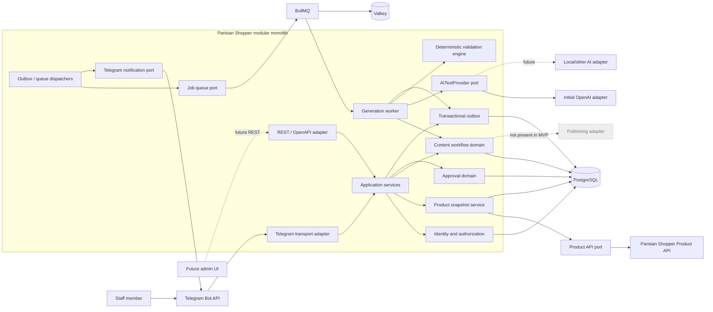
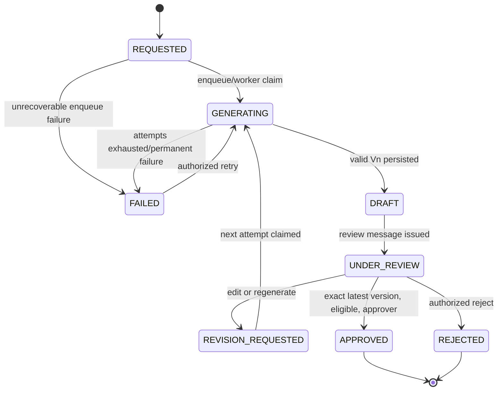
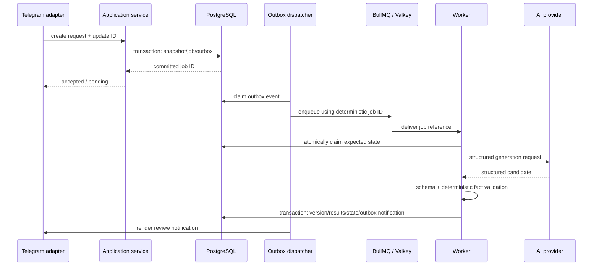

# Parisian Shopper system architecture

**Status:** Proposed implementation architecture under accepted ADR-002

**Scope:** MVP through exact-version approval; architecture only

**Explicitly out of scope:** visual generation, scheduling, social publishing, analytics, campaign planning, and live-selling automation

## Architectural objective

The system lets an authorized staff member use Telegram to select a real catalog product, generate bilingual marketing content, review append-only revisions, and approve or reject an exact validated version. The Product API remains authoritative. AI is a constrained content producer, never a product-data editor or factual validator of last resort.

The MVP is a modular monolith: one codebase and domain model, with an ingress process and an asynchronous worker process. PostgreSQL owns durable state. Valkey/BullMQ transports work but is not the source of truth.

## Non-negotiable invariants

1. Parisian Shopper Product API/database is the factual source of truth.
2. Product snapshots used for a generation request are immutable.
3. Content revisions are append-only; V1 is never overwritten by V2.
4. Approval records are immutable and auditable.
5. AI cannot directly modify canonical product data.
6. Deterministic factual validation runs before content can be approved.
7. Telegram is an interface; business logic belongs in application/domain services.
8. Telegram authorization uses numeric Telegram user ID mapped to an internal application user; usernames are informational only.
9. `APPROVED` and `PUBLISHED` are different states.
10. The MVP terminates at `APPROVED`.
11. Automatic publishing remains disabled server-side.
12. Restricted or unlicensed research repositories may be studied but their source code cannot be copied.

## Component model



### Trust and responsibility boundaries

- Telegram, Product API, and AI responses are untrusted external inputs.
- PostgreSQL stores the authoritative internal workflow state and immutable evidence.
- Valkey contains queue-delivery state only. A queue loss must be recoverable from PostgreSQL outbox records.
- AI provider adapters receive deliberately constructed context and return a schema-validated proposal. They cannot write database records.
- The validation engine is deterministic project code and cannot be bypassed by a prompt or provider response.
- There is no MVP path from an approved version to a social network.

## Module design

The paths below describe responsibilities, not generated source. Each feature module may contain `domain`, `application`, and `infrastructure` folders where useful; small modules should not add ceremonial layers.

| Module | Responsibility | May depend on | Must not own |
|---|---|---|---|
| `auth` | Resolve actor identity, authorization policies, role checks | users, common | Telegram presentation, content generation |
| `users` | Internal users, Telegram identity mapping, role assignment/status | common | Workflow state |
| `telegram` | Commands, callbacks, message rendering, update deduplication | application-facing ports, auth | Domain transitions, prompt construction, direct Prisma/AI calls |
| `products` | Product gateway, normalized contract validation, immutable snapshot creation | common, audit | AI enrichment of facts |
| `content` | Content jobs, versions, content types, workflow state machine | products, brand, validation ports | Telegram-specific behavior |
| `ai` | `AITextProvider`/future `AIImageProvider` ports, provider adapters, strict response parsing | common | Approval decisions, product mutations |
| `validation` | Deterministic factual and structural rules, severities, approval eligibility | content/product read models | AI calls or transport behavior |
| `approvals` | Exact-version approve/reject/revision events and permission/concurrency checks | content, auth, audit | Publication |
| `brand` | Immutable versioned brand rules and content strategies | common | Canonical product facts |
| `jobs` | BullMQ adapter, outbox dispatcher, worker orchestration, retries and dead-job operations | application ports, audit | Domain truth in queue payloads |
| `audit` | Append-only security and business audit events with redaction | common | Mutable operational state |
| `common` | IDs, clocks, errors, transaction abstractions, telemetry contracts | none of the feature modules | Feature-specific rules |

A conceptual source layout is:

```text
src/
  auth/             users/            telegram/
  products/         content/          ai/
  validation/       approvals/        brand/
  jobs/             audit/            common/
  entrypoints/
    api/
    worker/
```

### Dependency direction

Domain logic uses plain TypeScript and project-owned interfaces. Application services orchestrate domain operations and transactions. Infrastructure modules implement ports using Prisma, BullMQ, grammY, the Product API, or an AI SDK. Entrypoints compose modules. No domain module imports Nest controllers, Telegram types, Prisma models, queue classes, or vendor SDK types.

Cross-module operations use exported application ports rather than reaching into another module's repository. Circular module imports fail architecture tests. Shared types are promoted to `common` only when they are truly generic, not to bypass a boundary.

## Telegram MVP

### Commands

| Command | Authorized behavior |
|---|---|
| `/start` | Resolve numeric Telegram ID, show authorization result and concise onboarding. Unknown/disabled IDs receive no catalog data. |
| `/help` | Show commands allowed for the actor's roles. |
| `/create <SKU>` | Resolve exact SKU, create immutable snapshot, show verified facts/images, then request a content type. |
| `/search <keyword>` | Return a bounded, paginated product list. Exact SKU confirmation is required before generation. |
| `/newproducts` | Query an API capability defined by the Product API owner; disabled until its ordering/window semantics exist. |
| `/promo` | Query only active promotions according to upstream timestamps; never calculate or activate promotions in the bot. |
| `/status` | Show the actor's recent content jobs and current states. |
| `/history <SKU>` | Show authorized job/version/approval history for the exact SKU without exposing raw prompts or secrets. |

Usernames and display names may be stored for operator convenience but never authorize an action. Every command and callback resolves the numeric Telegram user ID to one active internal `User`, then evaluates role policy.

### `/create <SKU>` first vertical slice

1. The adapter parses a bounded SKU string and sends the Telegram update ID as an idempotency key.
2. The application service authenticates the numeric Telegram user ID and authorizes content creation.
3. The Product API adapter performs an exact-SKU read with timeouts and contract validation.
4. The product service stores an immutable normalized snapshot with a canonical digest.
5. The bot displays product name, brand, SKU, regular price, active promotion if any, stock status, and approved image references.
6. The user selects `PRODUCT_SPOTLIGHT`, `PROMOTION`, `SCENT_PYRAMID`, `EDUCATIONAL`, or `ENGAGEMENT` through an opaque, single-use callback token.
7. The application creates a `ContentJob` and outbox event in one PostgreSQL transaction.
8. The dispatcher enqueues the durable job ID. A worker generates and validates V1 asynchronously.
9. The bot shows the structured content, validation status, and actions: Approve, Edit, Regenerate, Reject, View Source.
10. The selected valid version may become `APPROVED`. Processing stops.

`SCENT_PYRAMID` is unavailable when curated fragrance notes are absent. `PROMOTION` is unavailable when no upstream promotion is currently active. Disabling the choice is an application rule, not a prompt hint.

### Review actions

- **Approve:** approver permission, latest-version check, state precondition, and zero blocking findings are all required. The immutable event references the exact content version.
- **Edit:** collect a reviewer instruction, create a revision request against the latest version, and enqueue generation of the next version. The instruction cannot override protected facts.
- **Regenerate:** enqueue the next version with the same snapshot and content strategy; V1 remains unchanged.
- **Reject:** append a rejection event/reason and move the job to `REJECTED` if the transition is valid.
- **View Source:** render facts from the stored snapshot used for this job, not a newly fetched product record.
- **New Visual / Change Type:** reserved UX concepts only; unavailable in the initial MVP.

## AI architecture

### Provider boundary

Conceptual interfaces, not implementation code:

```text
AITextProvider.generate(request, executionPolicy) -> StructuredGenerationResult

request:
  systemRulesRef, brandRuleVersion, contentStrategyVersion,
  productSnapshot, reviewerInstruction?, priorVersion?

executionPolicy:
  providerName, modelName, timeout, maximumAttempts, schemaVersion
```

Application/domain code depends only on `AITextProvider`. An OpenAI adapter is initially selected by explicit configuration. There is no automatic switch to another model/provider: an unavailable configured provider yields a visible retry or failure. Future cloud or local providers must pass the same contract, safety, Khmer quality, and deterministic-validation acceptance suite.

`AIImageProvider` is a future independent port and is not an MVP dependency.

### Context construction

Context is assembled in typed, independently versioned sections:

1. **SYSTEM RULES:** output schema, protected-fact policy, refusal/omission rules, language rules.
2. **BRAND RULES:** approved tone, spellings, prohibited claims, channel conventions.
3. **CONTENT STRATEGY:** content-type objective, structure, length, CTA and hashtag policy.
4. **PRODUCT DATA:** serialized snapshot inside an explicit untrusted-data delimiter; catalog description and fields are data, never instructions.
5. **REVIEWER INSTRUCTION:** separately delimited requested change, explicitly subordinate to system, brand, and protected-fact rules.

These sections are not concatenated from a single mutable string and are versioned/hashes recorded on a `GenerationAttempt`. Raw secrets are never placed in context. The adapter uses the provider's structured-output capability when available and still validates the response locally.

### Structured response

The initial logical schema is:

| Field | Shape | Rule |
|---|---|---|
| `headline` | string | Marketing headline; cannot introduce unsupported facts. |
| `khmer_caption` | string | Khmer caption; official product/brand names follow brand rules. |
| `english_caption` | string | English caption. |
| `cta` | string | Approved, non-publishing call to action. |
| `hashtags` | string array | Bounded count and length; facts in hashtags are validated too. |
| `creative_brief` | structured object | Textual art direction only in MVP; not sent to an image model. |
| `facts_used` | typed references array | Snapshot field paths and rendered values claimed by the model; useful evidence, never trusted as validation. |
| `warnings` | string array | Model-reported uncertainties; cannot downgrade deterministic findings. |
| `missing_information` | field-path array | Facts intentionally omitted because the snapshot lacks them. |

Unknown properties are rejected. Text and array limits are enforced before persistence. The exact Zod/OpenAPI schema will be versioned during Phase 1C.

## Deterministic factual validation

Validation receives only a `ProductSnapshot`, a candidate structured output, versioned brand/content rules, and deterministic locale-formatting rules. It does not call an LLM.

### Severity semantics

| Severity | Meaning | Approval effect |
|---|---|---|
| `INFO` | Traceable observation, such as a controlled field not used | No block |
| `WARNING` | Review-worthy style/coverage issue that is not a factual contradiction | No automatic block; visible to reviewer |
| `BLOCKING` | Contradiction, invented protected fact, invalid schema, or unverifiable prohibited claim | Version cannot be approved |

### Protected facts and rule examples

At minimum, validators cover SKU, product name, brand, price, promotion price, discount, currency, stock, size, concentration, fragrance notes, country of origin, and similarity claims. Validation scans every user-visible text field, including headline, both captions, CTA, hashtags, and creative brief.

- Money values are parsed as exact decimals. `38 USD` in the snapshot and `$35` in output is `BLOCKING`.
- Promotions must be active at the snapshot/evaluation instant and match upstream values. Generated discounts are `BLOCKING`.
- Concentration uses controlled codes and labels. `EDP` becoming `EDT` is `BLOCKING`.
- An origin claim when `country_of_origin` is absent is `BLOCKING`.
- Notes must be a subset of the curated tier in which they appear; added or reclassified notes are `BLOCKING`.
- Similarity wording must match an active approved claim under its channel/territory constraints. “Smells exactly like Dior Sauvage” with no approved claim is `BLOCKING`.
- Stock language maps from an approved phrase table. A snapshot cannot support invented quantity or urgency.
- Name, brand, and SKU use exact or explicitly approved locale representations; silent translation or spelling correction is blocked.
- Failure to parse the structured response is `BLOCKING` and no approvable version is created.

The engine stores its validator version and one result per rule/field occurrence. A content version with a failed `BLOCKING` result cannot pass the approval transaction even if the UI hides or fails to render the finding.

Natural-language claim extraction has limits. Phase 1D must define bounded patterns and adversarial fixtures; ambiguous factual language defaults to `BLOCKING` or requires removal, never silent acceptance.

## Domain state machine



| From | To | Preconditions/effect |
|---|---|---|
| `REQUESTED` | `GENERATING` | Durable job and outbox exist; worker atomically claims expected state. |
| `REQUESTED` | `FAILED` | Enqueue is permanently unrecoverable after reconciliation/operations decision. |
| `GENERATING` | `DRAFT` | New immutable version and completed deterministic validation are committed. Blocking findings may exist but make the draft ineligible for approval. |
| `GENERATING` | `FAILED` | Permanent error or retry budget exhausted; sanitized failure is recorded. |
| `DRAFT` | `UNDER_REVIEW` | Review notification outbox event is committed/dispatched; current version identified. |
| `UNDER_REVIEW` | `REVISION_REQUESTED` | Authorized edit/regenerate targets the latest version; request event appended. |
| `REVISION_REQUESTED` | `GENERATING` | Worker claims request and reserves the next version number. |
| `UNDER_REVIEW` | `APPROVED` | Actor has approval permission; target is latest version; no blocking failure; optimistic lock succeeds; approval event appended in same transaction. |
| `UNDER_REVIEW` | `REJECTED` | Actor is authorized; immutable rejection event/reason is appended. |
| `FAILED` | `GENERATING` | Explicit authorized retry with a new `GenerationAttempt`; never an invisible infinite retry. |

`APPROVED` is terminal in the MVP. `REJECTED` is also terminal for that job; a new request creates a new job. Future `SCHEDULED` and `PUBLISHED` values may be reserved in design documentation but must not be accepted by the MVP transition service.

All transitions use an expected current state and optimistic `lock_version`, inside a database transaction. Invalid or stale transitions return a conflict and append a security/audit event where appropriate.

## Data model

### Modeling principles

- UUID primary keys are generated by the application/database; external identifiers are never primary keys.
- All timestamps are timezone-aware PostgreSQL `timestamptz`, stored in UTC and rendered in the required locale.
- Money is stored as `numeric(precision, scale)` and serialized as decimal strings. Currency is a separate ISO 4217 code.
- Mutable administrative records use `created_at`, `updated_at`, and an explicit `disabled_at`/status where lifecycle demands it.
- Evidence records are append-only and have `created_at` only. Corrections append compensating events or new versions.
- JSONB is reserved for versioned external envelopes, bounded structured AI fields, and sparse audit metadata; identity, joins, state, money, and searchable attributes are typed columns.

### Entities and constraints

| Entity | Responsibility and key fields | Relationships, constraints, and indexes |
|---|---|---|
| `User` | Internal staff identity: `id`, display name, status, `disabled_at`, timestamps | PK `id`; index status. No hard delete after any authored event. |
| `TelegramIdentity` | Numeric Telegram mapping plus informational username/name and `last_seen_at` | PK; FK `user_id`; `telegram_user_id bigint UNIQUE`; normally `user_id UNIQUE` for one identity per MVP user. Username is not unique or authoritative. |
| `Role` | Stable permission bundle named `VIEWER`, `EDITOR`, `APPROVER`, or `ADMIN` | PK; `code UNIQUE`. Seeded/configuration-controlled, not free-form Telegram input. |
| `UserRole` | Many-to-many role assignment with assigning actor/time | Composite unique `(user_id, role_id)`; FKs to User/Role; no deletion if historical assignment evidence is required—revoke with timestamp. This table exists because users may need multiple roles. |
| `ProductSnapshot` | Immutable facts used by one or more jobs: source metadata, typed protected fields, exact normalized envelope, adapter/schema versions, digest | PK; no update/delete application grant; index `(sku, retrieved_at DESC)`; index `source_record_id`; optional unique `(source_system, sku, canonical_digest)` to reuse byte-identical snapshots. JSONB envelope preserves validated source fidelity while typed protected columns support constraints/querying. |
| `ContentJob` | Workflow aggregate: snapshot, requester, content type, state, strategy/rule versions, next version, optimistic lock, failure classification | PK; FKs snapshot/requester/brand-rule; unique `idempotency_key`; indexes `(requested_by, created_at DESC)`, `(state, updated_at)`, and snapshot; `next_version_number >= 1`; state changes only through transition service. |
| `ContentVersion` | Append-only Vn: structured content, parent, origin, content/schema hashes, generation attempt | PK; FK job; nullable self-FK parent; `UNIQUE(job_id, version_number)`; immutable; index `(job_id, version_number DESC)`. Captions/headline/CTA are typed text columns; bounded arrays/creative brief/facts-used use schema-versioned JSONB. |
| `ValidationResult` | Immutable rule outcome for a version: validator/rule version, field path, occurrence, severity, outcome, expected/actual normalized evidence, message | PK; FK version; unique `(content_version_id, rule_code, field_path, occurrence)`; index `(content_version_id, severity, outcome)`. Approval checks for no `BLOCKING`/`FAIL`. Sensitive full source payloads are not duplicated. |
| `ApprovalEvent` | Immutable exact-version action: approve, reject, edit requested, or regenerate requested; actor, reason/instruction, source action ID | PK; FKs job/version/actor; `source_action_id UNIQUE` for callback idempotency; indexes job/time and version/action. An `APPROVE` event must reference that job's latest eligible version and is created with state transition. |
| `BrandRuleVersion` | Immutable brand-rule text/structure, schema version, checksum, effective/retired metadata | PK; unique `(brand_key, version)`; index effective state. Never edit a version referenced by a job. Activation is a separate administrative action. |
| `ContentType` | Implemented as a code enum and versioned strategy definition, not a mutable table, for the five fixed MVP types | `ContentJob.content_type` constrained to the enum and records `content_strategy_version`. A table is deferred until business users truly need runtime-defined types. |
| `GenerationAttempt` | Each provider execution/retry: job, base/target version, provider/model, template/context hashes, status, timings, error class, token counts, estimated cost | PK; FK job and optional produced version; unique `execution_id`; index job/attempt and status/time. Raw credentials and unrestricted prompts/responses are not stored. This separates operational attempts from immutable editorial versions. |
| `AuditEvent` | Append-only security/administrative evidence: actor, action, aggregate, request/correlation IDs, redacted metadata | PK; index `(aggregate_type, aggregate_id, created_at)` and actor/time; no update/delete application grant. JSONB metadata follows an allowlisted schema and excludes secrets/content blobs. |
| `InboundTelegramUpdate` | Durable deduplication and processing status for Telegram delivery | PK; `telegram_update_id bigint UNIQUE`; payload hash, type, received/processed timestamps, sanitized error; short policy-driven retention after audit linkage. Added because retries are normal and audit logs alone cannot coordinate processing. |
| `TelegramActionToken` | Opaque callback reference, expected user/job/version/action, expiry and one-time consumption | PK random token ID (callback carries opaque ID); unique token hash; indexes expiry/consumption. Added to prevent forged or replayed state-bearing callback data. |
| `OutboxEvent` | Transactional bridge from PostgreSQL state to BullMQ or Telegram notification | PK; topic, aggregate ID, payload schema/reference, available/claimed/published timestamps, attempts; index unpublished/available. Added because PostgreSQL and BullMQ/Telegram cannot participate in one transaction. |

`AIUsageRecord` is not a separate MVP table because generation token/cost usage belongs to `GenerationAttempt`. It may be introduced later only if invoices, budgets, or cross-attempt aggregation require an immutable billing ledger.

### Append-only enforcement

Application repositories expose insert/read only for `ProductSnapshot`, `ContentVersion`, `ValidationResult`, `ApprovalEvent`, `BrandRuleVersion`, and `AuditEvent`. Production database roles deny `UPDATE` and `DELETE` on evidence tables. If Prisma migration ergonomics require an owner role with wider rights, the runtime role remains restricted. Database triggers may provide defense in depth and are covered by integration tests. Retention or legally required deletion uses a separately authorized, audited operations path—not normal application soft deletion.

Content text is not soft-deleted. User/identity access is disabled, while historic foreign keys remain. Operational inbox/outbox rows may be archived under a documented retention policy after durable audit correlation.

## Job and queue architecture

### Generation path



### Reliability policy

- **Idempotency:** inbound Telegram `update_id`, opaque action token, application request key, `ContentJob.idempotency_key`, BullMQ job ID, and generation execution ID are independently unique. Duplicate delivery returns the recorded result without repeating AI spend.
- **Transactional enqueue:** job creation and an outbox event commit together. A dispatcher claims with `FOR UPDATE SKIP LOCKED`, enqueues a deterministic BullMQ ID, and marks published. Duplicate enqueue is harmless.
- **Worker claim:** the worker changes only the expected state and records a `GenerationAttempt` before calling AI. A lease/heartbeat plus reconciliation recovers work after a crash.
- **Retries:** transient network, 429, and 5xx failures use bounded exponential backoff with jitter (initial proposal: three provider executions). Validation/schema or policy violations are permanent for that attempt. The exact policy is configuration, logged explicitly, and tested.
- **Timeouts:** Product API and AI calls have connect and total deadlines. Cancellation is attempted, but an uncertain provider completion never authorizes a second billable attempt until the execution idempotency/reconciliation policy permits it.
- **Dead jobs:** exhausted work moves the domain job to `FAILED`, retains sanitized diagnostics, and is visible to `/status` and operations. A dead-letter queue is diagnostic delivery state, not the only failure record.
- **Outages:** Product API failure creates no fabricated snapshot. AI outage leaves a visible retry/failure. Telegram outage retains notification outbox events without reverting completed content.
- **Worker restart:** PostgreSQL state and attempts determine recovery; queue payloads contain IDs only. Reconciliation finds stale `GENERATING` jobs and safely resumes or fails them according to lease and attempt records.
- **Transaction failure:** no version or notification is observable unless version, validation results, state transition, and notification outbox event commit together.
- **Concurrency:** reserve `next_version_number` and transition using a row lock/optimistic version. Concurrent edit and regenerate callbacks cannot both create V2.

## API design

The initial internal API is versioned REST with generated OpenAPI documentation. Controllers accept transport DTOs, authenticate the actor, and call application services. They never expose Prisma records directly. Stable error bodies contain a machine code, safe message, correlation ID, and field issues where appropriate.

Candidate resource boundaries are `/v1/content-jobs`, `/v1/content-jobs/{id}/versions`, `/v1/content-jobs/{id}/actions`, `/v1/products/search`, and `/v1/me`. Telegram may initially call application services in-process; REST exists for health/operations and a future dashboard, not as a mandatory loopback hop.

No `/publish`, schedule, social-account, or outbound-channel mutation endpoint exists in the MVP. A feature flag alone is insufficient protection; publishing code and credentials are absent from the deployable MVP.

## Deployment and operations

Initial Compose services are `api`, `worker`, `postgres`, and `valkey`, with an optional one-shot migration task. API and worker use the same pinned image with different entrypoints and least-privilege runtime roles. PostgreSQL and Valkey are not publicly exposed. TLS terminates at an approved reverse proxy; Telegram production delivery should use a verified webhook with secret token and network controls, with long polling limited to local development.

Secrets come from the deployment secret mechanism, never Compose files committed to Git. Health probes distinguish liveness from readiness. Readiness verifies required configuration and database access but does not make a billable AI call. Logs are structured, redacted, and correlated across Telegram update, request, job, attempt, version, and approval identifiers.

Backups, point-in-time recovery, restore tests, alerting destination, retention, RPO/RTO, and production secret manager remain operational decisions before deployment.

## Architecture fitness checks

Phase 1A should make these executable checks:

- domain folders cannot import infrastructure/vendor packages;
- no publication package, route, queue, or credential name appears in the MVP build;
- append-only tables reject update/delete through the runtime database role;
- every state change goes through the transition matrix;
- every approval transaction targets the latest exact version and rejects blocking findings;
- every external adapter has contract tests using fictional fixtures;
- duplicate Telegram updates, callbacks, outbox deliveries, and jobs are idempotent;
- dependency/license scans fail on unapproved or missing licenses;
- `/research` is excluded from application build context, package resolution, and provenance.

## Open architecture decisions

There is no blocker to Phase 1A project scaffolding. Product integration cannot exit Phase 1B until the Product API owner resolves the open contract questions and supplies sanitized fixtures. Production deployment additionally needs hosting, secret management, backup/recovery, and operational ownership decisions. Future publication requires a separate ADR, threat-model update, Meta terms/API review, and explicit management authorization.
