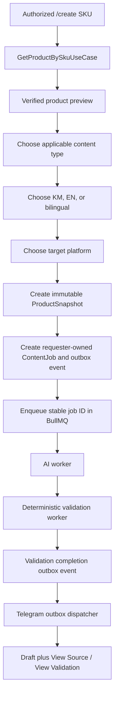

# Telegram bot

**Status:** Phase 1E implemented

The Telegram integration is a transport over the existing application services. grammY is confined to `app/packages/telegram`; command routing, permissions, durable flows, token semantics, and formatting use project-owned types in the application package. Telegram never queries Prisma, calls an AI provider, or mutates product facts directly.

## Commands

| Command | Phase 1E behavior |
|---|---|
| `/start` | Authenticates the numeric Telegram ID and shows role-aware commands. |
| `/help` | Shows only commands the actor may use and the human-review warning. |
| `/search <keyword>` | Validates input, searches SKU/name/brand through `SearchProductsUseCase`, and shows five results per page with opaque selection tokens. |
| `/create <SKU>` | Validates and retrieves a product, shows verified facts, then collects content type, language, and platform before snapshot/job creation. |
| `/status` | Shows up to ten authorized recent jobs with generation and validation state. |
| `/history <SKU>` | Validates the SKU and shows up to ten authorized jobs for it. |

There are no approve, reject, publish, schedule, or image-generation commands in Phase 1E.

## Create workflow



`PROMOTION` appears only when source promotion data exists. `SCENT_PYRAMID` appears only when verified fragrance notes exist. The selection is enforced again by the existing content strategy before provider execution.

## Local operation

Telegram is off by default. CI uses `FakeTelegramGateway` and never calls Telegram.

For deliberate local polling, configure fictional/non-production infrastructure, create an active `TelegramIdentity` mapped to an internal user and role, then set:

```dotenv
FEATURE_TELEGRAM=true
TELEGRAM_MODE=polling
TELEGRAM_BOT_TOKEN=<local-secret>
FEATURE_AI_TEXT_GENERATION=true
AI_PROVIDER=fake
```

For webhook mode, also set the public HTTPS callback URL and a random secret of at least 32 characters. Never commit `.env` or bot credentials. A production deployment must provision staff identities through an administrative/offboarding process; incoming messages never auto-create users.

## Known Phase 1E limits

- Product fixtures remain fictional while the Product API feature is disabled.
- Notification dispatch is a single-process PostgreSQL outbox poller with a five-minute lease. Horizontal deployment is safe through `SKIP LOCKED`, but operational metrics and dead-letter tooling remain Phase 1G work.
- A provider request that times out can still have incurred cost upstream; the existing stable queue job ID and generation lease prevent application-level duplicates but cannot provide a vendor guarantee.

