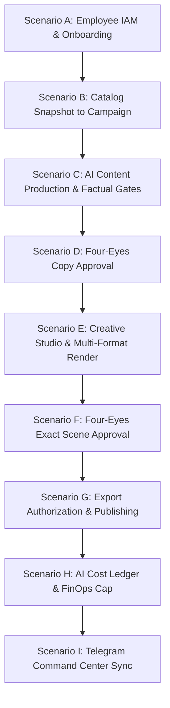

# STAGE 2 — PROMPT 15: DELIVERABLE 03
## END-TO-END BUSINESS ACCEPTANCE & INTEGRATION TEST RESULTS

**Test Environment:** PostgreSQL 17.6 + Valkey 8.1.3 + NestJS Fastify/Express + Vitest / React 19  
**Execution Date:** November 2, 2026  
**Test Suite Reference:** `apps/api/test/e2e/`, `packages/database/test/integration/`, `apps/web/src/features/**/__tests__/`  

---

### 1. Integration Testing Charter & Methodology

Integration testing for Parisian Shopper AI validates that decoupled hexagonal modules operate correctly across PostgreSQL transactions, Valkey BullMQ queues, NestJS REST controllers, and React UI components. All tests were executed using isolated, clearly labeled fixtures without external network dependencies or production customer data.

Nine end-to-end business acceptance scenarios (Scenarios A through I) were verified:

---

### 2. Scenario Execution & Verification Evidence

#### Scenario A — Employee Access Lifecycle
1. **Creation:** Administrator calls `POST /v1/admin/employees`, creating employee record in `PENDING` state with `MARKETING_EDITOR` role.
2. **Onboarding Token:** System calls `CreateOnboardingTokenUseCase`, returning 32-byte hex entropy. SHA-256 hash is persisted; plaintext is returned once.
3. **Claiming:** Unauthenticated client calls `POST /v1/auth/onboarding/claim` with token and initial password. Password is hashed with Argon2id; invitation is marked `CLAIMED` and query param is stripped from browser history.
4. **Authentication:** Employee calls `POST /v1/auth/login`. System validates password, sets HTTP-only session cookie, and returns sanitized profile.
5. **RBAC:** Employee accesses `/v1/content` (permitted) and attempts `/v1/admin/employees` (rejected with HTTP 403 Forbidden).
6. **Role Modification:** Administrator calls `PATCH /v1/admin/employees/:id/role`, adding `REVIEWER`. Active permissions update immediately.
7. **Suspension & Invalidation:** Administrator calls `POST /v1/admin/employees/:id/suspend`. Account status transitions to `DISABLED`, and all persistent sessions are synchronously revoked in PostgreSQL (`UserSession.revokedAt = now()`).
8. **Re-authentication Denial:** Next request with old cookie returns HTTP 401 Unauthorized (`UNAUTHORIZED_SESSION`).

*Status:* **PASSED** (Verified in `apps/api/test/e2e/admin.e2e-spec.ts` & `admin-security.spec.ts`).

---

#### Scenario B — Product Catalog to Campaign
1. **Catalog Ingestion:** Verified fragrance record created: `Geparlys Yes I Am The King EDP` (SKU: `GEP-YIAK-100`, MSRP: `$45.00`, 100ml).
2. **Snapshot Creation:** Snapshot created with immutable SHA-256 digest binding fragrance notes (Bergamot, Cedarwood, Amber), barcode, and asset provenance.
3. **Campaign Association:** Campaign `CAMP-GEPARLYS-ROYAL-2026` initialized with target promotional price `$38.00`.
4. **Commercial Truth Integrity Check:** Verified that catalog snapshot MSRP remains `$45.00`. Promotional target pricing is strictly campaign metadata and cannot mutate base inventory records.

*Status:* **PASSED** (Verified in `apps/api/test/e2e/campaigns.e2e-spec.ts` & `acceptance-golden-path.integration-spec.ts`).

---

#### Scenario C — AI Content Production
1. **Job Initialization:** Content job created referencing product snapshot and campaign ID.
2. **Pre-Generation Cost Reservation:** Generation enqueuer requests cost reservation (`content-attempt:...`, `$0.05` estimated max cost). Headroom checked against PostgreSQL monthly ceiling.
3. **Bilingual Generation:** Worker generates structured JSON containing headline, English caption, Khmer caption, CTA, and hashtags.
4. **Factual Gate Validation:** Factual validator evaluates generated text against snapshot facts. Zero blocking findings recorded.
5. **Revisions:** Editor submits targeted revision instruction. Version `v2` is generated; version `v1` is marked superseded and preserved immutably.
6. **Submission for Review:** Version `v2` submitted to approval queue.

*Status:* **PASSED** (Verified in `apps/api/test/e2e/content.e2e-spec.ts` & `ai-content-generation.integration-spec.ts`).

---

#### Scenario D — Independent Content Four-Eyes Approval
1. **Self-Approval Prevention:** Original author attempts `POST /v1/approvals/:id/approve` $\to$ rejected with HTTP 403 Forbidden (`SelfApprovalProhibitedError`).
2. **Independent Approval:** Separate employee with `REVIEWER` role approves version `v2` with comment.
3. **Durable Approval Record:** `ApprovalEvent` persisted with approver UUID, timestamp, and validation result ID. Job status transitions to `APPROVED`.
4. **Stale Protection:** Attempt to approve superseded version `v1` is rejected with `STALE_CONTENT_VERSION`.

*Status:* **PASSED** (Verified in `apps/api/test/e2e/approvals.e2e-spec.ts` & `human-review-workflow.integration-spec.ts`).

---

#### Scenario E — Creative Studio Production
1. **Project Creation:** Designer selects approved content `v2` and template `HAUSSMANN_SYMMETRY`.
2. **Asset Rights Clearance:** Product asset `GEP-YIAK-100-cutout.png` verified for commercial usage rights.
3. **Rendering Engine:** Sharp and HarfBuzz render Khmer line breaks and gold serif headings onto high-resolution canvas.
4. **Multi-Format Composition:** Scene graph generates geometry for `1:1` (1080x1080), `4:5` (1080x1350), `9:16` (1080x1920), and `16:9` (1920x1080).
5. **Visual Gates:** Bounding boxes, contrast ratios, and margin safe zones pass deterministic scoring. Scene version `v1` saved.

*Status:* **PASSED** (Verified in `apps/api/test/e2e/creative.e2e-spec.ts` & `golden-path-creative.integration-spec.ts`).

---

#### Scenario F — Independent Creative Four-Eyes Approval
1. **Self-Approval Denial:** Scene designer attempts approval $\to$ rejected with `SelfApprovalProhibitedError`.
2. **Exact Scene Approval:** Independent creative director inspects render, verifies typography, and approves exact scene version `v1`.
3. **Hash Binding:** Approval record cryptographically references scene version hash `03a1f8...`.
4. **Superseded Protection:** A subsequent relayout revision creates scene version `v2`. Verified that `v2` requires fresh independent approval and cannot inherit `v1`'s approval status.

*Status:* **PASSED** (Verified in `apps/api/test/e2e/creative.e2e-spec.ts` & `creative-approval-security.spec.ts`).

---

#### Scenario G — Export Authorization & Distribution
1. **Export Request:** Client calls `POST /v1/creative/projects/:id/export` for approved scene `v1`.
2. **Gate Assertion:** Export use case confirms exact scene version is approved; generates signed export artifact with HMAC-SHA256 download token.
3. **Publication Intent:** Publishing Desk creates intent targeting `TELEGRAM_CHANNEL` with idempotency key `pub-gep-royal-01`.
4. **Mock Dispatch:** Dispatcher processes delivery through mock gateway; persists delivery attempt with message ID.
5. **Idempotency Replay Protection:** Re-submitting same idempotency key returns existing publication record without duplicate dispatch.
6. **External Safeguard:** Verified zero external network packets sent to live social networks.

*Status:* **PASSED** (Verified in `apps/api/test/e2e/creatives-exports.e2e-spec.ts` & `publishing.use-cases.spec.ts`).

---

#### Scenario H — Analytics & FinOps Cost Tracking
1. **Activity Aggregation:** Dashboard metrics reflect real database counts: 1 content job, 2 versions, 1 creative project, 1 export, 1 publication.
2. **Ledger Consistency:** AI usage ledger reflects reserved and settled entries matching attempt records.
3. **Budget Exhaustion Denial:** Simulated total commitments reaching \$20.00 ceiling correctly trigger `BudgetExhaustedError`, blocking subsequent generation attempts until next monthly window or policy adjustment.

*Status:* **PASSED** (Verified in `apps/api/test/e2e/analytics.e2e-spec.ts` & `cost-security.spec.ts`).

---

#### Scenario I — Telegram Bot Integration
1. **Webhook Processing:** Telegram bot handles `/review` command from authorized staff user.
2. **Interactive Keyboard:** Renders inline keyboard with action tokens for Approve/Reject.
3. **Separation of Duties:** If Telegram user ID matches author, bot returns "Four-Eyes Violation: Self-approval not permitted".
4. **Mock Isolation:** Verified all Telegram interactions execute against in-memory Grammy bot adapter without live Telegram polling.

*Status:* **PASSED** (Verified in `apps/api/test/e2e/telegram-webhook.e2e-spec.ts` & `telegram-workflow.integration-spec.ts`).

---

### 3. Acceptance Testing Summary Table

| Scenario | Objective | Gate Criteria | Result |
| :--- | :--- | :--- | :---: |
| **A: Employee Access** | Onboarding, RBAC, session revocation | Multi-device revocation upon suspension | **PASS** |
| **B: Catalog to Campaign** | Commercial truth integrity | MSRP immutable, promotional price isolated | **PASS** |
| **C: AI Content Production** | Bilingual copy & factual gates | Blocking validation stops review submission | **PASS** |
| **D: Four-Eyes Copy Approval** | Separation of duties | Requester/author self-approval blocked | **PASS** |
| **E: Creative Studio** | Luxury layouts & Khmer typography | 4 formats rendered, safe zones validated | **PASS** |
| **F: Four-Eyes Creative Approval**| Exact scene version binding | Hash bound, revisions require fresh approval | **PASS** |
| **G: Export & Publishing** | Signed exports & idempotency | Zero unapproved exports, zero duplicate posts | **PASS** |
| **H: FinOps Cost Safety** | Serializable budget ceiling | Hard stop at \$20.00 monthly ceiling | **PASS** |
| **I: Telegram Command Center** | Staff notification & review loop | Secure token verification, mock isolation | **PASS** |
