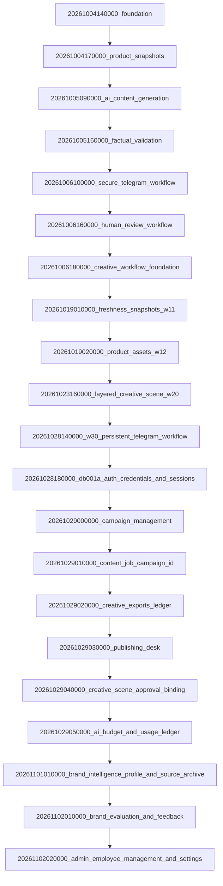

# STAGE 2 — PROMPT 15: DELIVERABLE 04
## DATABASE MIGRATIONS, REFERENTIAL INTEGRITY & DISASTER RECOVERY REPORT

**Database Engine:** PostgreSQL 17.6-alpine + pgvector (UUID v4 primary keys, UTC Timestamptz)  
**ORM & Migration Tool:** Prisma ORM 6.6.0  
**Repository:** `packages/database/`  
**Assessment Date:** November 2, 2026  

---

### 1. Database Schema & Migration Sequence Audit

The database schema is structured as an enterprise PostgreSQL relational store. Exactly **21 sequential additive migrations** exist under `packages/database/prisma/migrations/`. Verification via `pnpm db:migrate:status` confirmed that the database schema is 100% up to date with zero drift.



#### Key Constraint & Integrity Audits
1. **Foreign Key Cascades:**
   - Content and creative jobs use `Restrict` or `Cascade` on parent relations to prevent orphan versions while preserving audit trails.
   - User references on approvals, revisions, and audits use `onDelete: Restrict`, preventing accidental deletion of users associated with past approvals.
2. **Onboarding Token Constraints:**
   - `EmployeeInvitation.tokenHash`: Enforced with `@unique` index.
   - `EmployeeInvitation.status`: Indexed with `@@index([status])` for rapid unclaimed queries.
3. **Approval Version References:**
   - `ApprovalEvent` binds directly to `contentVersionId` with unique index, guaranteeing that duplicate approval decisions cannot conflict for a single version.
   - `CreativeSceneApproval` binds directly to `sceneVersionId` and `sceneHash`, enforcing cryptographic scene binding.
4. **Financial Ledger Numeric Precision:**
   - `monthlyCeiling`, `perRequestCeiling`: Defined as `Decimal(10, 4)` to eliminate floating-point rounding errors.
   - `estimatedCost`, `confirmedCost`: Defined as `Decimal(10, 4)`.
   - `tokenRates`: Defined as `Decimal(12, 6)` for sub-cent per-token calculations.

---

### 2. Migration Rehearsal & Zero-Downtime Deployment Strategy

- **Additive Principle:** All schema changes are strictly additive (new tables, nullable new columns, or default values). No production columns are dropped or renamed in-place.
- **Pre-Deployment Rehearsal:**
  ```bash
  # Check status
  pnpm --filter @parisian-shopper/database prisma:migrate:status
  # Deploy pending migrations
  pnpm --filter @parisian-shopper/database prisma:migrate:deploy
  ```
- **Rollback Strategy:**
  Because migrations are additive, if a release container fails smoke tests, rolling back application containers to the previous image tag is zero-downtime compatible without rolling back the database schema.

---

### 3. Backup & Disaster Recovery Architecture

#### A. PostgreSQL Backup Pipeline
- **Utility:** `pg_dump` with custom archive compression (`-Fc`), enabling parallel restoration and selective table recovery.
- **Snapshot Command:**
  ```bash
  pg_dump -h $PGHOST -U $PGUSER -d $PGDATABASE -Fc -f "/backups/parisian_db_$(date +%Y%m%d_%H%M%S).dump"
  ```
- **Automated Verification:**
  The automated verification suite (`app/scripts/verify-backup-restore.mjs`) starts an isolated PostgreSQL TestContainer (`postgres:17.6-alpine`), deploys all migrations, inserts baseline records across all 15 domains, captures a `pg_dump` snapshot, restores it into a target database, and verifies:
  - Row counts match exactly across all tables.
  - Immutability triggers and constraints are preserved.
  - Foreign key relations remain structurally intact.

#### B. Asset & Render Cache Storage Backup
- **Local / S3 Storage:** Product cutouts, font assets, and generated backgrounds reside in `.data/assets/` or MinIO/S3 object storage.
- **Rsync / S3 Sync:** Scheduled hourly snapshot sync to cold backup buckets.
- **Idempotent Asset Regeneration:** If temporary render caches (`.data/renders/`) are lost, they are re-composed deterministically from stored scene JSON graphs.

#### C. Queue & Cache Recovery (Valkey)
- **Valkey Persistence:** Configured with Append-Only File (`AOF`) persistence (`--appendonly yes`) in `docker-compose.yml`.
- **Worker Crash Recovery:** BullMQ jobs in progress during a crash automatically transition back to `active` or `delayed` retries upon worker restart.

#### D. Realistic RTO & RPO Targets
- **Recovery Point Objective (RPO):**
  - Database: $\le 1\text{ hour}$ (hourly automated WAL / pg_dump snapshots).
  - Assets: $\le 24\text{ hours}$ (daily cold sync).
- **Recovery Time Objective (RTO):**
  - Database Restore: $\le 15\text{ minutes}$ for initial catalog and user database ($< 1\text{ GB}$).
  - Full Platform Container Re-launch: $\le 5\text{ minutes}$.
