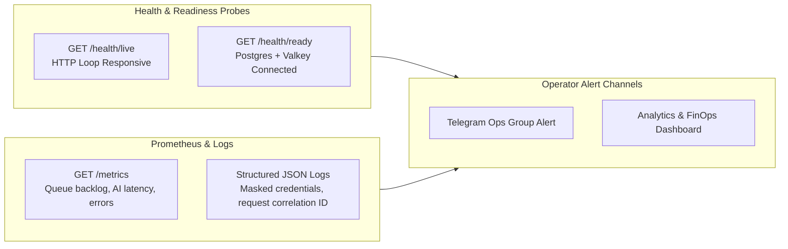

# STAGE 2 — PROMPT 15: DELIVERABLE 06
## OBSERVABILITY, HEALTH MONITORING & OPERATIONAL INCIDENT RUNBOOKS

**Logging Framework:** Pino Structured JSON Logger with Correlation Context Tracking  
**Metrics Telemetry:** Prometheus Metrics Controller (`/metrics`) + Health Probes (`/health/*`)  
**Assessment Date:** November 2, 2026  

---

### 1. Operational Observability Architecture

Parisian Shopper AI utilizes lightweight, high-performance telemetry designed for internal retail operations without requiring costly enterprise observability infrastructure:

---

### 2. Failure Detection Matrix

| Operational Event | Detection Mechanism | Severity | Automated Mitigation / System Response |
| :--- | :--- | :---: | :--- |
| **API Process Crash** | Docker daemon / Nginx 502 Bad Gateway | **P0** | Container restarts automatically (`restart: unless-stopped`). |
| **PostgreSQL Connection Lost** | `GET /health/ready` returns HTTP 503; Prisma pool timeout | **P0** | Ingress alerts operator; application reconnects upon DB recovery. |
| **Valkey Outage** | `GET /health/ready` reports Redis ping failure; BullMQ paused | **P1** | Worker pauses processing; jobs buffer in memory until reconnection. |
| **Worker Process Failure** | `WorkerHealthService` probe misses heartbeat | **P1** | BullMQ automatically locks and re-queues stalled jobs with backoff. |
| **Queue Backlog Spike** | `/metrics` reveals `bullmq_waiting_jobs > 20` | **P2** | Operator scales worker concurrency or investigates slow provider. |
| **AI Budget Exhaustion** | Use case throws `BudgetExhaustedError`; logs `BUDGET_CAP_EXCEEDED` | **P1** | Block all subsequent generation attempts until next month or manual ceiling update. |
| **Unreconciled AI Cost Exposure** | `AiCostReservation.status = UNRECONCILED` after timeout | **P2** | Reservation amount remains locked against ceiling until manual operator reconciliation. |
| **Publishing Dispatch Failure** | `PublicationAttempt.status = FAILED` | **P2** | Intent records retry count; notifies operator via Telegram review desk. |
| **Brute-Force Login Attack** | `failedLogins >= 5` triggers `lockedUntil` for 15 minutes | **P2** | HTTP 429 Too Many Requests; security event logged with source IP. |
| **Unauthorized Self-Approval Attempt** | Four-Eyes check logs `SelfApprovalProhibitedError` | **P2** | HTTP 403 Forbidden; security warning recorded in `AuditEvent`. |

---

### 3. Log Sanitization & Credential Protection (`PinoLoggerService`)

All structured log records are formatted as JSON and processed through `app/packages/logger/src/safe-serialization.ts`:
- **Masked Keys:** `password`, `token`, `sessionToken`, `rawSessionToken`, `secret`, `cookie`, `authorization`, `apiKey`, `botToken`.
- **Masking Mechanism:** Values matching sensitive patterns are replaced with `[REDACTED]` prior to stdout writing.
- **Correlation ID Tracking:** Every HTTP request generates or propagates an `X-Request-Id` (UUID v4) via `CorrelationMiddleware`, ensuring that log traces across controllers, application use cases, and database repositories can be grouped without exposing user credentials.

---

### 4. Operational Incident Response Runbooks

#### Runbook A: Resolving AI Budget Exhaustion
1. **Symptom:** Content or creative generation requests fail with `Operational AI budget exhausted: remaining headroom is $0.0000 USD`.
2. **Investigation:**
   - Log in as `ADMIN`.
   - Navigate to `/analytics/costs` in the web application.
   - Inspect current monthly consumption vs. `$20.00` ceiling.
   - Check the **Unreconciled Reservations** table for dangling requests from provider timeouts.
3. **Remediation:**
   - If dangling reservations exist: Select the unreconciled attempt and click **"Reconcile Usage"** to release unspent funds.
   - If genuine operational limit reached: Navigate to `/admin/settings`, adjust `monthlyCeiling` (e.g. from `$20.00` to `$30.00`), and save.

#### Runbook B: Clearing a Stuck Queue Job
1. **Symptom:** Content generation spinner persists for $> 2\text{ minutes}$.
2. **Investigation:**
   - Execute CLI status check: `pnpm queue:status`.
   - Inspect active jobs: `pnpm outbox:status`.
3. **Remediation:**
   - Restart the worker container: `docker compose restart worker`.
   - BullMQ will mark stalled attempts and re-dispatch or terminate the job cleanly.
