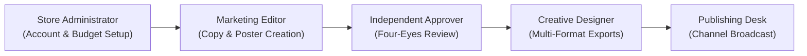

# STAGE 2 — PROMPT 15: DELIVERABLE 07
## EMPLOYEE USER ACCEPTANCE TESTING (UAT) PLAN & OPERATIONAL SCRIPTS

**Audience:** Retail Store Management, Marketing Editors, Approvers & Creative Designers  
**Platform URL (Staging):** `https://staging.parisianshopper.com`  
**Assessment Date:** November 2, 2026  
**Human Acceptance Status:** **PENDING STAGING PILOT (Formal Scripts Prepared)**  

---

### 1. Human Acceptance Policy & Protocol

Automated test suites (1,824 unit tests, 105 E2E tests, 131 web tests) prove that the software behaves correctly according to programmatic specifications. However, **automated tests cannot substitute for real employee acceptance**.

This document formalizes the operational test scripts for the upcoming limited staging pilot. No stakeholder sign-off is fabricated. Human acceptance is marked as **PENDING** until store personnel complete these scripts.

---

### 2. Operational Persona Test Matrix



#### Persona 1: Store Administrator (`ADMIN`)
- **Profile:** Store Manager / Platform Administrator.
- **Responsibilities:** Staff onboarding, role governance, system settings, AI cost budget monitoring.

#### Persona 2: Marketing Editor (`CONTENT_CREATOR`, `CAMPAIGN_PLANNER`)
- **Profile:** Retail Marketing Specialist.
- **Responsibilities:** Perfume catalog selection, promotional campaign planning, bilingual copy generation.

#### Persona 3: Marketing Approver (`REVIEWER`)
- **Profile:** Editorial Director / Senior Store Lead.
- **Responsibilities:** Four-Eyes verification, copy quality review, factual consistency validation, rejection rationale.

#### Persona 4: Creative Designer (`CREATIVE_SPECIALIST`)
- **Profile:** Graphic Designer / Visual Merchandiser.
- **Responsibilities:** Canvas layout composition, Khmer typography verification, poster exports in 4 aspect ratios.

---

### 3. Step-by-Step Executable UAT Scripts

| Script ID | Persona | Task Description | Expected Operational Outcome | Human Sign-off |
| :--- | :--- | :--- | :--- | :---: |
| **UAT-01** | **Administrator** | Create employee account & generate onboarding link. | Single-use invitation link generated; URL query param strips cleanly upon visit; user sets Argon2id password. | `[PENDING]` |
| **UAT-02** | **Administrator** | Verify Last-Active-Admin protection. | Demoting sole admin is blocked with clear error message; self-suspension is disallowed. | `[PENDING]` |
| **UAT-03** | **Administrator** | Inspect AI cost control dashboard. | Current month usage, remaining headroom ($20.00 ceiling), and itemized reservation ledger display accurately. | `[PENDING]` |
| **UAT-04** | **Editor** | Browse luxury perfume catalog (`/products`). | Verified fragrances (Geparlys Yes I Am The King, Johan B, Glenn Perri) display notes, MSRP, and asset cutouts. | `[PENDING]` |
| **UAT-05** | **Editor** | Create promotional campaign (`/campaigns/new`). | Campaign code, dates, and target promotional price save; catalog snapshot MSRP remains strictly unchanged. | `[PENDING]` |
| **UAT-06** | **Editor** | Generate bilingual marketing copy (`/content/new`). | Generates English and Khmer captions with luxury tone, CTAs, and hashtags; factual checks show zero errors. | `[PENDING]` |
| **UAT-07** | **Editor** | Submit content for review. | Status transitions to `UNDER_REVIEW`; draft becomes locked for editing. | `[PENDING]` |
| **UAT-08** | **Editor** | Attempt self-approval of own content. | UI blocks approval action; API throws Four-Eyes violation error if attempted. | `[PENDING]` |
| **UAT-09** | **Approver** | Review copy & approve (`/approvals`). | Approver inspects side-by-side English/Khmer text, verifies notes, and approves with comments. Status becomes `APPROVED`. | `[PENDING]` |
| **UAT-10** | **Designer** | Create creative poster (`/creative/new`). | Designer selects approved copy, applies Haussmann layout, adjusts Khmer gold typography, verifies safe margins. | `[PENDING]` |
| **UAT-11** | **Designer** | Submit scene for independent visual approval. | Scene version `v1` saved with exact hash; designer is prevented from self-approving. | `[PENDING]` |
| **UAT-12** | **Approver** | Approve exact creative scene. | Approver reviews high-resolution poster preview; approves exact version `v1`. Hash binding verified. | `[PENDING]` |
| **UAT-13** | **Designer** | Download multi-format export artifacts. | Generates signed exports in `1:1`, `4:5`, `9:16`, and `16:9` without image distortion. | `[PENDING]` |
| **UAT-14** | **Approver** | Schedule publishing to Telegram channel. | Intent created; idempotency prevents duplicate posts; alert is delivered to private staging channel. | `[PENDING]` |

---

### 4. UAT Defect Logging & Sign-Off Template

When conducting pilot sessions with store staff, issues must be recorded using the standardized template:

```markdown
### UAT Finding: [Script ID] — [Brief Title]
- **Date:** YYYY-MM-DD
- **Tester Persona:** [Admin | Editor | Approver | Designer]
- **Tested Environment:** Staging (Build: index-DA8Owk3e.js)
- **Task Executed:** [Exact steps followed]
- **Expected Outcome:** [Expected behavior]
- **Actual Outcome:** [Observed behavior]
- **Pass / Fail:** FAIL
- **Usability Severity:** [P1-Blocker | P2-Significant | P3-Minor]
- **Responsible Module:** [Admin | Catalog | Content | Creative | Publishing]
- **Screenshots / Error Message:** [Attach trace]
```
