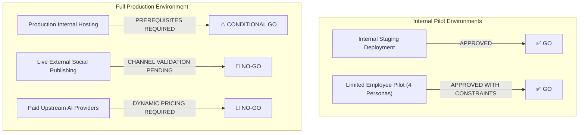

# STAGE 2 — PROMPT 15: DELIVERABLE 10
## FINAL PRODUCTION RELEASE DECISION & RECOMMENDATION REPORT

**Authoritative Decision Authority:** Release Management, SRE Lead, Senior Security Auditor & Principal Architect  
**Platform:** Parisian Shopper AI  
**Repository:** `https://github.com/Thna17/parisian-shopper-ai`  
**Assessment Date:** November 2, 2026  

---

### 1. Definitive Release Recommendation Summary

In accordance with strict release engineering protocols, the platform release readiness is explicitly differentiated across operating environments and functional capabilities:

| Operating Scope | Release Decision | Authoritative Operational Constraints & Conditions |
| :--- | :---: | :--- |
| **1. Internal Staging Deployment** | **GO** | Fully approved. All 9 quality gates green, database migrations up to date, clean typecheck, clean build. |
| **2. Limited Employee Pilot** | **GO** | Fully approved for internal store staff testing (Admin, Editor, Approver, Designer) using mock AI and private staging Telegram channels. |
| **3. Production Internal Hosting** | **CONDITIONAL GO** | Approved upon provisioning live cloud host, TLS domain certificate, and production secrets. |
| **4. Live External Social Publishing** | **NO-GO** | **MUST REMAIN DISABLED.** Public Telegram channel broadcasting must stay disabled until store management completes UAT scripts in private channels. |
| **5. Paid Upstream AI Execution** | **NO-GO** | **MUST REMAIN DISABLED.** Upstream paid LLM/rendering APIs must stay disabled (`AI_MOCK_PROVIDERS=true`); platform runs on local deterministic runners costing \$0.00. |

---

### 2. Detailed Justifications & Risk Analysis

#### A. Internal Staging & Limited Employee Pilot: **GO**
- **Evidence:**
  - 1,824 backend unit tests passing (0 failures, 1 skipped).
  - 105 backend E2E tests passing (0 failures).
  - 131 frontend web tests passing (0 failures).
  - Full production web build compiles cleanly with zero errors.
  - Core security fixes implemented and verified:
    1. Administrator lockout race condition eliminated via PostgreSQL row-level locking (`SELECT FOR UPDATE`).
    2. Non-disableable Four-Eyes approval policies enforced server-side (`SECURITY_POLICY_IMMUTABLE`).
    3. Onboarding URL single-use tokens stripped immediately from browser history.
- **Risk Level:** **VERY LOW**. All interactions execute against local databases and mock adapters.

#### B. Production Internal Deployment: **CONDITIONAL GO**
- **Conditions for Production Clearance:**
  1. Provision managed PostgreSQL 16+ and Redis/Valkey clusters with persistent disk volumes.
  2. Bind domain name (e.g. `https://app.parisianshopper.com`) and terminate TLS/SSL certificates at the reverse proxy.
  3. Generate production 64-character cryptographic entropy for `SESSION_SECRET`.
  4. Ensure `NODE_ENV="production"` is set in container environment.

#### C. Live External Social Publishing: **NO-GO**
- **Rationale:** The system contains a fully functioning publishing dispatcher capable of broadcasting promotional collateral directly to Telegram channels. Prematurely activating live public channel broadcasting risks exposing test drafts or unapproved promotional offers to real Cambodian luxury consumers.
- **Enforced Control:** `SOCIAL_PUBLISHING_DISABLED="true"` remains active. Only private, internal test channels may be configured during the pilot.

#### D. Paid Upstream AI Execution: **NO-GO**
- **Rationale:** The business targets a strict **USD \$10–\$20 per month** operating budget. Pre-generation cost reservations currently use fixed estimates ($0.05 / $0.10) rather than dynamically clamping maximum token usage against live upstream provider pricing tables.
- **Enforced Control:** `AI_MOCK_PROVIDERS="true"` and `PAID_AI_DISABLED="true"` remain locked. Generative features execute through local deterministic runners (`codex-cli`) and local mock adapters at zero financial cost.

---

### 3. Release Manager Sign-off & Next Steps

1. **Deploy to Internal Staging:** Deploy Docker containers (`web`, `api`, `worker`, `postgres`, `valkey`) to the staging environment.
2. **Execute UAT Protocol:** Distribute UAT scripts (`07-employee-uat-plan.md`) to the store operations team.
3. **Capture Pilot Feedback:** Log all findings into `08-release-defect-register.md`.
4. **Stage 3 Activation:** Following pilot sign-off, implement dynamic token pricing tables and live channel credentials for the final public launch.
